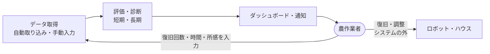
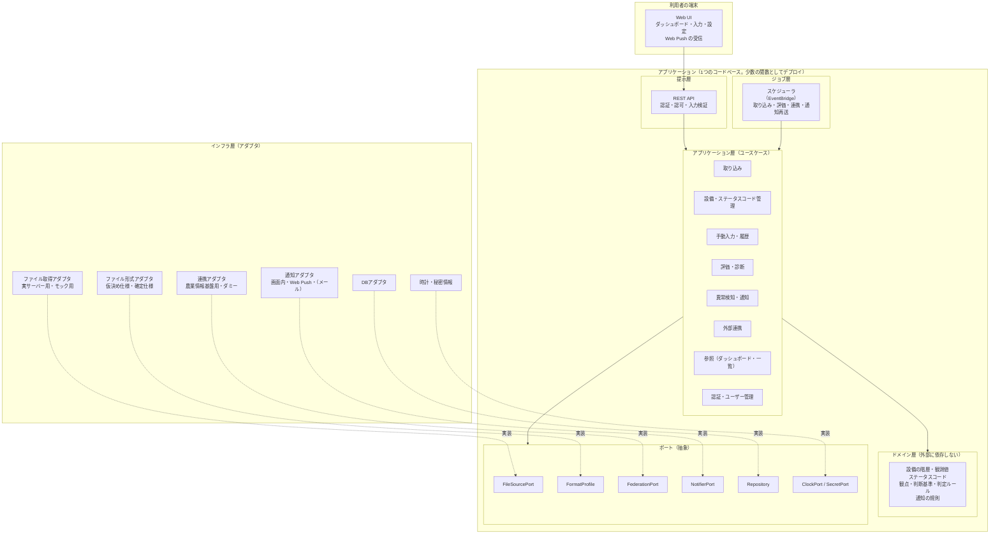
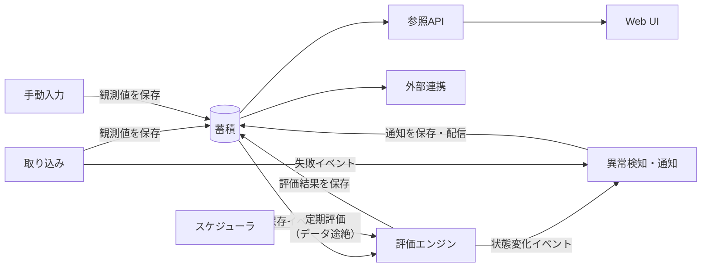
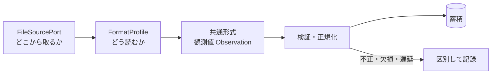
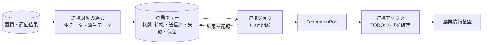
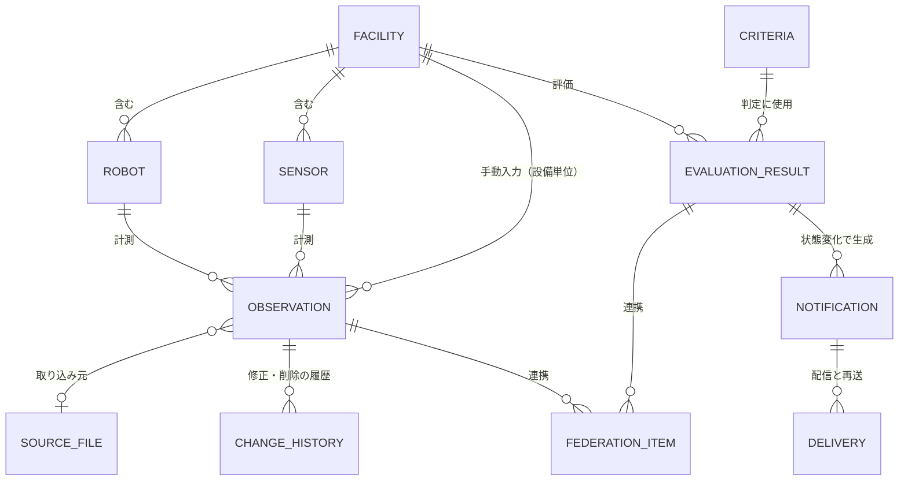
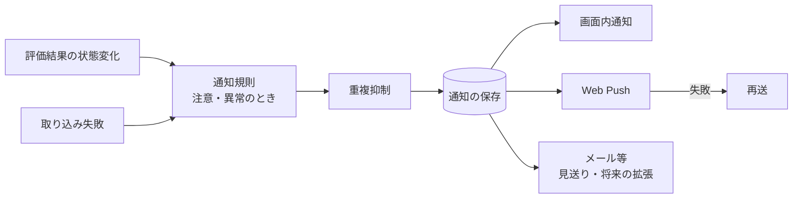
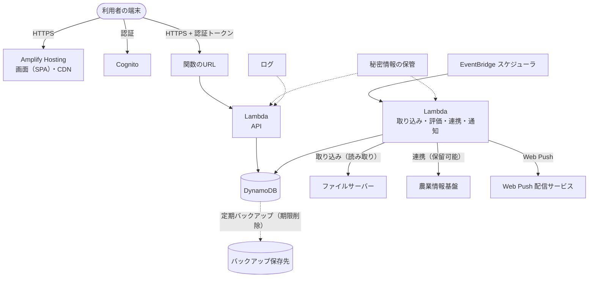
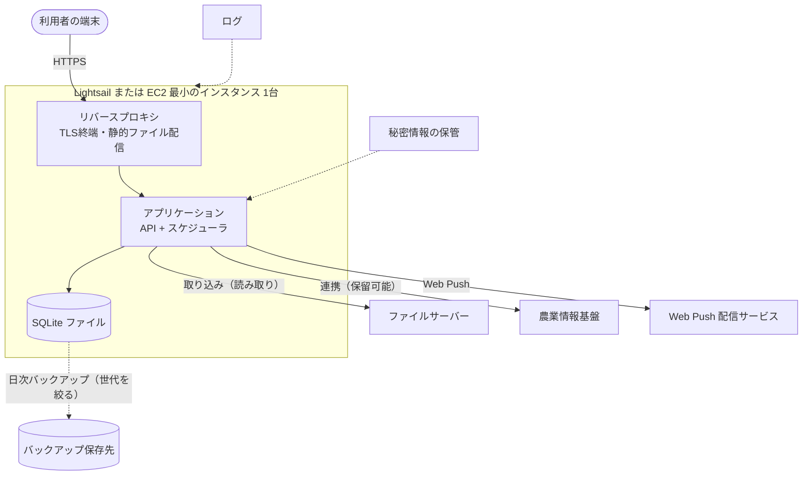

# アーキテクチャ設計

目的: 稼働モニタリング基盤の論理構成、各コンポーネントの責務、外部との境界（取り込み・連携）の抽象化、データの保持、非機能要件の実現方針、デプロイ構成と技術スタックを示し、実装の拠り所とする。システムの目的・利用者・境界は [system-overview.md](./system-overview.md) を参照する。

> **この文書の位置づけ**
> - 要件は [functional-requirements.md](../requirements/functional-requirements.md)（FR）、[non-functional-requirements.md](../requirements/non-functional-requirements.md)（NFR）に従い、各節で対応するIDを示す。NFR は「構成が満たす条件」を定めており、構成の選定は本書と [adr](../adr/) が担う
> - **技術スタック（言語・フレームワーク・DB・インフラ・パッケージ管理）は、本書 13章に集約する**（[ADR-0005](../adr/0005-tech-stack.md) で確定）。バージョンは、メジャーバージョンまでを示し、パッチバージョンは実装の開始時に確定する。[AGENTS.md](../../../AGENTS.md) の技術スタックの参照先は本書である
> - 発注者への確認が必要な事項（Q-番号）は、決め打ちせず、前提・選択肢・TODO として書く。どの回答でも成り立つ構造にすることを方針とする
> - 重要な設計判断は ADR に残す（15章）。ADR のステータスが「提案」のものは、確定するまで暫定

## 1. アーキテクチャの方針

| 方針 | 内容 | 根拠 |
|------|------|------|
| P-1 低コスト優先 | サーバーレス構成を基本とし、固定費をほぼ持たない。常時稼働の高価なマネージドサービスは避ける。拡張は、利用量に応じた課金と、設定・アダプタの差し替えで対応する（[ADR-0002](../adr/0002-deployment-serverless.md)） | RQ-016, RQ-017, RQ-021 / NFR-1.3, NFR-1.6 |
| P-2 疎結合（ポートとアダプタ） | 外部との接点（ファイルサーバー、農業情報基盤、通知、時計、DB）は、アプリケーション側が定義した抽象（ポート）越しに使い、具体的な接続先・形式は差し替え可能な部品（アダプタ）に閉じ込める | RQ-021 / NFR-2.2, NFR-2.3, NFR-2.9 |
| P-3 単独稼働 | 農業情報基盤・外部通知サービス・取り込み元の停止が、取り込み（他の元）・評価・表示・通知を止めない。外部とのやり取りは、失敗を記録して再試行する | RQ-007 / NFR-2.1, NFR-4.4 |
| P-4 段階の分離 | 取得 → 蓄積 → 評価 → 可視化・通知・連携の各段階を分け、入出力（保存するデータ）を定義して、単体でテストできるようにする | NFR-2.6 |
| P-5 設定で変える | 設備の追加、観点・判断基準、取り込みの形式の変更を、コードの変更ではなく設定・登録データで扱える範囲を広げる | RQ-019 / NFR-2.4, NFR-2.7, NFR-8.1, NFR-8.2 |
| P-6 仮決めを前提にする | ファイル仕様・接続先が未確定である前提で作り、確定した時の差分を局所化する | rfp.md 7章 / FR-1.3, FR-1.11, FR-1.12 |
| P-7 小さく作り、運用負荷を抑える | 構成要素の数を最小にし、自動再起動・構造化ログ・IaC で運用の手作業を減らす | RQ-018 / NFR-6.1, NFR-6.6 |

**構造の選択**: 1つのデプロイ単位の中に、責務ごとのモジュールを分けて持つ「モジュラーモノリス」とする。マイクロサービスは、運用の数・費用が増えて P-1, P-7 に反するため採らない（[ADR-0001](../adr/0001-modular-monolith-ports-and-adapters.md)）。

### 1.1 プロジェクトの背景・目的の反映

[project-overview.md](../../00_project/project-overview.md) の背景・概要・課題・目指す姿を、次のように設計へ反映する。ここでの対応づけは設計者の案であり、観点・メトリクスの確定（Q-007）に従って見直す。

| project-overview の項目 | 設計での扱い |
|--------------------------|--------------|
| 第三者評価の仕組み（運用の信頼性・実用性の客観的な評価） | 10観点を、短期・長期の視点で、正常／注意／異常／不明に判定する評価エンジン（7章）。判断基準は宣言的な設定で持ち、画面から参照・編集でき、変更の履歴と変更済みの識別を残す（FR-5.7, FR-5.8, NFR-5.7, NFR-7.4）。誰が見ても同じ基準で判定できることが、客観性の担保になる |
| 評価の5つの切り口（安全性、稼働率・連続運転性能、障害発生時の復旧容易性、メンテナンス性、代替作業手段の確保） | 対応づけ案: 安全性 → 観点「安全性」、稼働率・連続運転性能 → 観点「耐久性」（MTBF・稼働率）、復旧容易性・メンテナンス性 → 観点「メンテナンス性」（MTTR）（[robot-health.md](../viewpoint/robot-health.md)）。**「代替作業手段の確保」に対応する観点は、10観点にない**。本システムの観点としては含めず、対象外とする（体制・運用の評価で、何を数えるかの定義がないため。決定。[ADR-0017](../adr/0017-evaluation-rules.md)）。評価関係者から必要と示され、定義が示されたら、観点を追加する（観点は評価の部品と設定で追加できる構造のため（7章）、追加されても設計は変わらない。確認事項は #209） |
| 信頼性指標（MTBF・MTTR） | メトリクスの算出部品として評価エンジンに持つ。入力は、ステータスコード（自動取り込み）と、手動入力の故障回数・復旧に要した時間（UC-06、FR-4.1.2）。復旧時間の単位（分と時間）の換算は未定義（TODO: robot-health.md の確認事項） |
| ヒューマン・イン・ザ・ループ（HITL） | 下図。システムは、検知・提示・通知までを担い、復旧・調整は人がシステムの外で行う。その結果を手動入力で記録し、評価（MTTR など）に反映する。人の確認・承認のフロー（対応状況の管理）は設けない（Q-018）。詳細は [human-in-the-loop.md](./human-in-the-loop.md) |
| HITL・信頼性指標の国内外の先行事例調査 | 研究活動であり、本システムの機能・要件にはない。設計の対象外。調査結果を観点・判断基準に反映する場合は、観点側の更新（[viewpoint/](../viewpoint/)）で対応する |
| 環境制御に向けた情報基盤（環境情報の収集、環境状態の可視化、遠隔制御に必要な情報の把握） | 収集: 環境センサーデータの取り込み（5.4）と手動入力。可視化: 観点「環境適応性」とダッシュボード（4.3）。情報の把握と将来の利用: 蓄積した生データ・派生データを、農業情報基盤への連携（5.3）と、読み取りのREST API（NFR-8.3）で他のシステムに提供する。**本システムは制御の指示を出さない**（9章）。将来の遠隔制御・自動最適化は、これらの出口を使う別のシステムが担う。本システムに制御の経路を追加する場合は、その時点で認可・操作履歴を含めて ADR で設計する（[security.md](../../20_development/security.md)） |
| 現状の課題: 人手不足による省力化の要請 | 収穫ロボットの状態を、農作業者が遠隔・短時間で把握できるダッシュボードと通知（4.3, 8章） |
| 現状の課題: 実運用での課題・改善点を評価する仕組みがない | 評価の履歴・推移（4.3）、判断基準の調整（7章）、手動入力による所感・復旧記録（FR-4.1.2） |
| 現状の課題: 導入前に運用リスク・保守体制を把握しにくい | 長期視点（最大90日）の評価と、MTBF・MTTR の蓄積により、運用上の傾向を把握できる。必要な保守体制の判断材料は、評価結果と推移の参照で提供する（体制の設計自体は対象外。NFR-6.8 は TODO） |
| 現状の課題: 環境データを活用できる情報基盤がない | 環境データを共通形式（Observation）で一元的に蓄積し、評価・可視化・連携に使う（5.4, 6章） |
| 目指す姿: 客観的な評価、導入前のリスク把握、環境データの活用、省力化・生産性、実用化・普及モデルへの貢献 | 上の各行に対応する。省力化・生産性向上・普及モデルへの貢献は、システムの外で得られる成果であり、システムは、そのためのデータと評価結果を蓄積・提示する役割を担う |

### 1.2 成功条件を支える設計

[goals.md](../../00_project/goals.md) の「実現すること」と成功条件に対応する設計を示す。本システムは、ロボット・ハウスを自動で制御しない（goals.md の位置づけ）。

| goals.md | 設計での扱い |
|----------|--------------|
| データを集める | 取り込み（5章）、手動入力（4.2）。環境センサー・ロボットの両方を共通形式で扱う |
| データを蓄積する | 時系列の観測値と評価結果を保持し、1年分を蓄積する（6章、NFR-3.6） |
| 分析結果を伝える | 評価エンジン（7章）、ダッシュボード・詳細・推移（4.3）、通知（8章） |
| 人の対応につなげる | 通知・診断メッセージ・推奨アクション（FR-5.5, FR-7.1）。復旧の結果を記録する（FR-4.1.2）。1.1 の図 |
| 成功条件1: 現場で使える（継続的な収集・蓄積） | 取り込みの失敗を通知し（FR-7.4）、取り込み状況を画面で確認できる（NFR-6.4）。外部の停止に影響されない単独稼働（P-3）、自動再起動・日次バックアップ（10章）、手動入力による補完（FR-4.1.1）、月5,000円以内で継続できる構成（P-1）、タブレットで使える画面（NFR-7.3） |
| 成功条件2: 人に伝わる（ダッシュボードで届き、判断に使われる） | 状態を色・アイコンで直感的に示し（NFR-7.2）、診断メッセージと推奨アクションを付け、約10秒間隔で更新する（FR-6.7）。重要な変化は Web Push で届ける（8章）。判断基準を画面から参照できる（NFR-7.4） |
| 成功条件3: 安定稼働につながる（HITL による復旧で稼働が安定） | 早期に気づくための検知・通知（8章）、復旧の記録と MTBF・MTTR の把握（1.1）、推移による振り返りと判断基準の調整（7章） |

- 成功条件を満たしているかを、運用でどう確かめるか（測定の方法と指標）は、**新しい機能は作らず、既存のデータで測れる指標**を定義する（決定。[ADR-0017](../adr/0017-evaluation-rules.md)）。現場で使える: データ活用度合い（連携率）の値と推移、取り込みの失敗件数、手動入力の件数。人に伝わる: 通知の既読率と、作成〜既読までの時間、最終ログインの目安。安定稼働につながる: 稼働率・MTBF・MTTR の推移、復旧対応の件数と復旧時間、農作業者の所感（備考）。利用状況（画面の閲覧・操作）の記録は、追加しない。数値の合格ラインは、設けない（発注者と合意できたら決める。確認事項は #209）。限界: 「既読」は「確認した」であり、「対応した」ではない。満足度は、ロボット・ハウスの観点への受け止めで、成功条件の測定には使えない

## 2. 設計の前提と制約

| 前提・制約 | 設計への影響 | 根拠 |
|------------|--------------|------|
| 秋田県立大学のAWS環境に、払い出されたIAMユーザーの権限で構築する。利用できるサービス・操作は**未確認** | 特定のAWSサービスに依存しない構成を基本とし、利用するサービスは IAM で許可されるかを確認してから採用する（11.4） | NFR-1.1, NFR-1.2 |
| 月5,000円以内 | 常時起動のマネージドDB・コンテナ基盤・ロードバランサ等は、必要性とコストを示せるまで採用しない | NFR-1.3, NFR-1.6 |
| 規模は 1:1:1、利用者10名ほど | サーバーレス構成（関数・DynamoDB）で足りる。拡張は構成の変更で対応できる設計にする | NFR-3.1, NFR-3.2 |
| ファイル仕様・接続先が未確定 | 取り込み層を抽象化し、仮決めの仕様とモックで開発する（5章） | FR-1.3, Q-001, Q-002 |
| 農業情報基盤が停止することがある | 連携は非同期・保留可能にする（5.3） | RQ-007 |
| 圃場データは機密 | 認証・暗号化・最小権限（9章、10章） | NFR-5 |
| 2025年度の成果物は再利用しない | 新規に設計する | NFR-2.8 |

## 3. 論理構成

### 3.1 全体図

### 3.2 レイヤと依存の向き

| 層 | 役割 | 依存してよい先 |
|----|------|----------------|
| 提示層（API、Web UI） | 入出力の変換、認証、認可、入力検証 | アプリケーション層 |
| ジョブ層（スケジューラ） | 定期処理の起動（取り込み、評価、連携、再送）。基本構成では、EventBridge のスケジューラが Lambda を起動する | アプリケーション層 |
| アプリケーション層 | ユースケースの流れ（取り込み→保存→評価→通知など）、トランザクション | ドメイン層、ポート |
| ドメイン層 | 判定ルール、階層、データの意味。フレームワーク・DB・時刻・ネットワークに依存しない | なし（純粋なロジック） |
| インフラ層 | ポートの実装（DB、ファイル取得、連携、通知） | ポート（実装する側）、外部ライブラリ |

- **依存は内向き**（提示・インフラ → アプリケーション → ドメイン）。ドメインとアプリケーションは、インフラの具体的な型を知らない
- 外部の変更（接続先、ファイル仕様、連携方式）は、インフラ層のアダプタの差し替えに閉じる（NFR-2.3, NFR-2.9）
- 段階間（取得→蓄積→評価→可視化）の受け渡しは、DBに保存したデータと、保存のイベント（同じ関数内の呼び出し、または DynamoDB のストリーム）で行う。外部のメッセージキューサービスは、必要になるまで使わない（P-1。必要になれば、イベントの受け渡しをポートとして切り出す）

### 3.3 ソースコードとの対応（案）

`src/` の構成（[directory-structure.md](../../00_project/directory-structure.md)）への対応案。技術スタックは確定した（13章）ため、実装の開始時に、同ファイルへ反映する。

| 場所 | 置くもの |
|------|----------|
| `src/shared/` | ドメイン層の型と純粋なロジック（観測値の型、判定ルール、観点の定義の型）。フロントエンドとバックエンドで共有できるもののみ |
| `src/backend/` | アプリケーション層、ポート、インフラ層（アダプタ）、API、ジョブ。モジュールは 4章の単位で分ける |
| `src/frontend/` | Web UI |

## 4. コンポーネントと責務

### 4.1 コンポーネント間の関係

### 4.2 責務の一覧

| コンポーネント | 責務 | 対応する要件 |
|----------------|------|--------------|
| 取り込み（Ingestion） | 取得間隔ごとに、ファイル取得ポートで新しいファイルを探して読み、形式アダプタで共通形式に変換し、検証して保存する。同じファイルを二重に取り込まない（記録を保持）。失敗は再試行し、記録し、失敗イベントを出す。接続テスト・即時取得の入口を持つ | FR-1.1〜FR-1.9, FR-1.12 / NFR-2.3, NFR-4.4 / UC-08, 09, 15, 16 |
| 設備管理 | ハウス→ロボット／センサーの階層の登録・変更・削除。識別子の重複を拒否する | FR-2 / NFR-2.4 / UC-12 |
| ステータスコード管理 | コード定義（コード値・名称・カテゴリ）の管理と、走行・姿勢異常・故障の判定の入力の提供 | FR-3 / UC-17 |
| 手動入力 | 検証、必須項目、取得元の記録、論理削除、変更履歴。保存後に評価を起動する | FR-4 / NFR-5.7 / UC-06, 07, 18 |
| 評価エンジン | 観点ごとのメトリクスを算出し、判断基準で正常／注意／異常／不明を判定し、診断メッセージ・推奨アクションを付ける。短期・長期の視点（7章） | FR-5 / NFR-2.7, NFR-8.2 / UC-01〜04, 19, 21 |
| 異常検知・通知 | 評価結果の状態変化（注意・異常への遷移）と取り込み失敗から、通知を作る。重複を抑制し、配信（画面内・Web Push）、失敗の記録、再送を行う（8章） | FR-7 / UC-05, 10, 22, 23, 24 |
| 外部連携（Federation） | 連携対象のデータを、連携ポート越しに農業情報基盤へ送る。停止中は保留し、結果を記録する（5.3） | FR-8 / NFR-2.1, NFR-2.2 / UC-11 |
| 参照（Query） | ダッシュボード・詳細・推移・データ一覧・通知一覧など、読み取り専用の問い合わせ。評価結果は計算済みのものを返す | FR-6 / NFR-3.3〜NFR-3.5 / UC-01〜03, 20, 21 |
| 認証・ユーザー管理 | ログイン、セッション、ロールに応じた操作の制御、ユーザー管理（9章） | FR-9, NFR-5.1 / UC-13, 14 |
| 監査・操作履歴 | 入力・判断基準・設備構成・ステータスコード・設定の変更の履歴を残す（横断機能） | FR-4.2.3, NFR-5.7 |
| 設定・秘密情報 | 取り込み設定、取得間隔（設備ごと）、判断基準、秘密情報の読み書き（本番は、パラメータストア（SecureString）。画面から書き込み専用で登録し、保存後は再表示しない。5 分の期限つきキャッシュ。読み取りと書き込みの権限を分ける。[ADR-0016](../adr/0016-ingestion-federation-rules.md)。実装は #196）。秘密情報は画面・ログ・変更履歴に出さない | FR-1.4, NFR-5.4 |
| 運用の観測 | 構造化ログ、取り込み・連携の状況（成功・失敗・保留）の可視化、ヘルスチェック | NFR-6.3, NFR-6.4 / UC-16 |
| Web UI | 日本語の簡素な画面、レスポンシブ（PC・タブレット・スマートフォン）、約10秒間隔の表示更新、Web Push の受信 | FR-6, NFR-3.3, NFR-7 |

### 4.3 機能ごとの設計の補足

4.2 の責務のうち、要件の項目が細かく、設計の考え方を補足するものを示す。

**ステータスコードと設備（FR-2, FR-3）**

| 要件 | 設計 |
|------|------|
| FR-3.1〜FR-3.2 | コード定義（コード値・名称・説明・カテゴリ）を、登録データ（DB）として持つ。コード値は一意とし、重複登録は拒否する。削除は確認を経て行う。過去の観測値が参照するため、論理削除とする案を基本とする（TODO: 削除時の過去データの扱いは、要件側に定めがない）。初期の定義（仮）は、初期データとして投入する |
| FR-3.3 | 「ステータスコード → 走行／停止、姿勢異常、故障・異常」の判定は、ドメイン層の純粋関数とする（7章の評価エンジンと同様に、境界・未定義のコードのテストを網羅する）。定義にないコード値は、不正な値として区別して記録する（FR-1.6） |
| FR-3.4 | 評価エンジンは、観測値のコード値から、定義のカテゴリ（正常／注意／異常）を引いて、判定の入力にする |
| FR-2.3〜FR-2.5 | 設備は登録データとして持つ。識別子は一意制約で重複を拒否する。削除すると、配下の設備とデータも削除する（変更履歴・通知・取り込みログは残す。農業情報基盤に送信済みのデータは削除しない。復元はしない。非同期の削除。決定。[ADR-0018](../adr/0018-manual-input-and-data-rules.md)）。設備の追加は、データの登録のみで、取り込み・評価・表示・連携の対象になる |

**手動入力と満足度（FR-4, FR-5.1）**

| 要件 | 設計 |
|------|------|
| FR-4.1.1〜FR-4.1.3 | 入力のスキーマ（必須項目、形式、範囲）を、カテゴリの定義として持ち、API の入口で検証する。画面にも同じ検証を使う（`src/shared/`）。入力項目の定義は、データ辞書で確定する（Q-003） |
| FR-4.1.4 | 手動入力の観測値は、取得元（手動入力）を持つ。自動取り込みの値を上書きせず、両方を保持する。合計の項目は、評価の期間に自動の値があれば自動だけを使い、なければ手動だけを使う。状態値は、どちらも使う（決定。[ADR-0018](../adr/0018-manual-input-and-data-rules.md)） |
| FR-4.2.1〜FR-4.2.2 | 入力済みデータの一覧は、サーバー側で検索・絞り込み・並べ替え・ページ分割を行う（観測値のインデックスで引く）。論理削除したデータは、一覧・集計・評価の対象から除く |
| 満足度（FR-5.1, FR-6.9） | 9観点に対する1〜5スターを、カテゴリ「満足度情報」の観測値（手動入力）として保持し、「満足度」の観点の評価に使う。レーダーチャートの表示は、観点別の最新の値を参照APIが返す。入力は、農作業者の全員が、月に 1 回を目安に、1〜5 スターで行い、9観点が揃わないと保存できない。評価に使う値は、各入力者の期間内の最新の入力の平均（1 人 1 票）（決定。[ADR-0017](../adr/0017-evaluation-rules.md)。実装は #211。確認事項は #209。Q-008） |

**参照と画面（FR-6, FR-7.5, FR-7.6, NFR-7）**

| 要件 | 設計 |
|------|------|
| FR-6.1〜FR-6.2, FR-6.6 | 参照APIは、保存済みの評価結果を、対象の設備（ハウス・ロボット・センサー）で絞って返す。ステータスごとの観点の件数は、評価結果から集計して返す。メトリクスの良否は、色・アイコンで示す（NFR-7.2） |
| FR-6.3 | 最終のデータ取得日時を、観測値・取り込みログの最新の日時から返す。「古い」とみなす基準（取り込み間隔に対する経過時間）は、設定として持つ（TODO: 基準の値）。定期の評価（7章）が、データの途絶えを「不明」に反映する |
| FR-6.4 | 評価結果が、判定に使ったメトリクスの値・基準の版・対象期間を持つ（6章）。詳細画面は、これと、元データ（観測値）、判断基準（条件と区分）を表示する |
| FR-6.5, FR-6.10 | 長期視点の推移は、観測値の集計（期間の平均を含む）から返す。観点のステータスの推移は、評価結果の履歴から返す（状態が変わった時点を保持する）。推移の粒度・期間は未確定（TODO: 要件側 FR-6.10） |
| FR-6.7 | 約10秒間隔で、保存済みの最新の評価結果を読み直す（ポーリング。方式は 10章） |
| FR-6.8 | データ一覧は、取り込み済みの観測値を、日時・設備・カテゴリ・項目・値・取得元で表示する。絞り込み・並べ替え・ページ分割は、サーバー側で行う |
| FR-7.5〜FR-7.6 | 通知の一覧は、種別・既読／未読で絞り込む。ヘッダーの未読件数は、利用者ごとの未読の通知の件数を返す軽量なAPIで取得し、画面の更新（約10秒）と合わせて更新する。既読は、個別と一括で更新する。既読の単位（利用者ごとか、全員で共通か）は、通知の宛先（Q-011）と合わせて確認する（TODO） |
| NFR-7.1, NFR-7.3, NFR-7.4 | 日本語・簡素な画面・レスポンシブ（PC・タブレット・スマートフォン）。判断基準は、観点の詳細画面から参照できる。主要な操作に、ガイドまたはツールチップを付ける |

## 5. 取り込み層・連携層の抽象化

### 5.1 取り込み層

接続先とファイル仕様が未確定のため、取り込みを「取得」と「解釈」の2つの抽象に分ける。回答が得られないため、暫定の方針（宇都宮大学のファイルサーバーを想定する。アクセスの手段は決めず、接続先・認証・ネットワークの経路など、手段によらず必要になる情報を、設定として持ち、画面から設定して切り替える。ファイル仕様は、1 ファイルを随時更新する方式に見直す）で進める（[ADR-0015](../adr/0015-provisional-policy-external-specs.md)）。

| 抽象 | 役割 | 実装の候補 |
|------|------|------------|
| FileSourcePort（取得） | 前回以降の新しいファイルの一覧、ファイルの内容、メタデータ（名前・更新日時・サイズ）を返す。読み取り専用 | ローカルディレクトリ（開発・検証のモック用）、SFTP、S3バケット、HTTPS、SMB など。TODO: 実際の接続先で選ぶ（Q-002） |
| FormatProfile（解釈） | ファイルを共通形式の観測値に変換する。ファイルのレイアウトと、項目名の対応づけ（マッピング）を持つ。ロボットデータ用・環境センサー用など、データ種別ごとに版を付けて持つ | ロボットデータ（JSON）用、環境センサー用。マッピングは宣言的な設定（JSON/YAML）で書き、設定レベルの変更に対応する（NFR-8.1） |
| 共通形式（Observation） | 日時・設備・カテゴリ・項目名・値・取得元（自動取り込み／手動入力）を持つレコード（FR-1.10）。ドメイン・評価は、この形式だけを知る | - |

- 取り込み済みファイルの記録（識別子、更新日時、内容のハッシュ、結果）を持ち、再取り込みを防ぐ（FR-1.6）。ファイルは、JSON 形式で、更新のたびに全体が書き換わり、中身は最新の値だけ（通常 1 MB 以内）の想定。毎周期読み、内容のハッシュが同じなら何もせず、違えば解析して、新規・変更の観測値だけを保存・連携に積む（決定。[ADR-0016](../adr/0016-ingestion-federation-rules.md)。実装は #199）
- 検証の結果（形式違い、欠損、異常値、遅延、重複）は区別して記録し、評価では欠損・遅延を「不明」の入力として扱えるようにする。TODO: 具体的な扱い（FR-1.6、[evaluation.md](../viewpoint/evaluation.md)）
- ファイルサーバーとの通信は、暗号化と認証を行う方式の実装を選ぶ（NFR-5.2）。暗号化のない方式（例: 平文のFTP）は採らない。実際に使える方式は、接続先の確認後に決める（TODO: Q-002）
- 接続先の認証情報は、秘密情報の仕組みから読み出す（FR-1.4）。取り込みの失敗は、他の取り込み元や他の機能を止めない（FR-1.9）。取り込み元ごとに独立して実行・再試行する

**接続先が決まらない場合の選択肢**（TODO: Q-002）。どの選択でも、FileSourcePort の実装の追加・差し替えで対応でき、上位の層は変わらない。

| 選択肢 | 内容 | 留意点 |
|--------|------|--------|
| (a) 直接取得 | 秋田県立大学のAWSから、宇都宮大学のファイルサーバーへ接続する | 認証・ネットワークの許可（VPN・IP制限など）が必要。接続可否が未確認 |
| (b) 中継 | 宇都宮大学側（またはその運用者）が、ファイルを、本システムが読めるAWS上の置き場（例: S3バケット）へ配置する | 宇都宮大学側の作業が要る。AWS側の置き場の費用・IAM権限の確認が必要 |
| (c) 手動の取り込み | 当面、人がファイルを取り込み用の入口に置く（手動入力画面とは別） | 自動取り込みの要件（FR-1.1）の暫定。追加の入口の実装が必要 |

### 5.2 仮決めの仕様の扱い

rfp.md 7章の方針（推察して仮決め、モックで開発、根拠を記録、差分を把握、確定後に更新）を、次のように実現する（[ADR-0003](../adr/0003-ingestion-adapter-and-provisional-spec.md)）。

| 方針 | 実現方法 | 要件 |
|------|----------|------|
| 影響の局所化 | ファイルの仕様に依存するのは FormatProfile（とそのマッピング設定）のみ。評価・保存・画面は共通形式にのみ依存する | NFR-2.3, NFR-2.9 |
| 仮決めの識別 | FormatProfile に「仮決め／確定」の状態と版を持たせる。取り込んだ観測値に、どの版で解釈したかを残す | FR-1.11 |
| 根拠の記録 | 仮決めした項目ごとの根拠（資料・ヒアリング・推察の理由）と、確定仕様との差分を、データ辞書（[data-dictionary.md](../data/data-dictionary.md) 10.2 の様式）に記録する。仕様の対応づけの判断が重要な場合は ADR に残す | FR-1.11, NFR-6.7 |
| 差分の把握 | 仮決め仕様と確定仕様のそれぞれの FormatProfile を並べて比較できる形（宣言的な設定）で持つ。確定仕様の提供後に、差分を洗い出して要件・設計・テストを更新する | FR-1.12 |
| モックでの開発 | FileSourcePort のモック実装（ローカルディレクトリ。必要なら、検証環境に置くSFTP等のモックサーバー）と、**合成データ**のサンプルファイルで開発・検証する。実データはリポジトリに入れない | FR-1.3, [security.md](../../20_development/security.md) |
| 接続先の変更 | FileSourcePort の実装と接続設定の差し替え | FR-1.3, FR-1.4 |

### 5.3 連携層（農業情報基盤）

連携方式（API、データモデル、頻度、停止中のデータの扱い）は、私たちで調査して決める（#176。FIWARE の Orion の形式を想定。頻度は、データの取得の都度と、観点の評価のタイミング。[ADR-0015](../adr/0015-provisional-policy-external-specs.md)）。決まるまでは未確認（TODO: Q-005）。次の構造で、連携方式がどれでも成り立つようにする（[ADR-0004](../adr/0004-federation-outbox-standalone.md)）。

- **連携キュー（アウトボックス）**: 連携対象のデータは、保存・評価の完了と同じトランザクション（DynamoDB のトランザクション書き込み）の中で、DBの連携キューに積む。送信は別の関数（連携ジョブ）が、スケジューラまたはストリームを契機に非同期に行う。農業情報基盤が停止している間は、キューに残る（保留）。他の機能は、連携の成否に依存しない（FR-8.2, NFR-2.1）
- **停止の検知と再試行**: 送信の失敗時は、間隔を広げながら再試行する（停止が長い場合に負荷・ログを増やさない）。復旧後は、送信に成功したら、溜まった項目を、すぐ送る。一定期間（設定値。既定 30 日）より古いものは、破棄して、連携のログと通知に残す。送信の順序は保証せず、基盤の形式は、順序に依存しない時系列にする。冪等性は、観測値の一意キーと連携項目の ID を送り、受け手で吸収する（決定。[ADR-0016](../adr/0016-ingestion-federation-rules.md)。実装は #195）
- **連携の結果**: 成功／失敗／保留を記録し、取り込みと同じ画面で確認できるようにする（FR-8.3, NFR-6.4）
- **連携の向き**: 本システムから送る（プッシュ）方式をアダプタで実装するのを基本とする。農業情報基盤の側から取りに来る（プル）方式になる場合は、読み取り専用のREST API（NFR-8.3）で対応する。どちらの場合も、保存・評価の層は変わらない
- **FIWARE連携**: 農業情報基盤は FIWARE ベースとされている。2025年度のインターフェース資産の活用は、連携の設計で別途検討する（NFR-2.8）。TODO: データモデル・APIの確認後に、アダプタを設計する
- 連携対象（生データ・派生データ）の範囲・単位の設定は、連携の選択（SEL）で持つ。範囲は、D-35 の決定（#142）に従い、ロボット・環境センサーのデータ（手動入力を含む）、観点の分析結果、満足度などの手動入力、設備の名前・IDに限る。ユーザー・設定のデータは、連携しない。拡張（RQ-020）は、アダプタの追加と選択の設定で対応する

### 5.4 環境センサー

機種・取得方式が未確定（TODO: Q-004）。ロボットデータと同様にファイルサーバーを介する想定（RQ-002）のため、5.1 の仕組み（FileSourcePort + FormatProfile）を使う。ファイルサーバー以外の経路（センサーからの直接送信など）になる場合は、共通形式（Observation）に変換する新しい入口（インバウンドのアダプタ）を追加する。上位の層は変わらない。センサー選定が済むまでの補完は、手動入力で行う（FR-4.1.1）。

## 6. データの保持（概念）

物理スキーマは [data-model.md](../data/data-model.md)、項目の定義は [data-dictionary.md](../data/data-dictionary.md)、データの流れは [data-flow.md](../data/data-flow.md) で定義する。ここでは、保持するデータの種類と関係を概念として示す。

| データ | 内容 | 要件 |
|--------|------|------|
| 設備（ハウス・ロボット・センサー） | 階層。識別子は一意。削除すると、配下の設備とデータも削除する（決定。[ADR-0018](../adr/0018-manual-input-and-data-rules.md)） | FR-2 |
| 観測値（Observation） | 日時・設備・カテゴリ・項目名・値・取得元・取り込み元ファイル・FormatProfile の版を持つ時系列。自動取り込みも手動入力も同じ形式。手動入力は論理削除と変更履歴を持つ | FR-1.10, FR-4.1.4, FR-4.2 |
| 取り込み済みファイル・取り込みログ | ファイルの識別・ハッシュ、取得日時、成功／失敗、件数、エラー内容 | FR-1.6, FR-1.8 |
| ステータスコード定義 | コード値・名称・説明・カテゴリ | FR-3 |
| 観点の定義・判断基準 | 観点、指標、条件（上限型・下限型・範囲型）、閾値。既定値と、変更後の値、変更済みの識別を持つ。観点の定義の本体は [viewpoint/](../viewpoint/) | FR-5.7, FR-5.8, NFR-8.2 |
| 評価結果 | 観点・対象・視点（短期／長期、期間）・ステータス・メトリクス値・診断メッセージ・推奨アクション・判定に使った基準の版・評価日時。ダッシュボードは、これを読む。判断基準の変更時は、過去の評価を再計算せず、保持する（決定。[ADR-0017](../adr/0017-evaluation-rules.md)）。ハウスの結果は、配下の設備の結果のうち、最も悪いもの（設備ごとに評価。実装は #212） | FR-5, FR-6 |
| 通知・配信・既読 | 種別、対象、内容、発生日時、配信の結果、既読状態、重複抑制のキー | FR-7 |
| Web Push 購読 | 利用者・端末ごとの購読情報（有効／解除）。単位は、利用者 × 端末（決定。[ADR-0019](../adr/0019-notification-rules.md)） | FR-7.2 |
| 連携キュー・連携ログ | 連携対象、状態、試行回数、結果 | FR-8.3 |
| ユーザー・ロール | ユーザーID・名前・パスワードのハッシュ・ロール・最終ログイン（必須。ADR-0013） | FR-9 |
| 操作履歴 | 操作種別、対象、変更者、変更前後、日時 | FR-4.2.3, NFR-5.7 |
| 設定 | 取り込み設定（秘密情報は含めず、参照名のみ）、取得間隔、通知設定 | FR-1.4, NFR-4.5 |

- **保存期間**: 1年分を蓄積できる設計とする（暫定、NFR-3.6）。観測値などは、期限を設けない。取り込みログ・連携ログ・送信済みの連携項目は、90 日で自動削除する（決定。[ADR-0018](../adr/0018-manual-input-and-data-rules.md)。確認事項は #225）。長期視点は最大90日（FR-5.6）のため、評価は直近のデータで足りる。ただし、取得間隔が短いと、評価の読み取りの費用が大きくなる（#232）
- **生ファイルの保管**: 取り込んだ元ファイルは、**残さない**（決定。[ADR-0016](../adr/0016-ingestion-federation-rules.md)）。原本は、提供元に任せる。観測値と取り込み元ファイルの識別・ハッシュを持つため、残さなくても、再取り込みの判定はできる。見直しの条件は、提供元がファイルを上書き・削除する運用だと分かったとき、仕様確定後に再取り込みが必要になったとき、失敗の原因を調べられないとき（その場合は、取り込めなかったファイルだけを、短期間、暗号化した非公開の領域に残す案を検討する）
- **バックアップ**: DynamoDB のバックアップ（ポイントインタイムリカバリ、またはオンデマンドのバックアップ）を使い、保持は、PITR の 35 日（決定。[ADR-0018](../adr/0018-manual-input-and-data-rules.md)。NFR-4.2）。オンデマンドは、必要なときに手動で取る。保存先は、IAM権限の確認後に決める（11.4）

## 7. 評価エンジンの設計

- **判定ロジックの純粋関数化**: 「観測値の集合・判断基準・現在時刻 → ステータス・メッセージ・推奨アクション」を、外部に依存しない関数として実装する（ドメイン層）。入力は、アプリケーション層が読み出して渡す。境界値・欠損・遅延のテストを網羅しやすい（テスト方針の重点対象）
- **観点を部品として追加できる構造**: 観点ごとに「メトリクスの算出」と「判断基準（宣言的な設定）」を持つ。観点の追加・変更は、算出部品の追加と設定の変更に限る（NFR-2.7, NFR-8.2）。判断基準の数値は設定で持ち、画面から編集できる（FR-5.7）。観点・メトリクス・判断基準は、[viewpoint/](../viewpoint/) に従う（暫定の定義・既定値で運用し、評価関係者に確認して見直す。決定。[ADR-0017](../adr/0017-evaluation-rules.md)。確認事項は #209。Q-007〜Q-010）
- **判定の組み合わせ**: 複数指標の判定は、[evaluation.md](../viewpoint/evaluation.md) の規則（最も悪い判定を採用、不明の扱い、境界値）に従う。この規則は評価エンジンの1か所に置く
- **起動のタイミング**: (1) 取り込み・手動入力の保存イベント（FR-5.4）、(2) 判断基準の変更、(3) 定期（データが途絶えた時の「不明」・古いデータの表示のため。FR-6.3）。評価は、影響を受ける設備・観点に絞って行う
- **データ不足時の推奨アクション**: 判定に必要なデータが足りない場合は「不明」とし、「データの取得・入力を確認する」推奨アクションを付ける（FR-5.5）。診断メッセージと推奨アクションは、観点の定義（宣言的な設定）に、判定の結果ごとの文として持つ。推奨アクションは、ひな形と、観点ごとの固定の 1 文。「注意」「異常」のときは、最も悪い指標を、診断メッセージの先頭に示す（決定。[ADR-0017](../adr/0017-evaluation-rules.md)。実装は #213。現場の対応手順は確認する（Q-010。#209））
- **判断基準の編集（FR-5.7, FR-5.8）**: 保存前に、不正な組み合わせ（大小関係が成り立たない、数値でない、条件名が空欄または長すぎる）を検証する。検証は、ドメイン層の関数とし、画面と API で共有する。既定値を保持し、既定値へ戻せる。変更はシステム全体に適用し、変更済みの識別を持つ。変更した基準による判定の診断メッセージには、その旨を付ける。変更後の評価は、起動のタイミング(2)で更新する
- **短期・長期の視点**: 視点ごとに結果を保持し、長期の期間（当日〜90日）は設定として持つ。短期評価を持たない観点（コスト効率・耐久性・データ活用度合い・満足度）は、観点の定義で表す（FR-5.6。決定。[ADR-0017](../adr/0017-evaluation-rules.md)。評価関係者に確認する。Q-009）
- **評価の単位**: 評価結果は、設備（階層のどの単位か）への紐づけを持つ。単位は、観点の定義で指定できる形にし、ハウス単位・ロボット単位のどちらでも対応できるようにする（TODO: FR-5.3）
- **結果の事前計算**: ダッシュボードの初期表示は、保存済みの評価結果を読むだけにする（NFR-3.4）。推移のグラフは、評価結果の履歴と観測値の集計から返す（NFR-3.5）

## 8. 通知

- **NotifierPort**: 通知の配信手段をポートで抽象化する。画面内通知（通知を保存して一覧に出す）は必ず行い、Web Push を追加の配信手段とする（FR-7.2）。メール等は、アダプタの追加で対応する（手段は、画面内と Web Push。メールは見送り。決定。[ADR-0019](../adr/0019-notification-rules.md)。既存の通知サービスの有無は確認する。Q-011。#234）
- **作る条件**: 観点のステータスが「注意」「異常」に**変わった時**に作る（FR-7.1）。同じ状態が続く間は繰り返さない。抑制は、正常が一定時間（設定値。既定 15 分）続いたあとの悪化を、新しい出来事として通知し、短い行き来は通知しない（取り込み系は、同じ取り込み元・状況について 60 分に 1 件）。「不明」は通知せず、状態の変化ともみなさない。改善（異常 → 注意）は通知しない。欠損・遅延は、個別に通知しない（FR-7.3。決定。[ADR-0019](../adr/0019-notification-rules.md)。実装は #236）
- **取り込み失敗の通知**: 再試行後も失敗した場合に通知する（FR-1.9, FR-7.4）。評価の通知とは種別を分ける
- **配信の失敗と再送**: 配信の結果を記録し、失敗したものは再送する（FR-7.7。配信の状態は購読ごと。1 分から倍々の間隔で、通知を作ってから 1 時間まで再送する。決定。[ADR-0019](../adr/0019-notification-rules.md)。実装は #237）。Web Push の購読が無効（解除・期限切れ）になった場合は、購読を無効にする
- **既読管理**: 通知ごとに既読状態を持ち、個別・一括で更新する（FR-7.6）。対応状況の管理・承認は設けない（決定。[ADR-0019](../adr/0019-notification-rules.md)。Q-018）。既読は、利用者ごと。通知ごとに、経過・回復日時とメモを示す
- **Web Push の有効化と解除**: 利用者が画面で通知を有効にした場合にのみ購読を登録し、配信する。利用者は、いつでも解除できる（FR-7.2）
- **Web Push の前提**: HTTPS が必要。送信は、アプリケーションから Web Push 配信サービスへ行う（外部への通信）。購読情報は利用者・端末ごとに保持する。対象端末は、PC・タブレット・スマートフォン（NFR-7.3。決定）。購読の単位は、利用者 × 端末。受け取る種類は、選べない。宛先は、その設備を閲覧できる利用者（#116 と一緒に実装）。実配信は、実証実験の前に実装する（#241）（決定。[ADR-0019](../adr/0019-notification-rules.md)）
- 通知サービスの停止は、画面内通知・評価・取り込みに影響しない（P-3）

## 9. 認証・認可

認証・認可は必須で、ロールは、管理者・一般の 2 種類とする（決定: [ADR-0013](../adr/0013-environments-and-access-control.md)。Issue #78。実装は、Issue #115・#116）。[security.md](../../20_development/security.md)・NFR-5.1 は全APIに認証・認可を設けることを求める。次の構造で実現する（ロールの数は、設定の変更で、後から変えられる）。

| 層 | 設計 | 理由 |
|----|------|------|
| 認証（誰か） | AuthPort として抽象化する。既定は「アプリ内のユーザーID・パスワード」（FR-9.1〜FR-9.3）。外部の認証サービス（案1では Amazon Cognito。実装済み: [ADR-0008](../adr/0008-cognito-authentication.md)）への差し替え、または、閉じたネットワークでの利用時の別方式に変更できる | Q-017 の回答に依存しない |
| 認可（何ができるか） | 操作ごとに「必要な権限」を定義し、ロールに権限を割り当てる設定で制御する。ロールが1種類（全員が同じ権限。現在の実装）でも、2種類（管理者・一般。決定。ADR-0013）でも、3種類以上でも、設定の変更で対応する。一般ユーザーには、管理者が割り当てた設備だけを、閲覧させる（Issue #116）。認可の検査は、APIの入口と、アプリケーション層のユースケースで行う | FR-9.5。FR-9.5 と FR-9.6 の矛盾（要件側の TODO）にも、設定で対応できる |
| 操作の対象 | 権限を設けうる操作: 設備管理、取り込み設定、ステータスコード管理、手動入力、判断基準の編集、ユーザー管理（FR-9.5） | - |
| セッション | トークンまたはセッションの有効期限と更新（アクセストークン 30 分・リフレッシュトークン 7 日。Cognito で実現。[ADR-0008](../adr/0008-cognito-authentication.md)）。期限切れ時は再ログインを求める | FR-9.3 |
| パスワード | ハッシュ化して保存。ログイン試行の回数を制限する | FR-9.2 |
| 初期ユーザー | 初期化コマンド（`pnpm initial-user`。実装済み。ADR-0008）で、**管理者のロールで**作る（ADR-0013） | UC-13, UC-14 |
| 外部への権限 | 本システムが外部（ファイルサーバー、AWS）へ持つ権限は、読み取り専用・最小権限にする（NFR-5.3） | security.md |

- 利用者の認証は、**必須**とする（決定。ADR-0013）。ネットワークでのアクセス制限（IP 制限など）は、設けない（10 人程度の登録ユーザーが、インターネットから使う）。認証の無効化は、設定による明示的な選択とし、既定は有効のままとする（機密データの扱い（NFR-5.5））
- 操作履歴を残す（FR-4.2.3, NFR-5.7）。ロボット・ハウス設備への操作指示は存在しないため、設備操作の認可は発生しない

## 10. 非機能要件の実現方針

| 要件 | 実現方針 |
|------|----------|
| **コスト**（NFR-1.3, NFR-1.4, NFR-1.6, RQ-016, RQ-017） | サーバーレス構成を基本とし、常時課金の部品を持たない（11.1〜11.2、ADR-0002）。コスト比較は 11.5 に示す。コストの見積もりの前提を明示し、実際の請求で確認する（11.5）。自動の監視・アラートは設けず（11.1）、不要なリソースを残さない（NFR-1.5） |
| **初期構築のコスト**（NFR-1.4） | 構成要素を最小にし（P-7）、IaC（Amplify Gen 2 または CDK）で構築を再現可能にして、手作業と手戻りを減らす。新たな有償のマネージドサービスを増やさない。目安額は未確定（TODO: NFR-1.4） |
| **IAMユーザーの権限**（NFR-1.2, NFR-5.3） | 利用するAWSサービスは、最小の集合（Amplify、Lambda、DynamoDB、Cognito、EventBridge、秘密情報の保管、ログ）に絞り、権限の確認を設計の前提条件とする（11.4）。アプリケーションの実行権限も最小にする |
| **AWS環境**（NFR-1.1） | 構成のコード化（IaC）で、環境を再現できるようにする。IaC は AWS CDK（[ADR-0006](../adr/0006-iac-cdk-and-same-origin-delivery.md)）。IAM でその実行が許されることを確認した（Issue #70・#71。NFR-6.6） |
| **疎結合**（NFR-2.1〜NFR-2.3, NFR-2.5） | ポートとアダプタ（P-2）、連携キュー（5.3）。外部通信は、タイムアウト・再試行・失敗の記録を共通の部品で行う |
| **単独稼働**（NFR-2.1, NFR-4.4） | 取り込み元ごと、連携先ごと、通知手段ごとに失敗を分離する。外部の失敗でアプリケーションの本体の処理が待たされない（非同期・タイムアウト）。農業情報基盤を使う機能は、ヘルスチェックの対象から外し、停止でアプリケーションを異常とみなさない |
| **拡張性**（NFR-2.4, NFR-3.2, NFR-8） | 設備は登録データで増やす。取り込みは FormatProfile と接続設定で増やす。観点は評価の部品と設定で増やす（7章）。他システムからの利用のために、読み取りのREST API を整える（NFR-8.3）。規模が増えた場合は、インスタンスの拡大、DBの分離、ジョブの分離の順に対応する（モジュラーモノリスの境界を保つ） |
| **継続運用性**（NFR-6, RQ-018） | マネージドサービスによる自動復旧（関数の再試行、スケジューラの再実行）、構造化ログ（JSON。個人情報・秘密情報・リクエスト本文全体を出さない）、取り込み・連携の状況の画面、IaC、更新とロールバックの手順（デプロイの手順書は `40_operations/` に作成。TODO）。運用体制は未確認（TODO: NFR-6.8） |
| **性能**（NFR-3.3〜NFR-3.6） | 規模は 1:1:1。1台のロボットの1日あたり数百〜数千レコードで、1年分は数十万〜数百万行程度（暫定の前提から計算した桁）。観測値は（設備・項目・日時）のキーで引く。評価結果は事前計算（7章）。画面は、約10秒間隔でAPIを問い合わせて更新する（ポーリング。方式の TODO は FR-6.7。サーバープッシュ（SSE）は、必要になった時に追加できる）。性能の目標値（NFR-3.4, NFR-3.5）は暫定のため、実装後に計測して見直す |
| **取り込み間隔と画面更新**（FR-1.5, FR-6.7, NFR-3.3） | 取り込みの間隔（設備ごとに 1分〜1時間。既定はロボット 1分・環境センサー 5分）と、画面の更新（表示中のタブで約10秒ごとの自動更新）は別のものとして扱う（決定。[ADR-0016](../adr/0016-ingestion-federation-rules.md)）。画面は、保存済みの最新の評価結果を約10秒間隔で読み直す。データそのものの鮮度は取り込み間隔で決まる |
| **可用性**（NFR-4.1〜NFR-4.3） | マネージドサービス（Lambda、DynamoDB、Cognito）の冗長性を使う。取り込み・連携の失敗は、再試行と記録で吸収する。冗長構成（複数リージョン等）は、費用がNFR-1.3を超えるため採らない。**稼働率95%と月4時間以内（約99.4%）は数値が整合しない**（要件側の TODO）。目標値の合意後に、構成の妥当性を再評価する。代替の1台の構成（案2・案3）に切り替える場合は、単一インスタンスのため、自動再起動と日次バックアップで復旧を早める |
| **バックアップと復旧手順**（NFR-4.2, NFR-4.3） | DynamoDB のバックアップ（ポイントインタイムリカバリ等）を使う（6章）。復旧の手順（バックアップからの復元、関数・設定の再デプロイ）は、`40_operations/` に文書化する（[operations.md](../../40_operations/operations.md)・[backup-restore.md](../../40_operations/backup-restore.md) に記載済み）。保持期間は、プロジェクト終了後1年以上（暫定）とし、保存先の容量と費用に反映する（TODO: 合意） |
| **文書化**（NFR-6.2） | 構成図は本書と system-overview.md（Mermaid）、デプロイ・運用の手順は `40_operations/`、API の仕様は機能仕様書（[functional-specification.md](../functions/functional-specification.md)）または API 定義ファイルに置く（TODO: 形式の選定） |
| **データの保護**（NFR-4.5, NFR-5.5） | 設定・業務データは、DynamoDB（永続）に保存し、関数の再起動・再デプロイで失わない。保存データの暗号化、バックアップの暗号化・アクセス制限を行う。農業情報基盤への連携は可とする（決定。#142 の D-35）。連携の選択の設定は、ロボット・環境センサーのデータ（手動入力を含む）、観点の分析結果、満足度などの手動入力、設備の名前・IDに限り、システムに登録するユーザー・設定のデータは、連携しない（NFR-5.5） |
| **セキュリティ**（NFR-5） | 通信は HTTPS/TLS（利用者の端末〜アプリ、アプリ〜ファイルサーバー・農業情報基盤・通知サービス）。入力はAPIの入口と取り込みの検証で検査（スキーマ検証、DBはプレースホルダ）。エラーメッセージに内部情報を含めない。秘密情報は環境変数またはシークレット管理サービス（11.4） |
| **ユーザビリティ**（NFR-7） | Web UI はレスポンシブ（PC・タブレット・スマートフォン）、日本語、色・アイコンで状態を示す。判断基準を画面から参照できる（NFR-7.4）。現場の端末・通信環境は、実証実験は PC、実際の農場はスマートフォン・タブレットも想定し、回線は、ローカル 5G が基本で、スマートフォンはキャリア回線もありうる（決定。#142 の D-33。NFR-7.3） |
| **準拠する規格**（NFR-9） | ISO/IEC 25059 を参考にした観点は、[viewpoint/](../viewpoint/) で扱う。根拠は、評価関係者に確認する（Q-007。#209） |

## 11. デプロイ構成の候補とコスト

月5,000円（NFR-1.3）は上限であり、目標は「可能な限り低コスト」とする（NFR-1.6、RQ-017）。**サーバーレス構成を基本とする**（[ADR-0002](../adr/0002-deployment-serverless.md)、ステータス: 承認）。理由は、(1) コストが最小であること、(2) 同じ発注者（秋田県立大学）から委託を受けたこれまでのプロジェクトで、サーバーレス構成の実績があること（受注者の知見。TODO: 該当プロジェクトの概要を ADR-0002 に追記する）。ただし、**IAMユーザーの権限（未確認）**と、**ファイルサーバーの接続元IP制限（Q-002）**が前提条件であり、満たされない場合のみ、代替の構成（11.2）を使う。

### 11.1 選定の原則（コスト最適化のベストプラクティス）

AWS Well-Architected フレームワークのコスト最適化の考え方（使った分だけ支払う、マネージドサービスで運用の負荷を減らす、支出を計測・監視する）に沿って、次の原則で選ぶ。

| 原則 | 内容 |
|------|------|
| 規模に見合う、使った分だけの課金 | 利用者10名、1:1:1、1日あたり数百〜数千レコード。リクエスト・実行時間課金（関数、オンデマンドのDB、ビルド課金のホスティング）の無料枠・少額の範囲に収まる見込み |
| 常時課金の部品を持たない | ロードバランサ、NATゲートウェイ、マネージドDB（RDS、Aurora）、常時稼働のコンテナ（Fargate）、インターフェース型のVPCエンドポイントは、規模に対して高い。必要性が示せない限り使わない |
| マネージドサービスで運用を減らす | OS・ミドルウェアの更新、証明書、認証、ホスティングは、マネージドサービスに任せる（RQ-018）。ただし、固定費が増える場合は、運用の手間とのトレードオフを比較する |
| 公開IPアドレスの課金を意識する | 公開IPv4は1個あたり時間課金（約0.005ドル/時間、月500円強）。IPが料金に含まれるサービス（Lightsail）や、IPが不要なサービス（関数のURL、CDN）を優先する |
| データを小さく保つ | 保持するのは、評価に必要な観測値と評価結果。生ファイルは保持しない（または短期間のみ）。バックアップ・ログは世代・期間を絞り、ライフサイクルで自動削除する |
| 支出を把握する | コスト配分タグ（`Project`・`Environment`・`ManagedBy`）を付ける。**自動の監視・アラート（AWS Budgets など）は設けない**（月 5,000 円は、厳密に管理する上限ではないため。NFR-1.5）。費用が過去の月から著しく超過する場合は、AWS 環境を提供する秋田県立大学に相談する。想定外の課金になりやすいもの（データ転送、遊休のIP・ストレージ、ログ）は、構成の選定で避ける |
| 世代の新しいArm系・最小サイズを使う | 固定費の構成を採る場合は、Arm系の最小のサイズ。ストレージは汎用SSDの最小容量 |
| 長期契約・予約は使わない | 研究期間が限られ、規模が変わりうるため。使う場合は、別途ADRで決める |
| 夜間の停止は本体に適用しない | 異常の通知は24時間必要なため。検証用の環境のみ、夜間・休日に停止する（NFR-1.5） |

### 11.2 候補の洗い出しと評価（サーバーレスを基本とする）

| 案 | 構成 | 月額の見込み（概算・暫定。11.5） | 評価 |
|----|------|------------------------------|------|
| **案1: サーバーレス**（**基本構成**。ADR-0002） | 画面: **Amplify Hosting**（または S3 + CloudFront）。API・取り込み・評価・連携・通知: **Lambda**（関数のURL、スケジューラ）。DB: **DynamoDB**。認証: **Amazon Cognito**。IaC・CI/CD: Amplify Gen 2（または CDK） | **数百円**（無料枠に収まれば、ほぼ0円〜）。固定費がほぼない | 固定費がなく、OS管理も不要で、コストと運用の負荷が最小。ただし、必要なIAM権限が多い（Amplify は複数のサービスを作成する）。ファイルサーバーが接続元IPの制限を求める場合は、固定IPの部品（NAT等）が必要になり、不利 |
| 案2: Lightsail 1台（前提が満たされない場合の代替） | Amazon Lightsail のインスタンス（またはコンテナサービス）1台に、アプリ・リバースプロキシ・DB（SQLite）。公開IPv4・データ転送（1TB）・ストレージが、月額に含まれる | **約750〜1,050円**（$5〜7プラン。メモリ0.5GB／1GB。TODO: 1GBプランの価格を確認） | 固定価格で、IP・転送・ストレージ込みのため、案3より安い。OS・コンテナの更新は必要。メモリが小さい（0.5GBでは不足する可能性）。Lightsail の権限は、EC2とは別に確認が要る |
| 案3: EC2 最小 1台（案2が使えない場合の代替） | t4g.micro（1GB）にアプリ・リバースプロキシ・DB（SQLite）。公開IPv4・EBSは別料金 | 約2,000円 | 必要な権限が基本的。案2が使えない場合の代替 |
| 案4: ECS on Fargate | 最小のタスク（0.25 vCPU、0.5GB）常時1つ。DBは外部（DynamoDB等）。ALBなしでタスクに公開IP | 約2,300〜2,500円（Fargate 約1,700円 + 公開IPv4 約550円 + ログ等）。ALBを置くと、数千円増える。Fargate Spot は約70%安いが、中断される | コンテナのまま運用でき、OS管理は不要。ただし、案1〜3より高く、常時課金。ECS Express Mode は共有のロードバランサを作るため、固定費が増える。規模が増えた場合の移行先として残す |
| 案5: ECS/EKS + RDS・Aurora | マネージドDB（RDS、Aurora Serverless v2）を使う | 5,000円超（Aurora Serverless v2 は、0.5 ACU の常時稼働で、約6,500円以上の見込み） | 採らない。Aurora Serverless v2 は、0 ACU への自動停止（再開に約15秒）に対応するが、画面が約10秒ごとに問い合わせるため、停止せず、常時課金になる |
| **採用不可**: AWS App Runner | - | - | **2026-04-30 から新規の利用者を受け付けていない**（メンテナンスモード）。移行先として、ECS Express Mode が案内されている |

- いずれの案でも、論理構成（3章）・ポートとアダプタは同じ。違いは、インフラ層（DB、スケジューラの起動、認証、配信）に閉じる（[ADR-0001](../adr/0001-modular-monolith-ports-and-adapters.md)）
- **IaC・画面の配信の実装（ADR-0006）**: IaC は AWS CDK（Amplify Gen 2 ではなく、ADR-0002 の「または CDK」）、画面は S3 + CloudFront（Amplify Hosting ではなく、同「または S3 + CloudFront」）で実装した。画面と API（Lambda の関数の URL）を、CloudFront の同じオリジンで配信する。次の「Amplify の位置づけ」は、採用しなかった場合の記述として読む
- **Amplify の位置づけ**: 画面のホスティングとCI/CD、認証（Cognito）、IaC に使う。ドメイン・評価のロジックは、Amplify のデータ層（AppSync等）に依存させず、ポートとアダプタの外側に置く（ロックインを避ける。ADR-0001）。Amplify は、IAMで多数のサービスの作成権限を要求するため、権限が許さない場合は、S3 + CloudFront と CDK（または手順書）で同じ構成を作る
- **認証**: 案1では、Cognito（無料枠 10,000 MAU。利用者10名は無料枠に収まる）を AuthPort のアダプタとして使う。認証の安全性の確保・パスワード管理を、マネージドサービスに任せられる（security.md）。案2・3では、アプリ内の認証（9章）
- **選定の結果**: **案1（サーバーレス）を基本とする**。コストが最小であり、同じ発注者での実績がある（ADR-0002）。コスト比較は 11.5 と ADR-0002 に示す
- **前提条件が満たされない場合の代替**（新しい ADR で変更を記録する）:
  1. IAM権限が足りない、またはファイルサーバーが接続元IPの固定を求める → 案2（Lightsail。使えなければ案3）
  2. 規模・要求が増え、コンテナ運用が必要になった場合 → 案4（ECS on Fargate）へ移行（アダプタの差し替えとコンテナ化）
- DBの実装は、基本構成の DynamoDB とする。代替の構成（案2・案3）に切り替える場合のみ、SQLite のアダプタを実装する。それまでは Repository のポート（6章）を境界にして、DBの切り替えを局所化する
- 前提条件の確認（11.4）の結果が出るまでは、確認が不要な部分（ポートとアダプタ、評価のロジック、取り込みの仮決め）から進める

### 11.3 構成の図

**案1（サーバーレス）**

**案2・案3（代替の1台の構成）**

- 案2・案3の構成要素は、アプリケーションとリバースプロキシのコンテナ（DBのコンテナはなし）。Docker Compose で一括起動し、1コマンドでデプロイできる（構想時の要件）。再起動時にコンテナが自動で復旧する（NFR-4.3）
- SQLite は、書き込みを1つのプロセスに集約し、バックアップはファイルのオンラインバックアップ機能で取る
- HTTPS のための証明書とドメイン名（NFR-5.2、Web Push の必須条件）。TODO: ドメイン名の用意（秋田県立大学に確認）、証明書の発行方法

### 11.4 採用前の確認事項（IAMの権限・環境）

**確認結果（2026-10-15。Issue #70）**: 秋田県立大学の AWS アカウントの IAM ユーザー（払い出された権限）で、案1（サーバーレス）に必要な操作を、東京リージョン（ap-northeast-1）で確認した。**確認した範囲では、すべて利用できた。構成は、案1（サーバーレス）で進める**（代替への切り替えは不要）。

- 方法: 小さなリソースを実際に作成し、すぐ削除した（作成と削除の権限の両方を確認）。確認用のスクリプトは、Issue #70 に添付している（リポジトリには含めない）。アカウント ID・認証情報は、記録しない
- 「利用できた」は、確認用の最小の操作の結果。**実際の構築で必要になる、より細かい操作は、後続のタスクで確認する**（表の「未確認の操作」。括弧内は、確認するタスクの Issue）
- リージョンは、東京（ap-northeast-1）を基本とする（ユーザーの指示）

| 確認すること | 必要になる場面 | 利用できない場合の代替 | 結果（2026-10-15） | 未確認の操作（確認するタスク） |
|--------------|----------------|------------------------|--------------------|--------------------------------|
| Amplify（アプリの作成、サービスロール）の利用 | 案1の画面のホスティング・CI/CD・IaC | S3 + CloudFront と CDK（または手順書） | **可**: アプリの作成・削除。サービスロールに必要な、IAM ロールの作成・ポリシーのアタッチ・Lambda への PassRole も可 | **Amplify は採らない**（S3 + CloudFront + CDK に決定。ADR-0006）。CDK の bootstrap・デプロイは、確認済み（2026-10-15。#71） |
| 関数（Lambda）、関数のURL、スケジューラ（EventBridge）の作成 | 案1 | 案2 | **可**: 関数の作成、関数の URL（認証 AWS_IAM）、スケジュールグループ・ルールの作成 | **確認済み**: 関数の URL の公開設定（認証なし）（2026-10-20。#75。ADR-0006・ADR-0009）、スケジュールからの関数の起動（2026-10-20。#76。ADR-0011） |
| NoSQLのDB（DynamoDB）の作成 | 案1 | 案2・案3（SQLite） | **可**: テーブル（オンデマンド）の作成・TTL の設定・削除 | **確認済み**: ポイントインタイムリカバリ・オンデマンドのバックアップ・システムバックアップ（2026-10-20・21。#80。backup-restore.md） |
| 認証サービス（Cognito）の作成 | 案1の認証 | アプリ内の認証（9章） | **可**: ユーザープール・アプリクライアントの作成・削除 | **確認済み**: ユーザーの作成・パスワードの設定（2026-10-16。#74。ADR-0008） |
| ファイルサーバーが、接続元IPの制限を求めるか。求める場合、固定IPを用意できるか | 案1（制限があると、固定IPの部品が必要で不利） | 案2・案3（IP 1つで足りる） | **情報なし（未確認）**。当面はモックのため、影響しない | Q-002 の回答後に確認 |
| Lightsail（インスタンス、コンテナサービス）の利用 | 案2 | 案3 | **可**: 一覧の読み取りのみ | 作成（代替が必要になった場合のみ） |
| 仮想サーバー（EC2）の作成・起動・停止、ストレージ、公開IP、セキュリティグループ | 案3 | 案1または案2 | **可**: 一覧の読み取りのみ | 作成（代替が必要になった場合のみ） |
| ストレージ（S3）の作成・書き込み、ライフサイクルの設定 | バックアップ、取り込みの中継（5.1(b)） | 別のディスクへのバックアップ、手動の持ち出し | **可**: バケットの作成・ライフサイクルの設定・削除 | **確認済み**: オブジェクトの書き込み・読み取り・ファイルの自動削除（2026-10-20。#77。ADR-0012） |
| 秘密情報の保管（パラメータストア、シークレット管理） | NFR-5.4 | 環境変数（権限を絞ったファイル）で保持。ただし本番環境で `.env` を配置しない方針（security.md）との整合を確認する | **可**: パラメータストア（String・SecureString）・Secrets Manager の作成・削除 | 未実施（現在、秘密情報は、Lambda の環境変数に持たない（ID・テーブル名のみ）。実ファイルサーバーの認証情報の保管方法は、Issue #119 で決める） |
| ログ・監視（CloudWatch等） | NFR-6.3, NFR-1.5 | コンテナのログをローカルに保持し、ローテーション | **可**: ロググループの作成・保持期間の設定・削除 | なし（CloudWatch のアラームは設けない。#80） |
| 課金の監視（予算アラート） | NFR-1.5 | コスト管理画面を定期的に確認する運用 | **可**: 予算の作成・削除 | なし（予算アラートは設けない。11.1。#80） |
| IaC の実行に必要な権限 | NFR-6.6 | 手順書による再現 | **可**: CloudFormation のスタックの作成・削除 | **確認済み**: CDK の bootstrap・デプロイ・削除と再作成（2026-10-15。#71・#87。commands.md） |
| 通信（VPC、VPN、IP制限）、外部への通信の許可 | ファイルサーバー・農業情報基盤との接続（Q-002, Q-005） | 5.1 の選択肢(b)(c) | **未確認**。当面はモックのため、対象外 | Q-002・Q-005 の回答後 |
| メール送信（SES等） | メール通知（Q-011） | 画面内・Web Push のみ | **可**: 一覧の読み取りのみ。送信は、Q-011 が未確定のため、対象外 | Q-011 の確定後 |
| ドメイン名・証明書 | HTTPS、Web Push | 既定のドメイン（Amplify の `amplifyapp.com`）を使う | Route 53 に、プロジェクトのドメインがある（ユーザーの申告）。**サブドメインで運用する方針**。ACM の一覧の読み取りは可 | **独自のサブドメインを使う想定**（ユーザーの判断。2026-10-21）。未実施（環境変数で指定できる（ADR-0006）が、証明書の発行・レコードの作成の記録はない。指定しなければ、cloudfront.net の URL。Issue #128） |
| 無料利用枠（アカウントが対象か、残りの期間） | 案1の費用の見込み | 無料枠を前提にしない試算を使う | ユーザーの認識では、**対象外**（12 か月の無料枠は使えない見込み）。無料利用枠の使用状況の読み取りは可 | 未確認（費用は、人が不定期に請求を確認する方針。11.1） |

- **判断**: 案1（サーバーレス）で進める。ADR-0002 の前提条件（IAM 権限）は確認できたため、新しい ADR は追加しない。「未確認の操作」は、後続のタスクで、必要になったときに確認し、満たされない場合は、その時点で、代替と ADR を決める
- ファイルサーバーの接続元IP制限（Q-002）だけは、情報がなく、未確認のまま。モックで進め、回答が得られたら、再確認する
- 無料枠が使えない見込みのため、11.5 の無料枠に依存した見積もりは、暫定のまま（費用は、人が不定期に請求を確認し、自動の監視は設けない方針。11.1・NFR-1.5。Issue #80）

### 11.5 コスト試算

- **確定値ではない**。AWSの料金は変更されるため、見積もりの時点の公式の料金表と為替レートで再計算し、実際の請求（最初の1〜2か月）で検証して、結果をこの節に反映する
- 下表の単価は、第三者の料金一覧・AWSの告知・解説記事から確認した値（Linux、オンデマンド）で、**公式の料金表では未確認**。Fargate は米国東部の単価から、東京は20〜30%高いと仮定した概算。為替は1ドル150円

| サービス | 単価（USD） | 月額の概算（円） | 備考 |
|----------|-------------|------------------|------|
| Lightsail インスタンス（0.5GB、$5プラン） | 5/月（IPv4・1TB転送・20GBストレージ込み） | 約750 | 案2。1GBプランは約7ドル（TODO: 確認）で約1,050円 |
| EC2 t4g.micro（1GB） | 約0.011/時間 | 約1,200 | 案3。東京リージョン |
| EC2 t4g.small（2GB） | 約0.0216/時間 | 約2,400 | メモリが不足する場合のみ |
| 公開IPv4アドレス | 0.005/時間 | 約550 | 案3・案4。最初の12か月は無料枠がある場合がある（アカウント次第） |
| EBS gp3（20GB） | 約0.1/GB・月（TODO: 未確認） | 約300 | 案3。1年分の観測値は小さい（数百MB程度の見込み） |
| Fargate（0.25 vCPU、0.5GB、常時） | 約9/月（米国東部）。Spot は約70%引き | 約1,700（東京の概算）。Spot 約500 | 案4。Spot は2分前の通知で中断される。ログ・ECR・外部DBは別 |
| Amplify Hosting | ビルド 0.01/分（無料 1,000分/月）、保存 0.023/GB（無料 5GB）、配信 0.15/GB（無料 15GB） | 0〜数百 | 案1。無料枠が12か月か無期限かは、情報が食い違う（TODO: アカウントで確認）。月20回・3分のビルドは60分で、無料枠に収まる |
| Lambda | 0.20/100万リクエスト + 実行時間 | 0〜数十 | 案1。関数のURLに追加料金はない。無料枠あり（TODO: 確認） |
| DynamoDB | 無料枠あり（25GB、プロビジョニング容量）。オンデマンドは書き込み・読み取りの単価 | 0〜数十 | 案1。無料枠の扱いは情報が食い違う（TODO: 公式で確認） |
| Cognito | 10,000 MAU まで無料（Lite・Essentials。直接のサインイン）。超過は約0.015/MAU | 0 | 案1。利用者10名は無料枠に収まる |
| Aurora Serverless v2 | 0.5 ACU の常時稼働で約0.06/時間 | 約6,500以上 | 案5。採らない |
| バックアップ・ログ・監視・秘密情報 | - | 0〜数百（TODO: 確認） | ライフサイクルで期限を設定する |
| ドメイン名・証明書 | - | 0 | プロジェクトのドメイン（Route 53）は保有済みで、サブドメインで運用する（ドメインの追加費用なし）。ACM の公開証明書は無料。Route 53 のクエリ料金は少額（TODO: 確認） |

| 案 | 月額の合計の見込み（概算・暫定） |
|----|------------------------------|
| 案1（サーバーレス） | 数百円（無料枠に収まれば、さらに小さい）。ただし固定IPの部品（NAT等）が必要な場合は、数千円増えて不利 |
| 案2（Lightsail 1台） | 約750〜1,050円（+ バックアップ・ドメイン等） |
| 案3（EC2 最小 + SQLite） | 約2,000円 |
| 案4（ECS on Fargate） | 約2,300〜2,500円（ALBを置くと、数千円増える） |
| 案5（Aurora 等） | 5,000円超 |

- 案1〜案4は、5,000円以内の見込みだが、**確認できていない**。コストが小さい順に、案1、案2、案3、案4
- 見積もりの確度を上げる手順: (1) IAMの権限と、ファイルサーバーの接続元IP制限の確認（11.4。IAMの権限は 2026-10-15 に確認済み。接続元IP制限は未確認）、(2) 案の選定、(3) 料金表（公式）での再計算、(4) 実データでのメモリ・容量の測定、(5) 運用開始後の実績で更新
- **コストの運用**: 自動の監視・アラートは設けない（11.1。NFR-1.5）。コスト配分タグ（`Project`・`Environment`・`ManagedBy`）は、IaC で付けている。見込みとの差は、運用開始後の実績で、この節を更新して確認する
- **本番サイトの追加（Issue #117）**: 環境ごとに、固定費はほぼなく（オンデマンド・従量）、定期のジョブ（EventBridge → Lambda）の実行・ログ・DynamoDB・CloudFront の分が、環境の数だけ増える。合成データの生成の Lambda（15 分ごと）は、本番にはない。費用は、環境の数にほぼ比例して増える見込み（実績は、人が不定期に請求を確認する。11.1。試算は暫定）
- **コストをさらに下げる余地**: ストレージ容量・ログ・バックアップの保持期間の短縮、画面の更新（約10秒）をタブ表示中のみにする、秋田県立大学の既存ドメインの利用（Route 53 のホストゾーン月額を避ける）

## 12. 未確定事項と設計上の扱い

| 事項 | 設計上の扱い | 確認事項 |
|------|--------------|----------|
| ファイルサーバーの接続先・アクセス方法 | FileSourcePort の実装を差し替える。選択肢(a)〜(c)（5.1） | Q-002 |
| ファイル仕様・取得項目 | FormatProfile を仮決めし、モックで開発（5.2、ADR-0003） | Q-001, Q-003 |
| 環境センサーの機種・取得方式 | 5.4 の入口で対応。当面は手動入力で補完 | Q-004 |
| 農業情報基盤との連携方式 | FederationPort + 連携キュー（5.3、ADR-0004）。プッシュ／プル、頻度、再送は設定・アダプタで対応 | Q-005 |
| 観点・メトリクス・判断基準、評価の単位、短期の定義 | 設定と部品で対応（7章）。暫定の定義・既定値で運用し、確認して見直す（決定。ADR-0017） | Q-007〜Q-010（確認事項は #209）, FR-5.3 |
| 通知手段・宛先・条件、Web Push の対象端末 | NotifierPort（8章）。決定（ADR-0019） | Q-011（確認事項は #234） |
| 設備の登録の方法（画面か設定ファイルか） | 画面で行う（決定。ADR-0018）。登録データ（DB）を正とする構造は維持し、設定ファイルは将来の拡張 | 決定済み（Q-016） |
| 認証・ロール | AuthPort + 権限の設定（9章） | 決定（ADR-0013） |
| 既読管理 | 通知の既読状態を持つ（8章）。利用者ごと（決定。ADR-0019） | Q-018（確認事項は #234）, Q-011 |
| 「代替作業手段の確保」に対応する観点 | 本システムの観点としては含めず、対象外（決定。ADR-0017）。観点は部品と設定で追加できる（7章） | Q-007（確認事項は #209） |
| 成功条件の測定方法 | 既存のデータで測れる指標を定義（決定。ADR-0017。1.2）。目標値は、発注者と合意できたら決める | 発注者との合意（#209） |
| 設備削除・ステータスコード削除時の過去データ、手動入力と自動取り込みの重なり | 設備の削除は、配下とデータも削除（ステータスコードは論理削除）。重なりは、合計の項目は自動優先（決定。ADR-0018） | 決定済み（FR-2.3, FR-4.1.4） |
| 保存期間、生ファイルの保管 | 6章 | rfp.md 6章（番号なし） |
| 稼働率・可用性の目標 | 10章。目標の合意後に再評価 | NFR-4.1 の TODO |
| 運用・保守の体制 | 手順書を `40_operations/` に作成 | NFR-6.8 |
| IAMの権限、ファイルサーバーの接続元IP制限（サーバーレスの前提条件）、ドメイン・証明書 | 11.4（満たされない場合は 11.2 の代替） | Q-002 ほか（確認先は秋田県立大学） |

## 13. 技術スタック

**提案した候補で確定する**（[ADR-0005](../adr/0005-tech-stack.md)、ステータス: 承認）。バージョンは、メジャーバージョンまでをここで定め、パッチバージョンは、実装の開始時に最新の安定版を確認して、ロックファイルで固定する。選定の基準: (1) 低コストで動くこと、(2) 少人数で保守できること、(3) テストしやすいこと、(4) ライセンス・サポートの見通し、(5) `src/shared/` で共通コードを持てること（ディレクトリ構成の前提）。

### 13.1 技術スタック（確定）

| 区分 | 採用技術 | 代替案（採らない） | バージョン |
|------|----------|---------------------|-----------|
| 言語 | TypeScript（Node.js） | Python | Node.js 24（LTS。Lambda のランタイムも同じ）。Node.js 26 が LTS になった後に、更新を検討する。TypeScript は最新の安定版（6系または7系。周辺ツールの対応を確認して、実装の開始時に決める） |
| バックエンドのフレームワーク | **Hono**（軽量なHTTPフレームワーク。Lambda の関数のURLに適合する） | Fastify、FastAPI | 最新の安定版（実装の開始時に確認） |
| フロントエンド | React + Vite の SPA（PWA。Web Push の受信にサービスワーカーを使う）。グラフのライブラリは、設計時に選定する | Vue、サーバー側の画面生成 | React 19.3系、Vite 8系（実装で確認した版。当初は 19.2系と記載していたが、実装は 19.3系） |
| DB | **DynamoDB**（Repository のポートの裏に置く） | SQLite（代替の1台の構成でのみ）、PostgreSQL | - |
| インフラ/ホスティング | AWS: **サーバーレス**（S3 + CloudFront + Lambda + DynamoDB + Cognito + EventBridge。画面のホスティングは、Amplify Hosting ではなく、S3 + CloudFront。ADR-0006）。11章、[ADR-0002](../adr/0002-deployment-serverless.md)。IAM権限・接続元IP制限の確認が前提条件 | Lightsail 1台、EC2 最小 1台（前提が満たされない場合の代替）、ECS on Fargate（規模が増えた場合の移行先） | - |
| IaC・CI/CD | **AWS CDK（TypeScript）**（[ADR-0006](../adr/0006-iac-cdk-and-same-origin-delivery.md)。`infra/`）。デプロイは GitHub Actions + OIDC（手動実行から）。画面は S3 + CloudFront、API は Lambda の関数の URL を、CloudFront の同じオリジンで配信する | Amplify Gen 2、Terraform、CloudFormation、手順書 | aws-cdk-lib 2.273系・aws-cdk（CLI）2.1145系（実装で確認した版） |
| 認証 | Amazon Cognito（AuthPort のアダプタ。[ADR-0008](../adr/0008-cognito-authentication.md)。実装済み。実際の Cognito で、手元のバックエンドから確認済み。Lambda からも確認済み（2026-10-20。ADR-0009・ADR-0010）） | アプリ内の認証（代替の1台の構成） | - |
| AWS SDK | AWS SDK for JavaScript v3（バックエンドの本番のアダプタ。DynamoDB: `@aws-sdk/client-dynamodb`・`lib-dynamodb`、Cognito: `client-cognito-identity-provider`、S3（ファイルサーバーのモック）: `client-s3`） | - | 3.1147〜3.1148 系（ロックファイルで固定） |
| Lambda のコードのまとめ | esbuild の JS API で、API・ジョブ・合成データ生成の Lambda を、それぞれ 1 ファイルにまとめる（`infra/lib/bundle-lambda.ts`。ADR-0006） | CDK の `NodejsFunction`（Windows で失敗するため） | esbuild 0.28 系 |
| コンテナ | Docker（ローカルの開発・テスト用のエミュレータの実行。代替の1台の構成では、本番にも使う） | - | 最新の安定版 |
| リバースプロキシ | 代替の1台の構成でのみ（Caddy または nginx）。基本構成では不要 | - | - |
| パッケージ管理 | pnpm | npm、pip/uv | 最新の安定版（実装の開始時に確認。メジャーバージョンの更新では、互換性を確認する） |
| テスト | 単体・結合: Vitest。画面の単体テスト: Testing Library（`@testing-library/react`・`@testing-library/dom`）+ jsdom（Vitest の `frontend` プロジェクト）。E2E: Playwright。詳細は [test-policy.md](../../30_quality/test-policy.md) | pytest | Vitest 4系、Testing Library は react 16系・dom 10系、jsdom 30系、Playwright 最新の安定版（実装の開始時に確認） |
| 入力・応答の検証 | **Zod**（`src/shared/` のスキーマを、API の境界・フロントエンドの応答の検証・フォームの検証で共有する。coding-standards.md の、外部入力を境界で検証する規約） | - | Zod 4系 |
| Formatter / Linter | Prettier、ESLint（flat config + typescript-eslint）、oxlint（フロントエンドのアクセシビリティ（jsx-a11y）の検査のみ。`eslint-plugin-jsx-a11y` の代わり。ライセンスの確認の結果）。詳細は [coding-standards.md](../../20_development/coding-standards.md) | Biome | 最新の安定版（実装の開始時に確認）。oxlint は 1.84系 |

- 実装で使っている依存と版は、[as-built.md](as-built.md) の「技術スタックの実際の版」を参照する（この表は、技術選定の記録。実装との差は、as-built.md の「設計との差分」に記録する）
- バージョンの情報は、第三者の記事にもとづく。実装の開始時に、各パッケージの公式のレジストリで確認し、ロックファイルで固定する
- 定期的に、脆弱性の診断（`npm audit` や Dependabot など。[security.md](../../20_development/security.md)）とバージョンの更新を行う

### 13.2 主要な選択の比較

**言語（TypeScript と Python）**

| 観点 | TypeScript | Python |
|------|------------|--------|
| 共通コード（`src/shared/`） | フロント・バックで型・検証・判定ロジックを共有できる | フロントとは別の言語になり、共有できない |
| 評価・分析 | 閾値判定・集計が中心であり、十分 | データ分析のライブラリが豊富。高度な分析（インサイト、RQ-006）で有利な可能性 |
| 保守・人材 | 画面と一体で保守できる | データ系の担当者に馴染みがあるかもしれない（TODO: 開発・保守の体制による） |
| 判断 | **採用**（ADR-0005）。共通コードの利点を優先する。分析が必要になった場合は、別の関数として追加できる | 採らない |

**DB（DynamoDB・SQLite・PostgreSQL）**

| 観点 | DynamoDB（案1） | SQLite（案2・案3） | PostgreSQL（採らない方向） |
|------|-------------------|------------------|---------------------|
| 費用 | 無料枠・少額（規模が小さい） | 追加なし。メモリも少ない | コンテナで動かせば追加の月額なし。メモリを使うため、インスタンスが大きくなる |
| 時系列の集計・期間指定 | キー設計（設備・項目・日時）で引く。集計はアプリ側。事前計算が前提 | SQLで素直 | SQLで素直 |
| 同時書き込み（API・取り込み・連携） | 問題なし | 単一プロセスに集約する前提 | 問題なし |
| 運用 | マネージド。バックアップの設定が要る | ファイルのバックアップを自前で取る | DBの運用（更新・バックアップ）が要る |
| ローカルでのテスト | エミュレータが必要 | そのまま可能 | コンテナで可能 |
| 移行 | アダプタの書き換え | アダプタの書き換え | 移行しやすい |
| 判断 | **採用（基本構成。最小コスト）** | 代替の構成（Lightsail または EC2 最小の1台）でのみ。単一書き込みの制約を守る | SQLite で足りなくなった場合のみ |

**マネージドDB（RDS等）を採らない理由**: 常時課金で、月5,000円の大部分を占める可能性が高く、「可能な限り低コスト」（NFR-1.6）に反する。コストの余裕が確認できた場合は、DBアダプタの差し替えで移行できる。

**マネージドな認証サービス（Cognito）**: 基本構成（サーバーレス）では採用する。利用者10名は無料枠（10,000 MAU）に収まり、パスワードの管理・認証の安全性をマネージドサービスに任せられる。代替の案2・案3では、アプリ内の認証にする（外部サービスと権限が増えるため）。どちらも AuthPort のアダプタの差し替えで切り替えられる（9章）。認証・ロールの要否は Q-017 の回答に依存する。

**コンテナ基盤（ECS on Fargate）・App Runner を採らない理由**: Fargate は常時課金で、案1〜3より高い（11.5）。App Runner は、2026-04-30 から新規の利用者を受け付けていない（メンテナンスモード）。規模・要求が増えた場合に、案4（ECS on Fargate）へ移行できるよう、論理構成をコンテナ化できる形（ADR-0001）に保つ。

## 14. テスト容易性

[test-policy.md](../../30_quality/test-policy.md) の方針（単体はすべてモック、結合は外部サービスをモック、E2Eは主要シナリオ）に沿って、構成を次のようにする。

| 対象 | 方法 |
|------|------|
| ドメイン・評価（判定ロジック） | 純粋関数のため、外部なしで単体テスト。閾値の境界値・欠損・遅延・不明を網羅する（テスト方針の重点対象） |
| 現在時刻・乱数 | ClockPort 等で注入し、テストで固定する |
| 取り込み | FileSourcePort のモック（ローカルディレクトリのフィクスチャ）で、FormatProfile・検証・重複防止・再試行を検証する。**実ファイルサーバーのアダプタには、モックと同じ契約テスト（取得の振る舞いの共通テスト）を適用**し、差し替えの安全性を確かめる。検証環境にファイルサーバーのモック（SFTP等）を置き、結合・E2Eに使う（FR-1.3。モックの動かし方は、ローカルではコンテナ、検証環境では最小のコンテナ・関数のいずれか。TODO: 設計時に決める） |
| 仮決め仕様 | 仮決めの FormatProfile 用の合成データを `tests/fixtures/` に置く。確定仕様の提供後は、確定仕様用のフィクスチャを追加し、差分を比較するテストを加える（FR-1.12）。**実データを置かない**（匿名化データ・合成データのみ） |
| 連携 | FederationPort のダミー実装（成功・失敗・停止・遅延を再現できる）で、保留・再試行・単独稼働（農業情報基盤の停止中も他の機能が動く）を検証する（NFR-2.1） |
| 通知 | NotifierPort のダミー実装で、作成条件・重複抑制・再送・配信失敗を検証する。実際の Web Push 送信は、結合テストでスタブを使う |
| 認証・認可 | ロール・権限の設定を変えながら、全APIで未認証・権限不足が拒否されることを検証する（ロールは、管理者・一般の 2 種類。ADR-0013） |
| API・DB | 結合テストで、DynamoDB のローカル版などのエミュレータを使う。DBアダプタは Repository の契約テストを共通にする |
| E2E | ユースケース（[use-cases.md](../requirements/use-cases.md)）に沿った主要シナリオを、エミュレータによるテスト用DB・モックのファイルサーバー・ダミーの連携先・ダミーの通知先で通す |
| 段階ごとのテスト | 取得→蓄積→評価→可視化の各段階は、保存したデータを入出力とするため、前段の出力（フィクスチャ）から単独で検証できる（NFR-2.6） |

## 15. 設計判断の記録（ADR）

| ADR | タイトル | ステータス | 対応する要件 |
|-----|----------|------------|--------------|
| [0001](../adr/0001-modular-monolith-ports-and-adapters.md) | モジュラーモノリスとポート・アダプタ構成を採る | 承認 | RQ-007, RQ-016〜RQ-021 / NFR-2 |
| [0002](../adr/0002-deployment-serverless.md) | デプロイ構成は、サーバーレスを基本とする | 承認 | RQ-015〜RQ-018 / NFR-1, NFR-4 |
| [0003](../adr/0003-ingestion-adapter-and-provisional-spec.md) | 取り込みを取得と解釈に分け、仕様を仮決めして差し替え可能にする | 承認 | RQ-001, RQ-002, RQ-019, RQ-021 / FR-1.3, FR-1.11, FR-1.12 |
| [0004](../adr/0004-federation-outbox-standalone.md) | 農業情報基盤との連携を、連携キューによる非同期方式にする | 承認 | RQ-006, RQ-007, RQ-020 / FR-8 |
| [0005](../adr/0005-tech-stack.md) | 技術スタックを TypeScript・Hono・React・DynamoDB 等で確定する | 承認 | RQ-016〜RQ-021 / NFR-1, NFR-2, NFR-8 |
| [0006](../adr/0006-iac-cdk-and-same-origin-delivery.md) | IaC に AWS CDK を使い、画面と API を CloudFront の同じオリジンで配信する | 承認 | 各 ADR の「関連」を参照 |
| [0007](../adr/0007-dynamodb-table-design.md) | DynamoDB のテーブルを、観測値の専用テーブルと、そのほかの集約テーブルに分ける | 承認 | 各 ADR の「関連」を参照 |
| [0008](../adr/0008-cognito-authentication.md) | 認証に Amazon Cognito を使い、資格情報は Cognito、ロールは DynamoDB に持つ | 承認 | 各 ADR の「関連」を参照 |
| [0009](../adr/0009-lambda-production-assembly.md) | API の Lambda で、本番モード（DynamoDB・Cognito）の組み立てを動かす | 承認 | 各 ADR の「関連」を参照 |
| [0010](../adr/0010-client-ip-from-cloudfront-function.md) | 利用者の IP は、CloudFront の Function でヘッダーに入れて、Lambda が読む | 承認 | 各 ADR の「関連」を参照 |
| [0011](../adr/0011-jobs-eventbridge-lambda.md) | ジョブ（JB-01〜JB-04）を、EventBridge から Lambda で実行し、DynamoDB のロックで重複を防ぐ | 承認 | 各 ADR の「関連」を参照 |
| [0012](../adr/0012-demo-data-and-s3-file-server-mock.md) | 評価環境のデモデータは、ファイルサーバーのモック（S3）と、手元のコマンドで用意する | 承認 | 各 ADR の「関連」を参照 |
| [0013](../adr/0013-environments-and-access-control.md) | 評価環境は、開発サイトと本番サイトに分け、ログイン必須・管理者／一般の 2 ロールで制御する | 承認 | 各 ADR の「関連」を参照 |
| [0014](../adr/0014-defer-evaluation-on-manual-entry-write.md) | 手動入力の保存・削除の評価の再計算を、AWS では、応答から外し、定期の評価（JB-02）に任せる | 承認 | 各 ADR の「関連」を参照 |
| [0015](../adr/0015-provisional-policy-external-specs.md) | ファイルサーバー・ファイル仕様・農業情報基盤は、回答を待たず、暫定の方針で進める | 承認 | 各 ADR の「関連」を参照 |
| [0016](../adr/0016-ingestion-federation-rules.md) | 取り込み・連携の規則を、恒久の仕様にする（#143 の決定） | 承認 | 各 ADR の「関連」を参照 |
| [0017](../adr/0017-evaluation-rules.md) | 評価・観点・メトリクスの規則を、恒久の仕様にする（#144 の決定） | 承認 | 各 ADR の「関連」を参照 |
| [0018](../adr/0018-manual-input-and-data-rules.md) | 手動入力・データの扱いの規則を、恒久の仕様にする（#145 の決定） | 承認 | 各 ADR の「関連」を参照 |
| [0019](../adr/0019-notification-rules.md) | 通知の規則を、恒久の仕様にする（#146 の決定） | 承認 | 各 ADR の「関連」を参照 |
| [0020](../adr/0020-authentication-rules.md) | 認証の規則（ログインの制限・パスワード）を、恒久の仕様にする（#147 の決定） | 承認 | 各 ADR の「関連」を参照 |

承認済みのADRは書き換えず、変更する場合は新しいADRを追加する（[documentation-guidelines.md](../../00_project/documentation-guidelines.md)）。

## 16. 要件との対応（本書の節）

| 要件 | 本書の節 |
|------|----------|
| FR-1 | 4.2, 5.1, 5.2, 5.4, 14 |
| FR-2, FR-3 | 4.2, 4.3, 6 |
| FR-4 | 4.2, 4.3, 6 |
| FR-5 | 4.2, 4.3, 7 |
| FR-6 | 4.2, 4.3, 7, 10 |
| FR-7 | 4.2, 4.3, 8 |
| FR-8 | 4.2, 5.3 |
| FR-9 | 4.2, 9 |
| NFR-1 | 1.2, 2, 10, 11 |
| NFR-2 | 1, 3, 5, 10 |
| NFR-3 | 10 |
| NFR-4 | 6, 10, 11 |
| NFR-5 | 5.1, 9, 10, 11.4 |
| NFR-6 | 4.2, 10, 11 |
| NFR-7 | 4.2, 4.3, 10 |
| project-overview.md、goals.md | 1.1, 1.2 |
| NFR-8 | 5, 7, 10 |
| NFR-9 | 10 |
