目的: 現在のソースコード（`src/`・`tests/`・設定ファイル）を実際に読んで確かめた、実装の実態を示す。構成・ユースケース・ドメインモデル・処理の流れ・アルゴリズム・テストの構成を、クラス・関数・ファイルの名前つきでまとめる。設計時（実装前）に作成した [architecture.md](./architecture.md) は変更せず、そのまま残し、本書を「実装に基づく版」として併置する。

# 設計書概要説明

## 本書の目的・対象読者・読み方

- **目的**: 実装の実態（構成・振る舞い・テスト）を、コードを読んだ事実として記録する。設計時の記述（[architecture.md](./architecture.md)）の転記ではなく、コードから確かめた内容を書く
- **対象読者**: 開発者・保守担当者（コードの入口として）、設計のレビューアー、発注者側の確認担当者（暫定仕様と未実装の範囲の把握）
- **書かないこと**: コードにないこと・推測。確認できなかった値（例: 全 E2E の件数、性能の実測）は書かない。仕様の根拠（Q-番号・暫定仕様の採用理由）は [dev_spec.md](../functions/dev_spec.md) 4章、要件は [functional-requirements.md](../requirements/functional-requirements.md) に従う
- **設計との食い違いの扱い**: 食い違いは、勝手にどちらかへ合わせず、本書の「設計との差分」に記録する（[AGENTS.md](../../../AGENTS.md) の方針）

| 知りたいこと                                                   | 読む章                             |
| -------------------------------------------------------------- | ---------------------------------- |
| 何をするアプリか、どう動かすか、本番との差                     | アプリケーション概要説明           |
| 誰が何をできるか、UC と画面・API・ジョブの対応                 | ユースケース図                     |
| どんなデータをどう持つか                                       | ドメインモデル                     |
| どの層がどこに依存するか、実行構成、フロントエンドの作り、設定 | 設計アーキテクチャ                 |
| 登録・修正・削除・取り込み・連携・通知・ログインの処理の流れ   | CRUDメカニズム（シーケンス図）     |
| 各データの生成から削除までの状態                               | ドメインモデルごとのライフサイクル |
| 評価・品質判定・通知抑制・再送などの計算                       | 特徴的アルゴリズム説明             |
| どうテストしているか、現在のカバレッジ                         | テストアーキテクチャ               |

## 解析した範囲・日付・コミット状態

| 項目                                 | 内容                                                                                                                                                                                                                                                                                                                                                                                                                                                                                                                                                                                                                                                                    |
| ------------------------------------ | ----------------------------------------------------------------------------------------------------------------------------------------------------------------------------------------------------------------------------------------------------------------------------------------------------------------------------------------------------------------------------------------------------------------------------------------------------------------------------------------------------------------------------------------------------------------------------------------------------------------------------------------------------------------------- |
| 解析日                               | 2026-10-11                                                                                                                                                                                                                                                                                                                                                                                                                                                                                                                                                                                                                                                              |
| ブランチ                             | `feature/app-foundation`                                                                                                                                                                                                                                                                                                                                                                                                                                                                                                                                                                                                                                                |
| コミット                             | HEAD は `91d7bc1`（`first commit`）。**未コミットの作業ツリーを解析した**。`README.md` は変更済み、`src/`・`tests/`・`docs/`・設定ファイル・`.speccheck/` などは、すべて未追跡（Git の管理に入っていない）                                                                                                                                                                                                                                                                                                                                                                                                                                                              |
| ソース（TypeScript・TSX の数と行数） | `src/shared` 20 ファイル・1,932 行／`src/backend/domain` 18・1,637／`application` 36・3,803／`infrastructure` 15・1,921（ほかに FormatProfile の設定 JSON 2 ファイル）／`presentation` 10・1,182／`runtime` 5・677／`src/frontend` 59・8,401（CSS は 3 ファイル・1,771 行）                                                                                                                                                                                                                                                                                                                                                                                             |
| テスト                               | `tests/unit` 28 ファイル（テスト 27＋ `setup.ts` 1）・9,963 行／`tests/integration` 7・6,519／`tests/e2e` 38（テスト 30＋補助 8）・17,351／`tests/support` 6・879                                                                                                                                                                                                                                                                                                                                                                                                                                                                                                       |
| 読んだもの                           | `src/shared` と `src/backend` のすべて、`src/frontend` の `app`・`router`・`auth`・`api`・`hooks`・`push`・共通レイアウト・グラフ・主要な画面（ダッシュボード・観点の詳細・データ入力・通知・Web Push・ログイン・設備ほか）。残りの画面・部品は、冒頭の説明・呼び出し・使用箇所の確認にとどめた、`tests/` の構成・補助・主要テストの冒頭、`package.json`（ルートと 3 パッケージ）、`tsconfig`、`eslint.config.js`、`vitest.config.ts`、`playwright.config.ts`、`vite.config.ts`、`.env.example`、`.speccheck/` の 24 レポート（結論と、docs との食い違い・気づきの節）、`test-result/`（カバレッジの `coverage-summary.json`、Playwright のレポート、`.last-run.json`） |
| 実行したもの                         | `pnpm format:check`（現状の確認）と `pnpm lint`（エラーなし）。テスト・ビルドは、本書の作成のためには実行していない。件数・カバレッジは、`test-result/` にある直近の出力から確認できる値だけを書く                                                                                                                                                                                                                                                                                                                                                                                                                                                                      |

**手順8（リファクタリング）後の構成の変更**（2026-10-11。振る舞いは変えていない。上の行数・ファイル数は、解析時点の値）: 提示層のハンドラ・認証補助・本文の読み取り・ETag を領域・責務ごとのファイルに分けた（`middleware.ts` は `requestContext` のみ）／`local-repositories.ts` を、組み立てと `local/repositories/`（集約ごと）に分けた／`container.ts` を `buildSettings`・`buildAdapters`・`buildServices`・`buildDevControls` に分けた／共通コードに `shared/time.ts`・`omit-undefined.ts`・`constants/sorting.ts`・`constants/limits.ts`・`schemas/field-errors.ts` を追加／フロントエンドに `router/paths.ts`・`api/paths.ts`・`api/etag-cache.ts`・`hooks/use-status-names.ts`・`components/equipment-options.ts` を追加／ルートに `dev-ports.ts` を追加。削除したファイルはない。`PlaceholderPage`・`describeRobotState`・`AccessPolicy.can` などの未使用コードは、削除にユーザーの確認が要るため残している（D-07・D-16・D-17）。

## 設計時の architecture.md との関係

設計時の [architecture.md](./architecture.md)（約 84 KB）は、実装の前に作成した記録として変更していない。実装との関係を、次に要約する。差分の一覧は、この章の「設計との差分」にある。

**変わっていない点**

- 1 つのコードベースの**モジュラーモノリス**と**ポート・アダプタ**（ADR-0001）。層は shared・domain・application・infrastructure・presentation・runtime・frontend。依存は内向きで、ESLint が強制している
- 技術スタックの選定（ADR-0005）: TypeScript・Hono・React・Vite・Zod・Vitest・Playwright・pnpm・ESLint・Prettier
- ポートの名前と役割: `FileSourcePort`・`FormatProfile`・`FederationPort`・`NotifierPort`・Repository・`ClockPort`・`SecretPort`・`AuthPort`
- 評価エンジンは**外部に依存しない純粋関数**で、観点は定義（`ViewpointDefinition`）と判断基準の既定値（`default-criteria.ts`）で追加できる
- 取り込みの「取得（FileSourcePort）」と「解釈（FormatProfile）」の分離、連携キュー（アウトボックス）による非同期の連携、通知の重複抑制、認可は「ロール → 権限」の設定、同じ Hono アプリを Node サーバーと Lambda ハンドラで使う構成

**実装で変わった点・実装されていない点**

- **本番のアダプタは、DynamoDB の Repository と Cognito の認証を除き、未実装**: 実ファイルサーバー・実農業情報基盤・実 Web Push 配信・Secrets の接続（評価環境では、ファイルサーバー・農業情報基盤・Web Push は、モックのまま）。`APP_MODE=production` は、`AUTH_PROVIDER=cognito` と `PERSISTENCE=dynamodb` が必須で、満たさなければ起動時に `ConfigError`（Issue #75。ADR-0009）。実装済みのアダプタは、ローカル用（メモリ＋JSON ファイル、アプリ内の認証、ファイルサーバーと農業情報基盤のモック、Web Push のダミー、操作できる時計）と、**DynamoDB の Repository**（`infrastructure/dynamodb/`。Issue #73。`PERSISTENCE=dynamodb`。ローカル・テストの `APP_MODE` で、DynamoDB Local に対して動作確認済み。実際の AWS の `Main` テーブルの一部（ユーザー・ログインの試行回数・ステータスコードの初期データ）への読み書きは、手元のバックエンドから確認済み（2026-10-16）。観測値のテーブル・一覧・評価は未確認。Issue #79）、**Cognito の認証**（`infrastructure/cognito/`。Issue #74。`AUTH_PROVIDER=cognito`。偽の Cognito での契約テストと、**実際の Cognito（東京）での確認済み**（2026-10-16。手元のバックエンドから。Lambda からも確認済み（2026-10-20。ADR-0009・ADR-0010））。ADR-0008）
- 評価は、設計の「影響を受ける設備・観点に絞る」ではなく、**契機を問わず、全設備・全観点・全期間を毎回評価**する
- 認可の検査は、設計の「API の入口とユースケースの両方」ではなく、**API の入口（ルート表と `requirePermission`）のみ**
- ルーター・グラフ（折れ線・レーダーチャート）は、ライブラリを使わず、**自作**（History API のルーター、SVG）
- 実装時に増えたもの: 開発用 API（`/api/v1/dev/*`）、操作できる時計と停止・遅延の再現（`FaultController`）、合成データの生成、E2E の撮影とレイアウト検査

## 設計との差分

設計時の記述、または docs の記述と、コードが食い違う箇所を挙げる。**いずれも、どちらにも合わせて直していない**。

| No.  | 項目                       | 設計・docs の記述                                                                                                                                         | 実装（コード）                                                                                                                                                                                                                | 区分                             |
| ---- | -------------------------- | --------------------------------------------------------------------------------------------------------------------------------------------------------- | ----------------------------------------------------------------------------------------------------------------------------------------------------------------------------------------------------------------------------- | -------------------------------- |
| D-01 | DB                         | DynamoDB（architecture.md 13.1。ADR-0005）                                                                                                                | `PERSISTENCE=memory\|file` のみ（`infrastructure/local/local-store.ts`・`local-repositories.ts`。18 コレクション）。`dynamodb` を指定すると `createContainer` が `ConfigError`                                                | 未実装                           |
| D-02 | 認証                       | Amazon Cognito（architecture.md 9章・13.1）                                                                                                               | アプリ内の認証（`local-auth.ts`。scrypt・不透明トークン・メモリ上のセッション）と、**Cognito の実装**（`cognito/cognito-identity.ts`。`AUTH_PROVIDER=cognito`。ADR-0008。実際の Cognito で確認済み。Lambda からも確認済み（2026-10-20。ADR-0009・ADR-0010）） | 実装済み（手元から AWS で確認済み） |
| D-03 | ホスティング・ジョブ起動   | Amplify Hosting＋Lambda＋EventBridge（architecture.md 11章）                                                                                              | Lambda ハンドラ（`runtime/lambda.ts`）はあるが、組み立てが本番モードで失敗するため動かせない。EventBridge の連携コードはない。IaC（`infra/`。AWS CDK）に、画面（S3 + CloudFront）と最小の API（`/health` だけに答える Lambda）の評価環境がある（ADR-0006。Issue #71）。フロントエンドは `vite build` で `dist/frontend` へ出力する        | 一部実装（画面の配信と最小の API のみ。Issue #71）                           |
| D-04 | ファイルサーバー           | 実サーバー用アダプタ（architecture.md 5.1。接続先は Q-002 で未決定）                                                                                      | ディレクトリを見立てたモック（`mock-file-server.ts`）のみ。`connectionRef`（接続設定の参照名）は保存・表示されるが、接続には使われない。`SecretPort` の実装（`env-secret.ts`）はあるが、`container.ts` から接続されていない   | 未実装                           |
| D-05 | Web Push の配信            | 外部の配信サービスへ送信（architecture.md 8章）                                                                                                           | 配信はダミー（`dummy-web-push.ts`。記録のみ）。ブラウザ側（`push/browser-push.ts`・`public/sw.js`）は実装済み。VAPID の秘密鍵・送信ライブラリはない                                                                           | 未実装                           |
| D-06 | 農業情報基盤との連携       | 連携方式は Q-005 で未確定（architecture.md 5.3）                                                                                                          | `FederationPort` のモック（`mock-federation.ts`）のみ                                                                                                                                                                         | 未実装（仕様も未確定）           |
| D-07 | 認可の検査の位置           | 「API の入口と、アプリケーション層のユースケースで行う」（architecture.md 9章）                                                                           | 入口のみ。ルート表（`presentation/route-table.ts`）の `access` を `create-app.ts` の `guarded` が検査する。アプリケーション層のサービスには権限の検査がない（`AccessPolicy` の `can` は、どこからも呼ばれていない）           | 変更                             |
| D-08 | 評価の対象                 | 「影響を受ける設備・観点に絞って行う」（architecture.md 7章）                                                                                             | `EvaluationService` が、設備ごとに、全観点×全期間（長期 5 窓、短期評価を持つ観点はさらに短期 1 窓）を評価し、保存する。取り込み・手動入力の保存後は、データが変わった設備と、それを含むハウスだけ（`evaluateAffected`）、設備・ステータスコード・判断基準の変更後・定期（JB-02）は、全設備（`evaluateAll`）                      | 一部実装（保存後は絞り込み済み。手順10）                             |
| D-09 | 段階間の受け渡し           | 保存イベント（同じ関数内の呼び出し、またはストリーム）（architecture.md 3.2）                                                                             | 同期的な関数呼び出し。取り込み・手動入力・設備・ステータスコード・判断基準の各サービスが、`evaluateAll`（取り込み・手動入力の保存後は `evaluateAffected`）を直接呼ぶ（失敗は、ログに残して握りつぶし、保存の結果に影響させない）                                                | 実装の具体化                     |
| D-10 | 即時取得の応答             | 機能仕様書 4.2: 「202。非同期に実行」                                                                                                                     | `POST /ingestion/:sourceId/run` は、同期して実行し、結果の概要を 202 で返す（`admin-handlers.ts`。dev_spec.md 4章 No.29 に暫定として記載あり）                                                                                | 暫定仕様                         |
| D-11 | グラフ・ルーター           | グラフのライブラリは、設計時に選定（architecture.md 13.1）                                                                                                | ライブラリは未使用。SVG を自作（`line-chart.tsx`・`radar-chart.tsx`・`chart-geometry.ts`）。ルーターも自作（`router/router.tsx`。ADR-0005 の範囲外のため追加していないと明記）                                                | 変更                             |
| D-12 | 結合テストの DB            | DynamoDB のローカル版などのエミュレータ（architecture.md 14章）、テスト用 DB・コンテナ（test-policy.md）                                                  | エミュレータ・コンテナは使わない。メモリ／ファイルの Repository を、同じ契約テスト（`repository-contract.test.ts`）で検証する                                                                                                 | 変更                             |
| D-13 | 単体テストのファイル名     | 対象ファイル名に合わせる（test-policy.md）                                                                                                                | テーマ別のファイル（例: `domain-rules.test.ts`・`application-misc.test.ts`・`shared.test.ts`）。E2E は `UC-NN-*.ts`（`.test.ts` ではない。dev_spec.md 6.1 に記載あり）                                                        | 変更                             |
| D-14 | カバレッジの基準           | 行・分岐 90% 以上（test-policy.md）                                                                                                                       | 行・分岐・関数・文のすべて 95% 以上（`vitest.config.ts` の `thresholds`。dev_spec.md 6.2 に記載あり）                                                                                                                         | 変更（厳格化）                   |
| D-15 | ディレクトリ構成の記載     | [directory-structure.md](../../00_project/directory-structure.md) の frontend: `pages/・components/・hooks/・api/・push/・i18n/・styles/・public/`        | 実際は、これに加えて `auth/`（`auth-context.tsx`）・`router/`（`router.tsx`）がある。`src/shared` 直下に `criteria-text.ts` がある                                                                                            | docs が古い（未更新）            |
| D-16 | 走行・姿勢異常・故障の判定 | architecture.md 4.2: ステータスコードから状態を判定する入力の提供                                                                                         | `describeRobotState`（`domain/status-code.ts`）は、定義と単体テストはあるが、画面・API・評価のどこからも呼ばれていない。評価は、コードの**カテゴリ**を直接使う                                                                | 未使用のコード                   |
| D-17 | プレースホルダ画面         | -                                                                                                                                                         | `pages/placeholder-page.tsx`（`PlaceholderPage`）は、どこからも使われていない（カバレッジは 0%。1 行）                                                                                                                        | 未使用のコード                   |
| D-18 | 古いコメント               | -                                                                                                                                                         | `application/evaluation/criteria-service.ts` の冒頭コメントは「判断基準の編集（UC-19）は次の手順で、同じサービスに追加する」とあるが、編集は `criteria-admin-service.ts` に実装済み                                           | コードのコメントが古い           |
| D-19 | 提示層とインフラ層の依存   | `api-deps.ts` の冒頭コメント: 「提示層は、インフラ層（アダプタ）を知らない」。ESLint は、domain・application・shared・frontend にのみ import の制限を課す | 開発用 API のために、`presentation/api-deps.ts`・`dev-routes.ts` が `infrastructure/local/` の型・定数・合成データ生成を import している（ESLint の制限対象外）。本番の経路（`handlers`）は、アプリケーション層のみに依存する | コードのコメントと実装が食い違う |
| D-20 | 技術スタックの追加（ライセンス対応） | architecture.md 13.1: Formatter / Linter は Prettier・ESLint（flat config + typescript-eslint）。ビルドは Vite | ライセンス（コピーレフトの除外）の確認の結果（[.license-check/license-report.md](../../../.license-check/license-report.md)）、アクセシビリティの検査に oxlint を追加し（`eslint-plugin-jsx-a11y` を削除。axe-core が MPL-2.0）、Vite の CSS の最小化に esbuild を追加した（`build.cssMinify: 'esbuild'`。Vite 8 が必須とする lightningcss が MPL-2.0 のため、`pnpm-workspace.yaml` の `overrides` で導入しない）。architecture.md 13.1 には、Issue #40 で、Zod・oxlint・Testing Library・jsdom と、React 19.3 系を反映した | 追加（architecture.md に反映済み） |
| D-21 | IaC・画面の配信 | architecture.md 11.2・13.1: IaC は Amplify Gen 2（または CDK）、画面は Amplify Hosting（または S3 + CloudFront）（ADR-0002） | CDK・S3 + CloudFront を採用。画面と API を CloudFront の同じオリジンで配信し、GitHub Actions + OIDC で手動デプロイする（ADR-0006。Issue #71）。architecture.md 13.1 に反映した | 追加（architecture.md に反映済み） |

## 解析で気づいた課題

コードの問題・不整合として気づいたもの。**修正していない**。`.speccheck/` のレポートにも記載されているものは、その旨を付ける。

| No.  | 内容                                                                                                                                                                                                                                                                                                                                                                                                                                   | 根拠                                                                                                             |
| ---- | -------------------------------------------------------------------------------------------------------------------------------------------------------------------------------------------------------------------------------------------------------------------------------------------------------------------------------------------------------------------------------------------------------------------------------------- | ---------------------------------------------------------------------------------------------------------------- |
| I-01 | （**解消。手順9後半**: 開発用 API は、`DEV_API_ENABLED=true` と明示したときだけ有効（既定は無効）。`production`・Lambda では常に無効。Lambda は `APP_MODE`・`PERSISTENCE` を必須にした。dev_spec.md 4章 No.32） **開発用 API が、本番以外のすべてのモードで有効**。`APP_MODE` の既定は `local` で、`devApiEnabled = APP_MODE !== 'production'`。`/api/v1/dev/*`（全データのリセット・時計の操作・ジョブの起動を含む）は、ログイン済みであれば、権限なしで使える。本番のモードは起動できないため、**現状で動かせる構成のすべてで、開発用 API が有効**になる。Lambda ハンドラ（`lambda.ts`）が `process.env` の既定（`local`）で動くと、同様に有効になる | `runtime/config.ts`・`presentation/dev-routes.ts`                                                                |
| I-02 | （**解消。手順9後半**: `UserService.delete` が、`deleteByUser` を呼ぶ） **ユーザーを削除しても、そのユーザーの Web Push の購読は残る**。`UserService.delete` は、ユーザーと変更履歴のみを扱う。Repository には `deleteByUser` があるが、どこからも呼ばれていない。購読は利用者を区別せず全員の有効な購読へ配信するため、削除したユーザーの端末にも通知が届き続ける                                                                                                                                             | `auth/user-service.ts`・`notification-service.ts`（`deliverPending`）・`local-repositories.ts`                   |
| I-03 | （**解消。手順9後半**: ユーザーの削除でセッションを失効し、セッションにユーザーの作成日時（世代）を持たせた） **削除したユーザーと同じ ID で再登録すると、削除前のトークンが再び有効になる**。セッションは `userId` に結びつけてメモリに残り、`verifyAccessToken` は `userId` でユーザーを引き直すため（`.speccheck/UC-14` にも記載）                                                                                                                                                                                                                | `infrastructure/local/local-auth.ts`                                                                             |
| I-04 | （**解消。手順9後半**: パスワードの再設定でセッションを失効する。本人の操作では、現在のセッションだけを残す） **パスワードを再設定しても、発行済みのセッションが失効しない**（`.speccheck/UC-13`・`UC-14` にも記載）                                                                                                                                                                                                                                                                                                                                 | `user-service.ts`（`update`）・`local-auth.ts`                                                                   |
| I-05 | （**解消。手順9後半**: `TRUSTED_PROXY_HOPS`（既定 0。`X-Forwarded-For` を信頼しない）。dev_spec.md 4章 No.33。評価環境は、関数の URL が `X-Forwarded-For` を切り詰めるため、CloudFront の Function が入れるヘッダーを、`CLIENT_IP_HEADER` で読む。Issue #100・ADR-0010） **接続元の識別に、クライアントが付けた `X-Forwarded-For` の先頭をそのまま使う**。ログインの試行回数の制限（失敗 5 回／15 分）を、毎回違う値を付けて回避できる。本番では、プロキシが付ける値に合わせる必要がある（`.speccheck/UC-13` にも記載）                                                                                                                                                                                         | `presentation/middleware.ts`（`clientKeyOf`）                                                                    |
| I-06 | **Web Push の配信状態が、通知ごとに 1 つ**（購読ごとではない）。購読が複数あり、一部だけ失敗すると、通知全体が `FAILURE` となり、次の JB-04 で、すでに届いた購読にも再配信される（二重配信。`.speccheck/UC-10`・`UC-23` にも記載）                                                                                                                                                                                                     | `notification-service.ts`（`deliverPending`）                                                                    |
| I-07 | **通知の作成時に購読がなくても、JB-04 の次の実行で、Web Push は `SUCCESS`（試行 1）になる**。その後に購読した端末へは、その通知は配信されない                                                                                                                                                                                                                                                                                          | `notification-service.ts`（`deliverPending`。購読がない場合、`failure` が未設定のまま `SUCCESS` として保存する） |
| I-08 | **取り込みの再試行は、ファイルの一覧の取得（`listFiles`）のみ**。個々のファイルの読み取り（`readFile`）の失敗は、再試行せず、そのファイルを失敗として数える（取り込み済みの記録は残さないため、次回の取り込みで再び対象になる）                                                                                                                                                                                                        | `ingestion-service.ts`（`listFilesWithRetry`・`processFile`）                                                    |
| I-09 | **連携キューの 1 回の送信は、項目ごとではなく、バッチ全体で 1 つの結果**（成功・保留・失敗）になる。保留（`HELD`）と失敗（`FAILED`）は、同じ間隔（倍々・上限 12 時間）で、回数の上限なしに再試行される                                                                                                                                                                                                                                 | `federation-service.ts`（`runPending`）・`local-repositories.ts`（`listDue`）                                    |
| I-10 | **取り込みのログは、取り込みごとに 1 件、ファイルが 0 件でも追加される**。保存期間・件数の上限の定めはない（ローカルは無制限。`.speccheck/UC-16` にも記載）                                                                                                                                                                                                                                                                            | `ingestion-service.ts`（`runSourceUnlocked`）                                                                    |
| I-11 | （**緩和。手順9後半・手順10**: 1年分（約63万件・ハウス3）で、全設備の評価は約 530 ms（手順9: 1年分約35万件の1ハウスで 2,510 ms → 約 310〜480 ms）。手順10の負荷テストで、手動入力の保存が、同時接続の10名で 8.8 秒かかり、保存後の評価を、データが変わった設備とハウスだけにして（`evaluateAffected`）、評価をイベントループへ制御を戻しながら実行し、同じ回にまとめることで、約 1.6 秒に短縮した。日次の集計・差分の評価は未実施。結果は `test-result/stresstest.report.md`） **評価の処理量**: `evaluateAll` は、設備ごとに最大 90 日分の観測値を読み、観点ごとに最大 6 窓（長期 5、短期評価を持つ観点は短期 1 を加える）を計算する。設備や基準の変更・定期の評価では全設備、取り込み・手動入力の保存後は、変わった設備とハウスだけを、リクエストの中で同期的に実行する                                                                                                                          | `evaluation-service.ts`                                                                                          |
| I-12 | （解消。手順8のリファクタリング）`createDefaultFormatProfileRegistry()` は、`container.ts` の `buildAdapters` で1回だけ作り、取り込みと取り込み設定の参照で共有する | `runtime/container.ts` |
| I-13 | 判断基準を既定値へ戻した後、再び変更すると、版が `CUSTOM-1` から始まる。リセット前の `CUSTOM-1` と同じ表示になる（`.speccheck/UC-19` にも記載）                                                                                                                                                                                                                                                                                        | `criteria-admin-service.ts`（`nextVersion`）                                                                     |

### 手順9（後半）のレビュー指摘への対応で変わった構造

上の課題の解消・緩和に加えて、構造として次を追加・変更した（詳細は dev_spec.md 3章・4章 No.32〜40）。

- 接続元の識別は `presentation/client-address.ts` に分けた（Node の接続情報・Lambda のイベントの `sourceIp`・信頼するプロキシの段数）。`AuthPort` に `revokeSessionsOf` を追加した
- 外部通信のタイムアウト（`application/with-timeout.ts`）、失敗のログ用フィールド（`application/error-fields.ts`）、プロセスの終了処理（`runtime/shutdown.ts`）、データファイルのバックアップ・復元（`infrastructure/local/data-backup.ts`）を追加した
- 評価（`evaluateAll`・`evaluateAffected`）は、同時に1つだけ実行し、設備ごとの失敗を分離する。取り込み・手動入力の保存後は、データが変わった設備とハウスだけを評価する。設備ごとの区切りでイベントループへ制御を戻し、待機中の要求は設備をまとめて1回にする。取り込みは、データ取得の停止の通知・ファイルの大きさの上限・タイムゾーンのない日時の解釈（日本時間）・構造の変更の検出を持つ
- 性能: 観測値の一覧は上位の件数だけを選ぶページ分割、設備ごとの索引、計測日時の順の索引（一覧の既定の並べ替えで、先頭のページだけを取り出す。手順10）、最終の受信日時のキャッシュ、取り込み済みファイルの索引、手動入力の重複確認の一意キー参照
- フロントエンド: 更新の一時的な失敗でデータを保持（`usePolling` の `refreshError`）、API クライアントのタイムアウト、エラーバウンダリ、権限の表示の更新、確認ダイアログのキーボード操作、管理系の画面の遅延読み込み

# アプリケーション概要説明

## 何をするアプリか

イチゴ収穫ロボットとスマートハウスの稼働状況を、データで見える化し、農作業者が異常に早く気づき、復旧・調整を判断するための Web アプリ（[project-overview.md](../../00_project/project-overview.md)）。ロボット・ハウスの自動制御は行わない。コード上でも、推奨アクションは文言として示すのみで、設備を操作する処理はない。

処理の骨格は次のとおり。

1. **取り込む**: ファイルサーバー（実装はモック）のロボットデータ（JSON）・環境センサーデータ（CSV）を、定期（または即時）に取り込む。取り込めないデータは、農作業者が手動で入力する
2. **評価する**: 観測値を、10 の観点・短期と長期の視点で集計し、判断基準（上限型・下限型・範囲型の閾値）で「正常・注意・異常・不明」を判定する。診断メッセージと推奨アクションを付ける
3. **見せる・知らせる**: ダッシュボード・観点の詳細・推移・満足度のレーダーチャートで示す。「注意」「異常」への変化を通知する（画面内＋ Web Push）
4. **連携する**: 取り込んだデータ・手動入力・評価結果を、連携キューに積み、農業情報基盤へ非同期に送る（実装はモック）

## 利用者

| 利用者       | 実装での扱い                                                                                                                                                                                             |
| ------------ | -------------------------------------------------------------------------------------------------------------------------------------------------------------------------------------------------------- |
| 農作業者     | ロールの設定（`ROLE_DEFINITIONS_JSON`）で、操作ごとの権限（8 種）を割り当てる。**既定は 1 ロール `worker`（農作業者）が全権限**を持つ                                                                    |
| 閲覧者       | 固定のロールではない。権限を持たないロール（`permissions: []`）を定義すると、「要ログイン」の操作（参照・既読・Web Push の購読）のみできる。E2E のサーバーは、`worker` と `viewer` の 2 ロールで起動する |
| システム     | スケジューラ（`Scheduler`）と、取り込み・評価・連携・通知の配信のジョブ（JB-01〜JB-04）                                                                                                                  |
| 外部システム | ファイルサーバー（ロボットデータ・環境センサーデータ。実装はモック）、農業情報基盤（連携先。実装はモック）                                                                                               |

## 主な機能

### 画面（SC-01〜SC-15）

画面は `src/frontend/pages/` にあり、ルートは `src/frontend/app.tsx` の `SCREEN_ROUTES` に定義されている。未認証のアクセスは `/login?next=<元のパス>` へ誘導される。

| ID    | 画面                                                     | パス                                | 実装                                           | 必要な権限（API 側）                                                                   |
| ----- | -------------------------------------------------------- | ----------------------------------- | ---------------------------------------------- | -------------------------------------------------------------------------------------- |
| SC-01 | ログイン                                                 | `/login`                            | `login-page.tsx`                               | なし（公開）                                                                           |
| SC-02 | ダッシュボード                                           | `/`                                 | `dashboard-page.tsx`                           | 要ログイン                                                                             |
| SC-03 | 観点の詳細（診断・メトリクス・判断基準・推移・元データ） | `/viewpoints/:viewpointId`          | `viewpoint-detail-page.tsx`                    | 要ログイン（満足度は SC-04 へ移る）                                                    |
| SC-04 | 満足度の詳細（レーダーチャート）                         | `/satisfaction`                     | `satisfaction-page.tsx`                        | 要ログイン                                                                             |
| SC-05 | 通知一覧                                                 | `/notifications`                    | `notifications-page.tsx`                       | 要ログイン                                                                             |
| SC-06 | データ入力（手動入力）                                   | `/data-entry`                       | `data-entry-page.tsx`・`manual-entry-form.tsx` | 入力は `manual-entry:write`                                                            |
| SC-07 | 入力データ一覧（検索・修正・削除）                       | `/data-entry/list`                  | `entry-list-page.tsx`                          | 参照は要ログイン、修正・削除は `manual-entry:write`                                    |
| SC-08 | 変更履歴                                                 | `/data-entry/history`               | `entry-history-page.tsx`                       | `audit:read`                                                                           |
| SC-09 | 取り込み済みデータ一覧                                   | `/observations`                     | `observations-page.tsx`                        | 要ログイン                                                                             |
| SC-10 | 設備管理                                                 | `/settings/equipment`               | `equipment-page.tsx`                           | 参照は要ログイン、変更は `equipment:manage`                                            |
| SC-11 | 取り込み設定・状況                                       | `/settings/ingestion`               | `ingestion-page.tsx`                           | 参照は要ログイン、設定は `ingestion:configure`、接続テスト・即時取得は `ingestion:run` |
| SC-12 | ステータスコード管理                                     | `/settings/status-codes`            | `status-codes-page.tsx`                        | 参照は要ログイン、変更は `status-code:manage`                                          |
| SC-13 | 判断基準の編集                                           | `/viewpoints/:viewpointId/criteria` | `criteria-edit-page.tsx`                       | 参照は要ログイン、編集は `criteria:edit`                                               |
| SC-14 | ユーザー管理                                             | `/settings/users`                   | `users-page.tsx`                               | `user:manage`（権限がないとメニューにも出ない）                                        |
| SC-15 | 通知の設定（Web Push）                                   | `/settings/push`                    | `push-settings-page.tsx`                       | 要ログイン                                                                             |

共通のヘッダー（`components/app-layout.tsx`）に、設備の選択・未読の通知の件数・最終のデータ取得日時・メニュー・ログイン中のユーザー・ログアウトがある。

### API（`/api/v1`。40 ルート＋ `/health`）

ルート表は `presentation/route-table.ts`（`ROUTE_TABLE`）の 1 か所で、認証・認可を宣言する。アクセス種別は、`PUBLIC`（認証なし）・`LOGIN`（要ログイン）・権限名のいずれか。

| 領域                           | ルート                                                                                                                              | アクセス                              |
| ------------------------------ | ----------------------------------------------------------------------------------------------------------------------------------- | ------------------------------------- |
| 認証                           | `POST /auth/login`・`POST /auth/refresh`                                                                                            | PUBLIC                                |
|                                | `POST /auth/logout`                                                                                                                 | LOGIN                                 |
| 設備                           | `GET /equipment`                                                                                                                    | LOGIN                                 |
|                                | `POST /equipment`・`PUT`・`DELETE /equipment/:equipmentId`                                                                          | `equipment:manage`                    |
| ダッシュボード・評価           | `GET /dashboard`・`GET /viewpoints/:viewpointId`・`GET /viewpoints/:viewpointId/series`・`GET /viewpoints/:viewpointId/criteria`    | LOGIN                                 |
|                                | `PUT /viewpoints/:viewpointId/criteria`・`POST /viewpoints/:viewpointId/criteria/reset`                                             | `criteria:edit`                       |
| 観測値                         | `GET /observations`                                                                                                                 | LOGIN                                 |
| 手動入力・履歴                 | `GET /manual-entries`                                                                                                               | LOGIN                                 |
|                                | `POST /manual-entries`・`PUT`・`DELETE /manual-entries/:entryId`                                                                    | `manual-entry:write`                  |
|                                | `GET /audit-logs`                                                                                                                   | `audit:read`                          |
| ステータスコード               | `GET /status-codes`                                                                                                                 | LOGIN                                 |
|                                | `POST /status-codes`・`PUT`・`DELETE /status-codes/:code`                                                                           | `status-code:manage`                  |
| 通知                           | `GET /notifications`・`GET /notifications/unread-count`・`POST /notifications/read-all`・`POST /notifications/:notificationId/read` | LOGIN                                 |
| Web Push                       | `GET`・`PUT`・`DELETE /push-subscription`                                                                                           | LOGIN                                 |
| 取り込み・連携                 | `GET /ingestion/settings`・`GET /ingestion/logs`・`GET /federation/logs`                                                            | LOGIN                                 |
|                                | `PUT /ingestion/settings`                                                                                                           | `ingestion:configure`                 |
|                                | `POST /ingestion/:sourceId/test`・`POST /ingestion/:sourceId/run`                                                                   | `ingestion:run`                       |
| ユーザー                       | `GET`・`POST /users`・`PUT`・`DELETE /users/:userId`                                                                                | `user:manage`                         |
| ヘルスチェック                 | `GET /health`（`/api/v1` の外）                                                                                                     | 認証なし。外部の状態に依存しない      |
| 開発用（ローカル・テストのみ） | `/api/v1/dev/*`（時計・ジョブ・スケジューラ・モックの停止と遅延・データのリセットと投入）                                           | 要ログインのみ（権限なし。課題 I-01） |

共通の作りは次のとおり（`presentation/`）。

- 本文は JSON で上限 1 MiB（超えると 413）。エラー応答は `{ error: { code, message, fields? } }` に統一（`errors.ts`。`AppError`・`ZodError`・想定外のエラーを変換し、想定外のエラーの詳細は応答に含めない）
- 応答ヘッダーに `x-request-id`・`cache-control: no-store`・`x-content-type-options: nosniff` を付け、構造化ログ（本文・クエリ・認証情報は出さない）を出す（`requestContext`）
- 一覧は、カーソル（オフセットを base64url にした不透明な文字列）でページ分割する（`limit` の既定 20・最大 100）
- `GET /dashboard` のみ、内容のハッシュの `ETag` を付け、`If-None-Match` が一致すれば本文のない 304 を返す（`jsonWithEtag`）

### ジョブ（JB-01〜JB-04）

ジョブは `application/jobs/job-runner.ts`（`createJobRunner`）の同じ入口から実行する。スケジューラ（`scheduler.ts`）、開発用 API、テスト、ジョブの Lambda（EventBridge。`runtime/job-lambda.ts`）のどれからも同じ呼び出しになる。

| ID    | ジョブ     | 呼び出す処理                                                                   | 既定の実行間隔（`DEFAULT_SCHEDULE`） |
| ----- | ---------- | ------------------------------------------------------------------------------ | ------------------------------------ |
| JB-01 | 取り込み   | `IngestionService.runDueSources()`（取り込み元ごとの取得間隔が来たものを実行） | 1 分ごとに判定                       |
| JB-02 | 評価       | `EvaluationService.evaluateAll('SCHEDULED')`                                   | 5 分                                 |
| JB-03 | 連携       | `FederationService.runPending()`                                               | 5 分                                 |
| JB-04 | 通知の配信 | `NotificationService.deliverPending()`                                         | 1 分                                 |


**Lambda での実行（Issue #76。ADR-0011）**: ジョブ専用の Lambda（`runtime/job-lambda.ts`。1 つ）を、EventBridge の 4 つのルール（`DEFAULT_SCHEDULE` と同じ間隔: JB-01 は 1 分・JB-02 は 5 分・JB-03 は 5 分・JB-04 は 1 分）が、入力 `{ "jobId": "JB-01" }` で起動する。実行の前に、DynamoDB のリース式ロック（`Main` の `JOBLOCK` / `job:{jobId}`。期限 360 秒）を取り、取れなければ、何もせずに終わる（`SKIPPED`）。失敗は例外を投げ、再試行はしない（次の周期で、再び実行される）。ローカルのスケジューラは、変えていない（ロックは、メモリの実装）。

評価（`evaluateAll`。取り込み後・手動入力の後は、変わった設備とハウスだけを評価する `evaluateAffected`）は、JB-02 のほかに、取り込み後（`INGESTION`）・手動入力の登録・修正・削除の後（`MANUAL_ENTRY`）・設備の変更後（`EQUIPMENT_CHANGE`）・ステータスコードの変更後（`STATUS_CODE_CHANGE`）・判断基準の変更後（`CRITERIA_CHANGE`）・初期データの投入（`SEED`）・開発用 API（`DEV`）から、同期的に呼ばれる。

## 技術スタックの実際の版

`package.json`（ルートと `src/shared`・`src/backend`・`src/frontend`）と `pnpm-lock.yaml` から。pnpm ワークスペース（`pnpm-workspace.yaml`）で、ルートはツール類、`src/` 配下の 3 つがアプリのパッケージ。

| 区分           | 採用                                    | 指定（package.json）            | 固定された版（pnpm-lock.yaml）                |
| -------------- | --------------------------------------- | ------------------------------- | --------------------------------------------- |
| 実行環境       | Node.js                                 | `engines.node: >=24`            | （commands.md は、Node v25.9.0 で確認と記載） |
| パッケージ管理 | pnpm                                    | `packageManager: pnpm@12.8.2`   | 12.8.2                                        |
| 言語           | TypeScript                              | `~6.0.3`                        | 6.0.3                                         |
| バックエンド   | Hono                                    | `^4.13.13`                      | 4.13.13                                       |
|                | `@hono/node-server`                     | `^2.1.4`                        | 2.1.4                                         |
|                | `@hono/aws-lambda`                      | `^1.0.1`                        | 1.0.1                                         |
| スキーマ・検証 | Zod                                     | `^4.6.5`                        | 4.6.5                                         |
| フロントエンド | React・React DOM                        | `^19.3.0`                       | 19.3.0                                        |
|                | Vite                                    | `~8.3.1`                        | 8.3.3                                         |
|                | `@vitejs/plugin-react`                  | `^6.1.2`                        | 6.1.2                                         |
| テスト         | Vitest・`@vitest/coverage-v8`           | `^4.1.11`                       | 4.1.11                                        |
|                | Playwright（`@playwright/test`）        | `^1.64.0`                       | 1.64.0                                        |
|                | Testing Library（react・dom）・jsdom    | `^16.3.3`・`^10.4.2`・`^30.1.2` | 16.3.3・10.4.2・30.1.2                        |
| 静的解析       | ESLint・typescript-eslint・各プラグイン | `^9.39.5`・`^8.71.1`            | 9.39.5・8.71.1                                |
|                | oxlint（jsx-a11y の検査のみ）           | `~1.84.0`                       | 1.84.0                                        |
| ビルド         | esbuild（CSS の最小化）                 | `^0.28.0`                       | 0.28.2                                        |
| IaC（infra/） | aws-cdk-lib・constructs・aws-cdk（CLI） | `^2.273.0`・`^10.8.1`・`^2.1145.0` | 2.273.0・10.8.1・2.1145.0 |
|                | Prettier                                | `^3.9.9`                        | 3.9.9                                         |

データベース・認証・インフラの SDK（`@aws-sdk/*` など）は、依存に含まれていない（IaC のライブラリ `aws-cdk-lib` は、`infra/` の依存）。TypeScript の厳格な設定（`strict`・`noUncheckedIndexedAccess`・`exactOptionalPropertyTypes`・`verbatimModuleSyntax`・`erasableSyntaxOnly` など）は、ルートの `tsconfig.json` にあり、各パッケージが継承する。TypeScript をそのまま実行するため、バックエンドは `node --disable-warning=ExperimentalWarning --env-file-if-exists=.env src/backend/runtime/main.ts` で起動する（ビルドなし）。

## 起動の仕方（ローカル）

詳細は [commands.md](../../00_project/commands.md)。

```bash
pnpm install
cp .env.example .env          # 値はダミー。SEED_MODE=DEMO でデモの設備・合成データが入る
pnpm dev:backend              # Node サーバー（既定 http://127.0.0.1:8787）
pnpm dev:frontend             # Vite（http://127.0.0.1:5173。/api/v1 をバックエンドへ中継）
```

- ブラウザで `http://127.0.0.1:5173` を開き、`.env` の `INITIAL_USER_ID`・`INITIAL_USER_PASSWORD` でログインする。初期ユーザーは、ユーザーが 1 人もいないときだけ作られる（`ensureInitialUser`）
- バックエンドの起動処理は、`runtime/main.ts` → `startNodeServer`（`parseConfig` → `createContainer` → `initialize` → `createApp` → `serve`）。`SCHEDULER_ENABLED=true` なら、`SCHEDULER_TICK_SECONDS` ごとに `scheduler.tick()` を呼ぶ。終了時（SIGINT・SIGTERM）は、未保存のデータをファイルへ書き出す
- データは、`PERSISTENCE=file` なら `.local-data/store.json`（書き込みは、一時ファイルに書いてから置き換える）、`memory` なら保持しない。ファイルサーバーのモックは、`FILE_SERVER_DIR/<取り込み元>/` のファイル
- 取り込みを試すには、`FILE_SERVER_DIR/robot/` と `FILE_SERVER_DIR/environment-sensor/` に、`tests/fixtures/file-server/` を参考にした合成データのファイルを置き、画面の「即時取得」（SC-11）を押す

## 本番（AWS）との差

| 項目                     | 設計（本番の想定）                        | 実装の状態                                                                                                                          |
| ------------------------ | ----------------------------------------- | ----------------------------------------------------------------------------------------------------------------------------------- |
| データベース             | DynamoDB                                  | **Repository のアダプタを実装**（`infrastructure/dynamodb/`。ADR-0007。DynamoDB Local で、契約テストを通した。AWS では、`Main` テーブルの一部のみ確認済み（2026-10-16。手元のバックエンドから））。IaC は `infra/lib/data-stack.ts`。ローカルは、メモリ＋ JSON ファイル |
| 認証                     | Cognito                                   | **実装済み**（`infrastructure/cognito/`。ADR-0008。偽の Cognito で、契約テストを通した。実際の Cognito でも、手元のバックエンドから確認済み。Lambda からは未確認）。IaC は `SfmData`（ユーザープール・クライアント）。既定は、アプリ内の認証（`createLocalAuth`） |
| 実行                     | Lambda＋ EventBridge                      | API の Lambda（`createLambdaHandler`。`@hono/aws-lambda` の `handle`。ADR-0009）と、ジョブの Lambda（`createJobLambdaHandler`。EventBridge の 4 つのルールが起動する。Issue #76。ADR-0011） |
| ファイルサーバー         | 実サーバー（SFTP・S3・HTTPS など。Q-002） | モック（ディレクトリ）                                                                                                              |
| 農業情報基盤             | 連携方式は Q-005 で未確定                 | モック（成功・停止・遅延・拒否を再現）                                                                                              |
| Web Push                 | 外部の配信サービス                        | ダミー（配信の記録のみ）。購読と受信のブラウザ側は実装済み                                                                          |
| 秘密情報                 | シークレット管理サービス                  | `SecretPort` の環境変数版（`SECRET_<参照名>`）はあるが、未接続                                                                      |
| ホスティング・IaC・CI/CD | Amplify Hosting・Amplify Gen 2 または CDK | `infra/`（AWS CDK）に、評価環境（S3 + CloudFront + 関数の URL の最小の Lambda）と、GitHub の OIDC のスタック。デプロイは `deploy-evaluation.yml`（手動実行）。Amplify は使わない（ADR-0006）。DynamoDB・Cognito・EventBridge は未追加 |
| 負荷テスト               | `pnpm test:stress`                        | 実装済み（Playwright。大量データの状態で、全ユースケースの操作の応答時間を計測。dev_spec.md 6.5。結果は `test-result/stresstest.result.log`） |

差の詳細は、「設計との差分」（D-01〜D-19）を参照する。

# ユースケース図

ユースケース（UC-01〜UC-24）は [use-cases.md](../requirements/use-cases.md) に定義されている。ここでは、**実装でだれが何をできるか**を、`route-table.ts` の `access`（権限）・ジョブ・画面から整理する。

アクターの対応は次のとおり。

| use-cases.md のアクター | 実装での扱い                                                                                |
| ----------------------- | ------------------------------------------------------------------------------------------- |
| 農作業者                | 権限を持つロール（既定の `worker` は全 8 権限）でログインした利用者                         |
| 閲覧者                  | 権限なしのロール（例: E2E の `viewer`）でログインした利用者。コード上は固定のロールではない |
| （システム）            | `Scheduler` と `JobRunner`（JB-01〜JB-04）                                                  |
| ファイルサーバー        | `FileSourcePort` の先。取り込み（UC-08・UC-09）で読み取られる（実装はモック）               |
| 農業情報基盤            | `FederationPort` の先。連携（UC-11）で書き込まれる（実装はモック）                          |

## ユースケース図 1: ログイン済みの利用者（要ログインのみで使える）

農作業者・閲覧者のどちらも使える。権限は、ログイン応答の `permissions` に入り、画面のメニューやボタンの表示制御に使われる（サーバー側が正）。

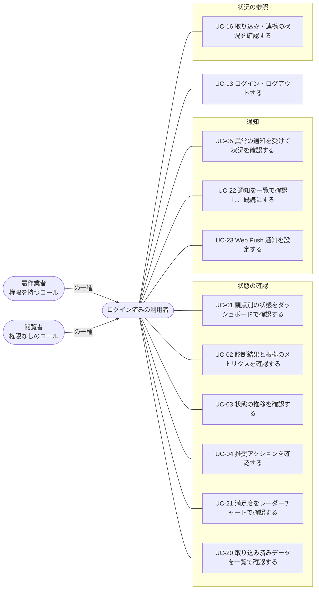

- UC-12・UC-15・UC-17・UC-18・UC-19 の**参照部分**（設備の階層、取り込み設定、ステータスコード一覧、入力済みデータの一覧、判断基準）も、要ログインのみで使える（`GET` の各ルートは `LOGIN`）
- 変更履歴の参照（`GET /audit-logs`）は `audit:read` が必要。要ログインのみのロールは使えない

## ユースケース図 2: 権限を持つ農作業者（入力・設定・管理）

各 UC は、`route-table.ts` の `access` の権限を要求する。権限がないロールは、サーバーが 403（`FORBIDDEN`）で拒否する。

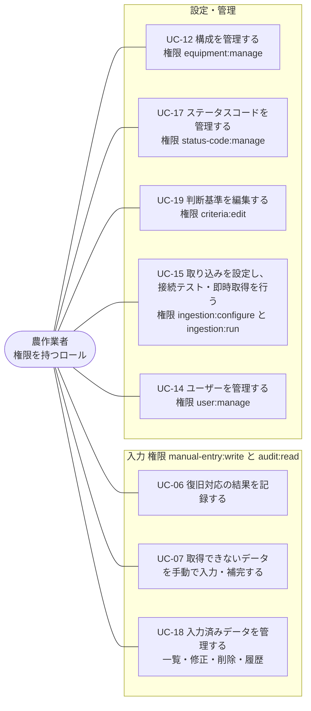

## ユースケース図 3: システムと外部システム（UI のないユースケース）

画面の操作を持たない UC。入口は、スケジューラのジョブ、または他の UC の保存後の処理。UC-15 の「即時取得」と開発用 API は、同じ処理を手動で起動する。

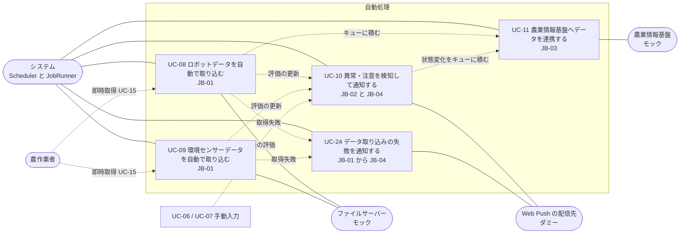

- 「Web Push の配信先」は、`NotifierPort` の先。実装はダミー（配信の記録のみ）
- 取り込み（UC-08・UC-09）の評価の更新は、取り込んだ件数が 1 件以上のときに行う。取得失敗は、一覧の取得を 3 回試しても失敗した場合のみ通知する（UC-24）。形式違いのファイルは通知しない

## UC と画面・API・ジョブの対応表

実装（`route-table.ts` の `useCases`・`handlers`・サービス）から作成した。`LOGIN` は要ログイン、`PUBLIC` は認証なし。

| UC    | ユースケース                                       | 画面                                             | API                                                                                     | ジョブ                  | 権限                                   | 主な実装                                               |
| ----- | -------------------------------------------------- | ------------------------------------------------ | --------------------------------------------------------------------------------------- | ----------------------- | -------------------------------------- | ------------------------------------------------------ |
| UC-01 | 観点別の状態をダッシュボードで確認する             | SC-02                                            | `GET /dashboard`・`GET /equipment`                                                      | JB-02（評価の事前計算） | LOGIN                                  | `DashboardQuery`・`jsonWithEtag`                       |
| UC-02 | 診断結果と根拠のメトリクスを確認する               | SC-03                                            | `GET /viewpoints/:id`・`GET /observations`                                              | JB-02                   | LOGIN                                  | `ViewpointQuery.detail`・`ObservationQuery`            |
| UC-03 | 状態の推移を確認する                               | SC-03                                            | `GET /viewpoints/:id/series`                                                            | JB-02                   | LOGIN                                  | `ViewpointQuery.series`・`domain/evaluation/series.ts` |
| UC-04 | 推奨アクションを確認する                           | SC-02・SC-03                                     | `GET /dashboard`・`GET /viewpoints/:id`                                                 | JB-02                   | LOGIN                                  | `domain/evaluation/messages.ts`                        |
| UC-05 | 異常の通知を受けて状況を確認する                   | SC-05・ヘッダー                                  | `GET /notifications`・`GET /notifications/unread-count`・`POST /notifications/:id/read` | JB-04                   | LOGIN                                  | `NotificationService`                                  |
| UC-06 | 復旧対応の結果を記録する                           | SC-06                                            | `POST /manual-entries`                                                                  | JB-02（保存後に評価）   | `manual-entry:write`                   | `ManualEntryService.create`                            |
| UC-07 | 取得できないデータを手動で入力・補完する           | SC-06                                            | `POST /manual-entries`                                                                  | JB-02                   | `manual-entry:write`                   | `ManualEntryService.create`                            |
| UC-08 | ロボットデータを自動で取り込む                     | （UI なし）SC-11 の即時取得、SC-09・SC-02 で確認 | `POST /ingestion/robot/run`・`GET /ingestion/logs`・`GET /observations`                 | JB-01                   | 即時取得は `ingestion:run`             | `IngestionService`・`robot-json`                       |
| UC-09 | 環境センサーデータを自動で取り込む                 | （UI なし）SC-11・SC-09・SC-02                   | `POST /ingestion/environment-sensor/run` ほか                                           | JB-01                   | 即時取得は `ingestion:run`             | `IngestionService`・`environment-sensor-csv`           |
| UC-10 | 異常・注意を検知して通知する                       | （UI なし）SC-05・ヘッダー・SC-02                | 入口は各保存の API。確認は `GET /notifications`                                         | JB-02・JB-04            | -                                      | `EvaluationService`・`NotificationService`             |
| UC-11 | 農業情報基盤へデータを連携する                     | （UI なし）SC-11 の連携の状況                    | `GET /federation/logs`                                                                  | JB-03                   | 参照は LOGIN                           | `FederationService`                                    |
| UC-12 | ハウス・ロボット・センサーの構成を管理する         | SC-10                                            | `/equipment` 一式                                                                       | -                       | `equipment:manage`（参照は LOGIN）     | `EquipmentService`                                     |
| UC-13 | ログイン・ログアウトする                           | SC-01                                            | `/auth/login`・`/auth/refresh`・`/auth/logout`                                          | -                       | PUBLIC（ログアウトは LOGIN）           | `AuthService`・`createLocalAuth`                       |
| UC-14 | ユーザーを管理する                                 | SC-14                                            | `/users` 一式                                                                           | -                       | `user:manage`                          | `UserService`                                          |
| UC-15 | 取り込みを設定し、接続テスト・即時取得を行う       | SC-11                                            | `/ingestion/settings`・`/ingestion/:id/test`・`/ingestion/:id/run`                      | JB-01                   | `ingestion:configure`・`ingestion:run` | `IngestionAdminService`・`IngestionService`            |
| UC-16 | 取り込み・連携の状況を確認する                     | SC-11                                            | `GET /ingestion/logs`・`GET /federation/logs`                                           | JB-01・JB-03            | LOGIN                                  | `IngestionAdminService`                                |
| UC-17 | ステータスコードを管理する                         | SC-12                                            | `/status-codes` 一式                                                                    | -                       | `status-code:manage`（参照は LOGIN）   | `StatusCodeService`                                    |
| UC-18 | 入力済みデータを管理する（一覧・修正・削除・履歴） | SC-07・SC-08                                     | `/manual-entries`・`GET /audit-logs`                                                    | JB-02                   | `manual-entry:write`・`audit:read`     | `ManualEntryService`・`AuditService`                   |
| UC-19 | 判断基準を編集する                                 | SC-13（SC-03 から）                              | `/viewpoints/:id/criteria` 一式                                                         | JB-02                   | `criteria:edit`（参照は LOGIN）        | `CriteriaAdminService`                                 |
| UC-20 | 取り込み済みデータを一覧で確認する                 | SC-09                                            | `GET /observations`                                                                     | -                       | LOGIN                                  | `ObservationQuery`                                     |
| UC-21 | 満足度をレーダーチャートで確認する                 | SC-04                                            | `GET /viewpoints/satisfaction`                                                          | JB-02                   | LOGIN                                  | `ViewpointQuery.detail`・`radar-chart.tsx`             |
| UC-22 | 通知を一覧で確認し、既読にする                     | SC-05                                            | `/notifications` 一式                                                                   | -                       | LOGIN                                  | `NotificationService`                                  |
| UC-23 | Web Push 通知を設定する                            | SC-15                                            | `/push-subscription`                                                                    | JB-04                   | LOGIN                                  | `PushSubscriptionService`・`PushBrowser`               |
| UC-24 | データ取り込みの失敗を通知する                     | （UI なし）SC-05・SC-11                          | `GET /notifications`・`GET /ingestion/logs`                                             | JB-01 → JB-04           | -                                      | `IngestionService`・`NotificationService`              |

# ドメインモデル

型の定義は、Zod のスキーマ（`src/shared/schemas/`）を正とし、型はそこから導出する（`z.infer`）。内部の記録（ユーザー・取り込み済みファイル・状態変化・連携の記録・Web Push の購読）は `application/ports/records.ts` に同じ方式で定義している。図の `?` は省略できる属性を表す。

## 設備・観測値・手動入力・ステータスコード

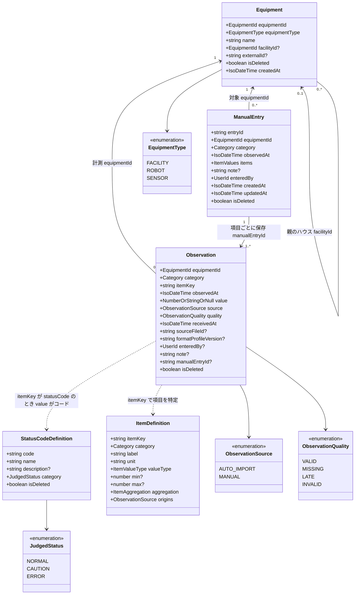

- **Equipment**: ハウス（`FACILITY`）が親、ロボット（`ROBOT`）・センサー（`SENSOR`）が子。スキーマの `refine` で「ハウスは親を持たず、ロボット・センサーは親のハウスが必須」を検証する。`externalId` は、ファイルの中の機体 ID・センサー ID との対応（取り込みの対応づけに使う。同じ種別の中で一意）。削除は論理削除（`isDeleted`）
- **Observation**: 共通形式の観測値。一意キーは `設備ID#項目#計測日時#取得元`（`observationKey`）。欠損は `null`（0 で代用しない）。取り込みの観測値は `sourceFileId`・`formatProfileVersion`、手動入力の観測値は `enteredBy`・`note`・`manualEntryId` を持つ
- **ManualEntry**: 1 回の入力（設備・カテゴリ・計測日時・項目の値・備考）。項目ごとの観測値（取得元 `MANUAL`・品質 `VALID`）としても保存される
- **ItemDefinition**: 項目カタログ（`shared/constants/items.ts`。37 項目）。検証・集計・画面で共有する。値の型（`integer`・`number`・`string`）・範囲・集計の種類（`TOTAL`・`LEVEL`・`STATUS`）・取得元（自動・手動）を持つ
- **StatusCodeDefinition**: ロボットのステータスコード。コード値は `^[A-Z][A-Z0-9_]*$`、カテゴリは正常・注意・異常。初期データとして 8 件を投入（`INITIAL_STATUS_CODES`）

### 項目カタログ（ItemDefinition）の内訳

| カテゴリ                | 項目（itemKey）                                                                                                                           | 取得元     | 集計         |
| ----------------------- | ----------------------------------------------------------------------------------------------------------------------------------------- | ---------- | ------------ |
| HARVEST 収穫情報        | `harvestCount`（個・整数）、`harvestSecondsPerFruit`（秒/果実）                                                                           | 自動       | TOTAL・LEVEL |
|                         | `harvestAttemptCount`・`harvestSuccessCount`・`damagedFruitCount`・`misrecognitionCount`・`wrongHarvestCount`・`missedFruitCount`（整数） | 手動       | TOTAL        |
| OPERATION 稼働情報      | `operatingHours`・`standbyHours`・`harvestOperatingHours`・`travelStoppedHours`（時間）                                                   | 自動       | TOTAL        |
| STATUS ステータス       | `statusCode`（文字列）                                                                                                                    | 自動       | STATUS       |
| ENVIRONMENT 環境情報    | `temperatureCelsius`・`humidityPercent`（0〜100）・`illuminanceLux`・`co2Ppm`                                                             | 自動・手動 | LEVEL        |
| OPERABILITY 操作情報    | `operationMinutes`・`operationStepCount`・`operationErrorCount`                                                                           | 手動       | TOTAL        |
| SAFETY 安全情報         | `emergencyStopCount`・`nearMissCount`                                                                                                     | 手動       | TOTAL        |
| COST コスト情報         | `robotCostYenPerHour`・`laborCostYenPerHour`（円/時間）                                                                                   | 手動       | LEVEL        |
|                         | `maintenanceCostYen`・`electricityCostYen`（円）                                                                                          | 手動       | TOTAL        |
| FAILURE 故障情報        | `failureCount`・`recoveryMinutes`                                                                                                         | 手動       | TOTAL        |
| SATISFACTION 満足度情報 | `satisfaction.<観点ID>`（9 観点。1〜5 の整数）                                                                                            | 手動       | LEVEL        |

`harvestSecondsPerFruit`・`standbyHours`・`harvestAttemptCount`・`harvestSuccessCount`・`misrecognitionCount` は、取り込み・入力できるが、どの観点のメトリクスの算出にも使われていない（コードの参照が、カタログと FormatProfile・合成データのみ）。

## 評価・判断基準・通知

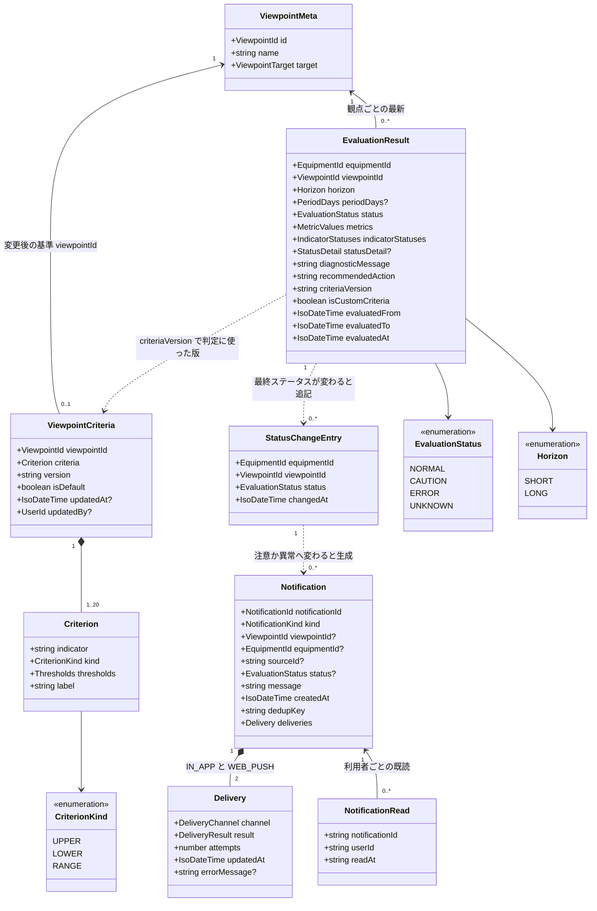

- **ViewpointDefinition**（コード。保存しない）: 観点ごとの定義（`domain/evaluation/definition.ts`）。短期評価の有無・判断基準で判定する指標・ステータスコードを使うか・一部の指標だけで判定するか・必須の入力・ダッシュボードと詳細のメトリクス・推奨アクションの文言・メトリクスの算出関数（`computeMetrics`）を持つ。10 観点（`viewpoints/robot-viewpoints.ts`・`house-viewpoints.ts`・`operation-viewpoints.ts`）を `registry.ts` に登録する
- **ViewpointCriteria**: 既定値はコード（`default-criteria.ts`）にあり、保存するのは変更後の値のみ。変更後は版 `CUSTOM-<n>`、既定値は版 `DEFAULT`
- **Criterion**: 指標ごとの条件。`UPPER`（`cautionFrom`・`errorFrom`）・`LOWER`（`errorBelow`・`cautionBelow`）・`RANGE`（`errorLower`・`normalLower`・`normalUpper`・`errorUpper`）の 3 形。閾値の大小関係は Zod の `superRefine` で検証する
- **EvaluationResult**: 設備×観点×視点×期間ごとの**最新の結果を上書き**して保存する。保存の一意キーは `設備ID#観点ID#視点#期間（短期は 0）`。履歴は持たない（ステータスの推移は `StatusChangeEntry` から作る）
- **StatusChangeEntry**: 観点の最終ステータス（短期・長期（7 日）のうち「不明」を除いた悪い方）が変わったときに追記する。最新の 1 件（`lastStatusChanges`）と履歴（`statusChangeHistory`）の 2 コレクションに保存する
- **Notification**: 重複抑制のキー `dedupKey` と、配信の状態 2 つ（画面内は作成時に `SUCCESS`、Web Push は `PENDING` から始まる）を持つ。既読は、通知とは別の `NotificationRead`（通知×利用者）で持つ

## 取り込み・連携・利用者・監査

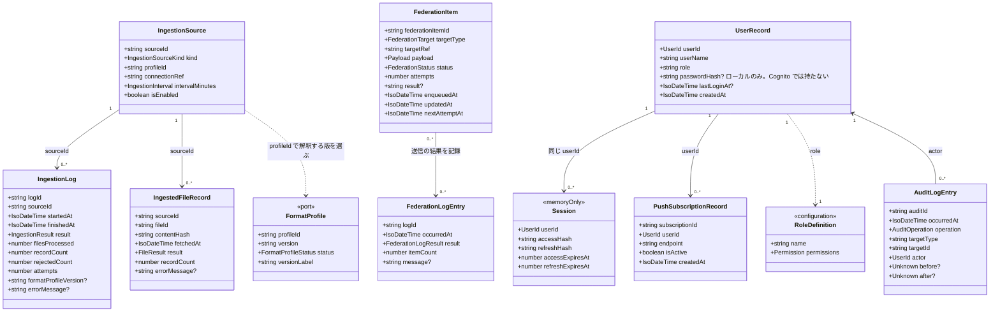

- **IngestionSource**: 取り込み元の設定（`robot`・`environment-sensor` の 2 件が既定）。保存するのは設定（`settings` コレクションのキー `ingestion.sources`）。接続先は参照名（`connectionRef`）のみで、認証情報の値は持たない。取得間隔は 5・15・30・60・360・1440 分のいずれか
- **IngestedFileRecord**: 再取り込みの防止のための記録。一意キーは `取り込み元#ファイルID#内容のハッシュ`。形式違いのファイルは `FAILURE` で記録する
- **FormatProfile**: ポート。実装は、設定（JSON）から作る宣言的な FormatProfile（`robot-json@0.1.0(PROVISIONAL)`・`environment-sensor-csv@0.1.0(PROVISIONAL)`）
- **FederationItem**: 連携キューの項目（アウトボックス）。`targetType` は `OBSERVATION`（取り込み・手動入力のデータ）または `EVALUATION`（観点ステータスの変化）。`payload` は送るデータのスナップショット
- **Session**: `createLocalAuth` がメモリ上に持つ（アクセストークン・リフレッシュトークンの SHA-256 のみ保持。平文は持たない）。永続化しないため、再起動で全員が再ログインになる
- **AuditLogEntry**: 変更履歴。対象の種類は `manual-entry`・`criteria`・`equipment`・`status-code`・`user`・`ingestion-settings` の 6 つ。`before`・`after` は、パスワードのハッシュを含まない形で記録する
- **RoleDefinition / Permission**: 設定（`ROLE_DEFINITIONS_JSON`）で与える。権限は 8 種（`equipment:manage`・`ingestion:configure`・`ingestion:run`・`status-code:manage`・`manual-entry:write`・`criteria:edit`・`user:manage`・`audit:read`）

## 永続化のコレクション（ローカルの Repository）

`createLocalRepositories`（`local-repositories.ts`。集約ごとの実装は `local/repositories/`）が、`LocalStore` に 18 のコレクションを登録する。読み込み時に、Zod のスキーマで検証する（壊れたデータを内部に渡さない）。

| コレクション          | 型                     | キー                                        |
| --------------------- | ---------------------- | ------------------------------------------- |
| `equipment`           | Equipment              | `equipmentId`                               |
| `statusCodes`         | StatusCodeDefinition   | `code`                                      |
| `criteria`            | ViewpointCriteria      | `viewpointId`                               |
| `observations`        | Observation            | `設備ID#項目#計測日時#取得元`               |
| `evaluations`         | EvaluationResult       | `設備ID#観点ID#視点#期間（短期は 0）`       |
| `lastStatusChanges`   | StatusChangeEntry      | `設備ID#観点ID`                             |
| `statusChangeHistory` | StatusChangeEntry      | `設備ID#観点ID#changedAt`                   |
| `notifications`       | Notification           | `notificationId`                            |
| `notificationReads`   | 通知×利用者の既読      | `通知ID#利用者ID`                           |
| `ingestedFiles`       | IngestedFileRecord     | `取り込み元#ファイルID#ハッシュ`            |
| `ingestionLogs`       | IngestionLog           | `logId`                                     |
| `federationItems`     | FederationItem         | `federationItemId`                          |
| `federationLogs`      | FederationLogEntry     | `logId`                                     |
| `auditLogs`           | AuditLogEntry          | `auditId`                                   |
| `manualEntries`       | ManualEntry            | `entryId`                                   |
| `users`               | UserRecord             | `userId`                                    |
| `pushSubscriptions`   | PushSubscriptionRecord | `sub-<利用者と宛先の SHA-256 の先頭 24 桁>` |
| `settings`            | キーと値               | `key`（現状は `ingestion.sources` のみ）    |

観測値のみ、設備ごとの索引（メモリ上。`Map<設備ID, キーの集合>`）と、計測日時の順の索引（一意キーと計測日時の整列済みの配列。新しい一意キーは、次の参照でまとめて加える）を持ち、評価・参照で全件を走査・並べ替えしない。

## 列挙・値オブジェクト

| 名前                                | 値                                                                                                                                                                                      | 定義                              |
| ----------------------------------- | --------------------------------------------------------------------------------------------------------------------------------------------------------------------------------------- | --------------------------------- |
| `EvaluationStatus`                  | `NORMAL`（正常）・`CAUTION`（注意）・`ERROR`（異常）・`UNKNOWN`（不明）                                                                                                                 | `shared/constants/status.ts`      |
| `JudgedStatus`                      | `NORMAL`・`CAUTION`・`ERROR`（「不明」を除く。ステータスコードのカテゴリも同じ）                                                                                                        | 同上                              |
| `Horizon`                           | `SHORT`（短期）・`LONG`（長期）                                                                                                                                                         | 同上                              |
| `PeriodDays`                        | 1・7・30・60・90（既定 7）                                                                                                                                                              | 同上                              |
| `EquipmentType`                     | `FACILITY`・`ROBOT`・`SENSOR`                                                                                                                                                           | 同上                              |
| `ObservationSource`                 | `AUTO_IMPORT`・`MANUAL`                                                                                                                                                                 | 同上                              |
| `ObservationQuality`                | `VALID`・`MISSING`・`LATE`・`INVALID`                                                                                                                                                   | 同上                              |
| `NotificationKind`                  | `STATUS_CHANGE`・`INGESTION_FAILURE`                                                                                                                                                    | 同上                              |
| `ReadState`                         | `UNREAD`・`READ`                                                                                                                                                                        | 同上                              |
| `FederationStatus`                  | `PENDING`・`SENT`・`FAILED`・`HELD`                                                                                                                                                     | 同上                              |
| `Category`（9）                     | `HARVEST`・`OPERATION`・`STATUS`・`ENVIRONMENT`・`OPERABILITY`・`SAFETY`・`COST`・`FAILURE`・`SATISFACTION`。手動入力できるのは、`OPERATION`・`STATUS` を除く 7 つ                      | `shared/constants/items.ts`       |
| `ViewpointId`（10）                 | `harvestAccuracy`・`harvestSpeed`・`environmentalAdaptability`・`operability`・`maintainability`・`costEfficiency`・`safety`・`dataUtilization`・`durability`・`satisfaction`（表示順） | `shared/constants/viewpoints.ts`  |
| `ViewpointTarget`                   | `ROBOT`・`HOUSE`・`OPERATION`（運用面はハウス単位で評価）                                                                                                                               | 同上                              |
| `Permission`（8）                   | 上記                                                                                                                                                                                    | `shared/constants/permissions.ts` |
| `ErrorCode`（9）                    | `VALIDATION_ERROR`・`UNAUTHENTICATED`・`FORBIDDEN`・`NOT_FOUND`・`CONFLICT`・`RATE_LIMITED`・`NOT_IMPLEMENTED`・`INTERNAL_ERROR`・`SERVICE_UNAVAILABLE`                                 | `shared/errors.ts`                |
| `AuditOperation`                    | `CREATE`・`UPDATE`・`DELETE`                                                                                                                                                            | `shared/schemas/audit.ts`         |
| `DeliveryChannel`・`DeliveryResult` | `IN_APP`・`WEB_PUSH`／`PENDING`・`SUCCESS`・`FAILURE`                                                                                                                                   | `shared/schemas/notification.ts`  |
| `IngestionResult`                   | `SUCCESS`・`PARTIAL`・`FAILURE`                                                                                                                                                         | `shared/schemas/ingestion.ts`     |
| `FaultMode`（モックの状態）         | `UP`・`DOWN`・`SLOW`・`REJECT`                                                                                                                                                          | `infrastructure/local/faults.ts`  |

値オブジェクトの例: ブランド型の識別子（`EquipmentId`・`UserId`・`NotificationId`。英数字・`_`・`-`、先頭は英数字、100 文字以内）、UTC の日時文字列（`IsoDateTime`）、`Criterion` の閾値（`UpperThresholds`・`LowerThresholds`・`RangeThresholds`）、`StatusDetail`（判定に使ったステータスコードの `code`・`name`・`category`）、`MetricValues`（メトリクスの識別子 → 数値または `null`）、`Delivery`、`FieldError`（`name`・`message`）。

### 観点ごとの評価の定義（ViewpointDefinition の実体）

| 観点             | 対象（ViewpointTarget） | 短期 | 判断基準で判定する指標（既定値）                                                                                                                                 | 未取得なら「不明」の入力                                                            |
| ---------------- | ----------------------- | ---- | ---------------------------------------------------------------------------------------------------------------------------------------------------------------- | ----------------------------------------------------------------------------------- |
| 収穫精度         | ROBOT                   | あり | 可販果率（90%未満で注意・80%未満で異常）・認識精度（同）                                                                                                         | 収穫数・果実損傷数・誤収穫数・取り残し数                                            |
| 収穫速度         | ROBOT                   | あり | 走行停止率（5%以上・10%以上）・平均処理時間（60秒以上・120秒以上）＋ステータスコード                                                                             | 収穫稼働時間・走行停止時間・収穫数・ステータスコード                                |
| 環境適応性       | HOUSE                   | あり | 温度（範囲 0〜10〜25〜35℃）・湿度（30〜40〜80〜90%）・照度（10,000〜20,000〜40,000〜50,000 lx）・CO2（200〜800〜1000〜3000 ppm）。**一部の指標だけで判定できる** | なし                                                                                |
| 操作性           | ROBOT                   | あり | 操作ステップ数（5回以上・10回以上）・操作時間（10分以上・30分以上）・操作エラー率（10%以上・30%以上）                                                            | 操作時間・操作ステップ数・操作エラー数                                              |
| メンテナンス性   | ROBOT                   | あり | MTTR（4時間以上・8時間以上）＋ステータスコード                                                                                                                   | 故障回数・復旧に要した時間・ステータスコード                                        |
| コスト効率       | ROBOT                   | なし | 可販果率・平均処理時間・稼働率（95%未満・90%未満）・経済生産性（1.2未満・1.0未満）                                                                               | 収穫数・収穫稼働時間・稼働時間・故障回数・復旧時間・損傷数・誤収穫数・コスト 4 項目 |
| 安全性           | ROBOT                   | あり | 緊急停止頻度（0.01回/時間以上・0.05以上）・ヒヤリハット頻度（0.05以上・0.2以上）                                                                                 | 緊急停止回数・ヒヤリハット件数・稼働時間                                            |
| データ活用度合い | OPERATION               | なし | データ連携率（90%未満・70%未満）                                                                                                                                 | 全データ数（長期の集計から算出）                                                    |
| 耐久性           | ROBOT                   | なし | MTBF（500時間未満・100時間未満）・稼働率（95%未満・90%未満）＋ステータスコード                                                                                   | 稼働時間・復旧時間・故障回数・ステータスコード                                      |
| 満足度           | OPERATION               | なし | 総合満足度（4未満・3未満）                                                                                                                                       | 9 観点のスター評価すべて                                                            |

「対象」の列は、`ViewpointTarget`（`shared/constants/viewpoints.ts`）の分類（運用面 `OPERATION` はハウス単位で評価する）。実際の評価は、設備の種別ごとに、ハウス＝全 10 観点（配下の設備の観測値をまとめて集計）、ロボット＝`ROBOT` の 7 観点、センサー＝環境適応性のみ（`viewpointsForEquipmentType`）。閾値は `default-criteria.ts` の既定値で、判断基準の編集で変更できる。

# 設計アーキテクチャ

## レイヤ構成

1 つのリポジトリ（pnpm ワークスペース）に、共通コード（`shared`）、バックエンド、フロントエンドを置く。バックエンドは、ドメイン・アプリケーション・インフラ・提示・実行形態の 5 層に分ける（モジュラーモノリス。ADR-0001）。

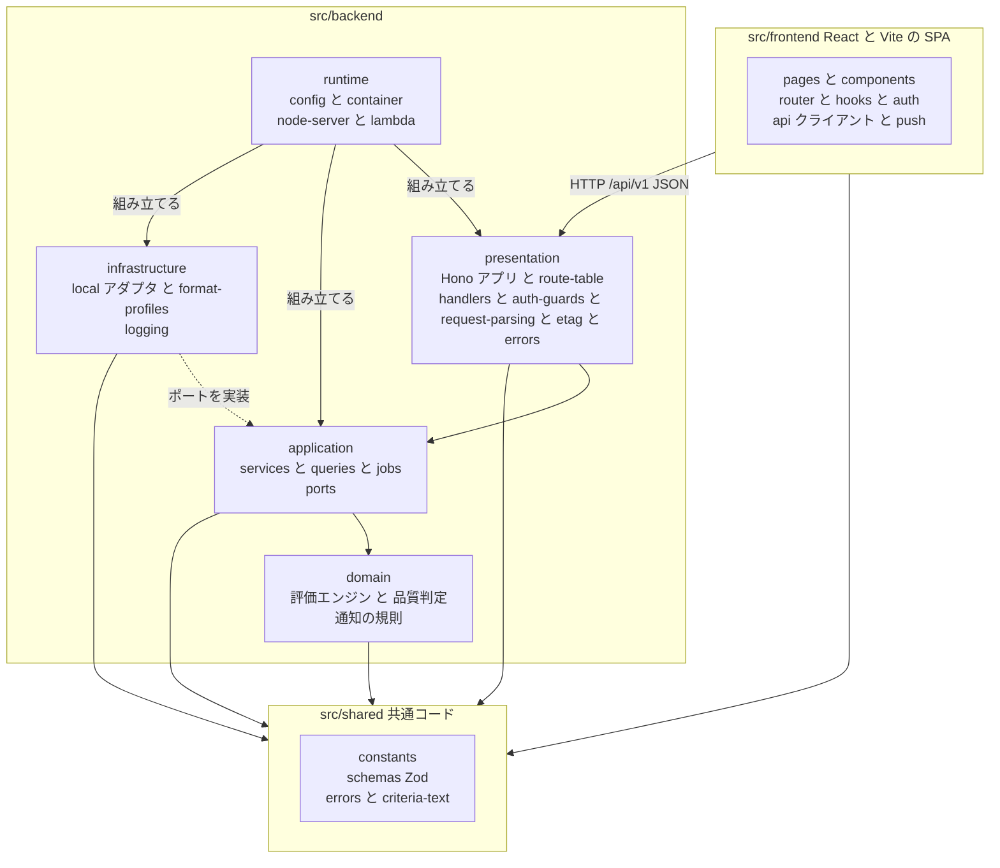

| 層               | ディレクトリ                  | 責務                                                                                                   | 主なファイル                                                                                                                                                                                                                                          |
| ---------------- | ----------------------------- | ------------------------------------------------------------------------------------------------------ | ----------------------------------------------------------------------------------------------------------------------------------------------------------------------------------------------------------------------------------------------------- |
| 共通             | `src/shared/`                 | 定数・Zod スキーマと型・共通エラー・判断基準の表示用変換。フロントエンドとバックエンドで共有する       | `constants/`（`status.ts`・`viewpoints.ts`・`items.ts`・`metrics.ts`・`permissions.ts`・`observation-labels.ts`）、`schemas/`（12 ファイル）、`errors.ts`（`AppError`）、`criteria-text.ts`                                                           |
| ドメイン         | `src/backend/domain/`         | 外部に依存しない純粋なロジック                                                                         | `evaluation/`（`engine.ts`・`grading.ts`・`measures.ts`・`scope-evaluator.ts`・`series.ts`・`definition.ts`・`messages.ts`・`numbers.ts`・`default-criteria.ts`・`viewpoints/`）、`observation-quality.ts`、`notification-rules.ts`、`status-code.ts` |
| アプリケーション | `src/backend/application/`    | ユースケース（サービス・参照・ジョブ）とポートの定義。トランザクションを持たず、Repository を順に呼ぶ  | `manual-entry/`・`equipment/`・`evaluation/`・`ingestion/`・`federation/`・`notification/`・`auth/`・`audit/`・`query/`・`jobs/`・`seed/`・`ports/`・`settings.ts`                                                                                    |
| インフラ         | `src/backend/infrastructure/` | ポートのアダプタ（現状はローカル用のみ）・FormatProfile・ログ                                          | `local/`（13 ファイル）、`format-profiles/`（`declarative-profile.ts`＋設定 JSON 2 つ）、`logging/json-logger.ts`                                                                                                                                     |
| 提示             | `src/backend/presentation/`   | Hono アプリ・ルート表・ハンドラ・認証認可・共通エラー・開発用 API                                      | `create-app.ts`・`route-table.ts`・`handlers.ts`（領域ごとのハンドラ（`viewpoint-`・`manual-entry-`・`equipment-`・`status-code-`・`criteria-`・`user-`・`ingestion-`・`push-subscription-handlers.ts`。設定・管理は `admin-handlers.ts` がまとめる）と合わせて）・`middleware.ts`（`requestContext`）・`auth-guards.ts`・`request-parsing.ts`・`etag.ts`・`request-helpers.ts`・`query-schemas.ts`・`route-types.ts`・`errors.ts`・`api-deps.ts`・`dev-routes.ts`                                                                                                     |
| 実行形態         | `src/backend/runtime/`        | 設定の検証・アダプタの選択とサービスの組み立て（コンポジションルート）・Node サーバー・Lambda ハンドラ | `config.ts`・`container.ts`・`node-server.ts`・`lambda.ts`・`main.ts`                                                                                                                                                                                 |
| フロントエンド   | `src/frontend/`               | SPA                                                                                                    | 後述                                                                                                                                                                                                                                                  |

### アプリケーション層のサービス間の依存

`container.ts` が、`buildSettings`・`buildAdapters`（Repository・モック・認証・FormatProfile）・`buildServices`・`buildDevControls` に分けて、次の順に作る。評価（`EvaluationService`）は、多くのサービスの保存後に同期的に呼ばれる。

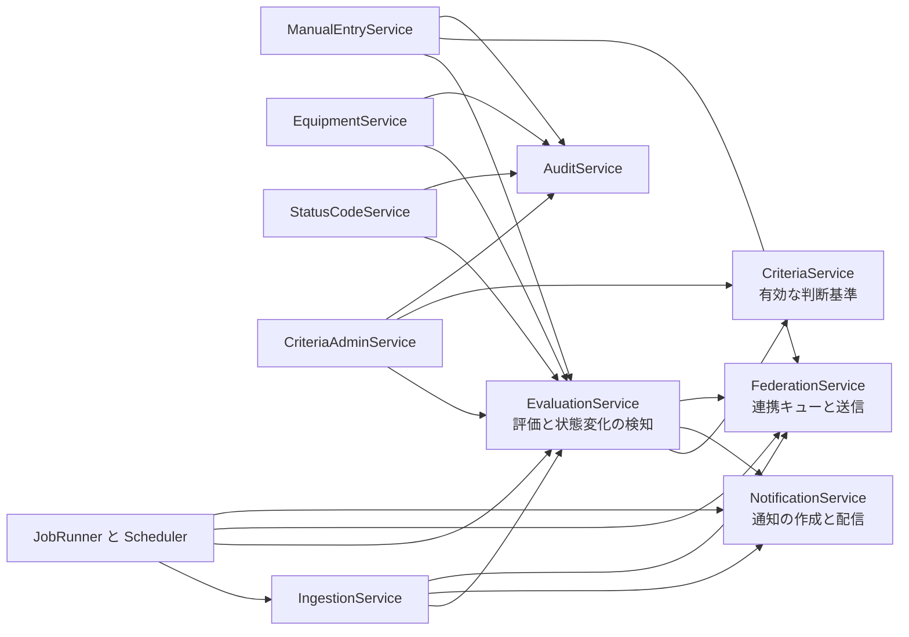

参照専用の `DashboardQuery`・`ViewpointQuery`・`ObservationQuery` は、Repository と `ClockPort` のみに依存し、評価を実行しない（保存済みの評価結果を読むだけ）。

## 依存の向きと ESLint による強制

依存は内向き（提示・インフラ・実行形態 → アプリケーション → ドメイン）。`eslint.config.js` が、`no-restricted-imports` で次を禁止する（`pnpm lint` は、解析時点でエラーなしで終わった）。

| 対象                                     | 禁止する import                                                                                                                                        | メッセージの要旨                                                                                                                                                                                         |
| ---------------------------------------- | ------------------------------------------------------------------------------------------------------------------------------------------------------ | -------------------------------------------------------------------------------------------------------------------------------------------------------------------------------------------------------- |
| `src/backend/domain/**`・`src/shared/**` | `hono`・`hono/*`・`@hono/*`、`react`・`react-dom`、`@aws-sdk/*`・`aws-lambda`、`**/infrastructure/**`・`**/presentation/**`・`**/runtime/**`、`node:*` | ドメイン・共通コードは、フレームワーク・SDK・外側の層・Node 標準に依存させない（純粋なロジックのみ）                                                                                                     |
| `src/backend/application/**`             | 上のうち `node:*` を除くすべて                                                                                                                         | アプリケーション層は、フレームワーク・SDK・外側の層に依存させない（ポートを介して使う）。`node:*` は禁止されていない（`ingestion-service.ts` と `push-subscription-service.ts` が `node:crypto` を使う） |
| `src/frontend/**`                        | `**/backend/**`・`@smart-farm/backend`・`@smart-farm/backend/*`                                                                                        | フロントエンドはバックエンドの実装に依存させない（共通コードは `src/shared`）                                                                                                                            |

そのほかの主なルール: `strictTypeChecked`＋`stylisticTypeChecked`（型情報つき。`projectService`）、`no-console`・`eqeqeq`・`no-var`、`consistent-type-imports`（インライン形式）、`enum` の禁止（`TSEnumDeclaration`）、フロントエンドに `react-hooks`。書式は Prettier のみ（`eslint-config-prettier`）。アクセシビリティ（jsx-a11y）の推奨ルールは、ESLint ではなく oxlint（`.oxlintrc.json`。`pnpm lint` が `eslint .` に続けて `oxlint -c .oxlintrc.json src/frontend` を実行する。ライセンス対応で、`eslint-plugin-jsx-a11y` から置き換えた。2026-10-11）で検査する。

**強制されていない依存**: 提示層（`presentation/`）には、インフラ層への import 制限がない。実際に、開発用 API のために、`api-deps.ts` が `infrastructure/local/faults.ts`・`clocks.ts` の型を、`dev-routes.ts` が `faults.ts`・`synthetic-data.ts` を import している（`api-deps.ts` の冒頭コメントは「提示層は、インフラ層（アダプタ）を知らない」と書く）。本番の経路（`createApp` の `handlers`）は、アプリケーション層のサービスのみに依存する。

## ポートとアダプタの一覧

| ポート                                     | 定義                            | 実装済みのアダプタ                                                                                                                                              | 本番の想定（未実装）                          |
| ------------------------------------------ | ------------------------------- | --------------------------------------------------------------------------------------------------------------------------------------------------------------- | --------------------------------------------- |
| Repository（13 種を束ねた `Repositories`） | `ports/repositories.ts`         | `local/local-repositories.ts`・`local/repositories/`（`LocalStore` のメモリ＋JSON ファイル）、`dynamodb/dynamodb-repositories.ts`（DynamoDB。ADR-0007）                                | DynamoDB（実装済み。契約テストは共通）        |
| `AuthPort`                                 | `ports/auth-port.ts`            | `local/local-auth.ts`（`createLocalAuth`）、`cognito/cognito-identity.ts`（`createCognitoIdentity`。ADR-0008）                                                  | Cognito（実装済み。契約テストは共通）         |
| `PasswordHasherPort`                       | `ports/password-hasher-port.ts` | `local/password-hasher.ts`（scrypt）。資格情報の管理は、`CredentialPort`（`local/local-credentials.ts`・`cognito/cognito-identity.ts`）が担う                    | Cognito が持つため、記録には持たない          |
| `ClockPort`                                | `ports/clock-port.ts`           | `local/clocks.ts`（`createControllableClock`。固定・進行・実時間）。`createSystemClock` もあるが、テストでのみ使われ、`container.ts` は常に操作できる時計を使う | -                                             |
| `IdGeneratorPort`                          | `ports/id-generator-port.ts`    | `local/ids.ts`（`createUuidGenerator`。テスト用に連番の `createSequentialIdGenerator`）                                                                         | -                                             |
| `Logger`                                   | `ports/logger-port.ts`          | `logging/json-logger.ts`（1 行 1 イベントの JSON。秘密情報らしい名前のフィールドをマスク）                                                                      | -                                             |
| `FileSourcePort`                           | `ports/file-source-port.ts`     | `local/mock-file-server.ts`（ディレクトリのモック。停止・遅延を再現）                                                                                           | SFTP・S3・HTTPS など（Q-002）                 |
| `FormatProfile`・`FormatProfileRegistry`   | `ports/format-profile.ts`       | `format-profiles/declarative-profile.ts`（設定 JSON から作る JSON・CSV の FormatProfile）                                                                       | 確定仕様の FormatProfile を追加して差し替える |
| `FederationPort`                           | `ports/federation-port.ts`      | `local/mock-federation.ts`（受け取りを記録。停止・遅延・拒否を再現）                                                                                            | 農業情報基盤用（Q-005）                       |
| `NotifierPort`                             | `ports/notifier-port.ts`        | `local/dummy-web-push.ts`（配信を記録。失敗・購読無効を再現）                                                                                                   | Web Push の配信サービス                       |
| `SecretPort`                               | `ports/secret-port.ts`          | `local/env-secret.ts`（`SECRET_<参照名>`）。**どこにも接続されていない**                                                                                        | シークレット管理サービス                      |

ポートの契約に沿った振る舞いの検証は、Repository は `repository-contract.test.ts`（メモリ・ファイルの 2 実装に同じテストを適用）、ほかのアダプタは `tests/unit/backend/infrastructure/adapters.test.ts` で行う。

## 実行構成

### ローカル（開発・E2E）

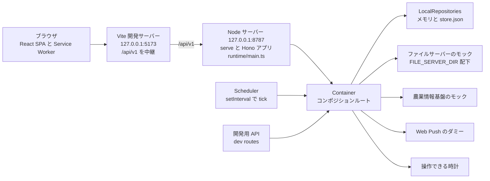

- `createContainer(config, overrides)` が、設定に応じてアダプタを選び、すべてのサービスを組み立てる。`overrides` で、ロガー・時計・ID 生成・動作設定を差し替えられる（テストが使う）
- `initialize()` は、ステータスコードの初期データ（8 件）、最初のユーザー（`INITIAL_USER_*` があり、ユーザーが 0 人のとき）、デモデータ（`SEED_MODE=DEMO` で、設備が 0 件のとき）を用意する
- `dev`（開発用の操作）は、`devApiEnabled`（`DEV_API_ENABLED=true` かつ `APP_MODE !== 'production'`。Lambda は常に false）のときのみ作る。時刻を操作できる時計も、このときのみ作る（無効なときは、システム時計）。`reset(seed)` は、データを消し、スケジューラ・モック・時計を初期状態に戻して、`initialize` をやり直す

### 本番（Lambda）の想定と、実装の範囲

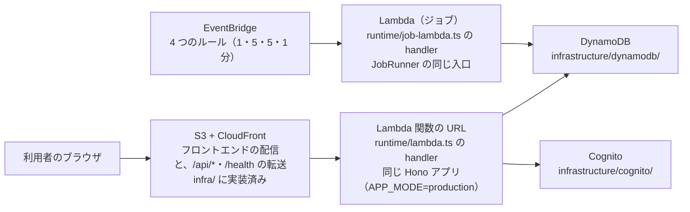

- `createLambdaHandler(env)` は、最初の呼び出しで `parseConfig` → `createContainer` → `initialize` → `handle(createApp(container))` を 1 度だけ行い、再利用する。設定は `parseLambdaConfig`（`APP_MODE`・`PERSISTENCE` の明示が必須。`SEED_MODE` は使えない。開発用 API・スケジューラは常に無効）。`APP_MODE=production` は、DynamoDB・Cognito が必須（ADR-0009）
- 実線は、コードと IaC がある（Issue #75 で、API の Lambda を、バックエンド本体（`runtime/lambda.ts`）にし、`SfmData` の DynamoDB・Cognito を、環境変数と最小権限の IAM でつないだ。**AWS で確認済み**（2026-10-20。ADR-0009・ADR-0010）。ログイン・認証つきの呼び出し・画面・利用者の IP の識別（Issue #100）。初回の応答は体感 1 秒以内。実測は Issue #79）。EventBridge からのジョブの起動は、Issue #76 で実装した（ジョブ専用の Lambda と 4 つのルール。**AWS での確認は、デプロイ後**。ADR-0011）。ファイルサーバー・農業情報基盤・Web Push は、モックのまま（S3 のファイルのモックは、Issue #77）。Lambda の環境変数・IAM・メモリ・配布物は、ADR-0009

## フロントエンドの構成

React 19 と Vite の SPA。外部の UI ライブラリ・ルーター・状態管理・グラフのライブラリは使わず、依存は `react`・`react-dom`・`zod`・`@smart-farm/shared` のみ。

| ディレクトリ            | 内容                                                                                                                                                                                                 |
| ----------------------- | ---------------------------------------------------------------------------------------------------------------------------------------------------------------------------------------------------- |
| `main.tsx`              | 起動のみ。`App` に、セッションの保持（`createSessionStorageAccess`）と `fetch` を渡す                                                                                                                |
| `app.tsx`               | `App`（`AuthProvider` → `PushBrowserProvider` → `AppRoutes`）、`SCREEN_ROUTES`（14 の画面のパス）。ログイン状態で、ログイン画面とレイアウトつきの画面を切り替える                                    |
| `router/router.tsx`     | History API のルーター（`navigate`・`useLocation`・`Routes`・`Link`・`matchPath`）。`useSyncExternalStore` で、`popstate` と独自イベントを購読する                                                   |
| `auth/auth-context.tsx` | `AuthProvider`・`useAuth`。ログイン中の利用者（`user`）と、`ApiClient` を提供する                                                                                                                    |
| `api/`                  | `client.ts`（`createApiClient`・`ApiError`）、`endpoints.ts`・`management-endpoints.ts`（エンドポイントごとの型つき呼び出し）、`paths.ts`（値を含むパスの組み立て）、`etag-cache.ts`（ETag のキャッシュ）、`session-storage.ts`                                                  |
| `hooks/`                | `use-polling`（約 10 秒）・`use-query-params`・`use-horizon-selection`・`use-cursor-paging`・`use-submit`・`use-permission`・`use-media-query`                                                       |
| `components/`           | 共通レイアウト・状態・表示部品（22 ファイル）。`app-layout`・`app-state`・`line-chart`・`radar-chart`・`chart-geometry`・`trend-section`・`manual-entry-form`・`criteria-table`・`status-badge` など |
| `pages/`                | 画面（17 ファイル。うち `placeholder-page.tsx` は未使用）                                                                                                                                            |
| `push/`                 | `browser-push.ts`（`PushBrowser`。サービスワーカー・Push API・Notification API の窓口）、`push-context.tsx`                                                                                          |
| `i18n/`                 | `messages.ts`・`management-messages.ts`（日本語の固定文言。多言語の仕組みはない）                                                                                                                    |
| `styles/`               | `app.css`・`viewpoints.css`・`management.css`                                                                                                                                                        |
| `public/`               | `sw.js`（Web Push の受信と、通知を選ぶと `/notifications` を開く）、`manifest.webmanifest`                                                                                                           |

### 状態管理

| 種類               | 手段                                                                                                                                     | 内容                                                                                                                                                |
| ------------------ | ---------------------------------------------------------------------------------------------------------------------------------------- | --------------------------------------------------------------------------------------------------------------------------------------------------- |
| 認証               | `AuthContext`                                                                                                                            | 利用者（`AuthenticatedUser`）。`api` は、`fetchFn`・`session`・`user` が変わると作り直す（ETag のキャッシュも新しくなる）                           |
| 画面をまたぐ状態   | `AppStateContext`（`AppLayout` の中）                                                                                                    | 設備の階層（60 秒ごとに読み直す）、選択中の設備（未選択・存在しない設備なら最初のハウス）、最終のデータ取得日時と新しさ（ダッシュボードが設定する） |
| 画面ごとの状態     | `useState`・`usePolling`・`useSubmit`                                                                                                    | 取得結果・入力値・実行中・エラー                                                                                                                    |
| URL                | `useQueryParams`・`useHorizonSelection`                                                                                                  | 絞り込み・並べ替え・視点（短期・長期）・期間。再読み込み・画面の移動でも保たれる                                                                    |
| ブラウザの保存領域 | `sessionStorage`（`smart-farm.session`。セッション全体）、`localStorage`（`smart-farm:last-entry-target`。直前に入力した設備・カテゴリ） | どちらも、`try/catch` で囲み、使えなくても動く                                                                                                      |
| 画面間の通知       | `window` のカスタムイベント（`unread-events.ts`）                                                                                        | 既読にした直後に、ヘッダーの未読件数を、10 秒の更新を待たずに読み直す                                                                               |

### API クライアントとポーリング

- `createApiClient`: Bearer トークンを付けて `/api/v1` を呼ぶ。応答は、Zod のスキーマで検証し、不一致は `INVALID_RESPONSE` にする。エラー応答は `ApiError`（`status`・`code`・`fields`）に変換し、通信失敗は `NETWORK_ERROR`
- 401 のときは、リフレッシュトークンでセッションを更新して、**1 度だけ**再試行する。更新は、同時に 1 つだけ実行する（`refreshSessionOnce`。複数の読み込みが同時に 401 になっても、使用済みのトークンで失敗しない）。さらに、**更新が終わったあとに、遅れて届いた 401** のとき、現在のトークンが、その要求に使ったトークンと違えば（ほかの要求が、すでに更新した）、更新せず、現在のトークンで再試行する（更新を重ねると、サーバーが、直前に発行したトークンを無効にし、そのトークンで再試行している要求が 401 になるため。Issue #60）。更新に失敗すると、セッションを消し、`onSessionExpired`（`setUser(null)`）でログイン画面へ戻す
- GET は、応答の `ETag` を、URL ごとに記憶し（同じアクセストークンのときだけ使う）、次の同じ GET に `If-None-Match` を付ける。304 なら前回の本文を使う（実際に `ETag` を返すのは `GET /dashboard` のみ）
- `usePolling(fetcher, intervalMs = 10_000)`: 最初に 1 回取得し、その後は、タブが表示されているとき（`document.visibilityState === 'visible'`）だけ、10 秒ごとに取得する。取得関数が変わると、読み込み中に戻して取得し直す。ほとんどの画面（ダッシュボード・観点の詳細・一覧・通知・ユーザー管理・ヘッダーの未読件数など）がこれを使う。例外は、判断基準の編集（SC-13。間隔が 24 時間で、実質的に読み直さない）と、ステータスコードの名称の取得（取り込み済みデータの表。60 秒）

## 認可・権限モデル

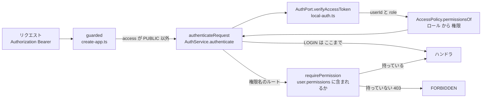

- **認証（誰か）**: `AuthPort`。ローカルの実装は、アプリ内のユーザー ID・パスワード。アクセストークン 30 分・リフレッシュトークン 7 日。ログインの失敗が、同じ接続元から 15 分間に 5 回に達すると、`RATE_LIMITED`（429）
- **認可（何ができるか）**: `AccessPolicy`（`application/auth/access-policy.ts`）。`RoleConfig`（ロール ID → 名前と権限の配列）から作る。未知のロールは権限なし。既定は、1 ロール `worker`（農作業者。全 8 権限）
- **ルートごとの宣言**: `route-table.ts` の `access`（`PUBLIC`・`LOGIN`・権限名）。`createApp` は、すべてのルートにハンドラがなければ起動時にエラーにする（認可の宣言だけが残ることを防ぐ）
- **ロール・権限の変更**: `verifyAccessToken` が、リクエストごとにユーザーを引き直し、`permissionsOf` が、設定から権限を導く。ユーザーの削除・ロールの変更は、次のリクエストから効く。画面の権限（メニュー・ボタンの表示）は、ログイン・セッション更新時の値
- **画面側**: `usePermission(permission)`、メニューの権限による絞り込み（`/settings/users` は `user:manage`）、権限のない操作の案内（`PermissionNotice`）。表示制御のみで、サーバー側の拒否が正
- **変更履歴**: 手動入力・判断基準・設備・ステータスコード・ユーザー・取り込み設定の変更は、操作の種別・対象・変更者・変更前後を記録する（`AuditService`）。ユーザーの前後は、パスワードのハッシュを含まない形（`PublicUser`）

| 権限                  | 要求するルート                                                        | 画面         |
| --------------------- | --------------------------------------------------------------------- | ------------ |
| `equipment:manage`    | `POST /equipment`・`PUT`・`DELETE /equipment/:id`                     | SC-10        |
| `ingestion:configure` | `PUT /ingestion/settings`                                             | SC-11        |
| `ingestion:run`       | `POST /ingestion/:sourceId/test`・`/run`                              | SC-11        |
| `status-code:manage`  | `POST /status-codes`・`PUT`・`DELETE /status-codes/:code`             | SC-12        |
| `manual-entry:write`  | `POST /manual-entries`・`PUT`・`DELETE /manual-entries/:id`           | SC-06・SC-07 |
| `criteria:edit`       | `PUT /viewpoints/:id/criteria`・`POST /viewpoints/:id/criteria/reset` | SC-13        |
| `user:manage`         | `/users` の 4 ルート                                                  | SC-14        |
| `audit:read`          | `GET /audit-logs`                                                     | SC-08        |

## 設定・環境変数

起動時に、`config.ts` の Zod スキーマ（`EnvSchema`）で検証する。エラーには、変数名のみを含め、値を含めない。`pnpm dev:backend` は `.env`（あれば）を読む。値のダミーは `.env.example`。

| 変数                                                            | 既定                      | 内容                                                                                                                                            |
| --------------------------------------------------------------- | ------------------------- | ----------------------------------------------------------------------------------------------------------------------------------------------- |
| `APP_MODE`                                                      | `local`                   | `local`／`test`／`production`。`production` は、`AUTH_PROVIDER=cognito` と `PERSISTENCE=dynamodb` が必須（ADR-0009）。`production` では、開発用 API は使えない                            |
| `HOST`・`PORT`                                                  | `127.0.0.1`・`8787`       | 待ち受け                                                                                                                                        |
| `PERSISTENCE`                                                   | `memory`                  | `memory`／`file`／`dynamodb`（Repository を DynamoDB にする。`DYNAMODB_OBSERVATIONS_TABLE`・`DYNAMODB_MAIN_TABLE` が必須）                                                                              |
| `DYNAMODB_OBSERVATIONS_TABLE`・`DYNAMODB_MAIN_TABLE`            | なし                      | `PERSISTENCE=dynamodb` のとき必須（なければ `ConfigError`）。DynamoDB のテーブル名（テーブルは IaC の `SfmData` が作る） |
| `DYNAMODB_ENDPOINT`・`AWS_REGION`                               | なし                      | DynamoDB の接続先（DynamoDB Local など。ローカルの確認用。指定すると、起動時にテーブルを作り、ダミーの認証情報を使う。AWS では指定しない）、リージョン（Lambda では実行環境が設定）。`PERSISTENCE=dynamodb` では、`DEV_API_ENABLED` は使えない |
| `AUTH_PROVIDER`                                                 | `local`                   | `local`（アプリ内の認証）／`cognito`（Amazon Cognito。ADR-0008）。`cognito` は、`COGNITO_USER_POOL_ID`・`COGNITO_CLIENT_ID` が必須で、`PERSISTENCE=dynamodb` が必要。`INITIAL_USER_*` とは併用できない（最初のユーザーは、`pnpm initial-user` で作る） |
| `DATA_FILE`                                                     | `.local-data/store.json`  | `file` のときの保存先                                                                                                                           |
| `FILE_SERVER_DIR`                                               | `.local-data/file-server` | ファイルサーバーのモックのルート（`<ルート>/<取り込み元>/`）                                                                                    |
| `SEED_MODE`                                                     | `NONE`                    | `NONE`／`DEMO`（デモの設備・合成データ・評価）                                                                                                  |
| `INITIAL_USER_ID`・`INITIAL_USER_NAME`・`INITIAL_USER_PASSWORD` | なし                      | 3 つそろえて指定する（一部だけは `ConfigError`）。ユーザーが 0 人のときだけ作成。パスワードは条件（8 文字以上・英大文字・英小文字・数字）を検証 |
| `ROLE_DEFINITIONS_JSON`・`INITIAL_USER_ROLE`                    | なし（1 ロール `worker`） | ロールと権限の定義、初期ユーザーのロール                                                                                                        |
| `SCHEDULER_ENABLED`・`SCHEDULER_TICK_SECONDS`                   | `false`・`30`             | スケジューラの有効化と tick の間隔（`.env.example` は `true`）                                                                                  |
| `LOG_LEVEL`                                                     | `info`                    | `debug`／`info`／`warn`／`error`                                                                                                                |
| `DEFAULT_INGESTION_INTERVAL_MINUTES`                            | `15`                      | 取得間隔の既定（5・15・30・60・360・1440）。データ活用度合いのスロットの幅にも使う                                                              |
| `STALE_AFTER_INTERVALS`                                         | `3`                       | 「データが古い」の基準（取得間隔の何倍か）                                                                                                      |
| `INGESTION_RETRY_BASE_DELAY_MS`                                 | `1000`                    | 取り込みの再試行の待ち時間の基準（E2E では 10）                                                                                                 |
| `WEB_PUSH_PUBLIC_KEY`                                           | なし                      | VAPID の公開鍵。なければ、Web Push の購読を受け付けない（503）                                                                                  |
| `SECRET_<参照名>`                                               | -                         | `SecretPort`（環境変数版）。現状、読み出す処理がない                                                                                            |

アプリケーション層の動作設定（`application/settings.ts` の `DEFAULT_APP_SETTINGS`）と、その他のコード内の定数は次のとおり。

| 設定                             | 値                                  | 場所                                        |
| -------------------------------- | ----------------------------------- | ------------------------------------------- |
| 取り込みの試行回数・再試行の待ち | 3 回、`1000 × 2^(n-1)` ミリ秒       | `settings.ts`・`ingestion-service.ts`       |
| 「遅延」の判定                   | 受信が計測より 60 分を超えて遅れた  | `observation-quality.ts`                    |
| 計測日時の未来の許容             | 5 分                                | `observation-quality.ts`・`manual-entry.ts` |
| 通知の抑制                       | 60 分                               | `notification-rules.ts`                     |
| Web Push の配信の試行回数        | 3 回                                | `settings.ts`                               |
| 連携の 1 回の件数・再試行の間隔  | 100 件、5 分の倍々、上限 720 分     | `settings.ts`・`federation-service.ts`      |
| 短期視点の対象期間               | 直近 24 時間                        | `scope-evaluator.ts`                        |
| 長期視点の期間                   | 1・7・30・60・90 日（既定 7）       | `shared/constants/status.ts`                |
| セッション                       | アクセス 30 分、リフレッシュ 7 日   | `local-auth.ts`                             |
| ログインの失敗の上限             | 5 回／15 分／接続元                 | `local-auth.ts`                             |
| リクエスト本文の上限             | 1 MiB                               | `request-parsing.ts`（`MAX_BODY_BYTES`）     |
| 一覧の件数                       | 既定 20、最大 100                   | `shared/schemas/api.ts`                     |
| 画面の読み直し                   | 10 秒（設備の階層は 60 秒）         | `use-polling.ts`・`app-state.tsx`           |
| ファイルへの書き込み             | 変更から 300 ミリ秒後にまとめて書く | `local-store.ts`                            |

# CRUDメカニズム（シーケンス図）

各図は、コードの実際の呼び出し順に沿う。participant の名前は、クラス・関数・ファイルの名前に合わせた。共通の前提は次のとおり。

- すべての `/api/v1` のリクエストは、`createApp`（`create-app.ts`）の `requestContext`（リクエスト ID・構造化ログ）→ `bodyLimit`（1 MiB）→ ルートごとの `guarded`（`route-table.ts` の `access` に従い、`authenticateRequest` と `requirePermission`）→ ハンドラの順に通る。エラーは `handleError` が共通形式（`{ error: { code, message, fields? } }`）に変換する
- ハンドラは薄く、「入力の検証（Zod）→ サービスの呼び出し → 応答」のみを行う。ドメインの規則は、アプリケーション層とドメイン層にある
- 保存はすべて Repository のポート経由（ローカルの実装は、メモリのコレクションへの書き込みと、300 ミリ秒後のファイルへのまとめ書き）
- 登録・修正・削除の後の評価（`evaluateAll`）は、失敗しても保存の結果に影響させない（`try/catch` でログに残す）。評価の中身は 4.3 に示す

## 4.1 ログイン・セッションの更新・ログアウト（UC-13）

**ログイン**（`POST /auth/login`。`PUBLIC`）

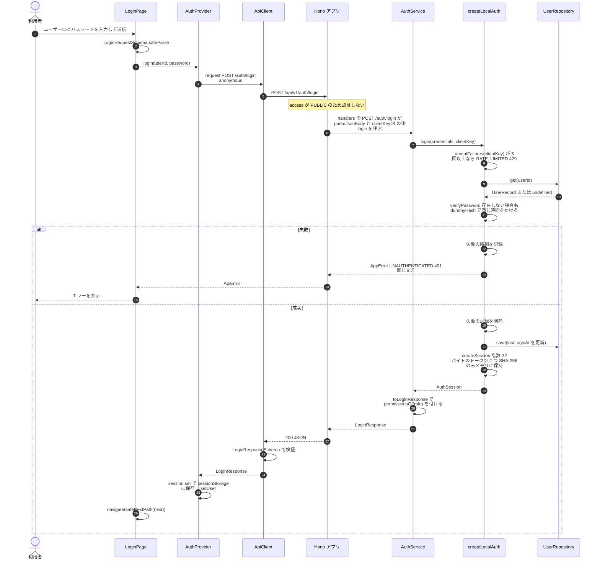

**セッションの更新とログアウト**

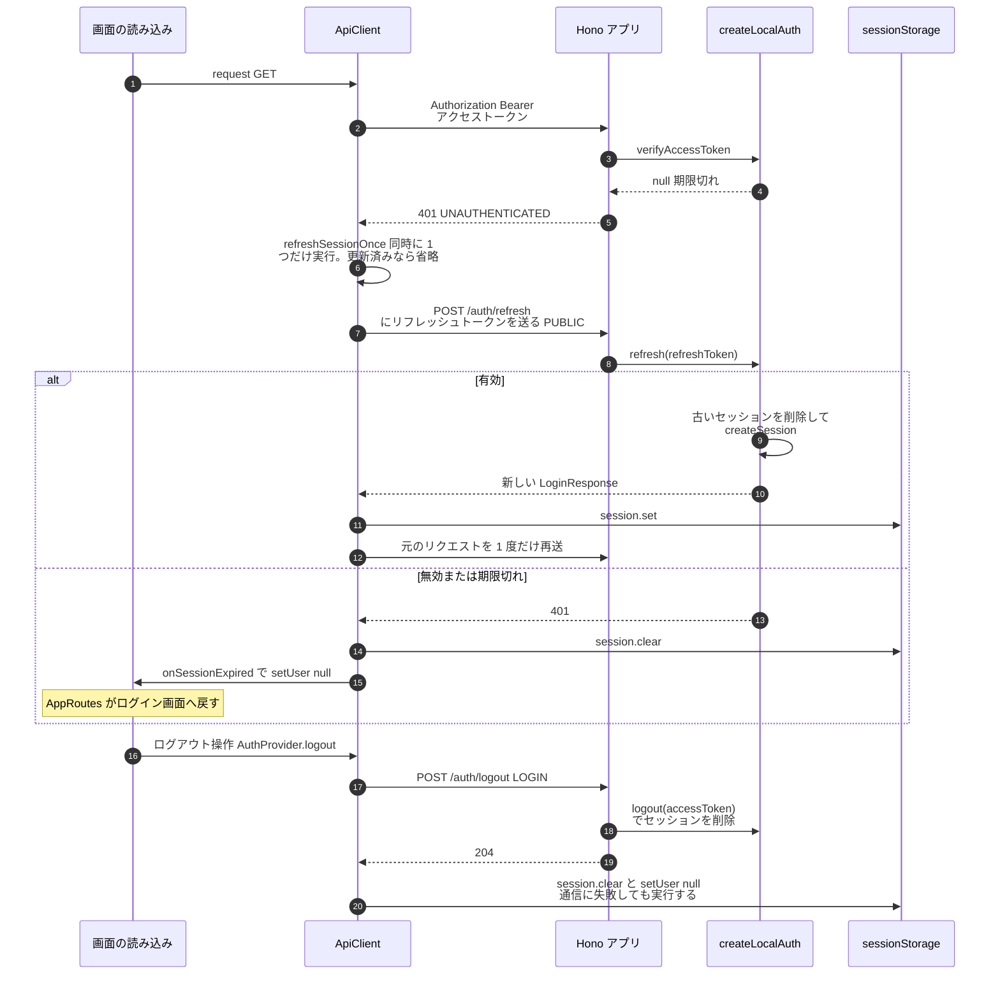

## 4.2 手動入力の登録（`POST /manual-entries`。UC-06・UC-07）

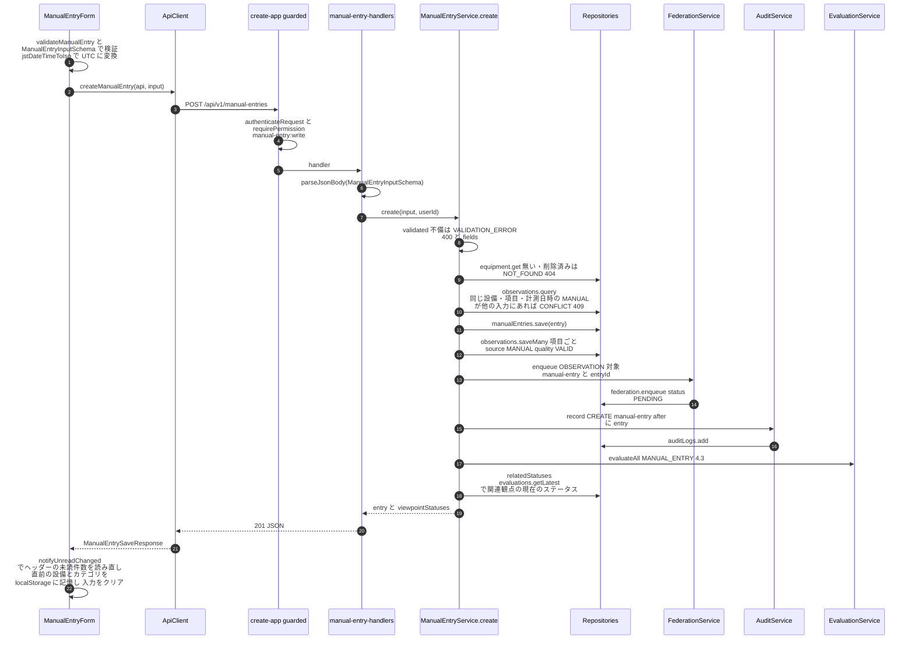

## 4.3 評価（`EvaluationService.evaluateAll`。JB-02 と、各保存の後）

手動入力・取り込み・設備・ステータスコード・判断基準の保存後と、JB-02（定期）が、同じ処理を呼ぶ。

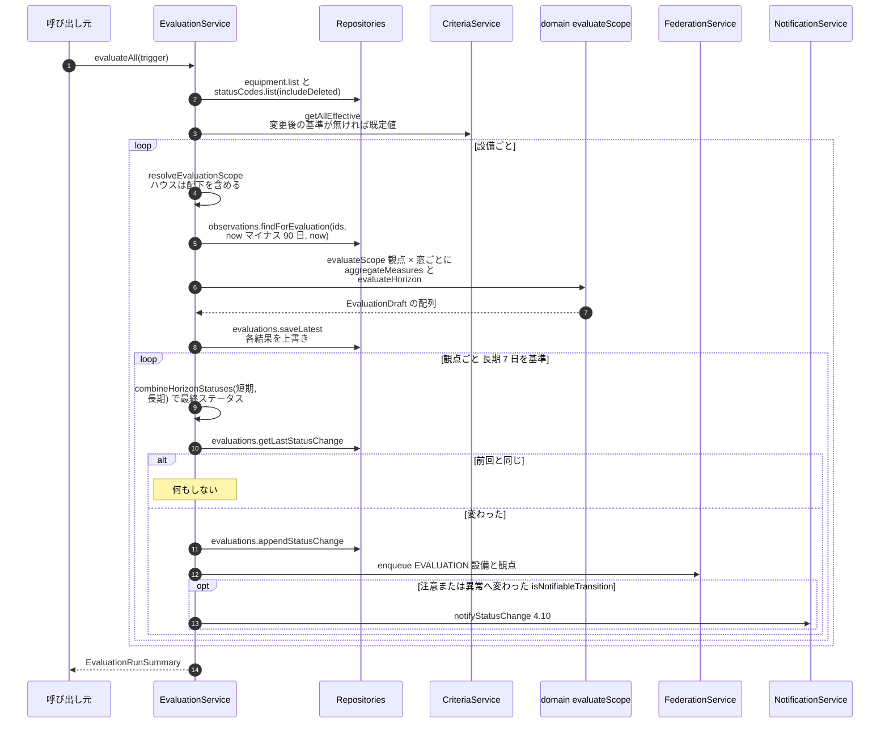

## 4.4 手動入力の修正と削除（`PUT`・`DELETE /manual-entries/:entryId`。UC-18）

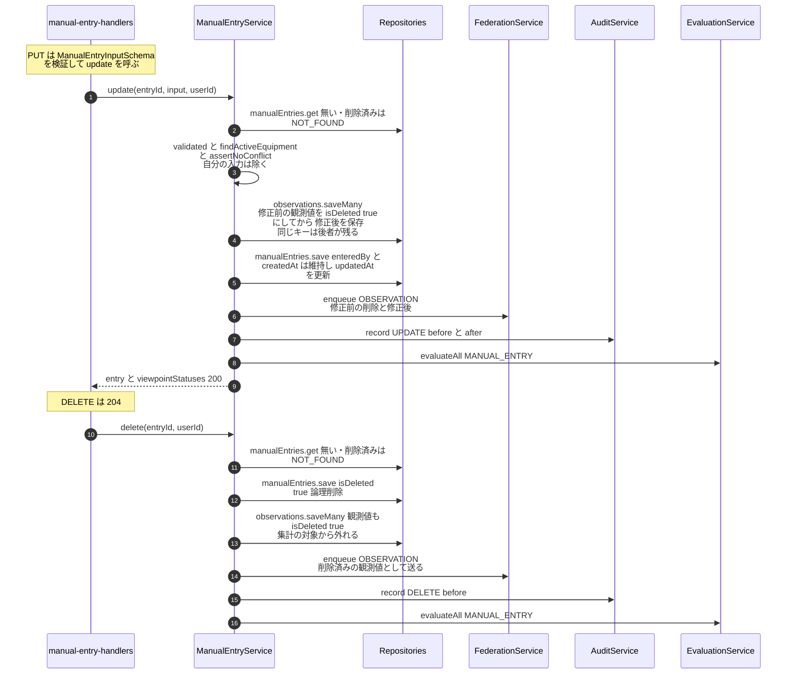

## 4.5 設備の登録・修正・削除（`/equipment`。UC-12）

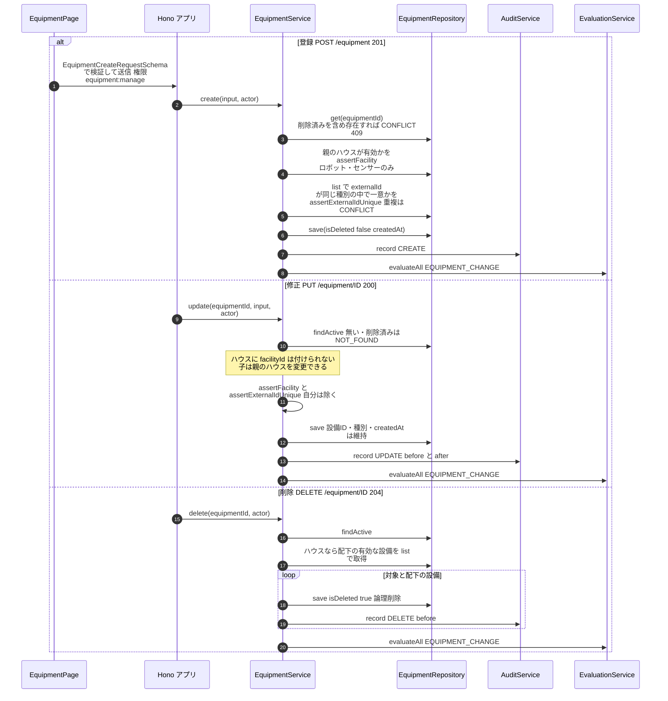

- 画面は、成功後に `reloadEquipment()` で設備の階層を読み直す。削除は確認ダイアログ（`ConfirmDialog`）を挟む
- 削除した設備の過去の観測値・評価結果は、削除されず残る。以降の評価の対象からは外れ、設備を指定するダッシュボード・観点の詳細は `NOT_FOUND` になる。設備を指定しない `GET /observations` には、削除した設備の観測値も出る（`ObservationQuery` が、設備を指定しない場合に全観測値を対象にするため）

## 4.6 ステータスコードの登録・修正・削除（`/status-codes`。UC-17）

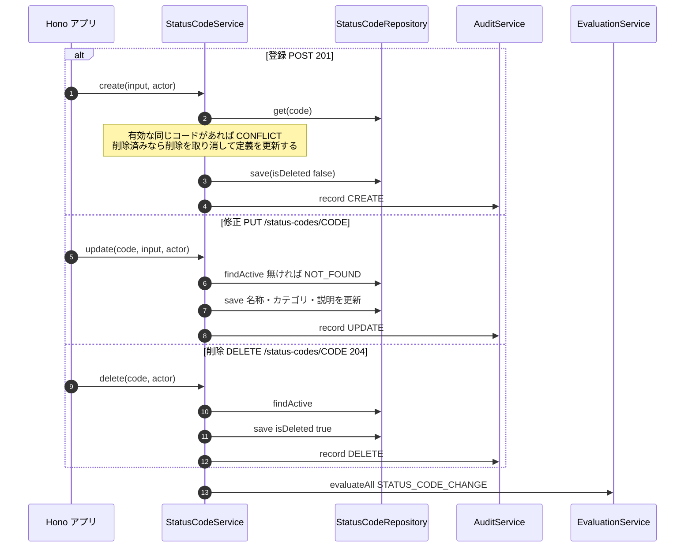

## 4.7 判断基準の編集と既定値へ戻す（`/viewpoints/:id/criteria`。UC-19）

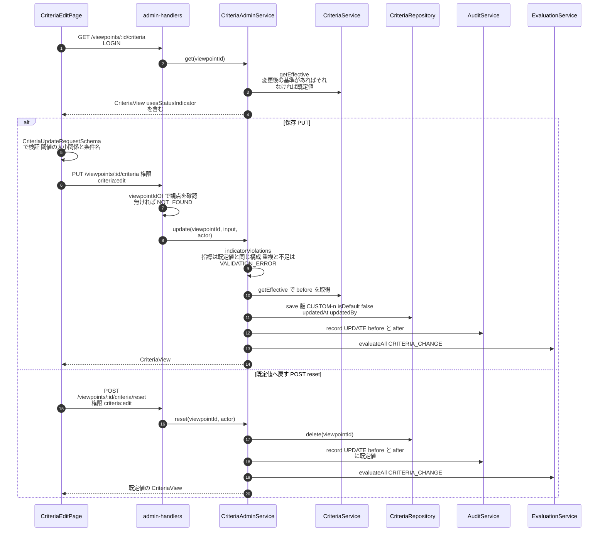

## 4.8 取り込み（JB-01。UC-08・UC-09・UC-15・UC-24）

**起動から取得まで**

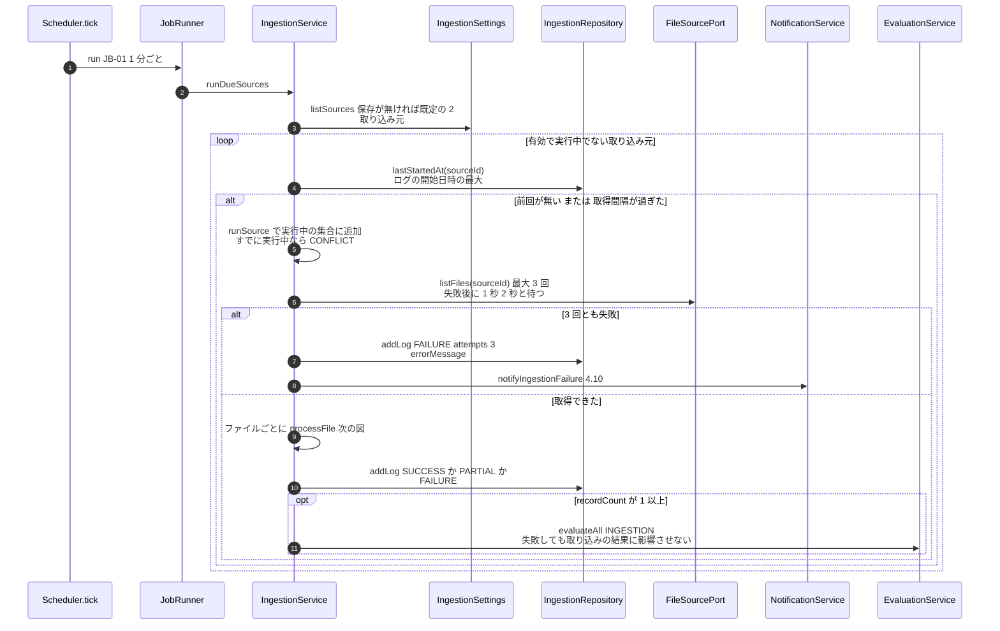

- 画面の「即時取得」（SC-11。`POST /ingestion/:sourceId/run`。`ingestion:run`）は、`IngestionService.runSource` を直接呼び、**同期して実行**し、結果の概要を 202 で返す。「接続テスト」は `testConnection`（`FileSourcePort.testConnection`）で、`{ ok, message }` を返す
- 取り込み元ごとに独立して実行する。想定外のエラーで 1 つが失敗しても、他の取り込み元は実行し、すべての実行後に最初のエラーをジョブへ伝える

**ファイルごとの処理（`processFile`）**

```mermaid
sequenceDiagram
  autonumber
  participant IS as IngestionService
  participant FSP as FileSourcePort
  participant R as Repositories
  participant FP as FormatProfile
  participant DQ as domain classifyValue
  participant FED as FederationService

  IS->>FSP: readFile(sourceId, fileId)
  alt 読めない
    IS->>IS: 失敗として数える<br>取り込み済みの記録は残さない
  else 読めた
    IS->>IS: 内容の SHA-256 を計算
    IS->>R: findIngestedFile(sourceId,<br>fileId, hash)
    alt 取り込み済み
      IS->>IS: 何もしない 件数にも数えない
    else 未取り込み
      IS->>FP: parse(content)
      alt FormatError 形式違い
        IS->>R: recordFile FAILURE<br>形式が仕様と異なる旨
      else 解釈できた
        loop 記録と項目ごと
          IS->>DQ: classifyValue(itemKey, rawValue,<br>context)
          DQ-->>IS: VALID LATE MISSING INVALID
        end
        IS->>R: observations.saveMany 取得元<br>AUTO_IMPORT と FormatProfile<br>の版つき
        IS->>R: recordFile SUCCESS recordCount<br>は VALID と LATE の数
        IS->>FED: enqueue OBSERVATION<br>取り込み元とファイルID
      end
    end
  end
```

## 4.9 連携（JB-03。UC-11）

```mermaid
sequenceDiagram
  autonumber
  participant SCH as Scheduler.tick
  participant JR as JobRunner
  participant FED as FederationService
  participant FR as FederationRepository
  participant PORT as FederationPort

  SCH->>JR: run JB-03 5 分ごと
  JR->>FED: runPending
  FED->>FR: listDue(now, 100)
  Note over FR: status が SENT 以外 かつ<br>nextAttemptAt が now 以前を<br>enqueuedAt の古い順に
  alt 該当なし
    FED-->>JR: sent 0 failed 0 held 0
  else 該当あり
    FED->>PORT: send(items) バッチ全体を 1<br>回で送る
    alt 成功
      PORT-->>FED: 完了 result SENT
    else FederationUnavailableError 停止中
      PORT-->>FED: エラー result HELD
    else その他のエラー
      PORT-->>FED: エラー result FAILED
    end
    loop 各項目
      FED->>FR: update status と updatedAt を更新<br>SENT 以外は attempts を 1 増やし<br>nextAttemptAt を倍々で後ろへ
    end
    FED->>FR: addLog result と itemCount と<br>message
    FED-->>JR: 件数の概要
  end
```

- 項目が積まれるのは、取り込み（`IngestionService`）・手動入力の登録・修正・削除（`ManualEntryService`）・観点ステータスの変化（`EvaluationService`）の保存時（`FederationService.enqueue`。`PENDING`・`attempts` 0・`nextAttemptAt` は積んだ時刻）
- 農業情報基盤が停止中（`HELD`）でも、他の処理は止まらない。復旧後は、`nextAttemptAt` が来た項目から、積んだ順に送られる（再送の間隔の計算は、「特徴的アルゴリズム説明」の連携の再送）
- 画面（SC-11）は、`GET /federation/logs` で、結果の記録（新しい順）と、連携キューの状態ごとの件数（`PENDING`・`SENT`・`FAILED`・`HELD`）を表示する

## 4.10 通知の生成と配信（UC-05・UC-10・UC-22・UC-24。JB-04）

**生成**（評価の状態変化、または取り込みの失敗から）

```mermaid
sequenceDiagram
  autonumber
  participant SRC as EvaluationService または IngestionService
  participant NS as NotificationService
  participant NR as NotificationRepository

  SRC->>NS: notifyStatusChange または<br>notifyIngestionFailure
  NS->>NS: メッセージと dedupKey を作る<br>観点と設備とステータス または<br>取り込み元
  NS->>NR: findLatestByDedupKey(dedupKey)
  NS->>NS: isWithinSuppression(最新の<br>createdAt, now, 60 分)
  alt 60 分未満
    NS-->>SRC: null 作らない
  else 60 分以上 または 初回
    NS->>NR: add 配信は IN_APP が SUCCESS<br>WEB_PUSH が PENDING attempts 0
    NS-->>SRC: Notification
  end
```

**配信（JB-04）と、画面での確認**

```mermaid
sequenceDiagram
  autonumber
  participant SCH as Scheduler.tick
  participant NS as NotificationService
  participant NR as NotificationRepository
  participant PR as PushSubscriptionRepository
  participant WP as NotifierPort
  participant UI as ヘッダーと SC-05

  SCH->>NS: JB-04 の deliverPending 1 分ごと
  NS->>NR: listUndelivered(3) WEB_PUSH が<br>PENDING または FAILURE で試行 3<br>回未満
  loop 通知ごと
    NS->>PR: listActive<br>利用者を区別せず有効な購読すべて
    loop 購読ごと
      NS->>WP: deliver(notification,<br>subscription)
      alt SUBSCRIPTION_GONE
        NS->>PR: deactivate(subscriptionId)
      else NotificationDeliveryError
        NS->>NS: failure に理由を記録
      end
    end
    NS->>NR: update WEB_PUSH を SUCCESS または<br>FAILURE にして attempts を 1<br>増やす
  end

  UI->>NS: API 経由で GET<br>/notifications/unread-count を約<br>10 秒ごと
  UI->>NS: GET /notifications<br>絞り込みとカーソル
  UI->>NS: POST /notifications/:id/read 個別<br>または POST read-all 範囲指定
  NS->>NR: markRead(notificationId, userId,<br>now) 既読は通知と利用者の組で保存
  UI->>UI: notifyUnreadChanged<br>で未読件数を読み直す
```

## 4.11 Web Push の購読（UC-23）

```mermaid
sequenceDiagram
  autonumber
  participant PG as PushSettingsPage
  participant PB as PushBrowser
  participant SW as Service Worker sw.js
  participant APP as Hono アプリ
  participant PS as PushSubscriptionService
  participant PR as PushSubscriptionRepository

  PG->>PB: currentEndpoint<br>この端末の購読の宛先
  PG->>APP: GET /push-subscription に<br>endpoint を付ける LOGIN
  APP->>PS: status(userId, endpoint)
  PS-->>PG: isAvailable と publicKey と<br>isSubscribed
  alt 有効にする
    PG->>PB: requestPermission ブラウザの確認
    PG->>PB: subscribe(publicKey)
    PB->>SW: register /sw.js と<br>pushManager.subscribe<br>applicationServerKey
    PB-->>PG: endpoint
    PG->>APP: PUT /push-subscription に<br>endpoint を送る
    APP->>PS: subscribe(userId, endpoint)
    Note over PS: publicKey が未設定なら<br>SERVICE_UNAVAILABLE 503
    PS->>PR: save subscriptionId<br>は利用者と宛先の SHA-256 isActive<br>true
  else 解除する
    PG->>PB: unsubscribe 解除した宛先
    PG->>APP: DELETE /push-subscription に<br>endpoint を送る
    APP->>PS: unsubscribe(userId, endpoint)
    PS->>PR: delete(subscriptionId)
  end
```

## 4.12 ユーザー管理と取り込み設定（UC-14・UC-15）

```mermaid
sequenceDiagram
  autonumber
  participant APP as Hono アプリ
  participant US as UserService
  participant UR as UserRepository
  participant IA as IngestionAdminService
  participant SR as IngestionSettings と SettingsRepository
  participant AU as AuditService

  alt ユーザーの登録 POST /users 201
    APP->>US: create(input, actor) 権限<br>user:manage
    US->>US: assertKnownRole<br>定義されていないロールは<br>VALIDATION_ERROR
    US->>UR: get(userId) 重複は CONFLICT 409
    US->>UR: save（パスワードは CredentialPort に預ける。<br>ローカルは scrypt のハッシュを記録に、<br>Cognito は Cognito に持つ）
    US->>AU: record CREATE after は<br>PublicUser
  else ユーザーの修正 PUT /users/ID
    APP->>US: update(userId, input, actor)
    US->>UR: get なければ NOT_FOUND
    US->>UR: save<br>パスワードは指定された場合のみ再ハッシュ
    US->>AU: record UPDATE
  else ユーザーの削除 DELETE /users/ID 204
    APP->>US: delete(userId, actor)
    US->>US: 本人なら CONFLICT 409
    US->>UR: delete
    US->>AU: record DELETE
  else 取り込み設定の更新 PUT /ingestion/settings
    APP->>IA: update(input, actor) 権限<br>ingestion:configure
    IA->>SR: listSources 経由で現在の設定を取得
    IA->>IA: sourceId の存在と重複を確認<br>connectionRef と intervalMinutes<br>と isEnabled のみ変更<br>指定のない取り込み元は残す
    IA->>SR: set ingestion.sources
    IA->>AU: record UPDATE ingestion-settings<br>before と after
  end
```

## 4.13 参照（ダッシュボードと ETag。UC-01）

```mermaid
sequenceDiagram
  autonumber
  participant PG as DashboardPage
  participant UP as usePolling
  participant API as ApiClient
  participant APP as Hono アプリ
  participant DQ as DashboardQuery
  participant REP as Repositories

  PG->>UP: fetchDashboard を 10 秒ごと<br>タブが表示中のみ
  UP->>API: request GET /dashboard に<br>equipmentId と horizon と<br>periodDays
  API->>APP: If-None-Match に前回の ETag<br>同じトークンのとき
  APP->>APP: 認証 LOGIN
  APP->>DQ: get(params) resolveEquipmentId<br>で省略時は最初のハウス
  DQ->>REP: equipment.get と listLatest と<br>latestReceivedAt
  DQ->>DQ: 観点ごとに短期と長期を合成<br>データの新しさを判定
  DQ-->>APP: DashboardResponse<br>評価はこの呼び出しでは行わない
  APP->>APP: jsonWithEtag 本文の SHA-256 を<br>ETag にする
  alt If-None-Match が一致
    APP-->>API: 304 本文なし
    API->>API: 前回の本文を使う
  else 一致しない
    APP-->>API: 200 JSON と ETag
    API->>API: ETag と本文を URL ごとに記憶
  end
  API->>API: DashboardResponseSchema で検証
  API-->>PG: DashboardResponse
```

## 4.14 スケジューラ（ジョブの起動）

```mermaid
sequenceDiagram
  autonumber
  participant T as setInterval または 開発用 API
  participant SCH as Scheduler.tick
  participant CK as ClockPort
  participant JR as JobRunner

  T->>SCH: tick SCHEDULER_TICK_SECONDS ごと<br>または POST /dev/scheduler/tick
  SCH->>SCH: 実行中なら何もしない 二重実行の防止
  loop DEFAULT_SCHEDULE の 4 ジョブ
    SCH->>CK: now
    alt 前回の実行から間隔が過ぎた または 初回
      SCH->>SCH: lastRunAt を更新
      SCH->>JR: run(jobId)<br>失敗しても他のジョブへ影響させない<br>ログに残す
    end
  end
  SCH-->>T: 実行したジョブの識別子
```

- 開発用 API の `POST /dev/jobs/:jobId/run` は、`JobRunner.run` を直接呼ぶ（間隔の判定をしない）
- 時計は `ClockPort`。E2E・結合テストでは、時計を固定し、`/dev/clock/advance` で進めて、`tick` や各ジョブを呼ぶ

# ドメインモデルごとのライフサイクル

状態は、コードの属性（`isDeleted`・`status`・`result` など）と、サービスの処理から読み取れるもの。削除は、**論理削除**（`isDeleted: true`）が基本で、物理削除は、ユーザー・Web Push の購読・変更後の判断基準のみ。

| モデル                                   | 生成                                                             | 更新                                           | 削除                                                     |
| ---------------------------------------- | ---------------------------------------------------------------- | ---------------------------------------------- | -------------------------------------------------------- |
| 設備                                     | `EquipmentService.create`                                        | `update`（名称・親・データ上の識別子）         | 論理削除（ハウスは配下も）。同じ設備 ID は再登録できない |
| 観測値                                   | 取り込み（`IngestionService`）、手動入力（`ManualEntryService`） | 同じ一意キーは上書き                           | 手動入力の観測値のみ、論理削除                           |
| 手動入力                                 | `ManualEntryService.create`                                      | `update`                                       | 論理削除（観測値も削除済みにする）                       |
| 評価結果                                 | `EvaluationService.evaluateAll`                                  | 同じキーを上書き                               | なし（設備を削除しても残る）                             |
| 観点の最終ステータス（状態変化の記録）   | 評価で変化したとき追記                                           | なし（追記のみ）                               | なし                                                     |
| 通知                                     | 評価の状態変化・取り込みの失敗                                   | 配信の状態のみ更新                             | なし（既読は利用者ごとの別レコード）                     |
| 取り込み設定                             | 既定値（保存がなければコードが返す）                             | `IngestionAdminService.update`                 | なし                                                     |
| 取り込みログ・取り込み済みファイルの記録 | 取り込みのたび                                                   | なし（追記のみ）                               | なし                                                     |
| 連携キュー                               | 取り込み・手動入力・評価の保存時                                 | 送信の結果で状態を更新                         | なし                                                     |
| ステータスコード                         | 初期データ・`StatusCodeService.create`                           | `update`                                       | 論理削除。同じコードを登録すると復活                     |
| 判断基準                                 | 既定値はコード。変更で保存                                       | `CriteriaAdminService.update`（版 `CUSTOM-n`） | `reset`（保存を物理削除し、既定値へ戻す）                |
| ユーザー                                 | 初期ユーザー・`UserService.create`                               | `update`                                       | 物理削除                                                 |
| セッション                               | ログイン                                                         | 更新（リフレッシュ）                           | ログアウト・期限切れ・再起動                             |
| Web Push の購読                          | `PushSubscriptionService.subscribe`                              | 同じ利用者と宛先は上書き                       | 解除（物理削除）、無効化（`isActive: false`）            |
| 変更履歴                                 | 各サービスの保存時                                               | なし（追記のみ）                               | なし                                                     |

## 設備（Equipment）

```mermaid
stateDiagram-v2
  [*] --> Active : POST equipment で登録
  Active --> Active : PUT equipment で名称 親のハウス データ上の識別子を修正
  Active --> Deleted : DELETE equipment で論理削除 ハウスは配下も
  Deleted --> [*]
```

- 生成: 設備 ID（一意。削除済みの ID も重複として拒否）・種別・名称・親のハウス（ロボット・センサーは必須）・データ上の識別子（任意。同じ種別の中で一意）。`createdAt` は登録時刻
- 更新: 名称・親のハウス（ロボット・センサーのみ）・データ上の識別子。設備 ID・種別は変えられない
- 削除: `isDeleted: true`。ハウスを削除すると、配下の有効なロボット・センサーも同時に削除する。**復活の操作はない**（同じ設備 ID で再登録すると CONFLICT）。削除した設備のデータ上の識別子は、別の設備で使える（重複の検査が、削除済みを除くため）
- いずれの変更も、変更履歴に記録し、評価を更新する。削除した設備の観測値・評価結果は残る

## 観測値（Observation）

```mermaid
stateDiagram-v2
  state "VALID 有効" as VALID
  state "LATE 遅延" as LATE
  state "MISSING 欠損" as MISSING
  state "INVALID 不正" as INVALID
  state "DELETED 論理削除" as DELETED

  [*] --> VALID : 取り込みまたは手動入力
  [*] --> LATE : 取り込みで受信が計測より60分を超えて遅れた
  [*] --> MISSING : 取り込みで値がない
  [*] --> INVALID : 取り込みで型 範囲 未来の日時 未定義の項目やコード
  VALID --> DELETED : 手動入力の修正または削除
  LATE --> LATE : 同じ一意キーの取り込みで上書き
  VALID --> VALID : 同じ一意キーの取り込みで上書き
```

- 取り込みの観測値は、`classifyValue`（`domain/observation-quality.ts`）が品質を決める。**評価に使うのは `VALID` と `LATE`** のみ（値があり、論理削除でないもの）。`MISSING`・`INVALID` は保存するが、評価・集計に使わない。取り込み結果の `rejectedCount` には、`MISSING`・`INVALID` を数える
- 一意キーは `設備ID#項目#計測日時#取得元`。同じキーを保存すると上書きされる（内容が変わったファイルの取り込み、手動入力の修正）
- 手動入力の観測値は、手動入力と一体で管理する（修正で、修正前の観測値を `isDeleted: true` にしてから、修正後を保存する。削除で、観測値も `isDeleted: true`）。取り込みの観測値には、修正・削除の操作がない
- 取り込み済みデータ一覧（`GET /observations`）は、論理削除でない観測値を、`INVALID`・`MISSING` も含めて表示する

## 手動入力（ManualEntry）

```mermaid
stateDiagram-v2
  [*] --> Active : POST manual-entries 項目ごとの観測値も保存
  Active --> Active : PUT manual-entries 修正前の観測値は論理削除し 修正後を保存
  Active --> Deleted : DELETE manual-entries 論理削除 観測値も論理削除
  Deleted --> [*]
```

- 生成: 1 回の入力（設備・カテゴリ・計測日時・項目の値・備考）を 1 件として保存し、項目ごとの観測値（`MANUAL`・`VALID`）、連携キューの項目、変更履歴を作る。同じ設備・項目・計測日時の手動入力が、有効な他の入力にあれば、CONFLICT
- 更新: 入力者（`enteredBy`）と作成日時は維持し、更新日時を更新する。修正で計測日時を変えると、修正前のキーの観測値は削除済みのまま残り、新しいキーの観測値を保存する
- 削除: 論理削除。一覧・修正の対象から外れ、同じ ID は `NOT_FOUND`。**復活の操作はない**。削除した入力と同じ設備・項目・計測日時の入力は、新しく登録できる（重複の検査が、論理削除の観測値を除くため）
- いずれも、変更履歴（変更前後）・連携キュー・評価の更新を伴う

## 評価結果と、観点の最終ステータス

評価結果（`EvaluationResult`）は、設備×観点×視点×期間ごとに**最新のものを上書き**し、削除しない（履歴を持たない）。観点の**最終ステータス**（短期・長期 7 日のうち「不明」を除いた悪い方）は、変化したときだけ `StatusChangeEntry` に追記する。

```mermaid
stateDiagram-v2
  state "UNKNOWN 不明" as UNKNOWN
  state "NORMAL 正常" as NORMAL
  state "CAUTION 注意" as CAUTION
  state "ERROR 異常" as ERROR

  [*] --> UNKNOWN : 設備の登録直後 評価前は評価結果なし
  UNKNOWN --> NORMAL : データがそろい 基準に収まる
  UNKNOWN --> CAUTION : データがそろい 注意の範囲 通知する
  UNKNOWN --> ERROR : データがそろい 異常の範囲 通知する
  NORMAL --> CAUTION : 指標が注意の範囲へ 通知する
  CAUTION --> ERROR : 指標が異常の範囲へ 通知する
  ERROR --> CAUTION : 異常から注意へ 通知する
  CAUTION --> NORMAL : 基準に戻る 通知しない
  ERROR --> NORMAL : 基準に戻る 通知しない
  NORMAL --> UNKNOWN : 必要なデータが足りない 通知しない
  CAUTION --> UNKNOWN : 必要なデータが足りない 通知しない
  ERROR --> UNKNOWN : 必要なデータが足りない 通知しない
```

- 状態の変化を起こす契機: 取り込み・手動入力・設備・ステータスコード・判断基準の変更、定期の評価（時間の経過で、期間内のデータが減る・途絶える）、判断基準の編集
- 最初の評価（前回の記録がない）では、結果が「不明」でも、`StatusChangeEntry` に追記し、連携キューに積む。通知の対象は、「注意」「異常」へ**変わった**とき（前回と同じ状態が続く間は、何もしない）
- 判断基準を変更しても、過去の評価結果は再計算しない（現在の評価のみ更新する）。結果には、判定に使った版（`criteriaVersion`）と、変更後の基準による判定か（`isCustomCriteria`）を残す

## 通知（Notification）と既読

```mermaid
stateDiagram-v2
  state "PENDING 配信待ち attempts 0" as PENDING
  state "SUCCESS 配信済み" as SUCCESS
  state "FAILURE 失敗 attempts が 1 または 2" as FAILURE
  state "FAILURE 失敗 attempts が 3 で再送しない" as GAVEUP

  [*] --> PENDING : 通知の作成 画面内の配信は作成時に SUCCESS
  PENDING --> SUCCESS : JB-04 の deliverPending で失敗なし 購読が無い場合も
  PENDING --> FAILURE : JB-04 で配信に失敗
  FAILURE --> SUCCESS : 再送に成功
  FAILURE --> FAILURE : 再送に失敗 attempts が 3 未満
  FAILURE --> GAVEUP : 再送に失敗し attempts が 3 に達する
```

上は、通知の **Web Push の配信状態**（`deliveries` の `WEB_PUSH`）。画面内の配信（`IN_APP`）は、作成時に `SUCCESS`（試行 1）で固定。

```mermaid
stateDiagram-v2
  [*] --> Unread : 通知の作成 全利用者に未読
  Unread --> Read : 利用者が既読にする 個別 一括 通知から画面へ移る
```

- 既読は、**利用者ごと**（`NotificationRead` が通知×利用者の組を持つ）。ある利用者が既読にしても、他の利用者の未読は変わらない。未読に戻す操作はない
- 通知は削除されない。作成は、重複抑制（同じ `dedupKey` の最新の通知から 60 分未満は作らない）を通った場合のみ
- Web Push は、利用者を区別せず、有効な購読すべてへ配信する。購読が無効（`SUBSCRIPTION_GONE`）と返ると、その購読を無効にする

## 取り込み設定・取り込みログ・取り込み済みファイル（UC-15・UC-16）

```mermaid
stateDiagram-v2
  [*] --> Enabled : 既定の 2 取り込み元 isEnabled true
  Enabled --> Disabled : PUT ingestion settings で無効にする
  Disabled --> Enabled : PUT ingestion settings で有効にする
  Enabled --> Enabled : PUT ingestion settings で接続先の参照名と取得間隔を変更
```

- 取り込み元の設定は、保存がなければコードの既定（`robot`・`environment-sensor`。取得間隔 15 分）を返す。更新すると、`settings` コレクションのキー `ingestion.sources` に保存し、変更履歴を残す。取り込み元の追加・削除の操作はない
- 実行中かどうかは、メモリ上の集合（`running`）のみで持つ。二重実行は CONFLICT。サーバーを再起動すると消える

```mermaid
stateDiagram-v2
  state "Discovered 一覧に現れた" as Discovered
  state "Skipped 取り込み済み" as Skipped
  state "ReadFailed 読めない" as ReadFailed
  state "ParseFailed 形式違い FAILURE を記録" as ParseFailed
  state "Imported 取り込み済み SUCCESS を記録" as Imported

  [*] --> Discovered : listFiles
  Discovered --> ReadFailed : readFile が失敗 記録せず次回また対象
  Discovered --> Skipped : 識別子とハッシュ または 内容のハッシュが同じ記録がある
  Discovered --> ParseFailed : FormatError
  Discovered --> Imported : 解釈と保存に成功
```

- 取り込み済みファイルの記録（`IngestedFileRecord`）と取り込みログ（`IngestionLog`）は、**追記のみ**で、更新・削除しない
- 取り込みログの結果: 処理したファイルがない（すべて取り込み済みの場合を含む）、または、失敗したファイルも不正な値もなければ `SUCCESS`、一部だけ失敗（または不正な値）があり、取り込めた件数が 1 件以上なら `PARTIAL`、取り込めた件数が 0 なら `FAILURE`。一覧の取得に失敗した場合は `FAILURE`（`attempts` は試行回数）

## 連携キュー（FederationItem）

```mermaid
stateDiagram-v2
  state "PENDING 待機" as PENDING
  state "SENT 送信済み" as SENT
  state "HELD 保留 農業情報基盤が停止中" as HELD
  state "FAILED 失敗 相手が受け付けない" as FAILED

  [*] --> PENDING : 取り込み 手動入力 観点ステータスの変化で積む
  PENDING --> SENT : JB-03 で送信に成功
  PENDING --> HELD : JB-03 で停止中
  PENDING --> FAILED : JB-03 で受け付けられない
  HELD --> SENT : nextAttemptAt が来て送信に成功
  FAILED --> SENT : nextAttemptAt が来て送信に成功
  HELD --> HELD : 再び停止中 attempts を増やし間隔を広げる
  FAILED --> FAILED : 再び失敗 attempts を増やし間隔を広げる
  HELD --> FAILED : 再試行で別の理由で失敗
  FAILED --> HELD : 再試行で停止中
  SENT --> [*]
```

- 項目は削除されない。`SENT` 以外は、`nextAttemptAt` が来るたびに再び送信の対象になる（試行回数の上限はない）
- 結果は、送信のたびに連携の記録（`FederationLogEntry`。成功・失敗・保留、件数、メッセージ）として、追記のみで残る

## ステータスコード（StatusCodeDefinition）

```mermaid
stateDiagram-v2
  [*] --> Active : 初期データ 8 件 または POST status-codes
  Active --> Active : PUT status-codes で名称 説明 カテゴリを更新
  Active --> Deleted : DELETE status-codes で論理削除
  Deleted --> Active : 同じコード値を POST status-codes で再登録 削除を取り消して更新
```

- 初期データ（`STANDBY`・`RUNNING`・`HARVESTING`・`STOPPED`・`LOW_BATTERY`・`RUNNING_ERROR`・`HARVEST_ERROR`・`FALLEN`）は、定義が 1 件もないときだけ投入する（冪等）
- 削除したコードの観測値は、以降の評価・取り込みで「未定義のステータスコード」（`INVALID`）として扱われる（保存済みの品質は変わらない）。変更はすぐに全設備を再評価する

## 判断基準（ViewpointCriteria）

```mermaid
stateDiagram-v2
  state "DEFAULT 既定値 コードで持つ" as DefaultCriteria
  state "CUSTOM-n 変更後 保存する" as CustomCriteria

  [*] --> DefaultCriteria : 観点ごとに初めから
  DefaultCriteria --> CustomCriteria : PUT criteria で保存 版は CUSTOM-1
  CustomCriteria --> CustomCriteria : PUT criteria で再保存 版の番号を 1 増やす
  CustomCriteria --> DefaultCriteria : POST criteria reset で保存を削除
```

- 観点ごとに、変更後の値を 1 件だけ持つ。保存は、指標の構成が既定値と同じ（追加・削除・重複なし）場合のみ。ステータスコードで判定する指標は、編集の対象外
- 既定値へ戻した後に、再び保存すると、版は `CUSTOM-1` から再び始まる（課題 I-13）。変更履歴には、リセットも `UPDATE` として残る
- 変更後は、すぐに全設備を再評価する。過去の評価結果は、再計算しない

## ユーザーとセッション

```mermaid
stateDiagram-v2
  [*] --> Active : 初期ユーザー または POST users
  Active --> Active : PUT users でユーザー名 ロール パスワードを更新
  Active --> Active : ログインで最終ログイン日時を更新
  Active --> Deleted : DELETE users 物理削除 本人は削除できない
  Deleted --> [*]
```

```mermaid
stateDiagram-v2
  state "AccessValid アクセストークン有効 30分" as AccessValid
  state "AccessExpired アクセストークン期限切れ" as AccessExpired

  [*] --> AccessValid : ログイン成功
  AccessValid --> AccessExpired : 30分経過
  AccessExpired --> AccessValid : リフレッシュ 古いトークンは使えなくなる 新しい 7日のリフレッシュトークン
  AccessValid --> [*] : ログアウト
  AccessExpired --> [*] : リフレッシュトークンが 7日を過ぎる または 無効 または ログアウト
  AccessValid --> [*] : サーバーの再起動 メモリのみ
```

- ユーザーは、初期ユーザー（ユーザーが 0 人のときだけ環境変数から作成）か、ユーザー管理で作る。パスワードは scrypt のハッシュのみ保存する。削除は物理削除で、変更履歴に残る
- セッションは、メモリのみ。ユーザーを削除すると、次のリクエストから 401（トークンはメモリに残る。課題 I-03）。ロールの変更は、次のリクエストから反映される

## Web Push の購読（PushSubscriptionRecord）

```mermaid
stateDiagram-v2
  state "Active 有効" as Active
  state "Inactive 無効" as Inactive

  [*] --> Active : PUT push-subscription
  Active --> Active : 同じ利用者と宛先の再登録で上書き
  Active --> Inactive : 配信で SUBSCRIPTION_GONE
  Inactive --> Active : 同じ利用者と宛先で再登録
  Active --> Deleted : DELETE push-subscription
  Inactive --> Deleted : DELETE push-subscription
  Deleted --> [*]
```

- 購読の識別子は、利用者と宛先から決まる（`sub-` ＋ SHA-256 の先頭 24 桁）。公開鍵（`WEB_PUSH_PUBLIC_KEY`）が未設定の環境では、登録できない（503）
- ユーザーを削除しても、その購読は削除されない（課題 I-02）

## 変更履歴（AuditLogEntry）

```mermaid
stateDiagram-v2
  [*] --> Recorded : 手動入力 判断基準 設備 ステータスコード ユーザー 取り込み設定の変更時に追記
  Recorded --> [*]
```

- `AuditService.record` が、操作の種別（`CREATE`・`UPDATE`・`DELETE`）・対象・変更者・変更前後を追記する。更新・削除の操作はない。参照は `GET /audit-logs`（`audit:read`）で、操作種別・変更者・対象の種類・期間で絞り込み、新しい順（または古い順）に返す
- 記録しない操作: ログイン・ログアウト、取り込みの実行、通知の既読、Web Push の購読、手動入力以外の観測値の変更

# 特徴的アルゴリズム説明

コードを読んで確かめた、実際の計算・判定の規則。数値の根拠（Q-番号・暫定仕様）は [dev_spec.md](../functions/dev_spec.md) 4章にある。

## 1. 評価エンジン

評価は、**外部に依存しない純粋関数**（`domain/evaluation/`）で、「集計済みの入力＋判断基準 → ステータス・メトリクス・診断メッセージ・推奨アクション」を計算する。観測値の読み出しと保存は、アプリケーション層（`EvaluationService`）が行う。

### 1.1 全体の流れ

```mermaid
flowchart TB
  A["EvaluationService.evaluateEquipment<br>設備ごと"] --> B["resolveEvaluationScope<br>評価の単位 ハウスは配下を含める"]
  B --> C["observations.findForEvaluation<br>直近90日の観測値"]
  C --> D["evaluateScope<br>観点 × 窓"]
  D --> E["aggregateMeasures<br>観測値から入力値へ集計"]
  E --> F["evaluateHorizon<br>メトリクス算出 と 判定"]
  F --> G["EvaluationDraft"]
  G --> H["evaluations.saveLatest<br>最新を上書き"]
  H --> I["combineHorizonStatuses<br>短期と長期7日の合成"]
  I --> J{"前回の最終ステータスと違う"}
  J -->|"はい"| K["状態変化の追記 と 連携キュー<br>注意か異常なら通知"]
  J -->|"いいえ"| L["何もしない"]
```

### 1.2 窓（視点と期間）

`evaluateScope`（`scope-evaluator.ts`）は、観点ごとに、次の窓を作る。`now` は評価時刻。

| 視点            | 期間                                  | 窓の開始               | 作る条件                      |
| --------------- | ------------------------------------- | ---------------------- | ----------------------------- |
| 短期（`SHORT`） | 直近 24 時間（`SHORT_HORIZON_HOURS`） | `now − 24 時間`        | 観点の `hasShortHorizon` が真 |
| 長期（`LONG`）  | 1・7・30・60・90 日                   | `now − 期間 × 24 時間` | すべての観点                  |

短期評価を持たない観点は、コスト効率・データ活用度合い・耐久性・満足度の 4 つ（暫定仕様）。

### 1.3 集計（観測値 → 入力値）

`aggregateMeasures`（`measures.ts`）。擬似コード:

```text
usable   = 観測値のうち 論理削除でない
                       かつ 値が null でない
                       かつ 品質が VALID または LATE
                       かつ from <= 計測日時 <= to
                       かつ 受信日時 <= knownAt            （既定は to。推移では現在時刻）
preferred = usable から、同じ 設備#項目#計測日時 に手動入力がある 自動取り込みの観測値 を除く
項目ごとにグループ化 (itemKey)
for 項目 in グループ:
    定義 = 項目カタログ[itemKey]
    if 定義.aggregation == STATUS: continue
    数値の点 = 値が数値の点
    最新 = 計測日時が最大の点（同時刻なら後に現れた点）
    if 定義.aggregation == LEVEL and 視点 == SHORT:   値 = 最新.値
    elif 定義.aggregation == TOTAL:                    値 = 合計
    else (LEVEL かつ LONG):                            値 = 平均
    values[itemKey] = round6(値)
if 視点 == LONG and usable が空でない:  values に データ活用度合いの入力 を加える（6.）
status = resolveStatus(...)                              （1.5 の「ステータスコード」）
```

- **未取得の項目は、結果に含めない**（0 で代用しない）。後段で「不明」になる
- 数値は、小数第 6 位に丸める（`normalizeMetric`。`roundTo(value + Number.EPSILON, 6)`）。90% ちょうどのような境界が、浮動小数点の誤差で外れないようにするため
- 集計の種類: `TOTAL`（期間内の発生量の合計。短期・長期とも）、`LEVEL`（状態値。短期は最新、長期は平均）、`STATUS`（ステータスコード）

**ステータスコードの集計**（`resolveStatus`）: 値が文字列で、定義があり、論理削除でないものだけを対象にする。短期は、最新の点のコード。長期は、期間内で**最も悪いカテゴリ**（異常 > 注意 > 正常）の点のうち、最新のもの。

### 1.4 メトリクスの算出式

`domain/evaluation/viewpoints/`（`helpers.ts` の共通式と、観点ごとの `computeMetrics`）。分母が 0 のとき、または必要な入力が 1 つでも欠けているときは `null`（「不明」の入力）。

| メトリクス                                | 式                                                                                      |
| ----------------------------------------- | --------------------------------------------------------------------------------------- |
| 可販果率（%）                             | `100 − (果実損傷数 + 誤収穫数) ÷ 収穫数 × 100`                                          |
| 認識精度（%）                             | `100 − 取り残し数 ÷ (収穫数 + 取り残し数) × 100`                                        |
| 取り残し率（%）                           | `取り残し数 ÷ (収穫数 + 取り残し数) × 100`                                              |
| 果実損傷率（%）                           | `果実損傷数 ÷ 収穫数 × 100`                                                             |
| 平均処理時間（秒/果実）                   | `収穫稼働時間 × 3600 ÷ 収穫数`                                                          |
| 走行停止率（%）                           | `走行停止時間 ÷ 収穫稼働時間 × 100`                                                     |
| 操作エラー率（%）                         | `操作エラー数 ÷ 操作ステップ数 × 100`。ステップ数が 0 なら 0                            |
| MTTR（時間）                              | `復旧に要した時間（分）÷ 60 ÷ 故障回数`。故障回数が 0 なら 0                            |
| MTBF（時間）                              | `稼働時間 ÷ 故障回数`。故障回数が 0 なら稼働時間                                        |
| 稼働率（%）                               | `MTBF ÷ (MTBF + MTTR) × 100`                                                            |
| 収穫速度（個/時間）                       | `収穫数 ÷ 収穫稼働時間`                                                                 |
| 運用コスト（円）                          | `(ロボットコスト + 人件費)（円/時間）× 稼働時間 + メンテナンス費 + 電気代`              |
| 経済生産性                                | `(可販果率 ÷ 100 × 収穫速度 × 稼働率 ÷ 100) ÷ 運用コスト`（運用コストが 0 なら `null`） |
| 緊急停止頻度・ヒヤリハット頻度（回/時間） | `回数 ÷ 稼働時間`                                                                       |
| データ連携率（%）                         | `(ロボット + センサー + 手動入力の取得数) ÷ 全データ数 × 100`（6.）                     |
| 総合満足度                                | 9 観点のスター評価の平均を小数第 1 位に丸めた値（9 観点すべてが必要）                   |
| 環境（温度・湿度・照度・CO2）             | 算出なし。集計した値をそのまま使う                                                      |

コスト効率では、稼働時間が 0 のとき MTBF を `null` にする。

### 1.5 判定（`evaluateHorizon`）

```text
metrics = 定義.computeMetrics(values)
不足 = 定義.requiredInputs のうち 未取得のもの          （ステータスコードは status が null のとき未取得）
if 不足がある:  return UNKNOWN（理由: 未取得の項目）

for 指標 in 定義.judgedIndicators:
    基準 = criteria から 指標に一致する条件
    値   = metrics[指標]
    if 基準がない:                 未設定として記録、指標の判定は UNKNOWN
    elif 値が null:
        if 部分判定を許さない観点:  算出不能として記録
        指標の判定は UNKNOWN
    else: s = judgeByCriterion(基準, 値);  判定の一覧に s を追加
if 定義.usesStatusIndicator and status が null でない:
    判定の一覧に status.category を追加

if 未設定がある:   return UNKNOWN（理由: 判断基準が未設定の指標）
if 算出不能がある: return UNKNOWN（理由: 算出できない指標）
最悪 = 判定の一覧のうち最も悪いもの（異常 > 注意 > 正常）
if 判定の一覧が空: return UNKNOWN（理由: 観測値が 1 つも取得できていません）
return 最悪
```

閾値の判定（`judgeByCriterion`。境界は「以上」「未満」）:

| 種別                              | 異常                                       | 注意                         | 正常                             |
| --------------------------------- | ------------------------------------------ | ---------------------------- | -------------------------------- |
| 上限型（`UPPER`。大きいほど悪い） | `値 ≥ errorFrom`                           | `値 ≥ cautionFrom`           | それ以外                         |
| 下限型（`LOWER`。小さいほど悪い） | `値 < errorBelow`                          | `値 < cautionBelow`          | それ以外                         |
| 範囲型（`RANGE`）                 | `値 < errorLower` または `値 ≥ errorUpper` | 正常の範囲の外（異常でない） | `normalLower ≤ 値 < normalUpper` |

- **複数の指標は、最も悪い判定を最終ステータスとする**。ステータスコードのカテゴリも、判定の 1 つに加わる（収穫速度・メンテナンス性・耐久性）
- **環境適応性は、一部の指標だけ取得できていれば、取得できた指標だけで判定する**（`allowsPartialJudgement`。必須の入力がない）。1 つも取得できなければ「不明」
- 診断メッセージは `観点名: 正常。可販果率 95.0%（正常）、…` の形で、指標ごとの値と判定を並べる。変更した基準による判定には、`カスタムの判断基準による判定です` を付ける。「不明」は `観点名: データ不足のため評価できません。<理由>`
- 推奨アクションは、正常＝「現在の状態を維持し、引き続き推移を確認してください」、注意＝「確認が望ましい状態です。」＋観点の文、異常＝「対応が必要な状態です。」＋観点の文、不明＝「データの取得・入力を確認してください（取り込みの状況、手動入力）」

### 1.6 短期と長期の合成、「不明」の扱い

```text
combineHorizonStatuses(短期, 長期):
    判定済み = [短期, 長期] のうち、null でなく UNKNOWN でないもの
    return 判定済みのうち最も悪いもの。判定済みが空なら UNKNOWN
```

- 「不明」は比較に使わない。片方が「不明」なら、もう片方を採る。両方が「不明」（短期評価を持たない観点は長期のみ）なら「不明」
- **通知・連携・状態変化の基準**は、短期と、**長期 7 日**（`DEFAULT_PERIOD_DAYS`）の合成。ダッシュボードのカードの最終ステータスは、短期と、**選んだ期間**の長期の合成（`DashboardQuery`）。期間を 7 日以外にすると、カードのステータスは、通知の基準と異なりうる
- 評価結果がまだ保存されていない観点（設備の登録直後など）は、ダッシュボード・詳細で「不明」（診断メッセージ: `評価がまだ行われていません`）
- 「不明」への変化は、通知しない（暫定仕様）が、状態変化の記録と連携キューには積む

### 1.7 判断基準の検証（保存前）

`CriterionSchema`（`shared/schemas/criteria.ts`）と `indicatorViolations`（`criteria-admin-service.ts`）。

- 上限型: `cautionFrom < errorFrom`。下限型: `errorBelow < cautionBelow`。範囲型: `errorLower < normalLower < normalUpper < errorUpper`
- 閾値は数値、条件名は 1〜200 文字、条件は 1〜20 件
- 指標は、観点の既定値と同じ構成（追加・削除・重複は不可）。画面と API で同じ検証を使う

## 2. データ品質（INVALID・MISSING・LATE）

`classifyValue`（`domain/observation-quality.ts`）。判定は、次の順に行い、最初に当てはまったものを採る。

```text
項目 = 項目カタログ[itemKey]
遅れ（分）= (受信日時 − 計測日時) ÷ 60,000

if 項目がない:                                  INVALID（未定義の項目）
if 遅れ < −5:                                   INVALID（計測日時が未来）    ← 欠損の判定より先
if 値が null または undefined:                  MISSING
if 値が型・範囲に合わない:                       INVALID                      （整数・数値・最小・最大。文字列は空でない）
if 項目が statusCode で、コードが未定義または論理削除: INVALID（未定義のステータスコード）
if 遅れ > 60:                                   LATE
else:                                           VALID
```

- 取り込み（`IngestionService.toObservations`）では、**値のない項目も観測値として保存する**。`MISSING` は `value: null`、`INVALID` は、数値・文字列なら元の値を保持したまま `INVALID` で保存する。`rejectedCount` に数えるのは、`MISSING`・`INVALID`・項目カタログにない項目・設備に対応づけられない記録・計測日時が読めない記録
- 評価・集計に使うのは `VALID` と `LATE` のみ（`LATE` は使う）。取り込みログの `recordCount` も、この 2 つの数
- 手動入力は、`validateManualEntry`（`shared/schemas/manual-entry.ts`）で検証し、品質は常に `VALID`。計測日時が、現在から 5 分を超える未来なら拒否

## 3. 通知の生成と抑制（60 分）

```text
isNotifiableTransition(前, 次) = (次 が CAUTION または ERROR) and (前 != 次)       ※ 前が null も含む

dedupKey（状態変化）   = "STATUS_CHANGE#" + 観点ID + "#" + 設備ID + "#" + ステータス
dedupKey（取り込み失敗）= "INGESTION_FAILURE#" + 取り込み元ID

isWithinSuppression(直近の同じキーの通知の作成日時, now, 60分) = (now − 作成日時) < 60分
```

- 作る条件は、**最終ステータスが「注意」「異常」へ変わったとき**（前回と同じ状態が続く間は、評価側で何もしない）。「不明」には通知しない
- 抑制は、**同じキーの直近の通知から 60 分未満**なら、作らない（ちょうど 60 分で、作れる）。キーに**ステータスが含まれる**ため、「注意」の通知の直後に「異常」へ変わると、別のキーとして通知される。「正常 → 注意 → 正常 → 注意」と 60 分以内に繰り返したときの 2 回目は、抑制される
- 取り込み失敗の通知は、取り込み元ごとに 1 つのキー。取り込みが間隔ごとに失敗し続けても、60 分に 1 回まで
- 通知には、ステータス・観点名・設備名・診断メッセージ（または取り込み元の表示名と理由）を含める。`【異常】収穫精度（ハウス1）: …`、`【データ取得失敗】ロボットデータ: …`
- 配信: 画面内は作成と同時に `SUCCESS`。Web Push は、JB-04 が `PENDING`・試行 3 回未満の `FAILURE` の通知を、有効な購読すべてへ配信する。配信の失敗が、評価・取り込み・画面内の通知に影響しない

## 4. 取り込みの重複判定・再試行

**重複の判定**（`findIngestedFile`。`local/repositories/ingestion-repositories.ts`）: 同じ取り込み元で、**内容のハッシュ（SHA-256）が同じ**記録のうち、「ファイルの識別子が同じ」**または**「記録の結果が成功」のものがあれば、取り込まない。

| ケース                                       | 記録の有無                 | 結果                                                             |
| -------------------------------------------- | -------------------------- | ---------------------------------------------------------------- |
| 同じファイル・同じ内容                       | あり（成功または失敗）     | 取り込まない                                                     |
| 同じファイル・内容が変わった                 | ハッシュが違うため、なし   | 新しい版として取り込む。同じ一意キーの観測値は上書き             |
| 名前が違う・同じ内容（前回が成功）           | あり（成功）               | 取り込まない                                                     |
| 名前が違う・同じ内容（前回が形式違いで失敗） | 識別子が違い、成功でもない | 重複とは判定せず、処理する（同じ内容のため、再び形式違いになる） |
| 読み取りに失敗（`readFile`）                 | 記録しない                 | 次回の取り込みで、また対象になる                                 |

**再試行**（`listFilesWithRetry`）: 一覧の取得を、最大 `maxAttempts`（3）回試す。失敗後の待ち時間は `retryBaseDelayMs × 2^(試行回数 − 1)`（既定 1 秒、2 秒。3 回目の失敗の後は待たない）。待ちは `ClockPort.sleep`（固定した時計では、待たずに時刻だけを進める）。3 回とも失敗したら、ログに `FAILURE`（`attempts` 3）を残し、取り込み失敗を通知する。

**取り込みの実行判定**（`runDueSources`）: `now − 直近の開始日時 ≥ 取得間隔`、または、これまでに実行がなければ実行する。取り込みログの追加が、「実行した」記録を兼ねる。

**対応づけ**: ファイルの設備の識別子（`externalId`）を、種別（ロボット／センサー）が同じ有効な設備の `externalId` に対応づける。対応する設備がない記録は、拒否として数える。

**FormatProfile の解釈**: JSON は、`recordsPath` の配列と `equipmentIdPath` の設備識別子、記録ごとの `timestampField`。CSV は、見出し行・区切り文字・設備列・時刻列。構造が仕様と異なるファイル全体は `FormatError`、読み取れない行・記録は拒否の件数に数える。

## 5. 連携の再送（倍々・上限 12 時間）

送信の結果が `SENT` 以外のとき、項目ごとに次の送信の時刻を、次のように決める（`nextAttemptAfter`）。

```text
attempts = 前回までの attempts + 1                    （送信に失敗した回数）
遅延（分）= min(retryMaxDelayMinutes, retryBaseDelayMinutes × 2^(attempts − 1))
          = min(720, 5 × 2^(attempts − 1))
nextAttemptAt = now + 遅延
```

| 失敗の回数               | 1   | 2   | 3   | 4   | 5   | 6   | 7   | 8   | 9 以降         |
| ------------------------ | --- | --- | --- | --- | --- | --- | --- | --- | -------------- |
| 次の送信までの間隔（分） | 5   | 10  | 20  | 40  | 80  | 160 | 320 | 640 | 720（12 時間） |

- 送信の対象は、`status != SENT` かつ `nextAttemptAt ≤ now` の項目を、積んだ順に最大 100 件。**バッチ全体が 1 つの結果**（成功・保留・失敗）を共有する
- 保留（`HELD`）と失敗（`FAILED`）は、同じ間隔で、回数の上限なしに再試行する。成功した項目は、`SENT` になり、`nextAttemptAt` は変わらない
- JB-03 は 5 分ごとに起動するため、実際の送信は、間隔が来た後の最初の起動

## 6. データ活用度合いのスロット計算

「全データ数」は、要件に定義がなく、暫定仕様（dev_spec.md 4章）。長期視点の集計の中で、`computeCoverage`（`measures.ts`）が計算する。

```text
入力: usable な観測値、窓 [from, to]、取り込み間隔 スロット幅 = coverageSlotMinutes（既定 15 分）、
      期待するデータの入口 expectedStreams = { ロボット: 評価の単位の配下にロボットがある, センサー: 同様 }

最初の時刻 = usable の計測日時の最小
開始       = max(from, 最初の時刻)                             ← データの取得が始まってから数える
期間       = max(0, to − 開始)
自動のスロット数 = max(1, ceil(期間 ÷ スロット幅))
手動のスロット数 = max(1, ceil(期間 ÷ 1日))

スロット番号(時刻, 幅, 数) = min(数 − 1, max(0, floor((時刻 − 開始) ÷ 幅)))

for 点 in usable:
    if 点が 手動入力:          手動の集合 に スロット番号(…, 1日, 手動のスロット数) を追加
    elif 点の分類が ENVIRONMENT:  センサーの集合 に追加（自動のスロット）
    else:                       ロボットの集合 に追加（自動のスロット）

ロボットの取得数 = expectedStreams.ロボット ? |ロボットの集合| : 0
センサーの取得数 = expectedStreams.センサー ? |センサーの集合| : 0
手動の取得数     = |手動の集合|
全データ数 = (ロボット ? 自動のスロット数 : 0) + (センサー ? 自動のスロット数 : 0) + 手動のスロット数

データ連携率(%) = (ロボットの取得数 + センサーの取得数 + 手動の取得数) ÷ 全データ数 × 100
```

- 計算例: 取得が始まってから 1 日分（スロット幅 15 分）で、ロボット・センサーとも期待され、ロボットが 96 スロットすべて、センサーが 48 スロット、手動入力が 1 日分あるとき、全データ数は `96 + 96 + 1 = 193`、データ連携率は `(96 + 48 + 1) ÷ 193 ≈ 75.1%`。既定値（90%未満で注意・70%未満で異常）では「注意」
- 手動入力は、1 日を 1 スロットとして数える。手動入力の分母（1 日あたり 1）は、手動入力の有無にかかわらず、全データ数に含まれる
- 短期視点では計算しない（データ活用度合いは、短期評価を持たない）。usable なデータが 1 件もなければ、入力値が作られず、「不明」になる

## 7. 手動入力の優先

同じ設備・項目・計測日時に、自動取り込みと手動入力の観測値が重なる場合の規則が、2 か所にある。

1. **評価での優先**（`applyManualPriority`）: 集計の前に、同じ `設備ID#項目#計測日時` の手動入力がある自動取り込みの観測値を、集計の対象から外す（両方とも保持される。手動入力が評価に使われる）。環境の項目（温度・湿度・照度・CO2）は、自動・手動のどちらでも入力できるため、この規則が働く
2. **手動入力どうしの重複の禁止**（`ManualEntryService.assertNoConflict`）: 同じ設備・項目・計測日時の、別の有効な手動入力があれば、登録・修正を CONFLICT で拒否する。自分自身の入力（修正）は除く。観測値の一意キーが、取得元を含むため、手動入力は項目ごとに 1 つだけ

## 8. ETag と 304、ポーリング

**サーバー**（`jsonWithEtag`）:

```text
text = JSON.stringify(応答)
etag = '"' + sha256(text) の 16 進の先頭 32 文字 + '"'
応答ヘッダー ETag = etag
if If-None-Match（カンマ区切り。弱い比較の W/ を除く。* を含む）に etag が一致: 304（本文なし）
else: 200（本文 = text）
```

認証・認可を通った後にだけ判定するため、304 で認証を回避できない。実際に使うルートは `GET /dashboard` のみ。

**クライアント**（`createApiClient`）: GET の応答の `ETag` を URL ごとに記憶し、次の同じ GET に `If-None-Match` を付ける（同じアクセストークンのときだけ）。304 なら記憶した本文を使い、200 なら記憶を更新する。`usePolling` が、タブが表示されているときに 10 秒ごとに取得し直すため、変化がなければ、小さな応答で済む。

## 9. 推移（時系列）の区間の計算

`planBuckets`・`computeMetricSeries`（`domain/evaluation/series.ts`）。

```text
if 視点 == SHORT または 期間 == 1日:
    区間 = 1時間ごとの 24 区間。最後の区間の開始 = floor(now ÷ 1時間) × 1時間
else:
    日の開始 = floor((now + 9時間) ÷ 1日) × 1日 − 9時間                  ← 日本時間（UTC+9）の 0 時
    区間 = 日ごとの 期間（日）個の区間。最後の区間は、今日

for 観測値:  区間番号 = floor((計測日時 − 最初の区間の開始) ÷ 区間の幅)    （範囲外は無視）
for 区間:
    to = (最後の区間) ? now : 区間の開始 + 区間の幅 − 1ミリ秒
    入力値 = aggregateMeasures(その区間の観測値, 視点, from=区間の開始, to, knownAt=now)
    メトリクス = 観点.computeMetrics(入力値)
メトリクスごとに  期間の平均 = 値のある区間の平均（なければ null）
```

- 各区間のメトリクスは、評価と**同じ集計・算出式**で求める。区間にデータがない・算出できない場合は `null`（グラフでは、線を途切れさせる。0 で代用しない）
- `knownAt = now` のため、区間の終了より後に受信した遅延データも、現在までに受信済みなら、その区間の値として使う
- ステータスの推移は、`StatusChangeEntry` の履歴から作る。期間の開始時点のステータス（開始より前の最後の変化）と、期間内の変化を返す

## 10. グラフの幾何（折れ線・レーダーチャート）

グラフのライブラリは使わず、`chart-geometry.ts`（純粋関数）と SVG の描画（`line-chart.tsx`・`radar-chart.tsx`）で作る。

**折れ線グラフ**

- 縦軸の範囲（`computeDomain`）: 値の最小・最大に、範囲の 1 割の余白を付ける。値が 1 種類だけなら、`max(|値| × 0.1, 1)` の幅を付ける
- 目盛り（`niceStep`・`niceTicks`）: `粗い刻み = 範囲 ÷ 4` を、仮数が 1.5 以下なら 1、3 以下なら 2、7 以下なら 5、それ以上なら 10 に丸め、10 のべき乗を掛ける。範囲内の刻みの倍数を目盛りにする
- 左の余白は、縦軸の目盛りの最長の文字数 × 7 ＋ 8 ＋ 8（文字幅・間隔・縁の余白）。グラフが左右に偏らず、余計な隙間もできないようにする
- 背景の帯は、判断基準の区分（`criterionBands`。範囲外は無限大）を縦軸の範囲に切り取って描く。欠損（`null`）で線を分ける（`splitSegments`）。横軸のラベルは、最大 8 個に間引く（`labelIndices`）

**レーダーチャート（満足度）**

```text
軸の数 N（9）。軸 i の向き = (cos θi, sin θi),  θi = −π/2 + 2π × i ÷ N         ← 真上から時計回り
点の位置(値) = 中心 + 向き × 半径 × clamp(値 ÷ 最大(5), 0, 1)
未入力の軸は、点を打たず、ラベルに「（未入力）」を付ける。多角形は、入力済みの点が 3 以上で polygon、2 で polyline

ラベルの位置 radarLabelLayout:
    x = 向き.x × (半径 + オフセット),  y の基準 = 向き.y × (半径 + オフセット)
    向き.x > 0.3 なら start、< −0.3 なら end、それ以外は middle   （左右の端に寄せる）
    向き.y > 0.5 なら軸の先の下、< −0.5 なら上、それ以外は中央に置く

表示範囲 viewBox（原点 = 中心）:
    枠 = ( すべてのラベルの範囲 ∪ 最も外側の多角形 )
    ラベルの範囲 = 描画後に、各 text の getBBox で測る（フォントによって幅が違うため）。
                  測れない環境では、文字数からの見積もり（全角 1em、半角 0.6em、行の高さ 1.3em）
    viewBox = (枠.左 − 8, 枠.上 − 8, 枠の幅 + 16, 枠の高さ + 16)
```

- 半径は、画面の幅が 480px 以下（`useMediaQuery('(max-width: 480px)')`）なら 90（オフセット 16）、それ以外は 150（オフセット 18）。ラベルの文字の大きさ（14）は変えず、収まるようにする。`useLayoutEffect` で、軸・半径が変わったときだけ測り直す
- この計算は、ラベルが切れず、左右・上下の余白が揃い、余計な隙間ができないことを目的としている（`.speccheck/UC-21` の不具合の修正）

## 11. スケジューラと操作できる時計

**操作できる時計**（`createControllableClock`）: 内部に `frozenMs`（固定中の時刻）と `offsetMs`（実時間との差）を持つ。

| 操作            | 固定中                                                                             | 実時間で進行中                                              |
| --------------- | ---------------------------------------------------------------------------------- | ----------------------------------------------------------- |
| `now()`         | `frozenMs`                                                                         | `Date.now() + offsetMs`                                     |
| `set(日時)`     | `frozenMs` を設定                                                                  | `offsetMs` を、指定の日時との差にする（以降も実時間で進む） |
| `freeze(日時?)` | 日時（省略なら現在）で固定                                                         | 同左                                                        |
| `unfreeze()`    | `offsetMs = frozenMs − Date.now()` にして、固定を解く                              | -                                                           |
| `advance(ms)`   | `frozenMs += ms`                                                                   | `offsetMs += ms`                                            |
| `sleep(ms)`     | **待たずに** `frozenMs += ms` して即座に解決（取り込みの再試行の待ちが即座に進む） | `setTimeout` で実際に待つ                                   |

**スケジューラ**（`createScheduler`）: `tick()` は、`DEFAULT_SCHEDULE` の 4 ジョブを順に見て、`lastRunAt`（ジョブごとの前回の実行時刻）から間隔（JB-01 は 1 分、JB-02 は 5 分、JB-03 は 5 分、JB-04 は 1 分）が過ぎたものを実行する。

- `tick` の実行中に呼ばれたら、何もしない（`ticking` フラグ）。ジョブが例外を投げても、ログに残し、他のジョブを続ける
- 実時間では、`start(tickIntervalMs)` が `setInterval` で `tick` を繰り返す（`unref` するため、プロセスの終了を妨げない）
- テストでは、時計を固定し、`advance` で進めてから `tick`（または `POST /dev/scheduler/tick`）を呼ぶ。経過時間に依存する挙動（データ途絶・抑制の期間・再送の間隔）を、実時間を待たずに確かめられる

## 12. そのほかの規則

| 規則                   | 内容                                                                                                                                                           | 場所                                               |
| ---------------------- | -------------------------------------------------------------------------------------------------------------------------------------------------------------- | -------------------------------------------------- |
| ページ分割             | カーソルは、オフセットを base64url にした不透明な文字列。`limit + offset` の位置から続きを返し、続きがあれば `nextCursor`。不正なカーソルは `VALIDATION_ERROR` | `local/repositories/collection-helpers.ts`（`paginated`） |
| 並べ替えの安定化       | 同じ値のときは、計測日時 → 一意キーの順で並べ、ページ分割の結果を安定させる                                                                                    | `compareObservations` ほか                         |
| 取得間隔の「古い」判定 | `最短の有効な取得間隔 × STALE_AFTER_INTERVALS（3）`（既定 15 × 3 ＝ 45 分）を超えて、最終の受信から経った場合 `STALE`、受信が 1 件もなければ `NONE`            | `dashboard-query.ts`                               |
| パスワードのハッシュ   | `scrypt`（ソルト 16 バイト、鍵 64 バイト）。形式 `scrypt$<salt>$<hash>`。比較は `timingSafeEqual`                                                              | `password-hasher.ts`                               |
| ログインの試行制限     | 接続元ごとの失敗の時刻を保持し、15 分の窓の中で 5 回に達したら拒否。成功で消す。存在しないユーザーも、ダミーのハッシュで同じ時間をかける                       | `local-auth.ts`                                    |
| 評価の単位             | ハウス＝ハウスと配下の観測値をまとめて評価。ロボット・センサー＝その設備のみ                                                                                   | `scope.ts`                                         |
| 観点の絞り込み         | ハウス 10 観点、ロボット 7 観点、センサー 1 観点（環境適応性）                                                                                                 | `viewpointsForEquipmentType`                       |
| 満足度の集計           | 長期（平均）の入力値の平均。短期評価はない。期間内に複数回入力されると、スターは平均（小数）になり、画面は四捨五入して示す                                     | `operation-viewpoints.ts`・`satisfaction-page.tsx` |
| ローカルのファイル保存 | 変更から 300 ミリ秒後に、まとめて JSON を書く（一時ファイルへ書いて置き換える）。終了時に残りを書く                                                            | `local-store.ts`                                   |
| 合成データ             | `mulberry32` の種つき擬似乱数。同じ種で同じデータ                                                                                                              | `synthetic-data.ts`                                |

# テストアーキテクチャ

方針は [test-policy.md](../../30_quality/test-policy.md)、構成の決めは [dev_spec.md](../functions/dev_spec.md) 6章。ここでは、実際の設定とコードの構成を示す。

## テストの種類と配置

| 種類                   | 配置                                                                                                             | 実行                       | 対象と外部依存                                                                                                                                                                                     |
| ---------------------- | ---------------------------------------------------------------------------------------------------------------- | -------------------------- | -------------------------------------------------------------------------------------------------------------------------------------------------------------------------------------------------- |
| 単体テスト（shared）   | `tests/unit/shared/`（3 ファイル）                                                                               | Vitest `node` プロジェクト | 定数・スキーマ・検証・判断基準の表示用変換。外部依存なし                                                                                                                                           |
| 単体テスト（backend）  | `tests/unit/backend/{domain,application,infrastructure,runtime}/`（10 ファイル）                                 | Vitest `node`              | 評価エンジン・品質判定・通知の規則・認可の方針・アダプタ（時計・認証・モック・FormatProfile・ログ）・設定・組み立て・Node サーバー・Lambda ハンドラ。外部はスタブ・一時ディレクトリ                |
| 単体テスト（frontend） | `tests/unit/frontend/`（14 ファイル）                                                                            | Vitest `frontend`（jsdom） | 画面・API クライアント・ルーター・ポーリング・グラフ・Web Push。API は `fetch` のスタブ                                                                                                            |
| 結合テスト             | `tests/integration/`（7 ファイル）                                                                               | Vitest `node`              | Hono アプリを `app.request` で呼ぶ。サービス＋ローカルのアダプタ（メモリのデータ・モックの外部サービス・固定した時計・一時ディレクトリのファイルサーバー）                                         |
| E2E テスト             | `tests/e2e/`（`UC-01`〜`UC-24` の 24 ファイル＋ `scenario-*.ts` の 6 ファイル。補助は `support/` の 8 ファイル） | Playwright（chromium）     | ブラウザ＋ Vite ＋ Node サーバー（`APP_MODE=test`・メモリのデータ・モックの外部サービス）                                                                                                          |
| 合成データ             | `tests/fixtures/file-server/`（`robot/` に JSON 3 つ、`environment-sensor/` に CSV 3 つ）                        | -                          | 正常・一部不正（`-002-partial`・`-002-invalid`）・壊れたファイル（`-003-broken`・`-003-bad-header`）。設備の識別子は `ROBOT-SAMPLE-01`・`SENSOR-SAMPLE-01`                                         |
| 補助                   | `tests/support/`（6 ファイル）                                                                                   | -                          | `test-context.ts`（結合テストの組み立て）、`builders.ts`（データ生成）、`frontend.ts`・`management-frontend.ts`（画面の単体テストの API のスタブと描画）、`viewpoint-fixtures.ts`、`response.d.ts` |

- 単体テストのファイル名は、対象のファイル名ではなく、テーマ別（例: `domain-rules.test.ts`・`measures.test.ts`・`application-misc.test.ts`）。`presentation/` には、対応する単体テストのディレクトリがなく、結合テスト（`app.request`）で検証する
- テストケース名は、「条件と期待結果」がわかる日本語（`describe` と `it`）。1 つのテストで 1 つの振る舞いを確かめる方針

## Vitest の構成

```mermaid
flowchart LR
  VC["vitest.config.ts"]
  subgraph NODE["プロジェクト node  環境 node"]
    N1["tests/unit/shared"]
    N2["tests/unit/backend"]
    N3["tests/integration"]
  end
  subgraph FRONT["プロジェクト frontend  環境 jsdom"]
    F1["tests/unit/frontend"]
    F2["setup.ts<br>localStorage を<br>メモリ実装へ差し替え<br>テストごとに cleanup"]
  end
  COV["coverage v8<br>src 配下の ts と tsx<br>しきい値 すべて 95 以上"]
  OUT["test-result/coverage<br>text-summary html lcov json-summary"]

  VC --> NODE
  VC --> FRONT
  VC --> COV
  COV --> OUT
  F2 -.-> F1
```

`vitest.config.ts` の要点:

- `node` プロジェクト: `tests/unit/shared/**`・`tests/unit/backend/**`・`tests/integration/**` の `*.test.ts`
- `frontend` プロジェクト: `tests/unit/frontend/**` の `*.test.{ts,tsx}`（jsdom）。`setupFiles: tests/unit/frontend/setup.ts` が、テストごとに `window.localStorage` を空のメモリ実装に差し替え（Node の実験的な `localStorage` が jsdom のものを隠すため）、`afterEach` で `cleanup()` する
- カバレッジ: provider は `v8`。対象は `src/**/*.{ts,tsx}`。除外は、`*.d.ts`・`src/frontend/main.tsx`・`src/backend/runtime/main.ts`・`src/frontend/vite.config.ts`（起動のみで、ロジックを持たない・ビルド設定。結線は `app.tsx`・`node-server.ts` のテストで検証）
- しきい値（`thresholds`）: 行・分岐・関数・文のすべて **95%**（test-policy.md の 90% より厳しい）。下回ると `vitest run --coverage` が失敗する
- E2E のカバレッジは、計測に含めない（Vitest の単体・結合のみ）

## テスト用の仕組み

| 仕組み                  | 内容                                                                                                                                                                                                                                                                              | 場所                                                                                          |
| ----------------------- | --------------------------------------------------------------------------------------------------------------------------------------------------------------------------------------------------------------------------------------------------------------------------------- | --------------------------------------------------------------------------------------------- |
| 操作できる時計          | 固定・進行・実時間（`ControllableClock`）。固定中の `sleep` は待たずに時刻を進める。結合テストは `TEST_NOW = 2026-10-09T03:00:00Z`（日本時間 12:00）で固定。E2E のサーバーの時計は、開発用 API（`PUT /dev/clock`）で固定し、ブラウザの時計は `page.clock.setFixedTime` で合わせる | `infrastructure/local/clocks.ts`・`tests/support/test-context.ts`・`tests/e2e/support/app.ts` |
| 識別子の連番            | `createSequentialIdGenerator('test')`。ログ・並べ替えで順序が読み取れる                                                                                                                                                                                                           | `infrastructure/local/ids.ts`                                                                 |
| 開発用 API              | `/api/v1/dev/*`: データのリセット（`NONE`・`DEMO`・`EQUIPMENT`）、観測値の投入（`/dev/observations`。個別と系列、`evaluate` で評価の更新）、時計の操作、ジョブとスケジューラの起動、モックの停止・遅延・拒否の切り替え、モックの記録の参照                                        | `presentation/dev-routes.ts`（結合テスト `dev-seed.test.ts` で検証）                          |
| モックの外部サービス    | ファイルサーバー（ディレクトリ）・農業情報基盤・Web Push のダミー。`FaultController` で `UP`・`DOWN`・`SLOW`・`REJECT` を切り替え、受け取り・配信を記録する                                                                                                                       | `infrastructure/local/mock-*.ts`・`dummy-web-push.ts`・`faults.ts`                            |
| 合成データ              | 種つきの擬似乱数（`mulberry32`）で、ロボット・センサーの観測値を生成する。実データは使わない                                                                                                                                                                                      | `infrastructure/local/synthetic-data.ts`・`tests/fixtures/`                                   |
| シードデータ            | `SEED_MODE=DEMO`: デモの設備（ハウス 1・収穫ロボット 1・環境センサー 1）と、3 日分の合成データ（温度の基準 26℃で「注意」になる）、手動入力、評価。`reset(EQUIPMENT)`: 設備のみ                                                                                                    | `runtime/container.ts`（`seedDemoData`）・`synthetic-data.ts`                                 |
| ダミーの認証情報        | 結合テスト: `test-user`／`Dummy-Passw0rd-test`、E2E: `e2e-user`／`Dummy-Passw0rd-e2e`。いずれも、明らかにダミーとわかる値                                                                                                                                                         | `tests/support/test-context.ts`・`tests/e2e/support/e2e-user.ts`                              |
| 画面の単体テストの補助  | `createFakeFetch(handler)`（呼び出しの記録つきの `fetch` のスタブ。`METHOD /path` → 応答）、`createMemorySession`、`management-frontend.ts` の `App` の描画（全権限・権限なしのログイン）                                                                                         | `tests/support/frontend.ts`・`management-frontend.ts`                                         |
| Repository の契約テスト | `describe.each` で、メモリ・ファイル永続化・DynamoDB（DynamoDB Local）の 3 実装に、同じテスト（実装ごとに 39 件）を適用する。DynamoDB 固有の振る舞い（時刻の正規化・併合順・カウンター・読み取りの上限・再送）は、`tests/integration/dynamodb-adapter.test.ts`                                                                                                                                            | `tests/integration/repository-contract.test.ts`                                               |

結合テストの組み立て（`createTestContext`）は、一時ディレクトリをファイルサーバーのモックのルートとし、`parseConfig`（`APP_MODE=test`・`PERSISTENCE=memory`）→ `createContainer`（固定した時計・連番の ID）→ `createApp` を作り、`login()`・`request()`・`placeFixture()`・`placeFile()` を提供する。

## E2E（Playwright）の構成

```mermaid
flowchart LR
  T["Playwright のテスト<br>tests/e2e"]
  BR["chromium<br>1280x720<br>video と screenshot"]
  VITE["Vite 127.0.0.1:5173"]
  BE["Node サーバー 127.0.0.1:8787<br>APP_MODE test<br>PERSISTENCE memory<br>SEED_MODE NONE"]
  FS["test-result/e2e-file-server<br>モックのファイルサーバー"]
  DEV["開発用 API<br>reset 時計 ジョブ モック"]
  OUT["test-result/e2e<br>動画 画像 trace<br>test-result/playwright-report"]

  T --> BR
  BR --> VITE
  VITE -->|"/api/v1"| BE
  T -->|"request で API を直接呼ぶ"| BE
  T --> DEV
  DEV --> BE
  T -->|"ファイルを置く"| FS
  BE -->|"取り込み"| FS
  BR --> OUT
```

`playwright.config.ts` の要点:

- `testDir: ./tests/e2e`、`testMatch: /(?:UC-\d{2}|scenario)-[a-z0-9-]+\.ts$/`（`support/` の補助は実行しない）。`fullyParallel: false`・`workers: 1`（バックエンドのデータを共有するため、順次実行。各テストの前に `POST /dev/reset`）
- `use`: `video: { mode: 'on', size: 1280x720 }`、`screenshot: 'on'`、`trace: 'retain-on-failure'`、`locale: ja-JP`、`timezoneId: Asia/Tokyo`。プロジェクトは `chromium`（Desktop Chrome、viewport 1280×720）のみ
- `outputDir: ./test-result/e2e`、レポータは `list` と `html`（`./test-result/playwright-report`、`open: never`）
- `webServer` は 2 つ（`reuseExistingServer: false`）: バックエンド（`node --disable-warning=ExperimentalWarning src/backend/runtime/main.ts`。`APP_MODE=test`・`PORT=8787`・`PERSISTENCE=memory`・`FILE_SERVER_DIR=test-result/e2e-file-server`・`SEED_MODE=NONE`・初期ユーザー・`LOG_LEVEL=warn`・`INGESTION_RETRY_BASE_DELAY_MS=10`・ロール定義 `worker`（全権限）と `viewer`（権限なし）・ダミーの `WEB_PUSH_PUBLIC_KEY`）、Vite（`node ../../node_modules/vite/bin/vite.js`。Windows のシェルで `pnpm` の解決に失敗することがあるため直接起動）。ポート 5173・8787 が空いている必要がある

### ファイルの命名とシナリオ

- ユースケースごと: `UC-NN-<英語の概略名>.ts`（例: `UC-10-detect-and-notify.ts`）。ファイルの冒頭に、ユースケースシナリオ（基本フロー・代替フロー・事後条件）と、値の同値分割（有効・無効・境界）を書く
- 複数のユースケース・複数の利用者をまたぐ: `scenario-<英語の概略名>.ts` の 6 ファイル（`scenario-user-onboarding`・`scenario-manual-entry-sharing`・`scenario-criteria-change`・`scenario-outage-recovery`・`scenario-configuration-changes`・`scenario-scheduled-ingestion`）と、各 UC ファイルの末尾のシナリオ。利用者 A（初期ユーザー）と利用者 B を、別のブラウザのコンテキスト（`newUserSession`。動画はコンテキストごと）で切り替える
- 期待値は、docs の判断基準・仕様から**手計算で選ぶ**（評価のコードを呼び出して期待値を作らない）。`NOW = 2026-10-09T03:00:00Z` を基準に、`hoursAgo`・`daysAgo` で観測値を置く

### 補助（`tests/e2e/support/`）

| ファイル                                                  | 内容                                                                                                                                                                                                                                                                                                             |
| --------------------------------------------------------- | ---------------------------------------------------------------------------------------------------------------------------------------------------------------------------------------------------------------------------------------------------------------------------------------------------------------- |
| `app.ts`                                                  | API の呼び出し（`api`・`apiOk`。401 ならログインし直す）、`runJob`・`setMock`・`advanceMinutes`、`addUser`、ファイルサーバーのモックへの配置（`placeFile`・`placeFixture`・`robotJson`・`sensorCsv`）、`prepareApp`、`alignBrowserClock`、`newUserSession`、`openAs`、`goToMenu`、`unreadBadge`、`confirmDialog` |
| `viewpoint-scenarios.ts`                                  | 観点ごとのデータ（`harvestAccuracyData`・`environmentData` など。正常・注意・異常・不明の値と境界値）、`seed`（開発用 API で観測値を投入）、`prepare`（リセットと時計の固定）、`shot`・`expectCleanLayout`                                                                                                       |
| `helpers.ts`・`e2e-user.ts`                               | 画面からのログイン、データのリセット、ダミーの利用者とロール定義                                                                                                                                                                                                                                                 |
| `entry.ts`・`ingestion.ts`・`notifications.ts`・`push.ts` | 手動入力・取り込み・通知・Web Push の画面操作と API の確認                                                                                                                                                                                                                                                       |

### スクリーンショット・動画・レイアウトの検査

- **動画**は常に撮影（`video: on`）。複数の利用者のシナリオは、コンテキストごとに動画を記録する。**スクリーンショット**は、`screenshot: 'on'` の自動撮影と、シナリオの要所での名前つきの撮影（`shot()`。ページ全体）
- **`shot(page, testInfo, name)`** は、撮影の前に `expectCleanLayout` を実行し、問題があればテストを失敗させる。`expectCleanLayout` が機械的に確認すること:
  - 横スクロールがない（`scrollWidth` ≦ `clientWidth` ＋ 1）
  - 同じ種類の要素（カード・表・ダイアログ・ログインのフォームなど）が重ならない。要素が表示領域の左右にはみ出さない
  - 見出し・バッジ・ボタン・タグなどの文字が、箱からあふれない（`scrollWidth` > `clientWidth` を検出）
  - 並んだ観点のカードの高さが揃っている（同じ行の上端が近いカードの高さの差が 2px 以内）
- 画面の幅（1280px・768px・375px）での確認、長い値・最大長の値の表示の確認も、E2E で行う（`.speccheck/` のレポートに、見つけた不具合と修正が記録されている）
- UI のない UC（UC-08〜UC-11・UC-24）は、ファイルサーバーのモックにファイルを置く・開発用 API でジョブと時計を操作する・モックを停止する、のいずれかで入口を作り、結果を画面（SC-05・SC-09・SC-11・SC-02）で確認する

## UC とテストの対応

E2E は `tests/e2e/UC-NN-*.ts`（ユースケースごとに 1 ファイル）。結合・単体テストは、主なものを示す（ファイルの `describe` から確認できる範囲）。

| UC        | E2E                                                               | 結合テスト（`tests/integration/`）                                                                           | 単体テスト（`tests/unit/`）                                                                                                                      |
| --------- | ----------------------------------------------------------------- | ------------------------------------------------------------------------------------------------------------ | ------------------------------------------------------------------------------------------------------------------------------------------------ |
| UC-01     | `UC-01-view-dashboard.ts`                                         | `evaluation-notification`（ダッシュボード）・`viewpoint-queries`（メトリクスごとの判定）・`api`（ETag・304） | `frontend/app.test.tsx`・`viewpoint-pages.test.tsx`・`api-client.test.ts`                                                                        |
| UC-02     | `UC-02-view-viewpoint-detail.ts`                                  | `viewpoint-queries`（観点の詳細・元データ）                                                                  | `frontend/viewpoint-pages.test.tsx`                                                                                                              |
| UC-03     | `UC-03-view-trend.ts`                                             | `viewpoint-queries`（推移）                                                                                  | `backend/domain/series.test.ts`・`frontend/charts.test.tsx`                                                                                      |
| UC-04     | `UC-04-view-recommended-action.ts`                                | `viewpoint-queries`                                                                                          | `backend/domain/viewpoint-evaluation.test.ts`（診断メッセージと推奨アクション）                                                                  |
| UC-05     | `UC-05-check-alert.ts`                                            | `evaluation-notification`（通知の一覧・既読）                                                                | `frontend/notifications-page.test.tsx`                                                                                                           |
| UC-06・07 | `UC-06-record-recovery.ts`・`UC-07-input-missing-data.ts`         | `management-api`（手動入力の登録）                                                                           | `shared/manual-entry.test.ts`・`frontend/entry-pages.test.tsx`                                                                                   |
| UC-08・09 | `UC-08-import-robot-data.ts`・`UC-09-import-sensor-data.ts`       | `ingestion`                                                                                                  | `backend/infrastructure/adapters.test.ts`（FormatProfile・ファイルサーバーのモック）・`backend/domain/domain-rules.test.ts`（品質判定）          |
| UC-10     | `UC-10-detect-and-notify.ts`                                      | `evaluation-notification`（評価・異常検知と通知）                                                            | `backend/domain/`（`grading`・`measures`・`viewpoint-evaluation`・`domain-rules`）                                                               |
| UC-11     | `UC-11-federate-data.ts`                                          | `evaluation-notification`（農業情報基盤との連携）                                                            | `backend/infrastructure/adapters.test.ts`（農業情報基盤のモック）                                                                                |
| UC-12     | `UC-12-manage-equipment.ts`                                       | `management-api`（設備管理）                                                                                 | `frontend/equipment-page.test.tsx`                                                                                                               |
| UC-13     | `UC-13-login-logout.ts`                                           | `api`（認証・認可（全ルート））                                                                              | `frontend/app.test.tsx`（ログイン）・`backend/infrastructure/adapters.test.ts`（ローカルの認証）・`backend/application/application-misc.test.ts` |
| UC-14     | `UC-14-manage-users.ts`                                           | `management-api`                                                                                             | `frontend/users-page.test.tsx`                                                                                                                   |
| UC-15・16 | `UC-15-configure-ingestion.ts`・`UC-16-check-ingestion-status.ts` | `management-api`・`ingestion`                                                                                | `frontend/ingestion-page.test.tsx`                                                                                                               |
| UC-17     | `UC-17-manage-status-codes.ts`                                    | `management-api`・`api`                                                                                      | `frontend/status-codes-page.test.tsx`                                                                                                            |
| UC-18     | `UC-18-manage-entries.ts`                                         | `management-api`（入力済みデータの管理・変更履歴）                                                           | `frontend/entry-pages.test.tsx`                                                                                                                  |
| UC-19     | `UC-19-edit-criteria.ts`                                          | `management-api`                                                                                             | `frontend/criteria-edit-page.test.tsx`・`shared/criteria-text.test.ts`・`shared/shared.test.ts`（判断基準の検証）                                |
| UC-20     | `UC-20-view-observations.ts`                                      | `viewpoint-queries`（観測値の一覧）                                                                          | `frontend/observations-page.test.tsx`                                                                                                            |
| UC-21     | `UC-21-view-satisfaction.ts`                                      | `viewpoint-queries`（満足度の詳細）                                                                          | `frontend/viewpoint-pages.test.tsx`・`charts.test.tsx`（レーダーチャート）                                                                       |
| UC-22     | `UC-22-manage-notifications.ts`                                   | `evaluation-notification`                                                                                    | `frontend/notifications-page.test.tsx`                                                                                                           |
| UC-23     | `UC-23-configure-web-push.ts`                                     | `management-api`（購読）・`evaluation-notification`（Web Push の配信と再送）                                 | `frontend/push.test.tsx`                                                                                                                         |
| UC-24     | `UC-24-notify-ingestion-failure.ts`                               | `ingestion`（取り込み失敗の通知）                                                                            | -                                                                                                                                                |

そのほか: `runtime.test.ts`・`config.test.ts`（組み立て・Node サーバー・Lambda ハンドラ・設定）、`router-polling.test.tsx`（ルーター・ポーリング・日時の表示）、`seeded-data.test.ts`・`dev-seed.test.ts`（開発用 API のデータ投入）、`repository-contract.test.ts`（Repository の契約）。

## 実行コマンド

`package.json` の `scripts`:

| コマンド                            | 内容                                                                                               |
| ----------------------------------- | -------------------------------------------------------------------------------------------------- |
| `pnpm test`                         | `vitest run --coverage && playwright test`（単体・結合 → E2E）                                     |
| `pnpm test:unit`                    | `vitest run --coverage`（単体・結合。カバレッジの計測としきい値の検査つき）                        |
| `pnpm test:e2e`                     | `playwright test`                                                                                  |
| `pnpm test:stress`                  | `playwright test -c playwright.stress.config.ts`（負荷テスト。`pnpm test` には含めない）           |
| `pnpm lint`                         | `eslint .`（依存の向きの検査を含む）                                                               |
| `pnpm typecheck`                    | ルート・shared・backend・frontend・tests の `tsc`                                                  |
| `pnpm format` / `pnpm format:check` | Prettier（`docs/`・`README.md`・`AGENTS.md`・`tests/fixtures/` などは `.prettierignore` で対象外） |

単一ファイル: `pnpm exec vitest run <ファイル>`、`pnpm exec playwright test tests/e2e/UC-06-record-recovery.ts [-g "テスト名"]`。

## 現在の件数・カバレッジ（`test-result/` から確認できる値）

### カバレッジ（Vitest。`test-result/coverage/coverage-summary.json`。生成日時 2026-10-11 01:33）

計測対象は 160 ファイル。生成は、`src/` の最終更新（2026-10-11 01:30）より後。

| 指標 | 割合   | 内訳（カバー／全体） | しきい値 |
| ---- | ------ | -------------------- | -------- |
| 行   | 99.6%  | 4,039／4,055         | 95% 以上 |
| 文   | 99.61% | 4,191／4,207         | 95% 以上 |
| 関数 | 99.76% | 1,300／1,303         | 95% 以上 |
| 分岐 | 96.29% | 2,442／2,536         | 95% 以上 |

ディレクトリ別（同じファイルの `files` の値を、本書で集計した値。しきい値は全体にのみ課される）:

| 対象                         | 行     | 文     | 関数   | 分岐   |
| ---------------------------- | ------ | ------ | ------ | ------ |
| `src/shared`                 | 100%   | 100%   | 100%   | 100%   |
| `src/backend/domain`         | 99.72% | 99.73% | 100%   | 96.12% |
| `src/backend/application`    | 99.6%  | 99.61% | 100%   | 95.46% |
| `src/backend/infrastructure` | 99.68% | 99.69% | 100%   | 97.94% |
| `src/backend/presentation`   | 99.25% | 99.27% | 100%   | 94.9%  |
| `src/backend/runtime`        | 99.24% | 99.25% | 100%   | 95.24% |
| `src/frontend`               | 99.58% | 99.6%  | 99.53% | 96.02% |

分岐が 90% を下回るファイルは、`access-policy.ts`（71.42%）・`ingestion-settings.ts`（60%）・`node-server.ts`（71.42%）・`jst.ts`（65%）・`use-permission.ts`（50%）・`auth-context.tsx`（75%）・`state-views.tsx`（75%）ほか、分岐の数が少ない（2〜28）ファイル。行が 0% のファイルは、未使用の `placeholder-page.tsx`（1 行）。

### E2E（Playwright。`test-result/playwright-report/`・`test-result/e2e/.last-run.json`。生成日時 2026-10-11 01:43）

- 直近の実行（`.last-run.json`）は、`status: passed`・失敗なし。レポートに含まれるのは、**`UC-24-notify-ingestion-failure.ts` の 1 ファイルのみ**で、20 件（期待どおり 20・失敗 0・不安定 0・スキップ 0）
- 全 E2E（30 ファイル）の件数・結果は、`test-result/` に直近の全件の出力がなく、**確認できない**（`outputDir` は実行のたびに上書きされるため）

### Vitest の件数

テストの成功・失敗の件数は、`test-result/` に出力がなく（カバレッジのみ）、**確認できない**。[commands.md](../../00_project/commands.md) に件数の記載があるが、本書では確認していないため、転記しない。テストファイルの数は、`tests/unit` 27（shared 3・backend 10・frontend 14）＋ `tests/integration` 7 ＝ 34 ファイル（本書の解析時のファイル数）。

## 方針との関係と、気づいた点

- 単体テストでは、現在時刻・乱数・外部通信を差し替える（時計・ID・モック・種つきの乱数）。テストごとに、組み立て・一時ディレクトリ・時計を作り、互いに独立させている
- 認可は、**全ルートの認証・権限の表**を、結合テスト（`api.test.ts`）で検証する。ロール定義を 3 ロールにしても、設定の変更だけで成り立つことも確かめている
- テストの合成データは、すべて合成。認証情報は、明らかにダミーとわかる値
- E2E は、ブラウザ・別プロセスのサーバーで動くため、そのカバレッジは計測していない。E2E でしか通らないコードの有無は、本書では確認できない
- 負荷テスト（`pnpm test:stress`）は実装済み（手順10。dev_spec.md 6.5）。ローカルのメモリ実装・1台での計測
