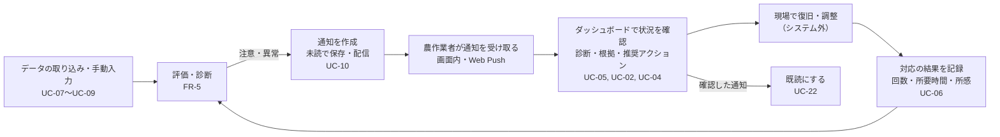
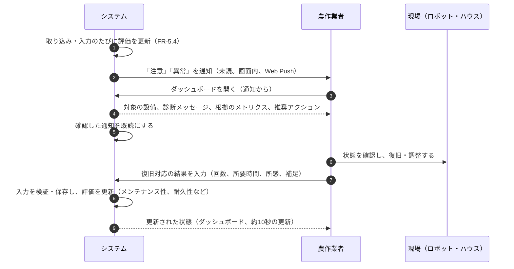
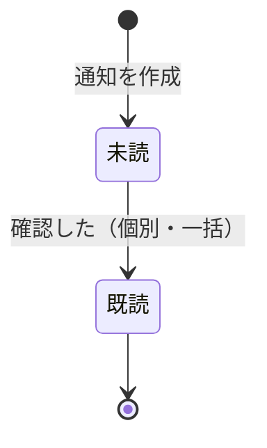

# ヒューマン・イン・ザ・ループ（HITL）

目的: 本システムで、人（農作業者）がどの場面で、何を確認・判断・入力し、システムがそれをどう支えるかを示す。異常の発生から、通知、確認、復旧、記録、評価への反映までの流れ（異常のライフサイクル）と、人が関与する機能の設計方針を定める。

> 元になった文書: [goals.md](../../00_project/goals.md)、[project-overview.md](../../00_project/project-overview.md)、[use-cases.md](../requirements/use-cases.md)、[functional-requirements.md](../requirements/functional-requirements.md)、[evaluation.md](../viewpoint/evaluation.md)、[architecture.md](./architecture.md)。未確定の事項は `TODO:` と確認事項の番号（rfp.md の Q-xxx）で示す。

## 1. HITL の位置づけ

- HITL は、システムの分析結果をもとに、人が状況を確認し、判断・対応（復旧・調整など）を行う方式（[glossary.md](../../00_project/glossary.md)）。ダッシュボードでの提示が、その入口になる（goals.md）
- 本システムは、ロボットやハウスを**自動で制御しない**。人の判断と対応を支援する情報基盤である。そのため、システムから設備への操作指示は存在せず、**設備操作の認可は発生しない**（architecture.md 9章）
- 人の関与は、次の3つに分かれる

| 関与 | 内容 | 主な機能 |
|------|------|----------|
| 確認・判断する | 状態・診断・推奨アクションを見て、対応を判断する | UC-01〜UC-05、UC-22 |
| 対応する（システム外） | 現場で、ロボット・ハウスの状態を確認し、復旧・調整する | （システム外。UC-05 の手順5） |
| 記録・補完する | 機器から取れない情報や、人の対応の結果を入力し、評価に反映する | UC-06、UC-07、UC-18 |

- 成功条件（goals.md）との対応: 「人に伝わる」＝通知と診断の提示、「安定稼働につながる」＝人の復旧・調整と、その記録による評価の改善

## 2. 異常のライフサイクル

異常・注意の発生から、評価への反映までの流れ。

### 2.1 シーケンス

### 2.2 通知の状態

通知の状態は、**未読と既読の2つだけ**とする（FR-7.6）。

- 対応状況（未対応／対応中／完了）の管理や、承認・却下は、設けない（UC-05）。TODO: 発注者の確認（Q-018）。必要と判断された場合は、通知とは別の状態として追加できる構造にする（architecture.md 8章）
- 評価のステータスが「正常」に戻ったときの扱い（通知の自動クローズなど）は、未定（TODO: 設計時に決める）

## 3. 人が関与する場面と、システムの役割

| 場面 | 人が行うこと | システムが行うこと | 機能 |
|------|--------------|--------------------|------|
| 気づく | 通知を受け取る | 「注意」「異常」を検知して通知する（重複を抑制）。取り込み失敗も通知する | UC-10、UC-24、UC-23、FR-7 |
| 確認する | ダッシュボードで状態・診断・根拠・推奨アクションを確認する | 観点別のステータス、診断メッセージ、根拠のメトリクス、推奨アクションを提示する。データが足りない場合は、その旨と確認すべきことを示す | UC-01、UC-02、UC-04、FR-5、FR-6 |
| 傾向を見る | 短期・中長期の推移を確認する | 推移のグラフと、視点ごとのフィードバックを提示する | UC-03、FR-5.6、FR-6.5 |
| 判断する | 推奨アクションを参考に、対応を判断する | 推奨アクションを示す。**判断は人が行い、システムは操作しない** | UC-04 |
| 対応する | 現場で復旧・調整する | （関与しない） | システム外 |
| 記録する | 対応の結果（回数、所要時間、所感、補足）を入力する | 検証・保存し、評価に反映する | UC-06、FR-4.1.2 |
| 補う | 機器から取れない値、仕様未確定で取り込めない値を入力する | 検証・保存し、取得元（手動入力）を区別して保持する。評価に反映する | UC-07、FR-4.1.1、FR-4.1.4 |
| 見直す | 入力の誤りを修正・削除する。判断基準を調整する | 修正・削除（論理削除）を許し、変更の履歴を残す。判断基準の変更を、システム全体に適用する | UC-18、UC-19、FR-4.2、FR-5.7 |
| 設定する | 設備構成・取り込みの設定を行う | 設備の階層で、データの紐づけを管理する。接続テスト・即時取得を提供する | UC-12、UC-15、FR-1.4、FR-2 |

## 4. 人の入力を評価に反映する設計

人が入力するデータは、評価の入力であり、評価の信頼性に直結する。そのため、次の方針とする。

| 方針 | 内容 | 根拠 |
|------|------|------|
| 入力の検証 | 形式・範囲・必須項目を検証し、不正な場合は、エラーを示して再入力を促す。対象の設備・カテゴリ・計測日時を必須とする | FR-4.1.1、FR-4.1.3 |
| 取得元の区別 | 手動入力と自動取り込みを、取得元として区別して保持する。同じ項目・時刻の値が重なる場合の扱いは未定（TODO: FR-4.1.4） | FR-1.10、FR-4.1.4 |
| 評価への即時反映 | 入力の保存のたびに、評価を更新する。「注意」「異常」になれば、通知につなげる。**AWS では、保存の応答を速くするため、評価は定期の評価（JB-02）が更新する（最大 5 分遅れる。ADR-0014）** | FR-4.1.5、FR-5.4 |
| 変更の追跡 | 入力・修正・削除の履歴（操作種別、対象、変更者、変更前後、日時）を残す。削除は論理削除 | FR-4.2.2、FR-4.2.3、NFR-5.7 |
| 修正後の評価 | 修正・削除の後の評価の更新と通知の扱いは未定（TODO: 要件側） | UC-18 |
| 欠損の扱い | 欠損は、0 などで代用せず、区別する。データが足りない評価は「不明」とし、入力・取得を促す | evaluation.md 4章 |
| 入力の負担を抑える | 入力項目は必要最小限にし、よく使う入力を短い手順で行える画面にする。農作業者が、ITの知識に依存せず操作できる | NFR-7.1 |

### 4.1 人の入力が反映される観点

人の入力は、次の観点の評価に使われる（詳細は [viewpoint/](../viewpoint/) の各観点）。

| 入力 | 反映される観点 |
|------|----------------|
| 復旧に要した時間、故障回数 | メンテナンス性（MTTR）、耐久性（MTTR、稼働率）、コスト効率（稼働率） |
| 収穫の試行・成功・損傷・誤認識・誤収穫・取り残し | 収穫精度、コスト効率 |
| 操作時間・操作ステップ数・操作エラー数 | 操作性 |
| 緊急停止回数・ヒヤリハット件数 | 安全性 |
| ロボットコスト・人件費・メンテナンス費・電気代 | コスト効率 |
| 温度・湿度・照度・CO2濃度（環境センサーの補完） | 環境適応性 |
| 各観点への 1〜5 スター | 満足度 |
| 備考・所感・補足情報 | 評価の根拠・運用の補足として保持する（評価の計算には使わない。TODO: 活用方法） |

## 5. 人が見直せる設定

| 設定 | 内容 | 設計方針 |
|------|------|----------|
| 判断基準 | 閾値を画面から編集・保存できる（既定値へ戻せる） | 不正な組み合わせは保存できない。変更はシステム全体に適用し、変更済みを識別できる。診断メッセージで、変更した基準による判定であることを示す（FR-5.7、FR-5.8）。変更の履歴を残す（TODO: 履歴の対象。過去の評価への影響は未定） |
| ステータスコード | ロボットの状態のコードと、正常／注意／異常の区分 | 登録・編集・削除・参照（FR-3）。区分の変更は、評価に影響する |
| 通知の手段 | Web Push の有効化・解除 | 利用者が有効にした場合にのみ配信する（FR-7.2）。TODO: 対象端末、利用者ごとの設定 |
| 設備構成・取り込み | ハウス・ロボット・センサーの登録、取り込みの接続先・間隔 | FR-2、FR-1.4、FR-1.5 |

- 判断基準・ステータスコードの変更は、評価と通知の結果を変えるため、**変更した人と内容を残す**（NFR-5.7）
- どの操作を、誰ができるかは、認証・認可の確認結果による（管理者・一般の 2 ロール。[ADR-0013](../adr/0013-environments-and-access-control.md)。architecture.md 9章）。操作ごとの権限を設定で割り当てる構造とする

## 6. 承認フローについて

- 現時点では、**承認・却下・タイムアウトを伴う承認フローは設けない**。人が確認・判断・対応する一方向の流れであり、システムが人の承認を待って処理を進める場面がない
- 理由: (1) 本システムは設備を自動制御しない（承認すべき操作がない）、(2) 発注者の要求にも、承認の要求がない（RQ-012、RQ-013）、(3) 対応状況の管理は、要求にない
- 将来、承認が必要になった場合（例: 判断基準の変更の承認）は、通知とは別の状態・機能として追加する。その際は、承認・却下・タイムアウトの全ての分岐を、テストの重点対象とする（[test-policy.md](../../30_quality/test-policy.md)）
- TODO: 承認フローの要否を、発注者に確認する（Q-018）

## 7. 非機能の観点（HITL を成立させる条件）

| 条件 | 内容 | 根拠 |
|------|------|------|
| 気づける | 通知が、画面を開いていない場合も届く（Web Push）。通知に失敗した場合は、記録して再送する。取り込みの失敗も通知する | FR-7.2、FR-7.7、FR-7.4 |
| すぐ判断できる | 状態が色・アイコンなどで直感的に分かる。診断メッセージに、対象の設備・内容・根拠・取るべき対応が含まれる | NFR-7.2、FR-6.2 |
| 鮮度が保たれる | 画面は約10秒間隔で更新する。ただし、HITL は即座の対応を前提としない（人の対応の時間に見合う鮮度で足りる） | NFR-3.3、rfp.md 7章 |
| 現場で使える | PC・タブレット・スマートフォンで閲覧・入力できる。回線は、ローカル 5G が基本で、スマートフォンはキャリア回線もありうる（決定。#142）。狭い幅への対応は、#151 | NFR-7.3 |
| 外部の停止に影響されない | 通知サービス・農業情報基盤・取り込み元の停止が、確認・入力・評価を止めない | NFR-2.1、NFR-4.4、architecture.md P-3 |
| 誤りを防げる | 入力の検証、変更の履歴、論理削除で、人の入力の誤りを検出・追跡・修正できる | FR-4.1.3、FR-4.2 |

## 8. 未確定事項

| 事項 | 現時点の扱い | 確認事項 |
|------|--------------|----------|
| 通知の手段・宛先・条件、「不明」の通知の要否 | 画面内通知・Web Push を提供。「不明」は未定 | Q-011、Q-010 |
| 既読の単位（利用者ごとか、共通か） | 通知の宛先と合わせて決める（TODO） | Q-018、Q-011 |
| 対応状況の管理・承認の要否 | 設けない。必要になれば追加できる構造にする | Q-018 |
| 異常の判断基準、推奨アクションの内容・提示ルール | 仮の既定値で進める（viewpoint/） | Q-007、Q-010 |
| 認証・認可、操作ごとの権限、設備登録者 | ロールは、管理者・一般の 2 種類に決定。設備の登録は、管理者（FR-9.6）。設定で割り当てる構造は、維持する | 決定（ADR-0013）、Q-016 |
| 手動入力と自動取り込みの値の重なり、修正後の評価の更新 | 未定（要件側 TODO） | FR-4.1.4、UC-18 |
| 状態が「正常」に戻ったときの通知の扱い | 未定 | 設計時に決める |
| 現場の端末・通信環境 | PC・タブレット・スマートフォン。回線は、ローカル 5G が基本（決定） | 決定（#142）、NFR-7.3 |

## 9. 関連文書

- 全体像: [system-overview.md](./system-overview.md)、[architecture.md](./architecture.md)（8章 通知、9章 認証・認可）
- ユースケース: [use-cases.md](../requirements/use-cases.md)（UC-05〜UC-07、UC-10、UC-18、UC-19、UC-22〜UC-24）
- 要件: [functional-requirements.md](../requirements/functional-requirements.md)（FR-4、FR-5、FR-7）
- 観点・評価: [viewpoint/](../viewpoint/)、[evaluation.md](../viewpoint/evaluation.md)
