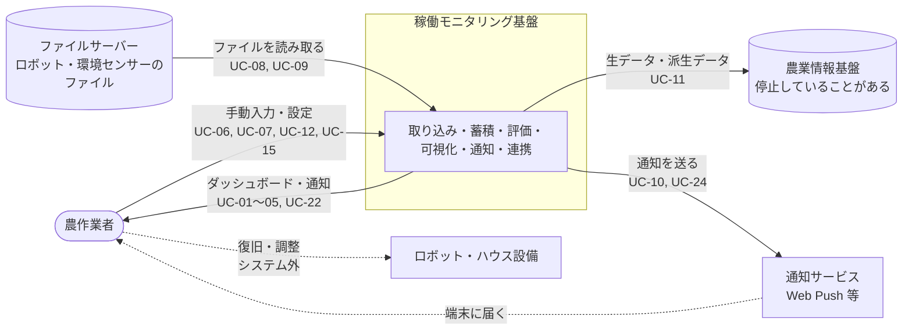
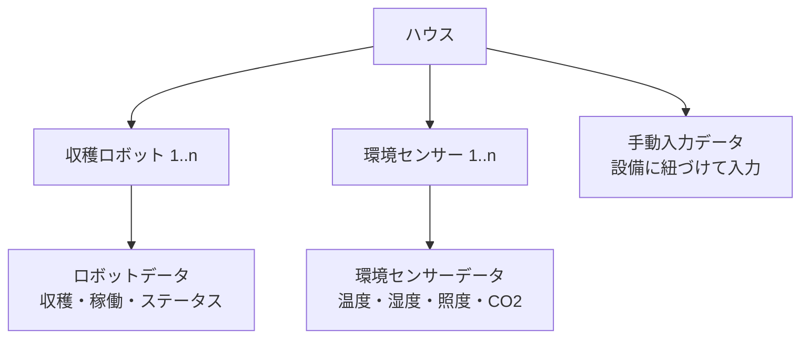
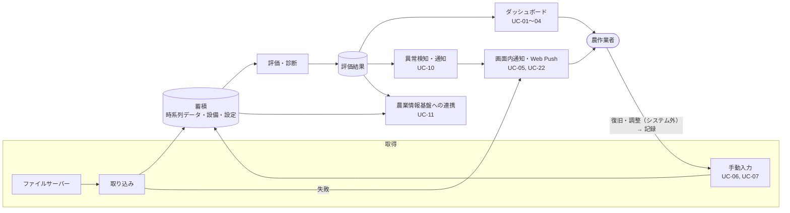

# システム全体像

目的: 本システム（稼働モニタリング基盤）が何のために、誰に使われ、何とつながり、どこまでを担うのかを、全体像として示す。構成・技術・非機能の実現方法は [architecture.md](./architecture.md) に書き、ここには書かない。

> **この文書の前提**
> - 要件は [functional-requirements.md](../requirements/functional-requirements.md)（FR）、[non-functional-requirements.md](../requirements/non-functional-requirements.md)（NFR）、[use-cases.md](../requirements/use-cases.md)（UC）、[rfp.md](../requirements/rfp.md)（RQ・Q）に従う。要件側の `TODO:` は、ここでも未確定として扱う
> - 発注者への確認が必要な事項（Q-番号）は決め打ちせず、「TODO（Q-xxx）」として残す

## 1. システムの目的と位置づけ

- 目的: ロボットとハウスの状態をデータで見える化し、異常や不調に農作業者が早く気づいて対処できるようにして、安定稼働を支える（[goals.md](../../00_project/goals.md)）
- 位置づけ: 人の判断と対応を支援する情報基盤。ロボット・ハウスを自動で制御しない（ヒューマン・イン・ザ・ループ、HITL）
- 重視する性質: 低コスト・疎結合・拡張性・継続運用性（RQ-021 / NFR-2.5）
- 背景と課題: [project-overview.md](../../00_project/project-overview.md)、[rfp.md](../requirements/rfp.md) 1章・4章

### 1.1 背景と、システムが担う二つの柱

project-overview.md の二つの取り組みに対して、本システムは次の役割を担う。設計への反映は [architecture.md](./architecture.md) 1.1・1.2 に示す。

| 取り組み | 本システムの役割 |
|----------|------------------|
| 収穫ロボットの第三者評価の仕組み構築（安全性、稼働率・連続運転性能、復旧容易性、メンテナンス性、代替作業手段の確保。MTBF・MTTR、HITL を踏まえる） | 10観点の評価・診断（FR-5）。MTBF・MTTR をメトリクスとして算出する。農作業者の復旧の結果を手動入力で記録し、評価に反映する（HITL）。TODO: 「代替作業手段の確保」に対応する観点がない（Q-007） |
| 環境制御に向けた情報基盤の整備（環境情報の収集、可視化、遠隔制御に必要な情報の把握） | 環境センサーデータの取り込み・蓄積・可視化（FR-1.2, FR-6）と、農業情報基盤・他のシステムへの提供（FR-8, NFR-8.3）。制御そのものは対象外 |

- 現状の課題（人手不足、評価の仕組みの不在、導入前のリスク把握の難しさ、環境データを活用する情報基盤の不足）と、目指す姿は、architecture.md 1.1 で設計との対応を示す
- 成功条件（現場で使える／人に伝わる／安定稼働につながる）に対応する設計は、architecture.md 1.2 に示す

## 2. 利用者と外部システム

| 区分 | 名前 | 関わり方 | 関連する要件 |
|------|------|----------|--------------|
| 利用者 | 農作業者（10名ほど） | 状態・診断・推奨アクションの確認、通知の確認、手動入力、設備・設定の管理。ロボット・ハウスの復旧・調整は、本システムの外で行う | UC-01〜07, 12, 13, 15〜23 / NFR-3.1 |
| 外部システム | ファイルサーバー | ロボットデータ（JSON）・環境センサーデータの配置元。本システムが読み取る。管理は宇都宮大学の想定。TODO: 接続先とアクセス方法（Q-002） | RQ-001, RQ-002 / UC-08, UC-09 |
| 外部システム | 農業情報基盤 | 本システムのデータの連携先。FIWAREベースで AWS EC2 上にあり、停止していることがある。可用性に依存できない | RQ-006, RQ-007, RQ-020 / UC-11 |
| 外部サービス（任意） | 通知サービス（Web Push配信サービス、メール等） | 通知の配信先。TODO: 手段・宛先・既存サービスの有無（Q-011） | RQ-013 / UC-10, UC-23 |
| 運用の主体 | 秋田県立大学（AWS環境の提供） | 本システムのデプロイ先を提供する。払い出されたIAMユーザーの権限の範囲で利用する | RQ-015 / NFR-1.1, NFR-1.2 |

- ユースケース上の「運用者」の区別（UC-14〜16）や、ロール（管理者・評価者・閲覧者など）の要否は未確定（TODO: Q-017）。この文書では「農作業者」に統一する

## 3. システムコンテキスト

- 本システムからロボット・ハウス設備へ指示を出す経路はない（自動制御は対象外）。農作業者の復旧・調整はシステムの外で行い、その結果を手動入力（UC-06）で記録する
- 接続先・ファイル仕様・連携方式は未確定のため、各境界は差し替えられるようにする（[architecture.md](./architecture.md) 5章）

## 4. システムの境界

| 区分 | 内容 | 根拠 |
|------|------|------|
| 対象（スコープ内） | データ取り込み（ファイルサーバー・手動入力）、設備の階層管理、ステータスコード管理、観点別の評価・診断、ダッシュボード、異常検知・通知、農業情報基盤への連携、認証・ユーザー管理（暫定） | [rfp.md](../requirements/rfp.md) 5.2、FR-1〜FR-9 |
| 対象外（スコープ外） | ロボット・ハウスの自動制御・遠隔制御（将来の遠隔制御・自動最適化は、本システムのデータを使う別のシステムが担う）。対応状況の管理・承認（FR-7.6。Q-018 で確認中）。HITL・信頼性指標の先行事例調査（研究活動） | [goals.md](../../00_project/goals.md)、[project-overview.md](../../00_project/project-overview.md)、FR-7.6 |
| 判断保留 | 自動取り込みの接続先（宇都宮大学のファイルサーバーか）とファイル仕様、環境センサーの機種・取得方式 | rfp.md 5.2、Q-001, Q-002, Q-004 |
| 再利用しない | 2025年度のプロトタイプ・メトリクス定義 | NFR-2.8 |

## 5. 管理対象の階層

ハウスを頂点に、ロボットと環境センサーを紐づけて管理する（RQ-005 / FR-2.1, FR-2.2）。基本の構成は 1:1:1 で、台数・棟数が増えても同じ構成で扱う（NFR-3.1, NFR-3.2）。

評価の単位（ハウス単位かロボット単位か）は未確定（TODO: FR-5.3、[evaluation.md](../viewpoint/evaluation.md)）。

## 6. 主要な機能のまとまり

| まとまり | 役割 | 主な要件 | 主なUC |
|----------|------|----------|--------|
| 取り込み | ファイルサーバーのデータを自動で取り込み、検証して、設備に紐づけて保存する。取り込み設定・ログ・失敗時の再試行を持つ | FR-1 | UC-08, 09, 15, 16, 24 |
| 設備管理 | ハウス・ロボット・センサーの階層を登録・変更する。ステータスコードの定義を管理する | FR-2, FR-3 | UC-12, 17 |
| 手動入力 | 取得できないデータ、復旧対応の結果、所感を人が入力する。修正・削除・履歴を持つ | FR-4 | UC-06, 07, 18 |
| 評価・診断 | 10観点を、短期・長期の視点で、正常／注意／異常／不明に判定し、診断メッセージと推奨アクションを付ける。判断基準を編集できる | FR-5 | UC-01〜04, 19, 21 |
| 可視化 | ダッシュボード、観点の詳細、推移グラフ、データ一覧、満足度のレーダーチャート | FR-6 | UC-01〜03, 20, 21 |
| 異常検知・通知 | 注意・異常を検知し、画面内・Web Push で通知する。通知の一覧と既読を管理する | FR-7 | UC-05, 10, 22, 23, 24 |
| 外部連携 | 生データ・派生データを農業情報基盤へ連携する。停止中は保留する | FR-8 | UC-11 |
| 認証・ユーザー管理 | ログイン、ロールに応じた操作の制御、ユーザー管理。TODO: 要否とロール（Q-017） | FR-9 | UC-13, 14 |

観点ごとのメトリクス・判断基準は [viewpoint/](../viewpoint/) に従う（ここでは書かない）。

## 7. 全体のデータの流れ

データ取得 → 蓄積 → 評価 → 可視化・通知・連携、の順に流れる（NFR-2.6）。詳細な項目・処理の流れは [data-flow.md](../data/data-flow.md)、人の関与は [human-in-the-loop.md](./human-in-the-loop.md) で扱う。

- 取り込みと手動入力のどちらも、同じ形式の時系列レコードとして保存する（FR-1.10）。取得元（自動取り込み／手動入力）は区別して保持する（FR-4.1.4）
- データの取り込み・入力のたびに評価を更新する（FR-5.4）
- 画面の表示は約10秒間隔で更新する（FR-6.7, NFR-3.3）。データそのものの鮮度は、取り込みの間隔（5分〜日次。FR-1.5）で決まる。両者の関係は要件側で未整理（TODO）
- 農業情報基盤が停止していても、取り込み・評価・表示・通知は継続する（NFR-2.1）

## 8. 要件との対応

### 8.1 機能要件・ユースケースとの対応

| 機能要件 | 全体像での位置づけ | 本書の節 | 設計の詳細 |
|----------|--------------------|----------|-----------|
| FR-1 | 取り込み | 6, 7 | [architecture.md](./architecture.md) 4.2, 5 |
| FR-2, FR-3 | 設備管理 | 5, 6 | 同 4.2 |
| FR-4 | 手動入力 | 6, 7 | 同 4.2 |
| FR-5 | 評価・診断 | 6 | 同 4.2, 7 |
| FR-6 | 可視化 | 6 | 同 4.2 |
| FR-7 | 異常検知・通知 | 6 | 同 4.2, 8 |
| FR-8 | 外部連携 | 2, 6 | 同 5.3 |
| FR-9 | 認証・ユーザー管理 | 6 | 同 9 |

UC-01〜UC-24 の割り当ては 6章の表のとおり。UC-01〜UC-24 のすべてが、いずれかのまとまりに含まれる。

### 8.2 非機能要件との対応

| 非機能要件 | 全体像での扱い | 実現方針 |
|------------|----------------|----------|
| NFR-1（コスト・AWS・IAM） | 月5,000円以内、秋田県立大学のAWS環境、払い出されたIAMユーザーの権限の範囲で稼働する（2章、8.3） | [architecture.md](./architecture.md) 10, 11 |
| NFR-2（疎結合・単独稼働） | 外部システムとの境界を差し替え可能にし、農業情報基盤の停止に影響されない（3章、7章） | 同 2, 5 |
| NFR-3（性能・規模） | 1:1:1・利用者10名・画面の更新10秒を基本とし、階層の拡張に同じ構成で対応する（2章、5章、8.3） | 同 10 |
| NFR-4（可用性） | 単独稼働・失敗の分離、バックアップ、自動再起動 | 同 10 |
| NFR-5（セキュリティ） | 機密データの扱い、外部境界の暗号化・認証、操作履歴 | 同 5.1, 9, 10 |
| NFR-6（運用・保守） | 運用の負荷を抑える。取り込み・連携の状態を運用者が確認できる（6章） | 同 4.2, 10 |
| NFR-7（使いやすさ） | 農作業者向けの簡素な日本語の画面、タブレット、色・アイコンでの表示（6章の可視化） | 同 4.3, 10 |
| NFR-8（拡張性） | 設備・取り込み・観点を、設定・登録データで追加できる。他のシステムへ読み取りのAPIで提供する（6章の外部連携） | 同 5, 7, 10 |
| NFR-9（規格） | ISO/IEC 25059 を参考にした観点（6章の評価・診断） | 同 10、[viewpoint/](../viewpoint/) |

### 8.3 制約との対応

| 制約 | 全体像での扱い |
|------|----------------|
| 月5,000円以内（NFR-1.3） | サーバーレス構成を基本とし、常時課金の部品を持たない（ADR-0002）。費用は未確認の見込みで、確定値ではない（architecture.md 11.5） |
| 秋田県立大学のAWS環境・IAMユーザー（NFR-1.1, NFR-1.2） | 払い出された権限の範囲で稼働する。利用できるサービスは未確認で、確認後に構成を確定する（architecture.md 11.4） |
| 農業情報基盤に依存しない単独稼働（NFR-2.1） | 3章・7章のとおり、農業情報基盤は連携先であり、停止中も取り込み・評価・表示・通知は継続する |
| ファイルサーバーの仕様の仮決めとモック（FR-1.3, FR-1.11, FR-1.12） | 接続先・ファイル仕様を仮決めし、モックで開発する。確定後に差し替える（architecture.md 5.2） |
| 画面の更新10秒（NFR-3.3）、利用者10名（NFR-3.1） | 2章・7章のとおり。取り込み間隔（5分〜日次）とは別のものとして扱う（architecture.md 10章） |
| 拡張性（NFR-2.4, NFR-3.2, NFR-8） | 5章の階層で、台数・棟数を増やしても同じ構成で扱う |

## 9. 未確定事項（TODO）

全体像に影響する未確認事項を示す。設計上の扱いは [architecture.md](./architecture.md) 12章にまとめる。

| 事項 | 全体像への影響 | 確認事項 |
|------|----------------|----------|
| ファイルサーバーの接続先・アクセス方法 | 取り込みの経路（直接接続か、中継か） | Q-002 |
| ロボットデータのファイル仕様・取得項目 | 取り込みデータの項目、手動入力の対象 | Q-001, Q-003 |
| 環境センサーの機種・取得方式 | 環境センサーデータの経路 | Q-004 |
| 農業情報基盤との連携方式 | 連携の向き（送る／取りに来る）・データモデル・頻度 | Q-005 |
| 通知手段・宛先・条件 | 通知サービスとのつながり | Q-011 |
| 認証・ロール | 利用者と操作の範囲 | Q-017 |
| 評価の単位、観点・メトリクスの確定 | 評価結果の保持単位 | Q-007〜Q-010、FR-5.3 |
