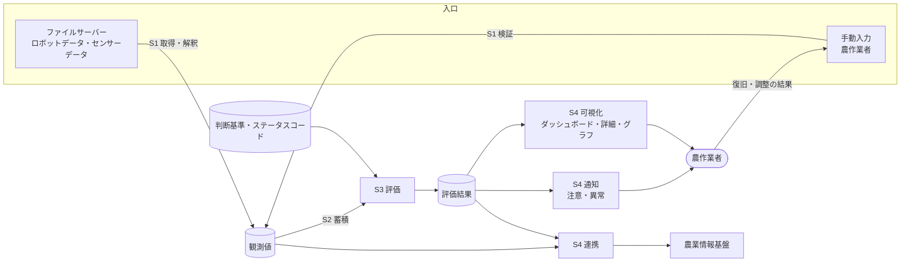
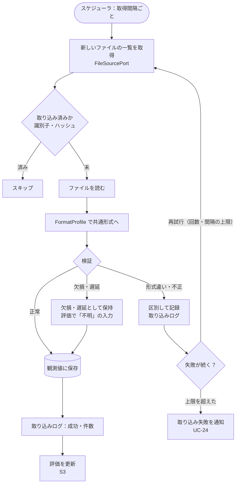
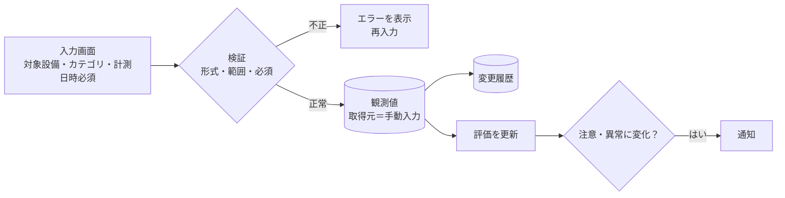
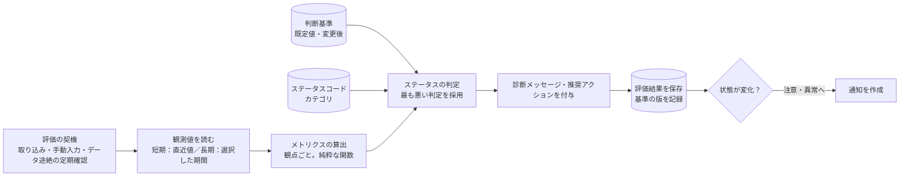
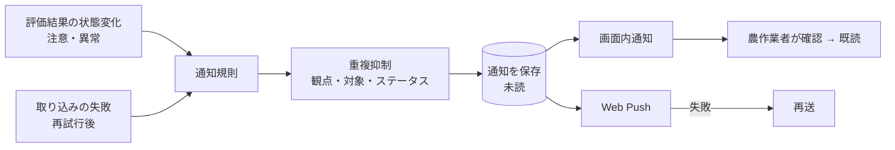
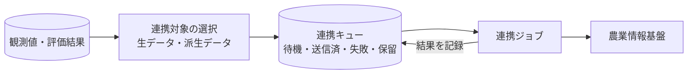

# データの流れ

目的: データが、取り込みから、蓄積、評価、可視化・通知・連携まで、どう流れるかを示す。各段階の入力・出力・保存先を定め、段階ごとに単体でテストできるようにする（NFR-2.6）。データの構造は [data-model.md](./data-model.md)、項目の定義は [data-dictionary.md](./data-dictionary.md) を参照する。

> 元になった文書: [architecture.md](../architecture/architecture.md)、[functional-requirements.md](../requirements/functional-requirements.md)、[use-cases.md](../requirements/use-cases.md)、[evaluation.md](../viewpoint/evaluation.md)、[human-in-the-loop.md](../architecture/human-in-the-loop.md)。未確定の事項は `TODO:` と確認事項の番号（rfp.md の Q-xxx）で示す。

## 1. 全体の流れ

- 4段階（S1 取り込み、S2 蓄積、S3 評価、S4 可視化・通知・連携）に分け、段階間は、保存したデータを入出力として受け渡す（architecture.md P-4）。各段階は、前段の出力（フィクスチャ）から単独で検証できる
- 人の入力は、取り込みの入口の1つとして扱う。人の復旧・調整の結果が、観測値として戻り、評価を更新する（HITL。[human-in-the-loop.md](../architecture/human-in-the-loop.md)）

## 2. 段階ごとの入力・出力

| 段階 | 入力 | 処理 | 出力（保存先） | 要件 |
|------|------|------|----------------|------|
| S1 取り込み | ファイルサーバー上のファイル（ロボット：JSON。環境センサー：形式は仮決め）。手動入力 | 取得（FileSourcePort）→ 解釈（FormatProfile）→ 共通形式への変換 → 検証・正規化 | 観測値（取得元つき）、取り込み済みファイルの記録、取り込みログ。不正・欠損・遅延のデータは、区別して記録する | FR-1、FR-4.1 |
| S2 蓄積 | 検証済みの観測値 | 時系列で保存。重複の排除。手動入力は、論理削除と変更履歴を持つ | 観測値（時系列）、変更履歴 | FR-1.10、FR-4.2 |
| S3 評価 | 観測値、判断基準、ステータスコード | 観点ごとにメトリクスを算出し、短期・長期の視点でステータスを判定する。診断メッセージ・推奨アクションを付ける | 評価結果（観点・対象・視点ごと） | FR-5 |
| S4 可視化 | 評価結果、観測値 | 最新の評価結果の提示、詳細、推移のグラフ、データ一覧 | （表示。保存はしない） | FR-6 |
| S4 通知 | 評価結果の状態変化、取り込みの失敗 | 「注意」「異常」への変化を検知し、重複を抑制して通知を作成・配信。失敗は再送 | 通知、配信の結果、既読状態 | FR-7 |
| S4 連携 | 観測値（生データ）、評価結果（派生データ） | 連携対象を選び、連携キューに積み、非同期に送信 | 連携キュー、連携の結果 | FR-8 |

## 3. 取り込み（S1）の流れ

- 取り込み元（ロボット、環境センサー）ごとに、独立して実行・再試行する。1つの失敗が、他の元や他の機能を止めない（FR-1.9）
- ファイルの識別子と内容のハッシュで、再取り込みを防ぐ（FR-1.6）。ファイルが上書き更新される場合（JSON・全体が書き換わる・最新の値だけ）は、毎周期読み、ハッシュが同じなら何もせず、違えば解析して、新規・変更の観測値だけを保存・連携に積む。消えた行は反映しない（決定。[ADR-0016](../adr/0016-ingestion-federation-rules.md)）
- 接続先・ファイルのレイアウト・取得項目は仮決め（FormatProfile の版と状態「仮決め」を観測値に残す。FR-1.11）。接続先の選択肢は architecture.md 5.1（TODO: Q-002）
- 取得間隔は、5分〜日次から選択できる（FR-1.5）。TODO: 既定値

## 4. 手動入力の流れ

- 手動入力と自動取り込みは、同じ形式（共通形式）で保持し、取得元で区別する（FR-4.1.4）。値が重なる場合、評価では、合計の項目は、評価の期間に自動の値があれば自動だけを使い、なければ手動だけを使う（決定。[ADR-0018](../adr/0018-manual-input-and-data-rules.md)）
- 修正・削除は、論理削除と変更履歴を残す（FR-4.2.2、FR-4.2.3）。修正・削除の後の評価の更新と通知の扱いは未定（TODO: 要件側）

## 5. 評価（S3）の流れ

- 判定のロジックは、副作用のない純粋な関数とし、観測値・判断基準・時刻を入力として受ける（architecture.md 7章）。メトリクス・判断基準の定義は [viewpoint/](../viewpoint/)
- データが足りない観点は「不明」とし、入力・取得を促す推奨アクションを付ける（evaluation.md 4章）
- 評価結果は事前に計算して保存し、画面は、保存済みの結果を読む（ダッシュボードの初期表示を速くする。NFR-3.4）
- 判断基準の変更が、過去の評価に影響するか（再計算するか保持するか）は未定（TODO: 要件側）

## 6. 可視化・通知・連携（S4）の流れ

### 6.1 可視化

- 画面は、約10秒間隔で、保存済みの最新の評価結果を読み直す（FR-6.7）。データそのものの鮮度は、取り込みの間隔で決まる（取り込みの間隔と画面の更新は別のもの）
- 長期視点の推移グラフは、期間（当日／7日／30日／60日／90日）の評価結果・観測値を読む（FR-5.6、FR-6.5）。DynamoDB で FR-6.5 を満たせることは、実装の前に検証した（90 日の推移で約 0.9 秒。[ADR-0007](../adr/0007-dynamodb-table-design.md)）

### 6.2 通知

- 通知は、状態が「注意」「異常」に**変わったとき**に作り、同じ状態が続く間は繰り返さない（FR-7.1、FR-7.3）。「不明」の通知の要否は未定（TODO: Q-010、Q-011）
- 既読・未読の2状態のみ（FR-7.6）。対応状況の管理は扱わない（Q-018）

### 6.3 連携

- 連携対象: 生データ（ロボットデータ、環境センサーデータ、手動入力データ）、派生データ（メトリクス、観点別の診断結果、推奨アクション、分析結果・インサイト）（FR-8.1）。設備の名前・ID を含める。システムに登録するユーザー・設定のデータは、連携しない（決定。#142 の D-35）
- 連携キューへの追加は、保存・評価と同じトランザクションで行う（ADR-0004）。農業情報基盤の停止中は、保留する。他の機能は影響を受けない（FR-8.2）
- 連携方式（API、データモデル、頻度）、復旧後の再送・遅延連携は未定（TODO: Q-005）

## 7. データの鮮度とタイミング

| 項目 | 内容 | 根拠 |
|------|------|------|
| 取り込みの間隔 | 5分〜日次から選択。TODO: 既定値 | FR-1.5 |
| 評価の更新 | 取り込み・手動入力のたびに更新。データ途絶の確認のため、定期的にも評価する | FR-5.4、architecture.md 4.1 |
| 画面の更新 | 約10秒間隔で、保存済みの最新の評価結果を読み直す。タブの表示中のみ | FR-6.7、NFR-3.3 |
| 通知 | 評価の状態変化の時点で作成・配信。失敗は再送 | FR-7 |
| 連携 | 保存・評価の後に、非同期で送信。頻度は連携方式による | FR-8、TODO: Q-005 |

- TODO: 取り込みの間隔（5分〜）と、画面の更新（10秒）の関係の整理（要件側 TODO）

## 8. 異常系の流れ（まとめ）

| 異常 | 扱い | 要件 |
|------|------|------|
| 接続先に接続できない、ファイルが読めない | 再試行（回数・間隔の上限）し、失敗を記録。上限を超えたら通知。他の取り込み元・機能は継続 | FR-1.9、FR-7.4 |
| ファイルの形式・項目が仕様と異なる | 取り込みを継続しつつ、不正データを区別して記録 | FR-1.6 |
| 欠損・異常値・遅延 | 区別して保持。評価では「不明」の入力として扱う。TODO: 具体的な扱い | FR-1.6、evaluation.md 4章 |
| 同じファイルの再取得 | 識別子・ハッシュで検出し、取り込まない | FR-1.6 |
| 通知の配信に失敗 | 記録し、再送。Web Push の購読が無効なら、購読を無効にする | FR-7.7 |
| 農業情報基盤が停止 | 連携を保留。復旧後の扱いは設定。他の機能は影響を受けない | FR-8.2、NFR-2.1 |
| 手動入力の不正 | エラーを表示し、再入力を促す | FR-4.1.3 |

## 9. 関連文書

- データの構造: [data-model.md](./data-model.md)、項目の定義: [data-dictionary.md](./data-dictionary.md)
- 全体像: [system-overview.md](../architecture/system-overview.md)、[architecture.md](../architecture/architecture.md)（5章 取り込み・連携、6章 データの保持、7章 評価、8章 通知）
- 人の関与: [human-in-the-loop.md](../architecture/human-in-the-loop.md)
