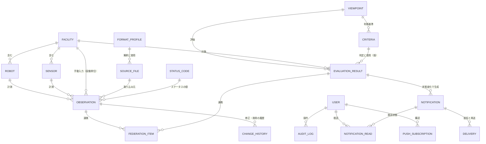

# データモデル

目的: 本システムが保持するデータの構造（論理モデル）と、DynamoDB での持ち方（物理設計）を定める。項目の定義（型・単位・取得元）は [data-dictionary.md](./data-dictionary.md)、データの流れは [data-flow.md](./data-flow.md) を参照する。

> **位置づけ**
> - 論理モデルは、要件（FR）にもとづく。物理設計は、DynamoDB を採用する前提（[ADR-0002](../adr/0002-deployment-serverless.md)、[ADR-0005](../adr/0005-tech-stack.md)）で、FR-6.5（推移のグラフ）などのアクセスパターンを検証して、[ADR-0007](../adr/0007-dynamodb-table-design.md) で決めた（2026-10-15）
> - DB へのアクセスは、Repository のポートを介して行い、ドメインのコードに DynamoDB の型を出さない（[ADR-0001](../adr/0001-modular-monolith-ports-and-adapters.md)）。そのため、物理設計を変えても、論理モデルは変わらない
> - 未確定の事項は `TODO:` と確認事項の番号（rfp.md の Q-xxx）で示す

## 1. 論理モデル

### 1.1 ER 図

### 1.2 エンティティ

| エンティティ | 内容 | 主な属性（詳細は data-dictionary.md） | 要件 |
|--------------|------|---------------------------------------|------|
| 設備 Facility / Robot / Sensor | ハウス→ロボット／環境センサーの階層。識別子は一意 | 設備ID、種別、名称、親（ハウス）、状態（有効／削除）、登録日時 | FR-2 |
| 観測値 Observation | 計測または入力された1つの値。自動取り込みも手動入力も同じ形式 | 設備ID、項目、日時、値、取得元、状態（有効／論理削除／欠損・遅延）、取り込み元ファイル、FormatProfile の版、入力者 | FR-1.10、FR-4 |
| 取り込み元ファイル SourceFile | 取り込んだファイルの記録。再取り込みの防止と追跡 | 取り込み元、識別子、更新日時、ハッシュ、取得日時、結果、件数、エラー内容 | FR-1.6、FR-1.8 |
| FormatProfile | ファイルの解釈（レイアウトと項目の対応づけ）。版と状態（仮決め／確定）を持つ | 種別、版、状態、マッピング、根拠 | FR-1.3、FR-1.11 |
| ステータスコード StatusCode | ロボットの状態のコード | コード値（一意）、名称、説明、カテゴリ（正常／注意／異常） | FR-3 |
| 観点 Viewpoint | 評価の観点の定義 | 観点ID、名称、対象、表示順、指標 | FR-5.1、[viewpoint/](../viewpoint/) |
| 判断基準 Criteria | 観点の指標ごとの条件と閾値 | 観点、指標、型（上限／下限／範囲）、閾値、版、既定値か変更後か | FR-5.7 |
| 評価結果 EvaluationResult | 観点・対象・視点ごとの評価 | 観点、設備、視点（短期／長期）、期間、ステータス、メトリクス値、診断メッセージ、推奨アクション、判断基準の版、評価日時 | FR-5、FR-6 |
| 通知 Notification | 通知の内容 | 種別、対象、観点、ステータス、メッセージ、発生日時、重複抑制のキー | FR-7 |
| 配信 Delivery | 通知の配信の結果 | 通知、手段、結果、試行回数、日時 | FR-7.7 |
| 既読 NotificationRead | 通知の既読状態 | 通知、状態（未読／既読）、日時。単位は、利用者ごと（決定。[ADR-0019](../adr/0019-notification-rules.md)） | FR-7.6 |
| Web Push 購読 PushSubscription | 通知を受ける端末の購読 | 利用者、購読情報、有効／解除。単位は、利用者 × 端末（決定。[ADR-0019](../adr/0019-notification-rules.md)） | FR-7.2 |
| 通知のメモ NotificationMemo | 通知ごとの、利用者のメモ（自由記述） | 通知、入力者、日時、本文。共有・追記のみ。通知と同じ保持（決定。[ADR-0019](../adr/0019-notification-rules.md)。実装は #239） | FR-7.6 |
| 連携項目 FederationItem | 農業情報基盤へ送るデータの状態（連携キュー） | 対象（観測値／評価結果の参照）、状態（待機／送信済／失敗／保留）、試行回数、結果、日時 | FR-8 |
| ユーザー User | 利用者（必須。FR-9。ロールは、管理者・一般の 2 種類。ADR-0013） | ユーザーID（一意）、名前、ロール、最終ログイン。認証情報は Cognito に持つ（パスワードをアプリで保持しない。[ADR-0008](../adr/0008-cognito-authentication.md)。DynamoDB の `USER` は、名前・ロール・最終ログインのみ）。代替構成ではアプリ内 | FR-9 |
| 変更履歴・操作履歴 ChangeHistory / AuditLog | 入力・設定の変更の追跡 | 操作種別、対象、変更者、変更前後、日時 | FR-4.2.3、NFR-5.7 |
| 設定 Setting | 取り込み設定（秘密情報は参照名のみ）、取得間隔、通知設定 | キー、値、更新日時 | FR-1.4、NFR-4.5 |

### 1.3 主な制約・ルール

- **設備の階層**: ロボット・センサーは、1つのハウスに属する。ハウスは複数。識別子は設備全体で一意
- **観測値の一意性**: （設備、項目、日時、取得元）で一意とする。同じ項目・時刻に、自動取り込みと手動入力の値が重なる場合は、両方を保持する。評価では、合計の項目は、評価の期間に自動の値があれば自動だけを使い、なければ手動だけを使う（決定。[ADR-0018](../adr/0018-manual-input-and-data-rules.md)）
- **削除**: 手動入力・ステータスコードは、論理削除とする。**設備は、削除すると、配下の設備とデータ（観測値・手動入力・評価結果・状態変化の履歴）も削除する**（設備の変更履歴・通知・取り込みログは残す。連携キューの未送信分は破棄。農業情報基盤に送信済みのデータは削除しない。非同期の削除。決定。[ADR-0018](../adr/0018-manual-input-and-data-rules.md)。実装は #229）
- **欠損の表現**: 欠損は 0 などで代用せず、値なし（欠損）として区別して保持する。遅延（到着が遅れたデータ）は、到着日時を持つ（[coding-standards.md](../../20_development/coding-standards.md)）
- **時刻**: UTC（ISO 8601）で保存し、表示時に日本時間へ変換する
- **評価結果は派生データ**: 観測値と判断基準から再計算できる。保存は、画面の初期表示を速くするためで、判定に使った判断基準の版を残す。判断基準の変更時の再計算の要否は未定（TODO: 要件側）
- **秘密情報は保持しない**: 取り込みの認証情報は、設定に参照名のみを持ち、値は秘密情報の保管サービスに置く（NFR-5.4）
- **実データをテストに使わない**: テスト・サンプルは、合成データ（`tests/fixtures/`）

## 2. 物理設計（DynamoDB）

設計は、[ADR-0007](../adr/0007-dynamodb-table-design.md)（承認。2026-10-15）で決めた。DynamoDB Local で、負荷テストと同じ規模（観測値 約 63 万件・1 年分）の合成データを使って検証した。テーブル・キーの詳細、検証の結果、費用の見込みは、ADR-0007 を参照する。ここには、アクセスパターンと、設計の要点を示す。

### 2.1 アクセスパターン

実装の Repository のポート（`src/backend/application/ports/repositories.ts`）の操作に対応する。

| ID | アクセスパターン（ポートの操作） | 頻度 | 要件 |
|----|----------------------------------|------|------|
| AP-01 | 設備の一覧・取得・保存（`EquipmentRepository`） | 画面の表示ごと（少量） | FR-2、FR-6.6 |
| AP-02 | 設備の範囲（ハウスなら、ハウスとロボット・センサー）の、最大 90 日分の観測値を、全項目まとめて読む（`findForEvaluation`。評価・推移の入力） | 評価ジョブごと（既定 5 分）、推移の表示ごと | FR-5、FR-6.5 |
| AP-03 | 観測値の最終の受信日時（自動取り込みのみ・全体）（`latestReceivedAt`） | ダッシュボードの表示ごと（約 10 秒） | FR-6.1 |
| AP-04 | 取り込み済みのファイルかの判定（取り込み元 + 識別子 + ハッシュ。同じ内容のハッシュの成功の記録も）（`findIngestedFile`）、取り込み元の直近の日時（`lastStartedAt` など） | 取り込みごと | FR-1.6 |
| AP-05 | 設備の、すべての観点・視点・期間の、最新の評価結果（`listLatest`） | ダッシュボードの表示ごと（約 10 秒） | FR-6.1 |
| AP-06 | 観点の最終ステータスの変化の履歴（古い順）（`listStatusChanges`）と、最終の変化（`getLastStatusChange`） | 詳細・グラフの表示ごと、評価ごと | FR-6.10 |
| AP-07 | 通知の一覧（新しい順。種別・既読／未読で絞る）、未読の件数、既読にする、重複抑制のキーで最新を引く、配信が未完了の通知（`NotificationRepository`） | 画面の表示ごと、**未読の件数は約 10 秒** | FR-7.5、FR-7.6 |
| AP-08 | 観測値の一覧（計測日時・カテゴリ・値の順。設備・カテゴリ・項目・取得元・期間・キーワードで絞る。カーソルでページ送り）（`ObservationRepository.query`） | 画面の表示ごと | FR-6.4、FR-6.8 |
| AP-09 | 手動入力の一覧（カテゴリ・設備・期間・入力者・キーワードで絞る。並べ替え。ページ送り）、取得・保存 | 画面の表示ごと | FR-4.2.1 |
| AP-10 | 変更履歴の一覧（操作種別・変更者・対象・期間で絞る。新しい順・古い順） | 画面の表示ごと（少量） | FR-4.2.3 |
| AP-11 | 連携キュー: 送信してよい項目（未送信で、次の試行の日時が来ているもの）、状態ごとの件数、連携ログの一覧 | 連携ジョブごと、画面の表示ごと | FR-8 |
| AP-12 | ステータスコード・判断基準・設定・利用者・Web Push 購読の取得・保存（少量） | 評価・画面・通知ごと | FR-3、FR-5.7、FR-7.2、FR-9 |

### 2.2 テーブルと設計の要点

テーブルは、**`Observations`**（観測値。時系列で件数が多い）と、**`Main`**（それ以外。単一テーブル設計）の 2 つ。どちらも、オンデマンド課金（固定費なし）。

| テーブル | キー | 内容 |
|----------|------|------|
| Observations | PK = `{equipmentId}#{itemKey}`、SK = `{observedAt（UTC・ミリ秒つきに正規化）}#{A\|M}`（A = 自動取り込み、M = 手動入力） | 観測値（属性名を短く。平均 84 バイト）。疎な GSI `manual`（手動入力のみ） |
| Main | PK・SK（集約ごとに、接頭辞を持つ）、GSI1 | 設備・ステータスコード・判断基準・設定・利用者・Web Push 購読・評価結果・ステータスの変化・通知・通知の既読・カウンター・取り込み済みファイル・取り込みログ・連携項目・連携ログ・変更履歴・手動入力・観測値のレジストリと最終の受信日時、ログインの失敗の記録（`LOGINFAIL`。接続元ごと・TTL）、ジョブのロック（`JOBLOCK`。ADR-0011） |

- **評価・推移（AP-02）**: 設備ごとの項目のレジストリで、パーティション（設備 × 項目）を知り、期間で Query する（並列）。90 日の推移は、約 0.9 秒・882 RRU（HOUSE-01 のスコープ）
- **一覧（AP-08）**: 対象のパーティションを、計測日時の順に併合して、1 ページ分を取る。1 ページ 22 RRU・約 40 ミリ秒（想定の規模）。**値・カテゴリの順と、キーワード検索は、期間（31 日以内）の指定を必須にする**（DynamoDB は、計測日時の順にしか、効率よく読めないため）
- **未読の件数（AP-07）**: 通知の総数と、利用者ごとの既読数の、2 つのカウンターの差。全件を数えない（約 10 秒のポーリングのため）
- **全件の走査（Scan）は使わない**。キーで引く（[coding-standards.md](../../20_development/coding-standards.md)）
- **評価・書き込みの方針**: 観測値の書き込みは、BatchWriteItem で、一意キーを使った上書き（冪等）。通知・カウンター・連携の状態の更新は、トランザクションで行う。期限のあるデータは、**取り込みログ・連携ログ・送信済みの連携項目が 90 日**（TTL。決定。[ADR-0018](../adr/0018-manual-input-and-data-rules.md)。実装は #230）。変更履歴は、期限なし。バックアップは、ポイントインタイムリカバリ等を使う（NFR-4.2。architecture.md 6章）

### 2.3 検証の結果（要約）

DynamoDB Local で測定した（時間は、実際の AWS の遅延とは異なる参考値）。詳細は、ADR-0007。

- **FR-6.5（推移）・NFR-3.5（10 秒以内）**: 90 日の推移は、約 0.9 秒。**満たせる**
- **評価の読み取りの費用**: 想定の規模（ハウス 1・ロボット 1・センサー 1。15 分間隔）で、1 周期（既定 5 分）あたり約 1,760 RRU。月に約 1,520 万 RRU（約 290〜650 円。単価は未確認の概算）。月 5,000 円（NFR-1.3）に収まる見込み
- **観測値の重なり（FR-4.1.4）**: 自動取り込みと手動入力は、SK の末尾（A・M）で、別のアイテムとして、両方を保持する（評価での優先は、合計の項目は自動優先。ADR-0018）
- **AWS での実測**（Issue #79。2026-10-21。30 日分のデータ。端末のブラウザから見た時間）: 推移（直近 30 日）は 1.35〜1.91 秒で、NFR-3.5 を満たす。ダッシュボードの自動更新は約 0.2 秒。**評価の再計算（直近 90 日の観測値の読み出し）は、データ量に比例して重くなる**（約 0.05 秒/日）。手動入力の保存・削除では、評価を応答から外した（ADR-0014）
- **コールドスタート**（Issue #79 の実測）: 長時間アクセスがないあとの、最初のログイン → ダッシュボードの表示は、次の操作可能まで約 3.2 秒（NFR-3.4 の暫定の 3 秒を、約 0.2 秒超過。応答は 2.96 秒で許容内）。2 回目以降は約 1.4 秒。既知の制約として許容した（ユーザーの判断。test.spec.md 13.3）
- **未検証**: ダッシュボードのポーリングの読み取りの費用

### 2.4 実装（Issue #73）

DynamoDB の Repository を実装した（`src/backend/infrastructure/dynamodb/`。IaC は `infra/lib/data-stack.ts`）。設計を具体化した点（ポインタ項目・時刻のキーの正規化・整合性・読み取りの上限）と、ローカルの実装との違いは、[ADR-0007](../adr/0007-dynamodb-table-design.md) の「実装」を参照する。契約テストは、ローカルの 2 実装と同じ 39 件が、DynamoDB Local でも成功している。AWS 上での確認は、Issue #79。

## 3. 代替構成での扱い

前提条件（IAM 権限・接続元IP制限）が満たされず、代替の1台の構成（Lightsail・EC2）に切り替える場合は、SQLite のアダプタを実装する（ADR-0002）。論理モデルは変わらず、エンティティを表として持つ。SQLite では、観測値の期間の集計を SQL で行える。物理設計（テーブル定義・インデックス）は、その場合に追加する。ただし、サーバーレス構成を採用し、前提条件（IAM 権限）を確認した（ADR-0002・Issue #70・#71）ため、この代替は採らず、SQLite の物理設計は、不要。

## 4. 未確定事項

| 事項 | 現時点の扱い | 確認事項 |
|------|--------------|----------|
| 保存期間（観測値、評価結果、ログ）、生ファイルの保管 | 1年分を蓄積できる設計（暫定）。TTL は確定後に設定。**生ファイルは、残さない**（決定。[ADR-0016](../adr/0016-ingestion-federation-rules.md)） | rfp.md 6章（番号なし）、NFR-3.6 |
| 観測値の重なり（自動取り込みと手動入力）の優先 | 両方を保持。評価では、合計の項目は自動優先（決定。ADR-0018） | FR-4.1.4 |
| 判断基準の変更時の過去の評価の扱い | 判定に使った基準の版を残す。再計算の要否は未定 | 要件側 TODO（UC-19） |
| 通知の既読の単位、Web Push 購読の単位 | 利用者ごとの項目として持つ案。確定は確認後 | Q-018、Q-011 |
| 設備・ステータスコード削除時の過去データ | 設備は、配下とデータも削除（決定。ADR-0018）。ステータスコードは、論理削除 | FR-2.3 |
| 認証・ロールのデータ | 資格情報は Cognito、ロールは DynamoDB の `USER`（実装済み。ADR-0008）。ロールと権限の割り当ては、設定（ロールは、管理者・一般の 2 種類。決定。ADR-0013） | 決定済み |
| 取り込みファイルの上書き更新の扱い | ファイル識別子・ハッシュで判定。仕様の提供後に決める | Q-001 |
| ファイル仕様・取得項目の確定 | FormatProfile（仮決め）で吸収。確定後に差分を反映 | Q-001〜Q-004 |

## 5. 関連文書

- [data-dictionary.md](./data-dictionary.md)（項目の定義）、[data-flow.md](./data-flow.md)（データの流れ）
- [architecture.md](../architecture/architecture.md)（5章 取り込み・連携、6章 データの保持）、[ADR-0003](../adr/0003-ingestion-adapter-and-provisional-spec.md)、[ADR-0004](../adr/0004-federation-outbox-standalone.md)
- 観点・判断基準: [viewpoint/](../viewpoint/)
