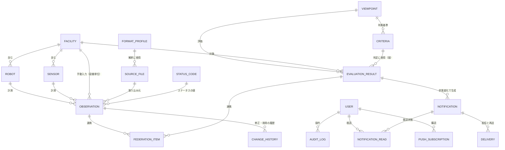

# データモデル

目的: 本システムが保持するデータの構造（論理モデル）と、DynamoDB での持ち方（物理設計の案）を定める。項目の定義（型・単位・取得元）は [data-dictionary.md](./data-dictionary.md)、データの流れは [data-flow.md](./data-flow.md) を参照する。

> **位置づけ**
> - 論理モデルは、要件（FR）にもとづく。物理設計は、DynamoDB を採用する前提（[ADR-0002](../adr/0002-deployment-serverless.md)、[ADR-0005](../adr/0005-tech-stack.md)）の**提案**で、実装前に、FR-6.5（推移のグラフ）などのアクセスパターンを満たせるか検証する。検証の結果、変更する場合がある
> - DB へのアクセスは、Repository のポートを介して行い、ドメインのコードに DynamoDB の型を出さない（[ADR-0001](../adr/0001-modular-monolith-ports-and-adapters.md)）。そのため、物理設計を変えても、論理モデルは変わらない
> - 未確定の事項は `TODO:` と確認事項の番号（rfp.md の Q-xxx）で示す

## 1. 論理モデル

### 1.1 ER 図

### 1.2 エンティティ

| エンティティ | 内容 | 主な属性（詳細は data-dictionary.md） | 要件 |
|--------------|------|---------------------------------------|------|
| 設備 Facility / Robot / Sensor | ハウス→ロボット／環境センサーの階層。識別子は一意 | 設備ID、種別、名称、親（ハウス）、状態（有効／削除）、登録日時 | FR-2 |
| 観測値 Observation | 計測または入力された1つの値。自動取り込みも手動入力も同じ形式 | 設備ID、項目、日時、値、取得元、状態（有効／論理削除／欠損・遅延）、取り込み元ファイル、FormatProfile の版、入力者 | FR-1.10、FR-4 |
| 取り込み元ファイル SourceFile | 取り込んだファイルの記録。再取り込みの防止と追跡 | 取り込み元、識別子、更新日時、ハッシュ、取得日時、結果、件数、エラー内容 | FR-1.6、FR-1.8 |
| FormatProfile | ファイルの解釈（レイアウトと項目の対応づけ）。版と状態（仮決め／確定）を持つ | 種別、版、状態、マッピング、根拠 | FR-1.3、FR-1.11 |
| ステータスコード StatusCode | ロボットの状態のコード | コード値（一意）、名称、説明、カテゴリ（正常／注意／異常） | FR-3 |
| 観点 Viewpoint | 評価の観点の定義 | 観点ID、名称、対象、表示順、指標 | FR-5.1、[viewpoint/](../viewpoint/) |
| 判断基準 Criteria | 観点の指標ごとの条件と閾値 | 観点、指標、型（上限／下限／範囲）、閾値、版、既定値か変更後か | FR-5.7 |
| 評価結果 EvaluationResult | 観点・対象・視点ごとの評価 | 観点、設備、視点（短期／長期）、期間、ステータス、メトリクス値、診断メッセージ、推奨アクション、判断基準の版、評価日時 | FR-5、FR-6 |
| 通知 Notification | 通知の内容 | 種別、対象、観点、ステータス、メッセージ、発生日時、重複抑制のキー | FR-7 |
| 配信 Delivery | 通知の配信の結果 | 通知、手段、結果、試行回数、日時 | FR-7.7 |
| 既読 NotificationRead | 通知の既読状態 | 通知、状態（未読／既読）、日時。TODO: 単位（利用者ごとか共通か。Q-018、Q-011） | FR-7.6 |
| Web Push 購読 PushSubscription | 通知を受ける端末の購読 | 利用者、購読情報、有効／解除。TODO: 単位（要件側 TODO） | FR-7.2 |
| 連携項目 FederationItem | 農業情報基盤へ送るデータの状態（連携キュー） | 対象（観測値／評価結果の参照）、状態（待機／送信済／失敗／保留）、試行回数、結果、日時 | FR-8 |
| ユーザー User | 利用者。TODO: 要否（Q-017） | ユーザーID（一意）、名前、ロール、最終ログイン。認証情報は Cognito に持つ（パスワードをアプリで保持しない）。代替構成ではアプリ内 | FR-9 |
| 変更履歴・操作履歴 ChangeHistory / AuditLog | 入力・設定の変更の追跡 | 操作種別、対象、変更者、変更前後、日時 | FR-4.2.3、NFR-5.7 |
| 設定 Setting | 取り込み設定（秘密情報は参照名のみ）、取得間隔、通知設定 | キー、値、更新日時 | FR-1.4、NFR-4.5 |

### 1.3 主な制約・ルール

- **設備の階層**: ロボット・センサーは、1つのハウスに属する。ハウスは複数。識別子は設備全体で一意
- **観測値の一意性**: （設備、項目、日時、取得元）で一意とする。同じ項目・時刻に、自動取り込みと手動入力の値が重なる場合は、両方を保持し、評価での優先は未定（TODO: FR-4.1.4）
- **論理削除**: 設備・手動入力・ステータスコードは、論理削除とし、過去のデータと評価の参照を保つ（TODO: 設備削除時の過去データの扱い。FR-2.3）
- **欠損の表現**: 欠損は 0 などで代用せず、値なし（欠損）として区別して保持する。遅延（到着が遅れたデータ）は、到着日時を持つ（[coding-standards.md](../../20_development/coding-standards.md)）
- **時刻**: UTC（ISO 8601）で保存し、表示時に日本時間へ変換する
- **評価結果は派生データ**: 観測値と判断基準から再計算できる。保存は、画面の初期表示を速くするためで、判定に使った判断基準の版を残す。判断基準の変更時の再計算の要否は未定（TODO: 要件側）
- **秘密情報は保持しない**: 取り込みの認証情報は、設定に参照名のみを持ち、値は秘密情報の保管サービスに置く（NFR-5.4）
- **実データをテストに使わない**: テスト・サンプルは、合成データ（`tests/fixtures/`）

## 2. 物理設計（DynamoDB の案）

### 2.1 アクセスパターン

| ID | アクセスパターン | 頻度 | 要件 |
|----|------------------|------|------|
| AP-01 | 設備の一覧と階層（ハウスとその配下）を取得する | 画面の表示ごと（少量） | FR-2、FR-6.6 |
| AP-02 | （設備、項目）の観測値を、期間で、日時順に取得する（推移のグラフ、評価の入力） | 評価ごと、グラフの表示ごと | FR-5、FR-6.5 |
| AP-03 | （設備、項目）の最新の観測値を取得する | 評価ごと | FR-5、環境適応性（短期） |
| AP-04 | 取り込み済みのファイルかを判定する（取り込み元＋識別子） | 取り込みごと | FR-1.6 |
| AP-05 | 設備ごと・観点ごと・視点ごとの、最新の評価結果を取得する | ダッシュボードの表示ごと（約10秒間隔） | FR-6.1 |
| AP-06 | 観点の評価結果の履歴（期間）を取得する | 詳細・グラフの表示ごと | FR-6.5 |
| AP-07 | 通知の一覧を、日時順に、種別・既読／未読で絞って取得する。未読の件数を取得する | 画面の表示ごと | FR-7.5、FR-7.6 |
| AP-08 | 手動入力データを、カテゴリ・設備・期間・入力者で絞って、一覧する | 画面の表示ごと | FR-4.2.1 |
| AP-09 | 変更履歴を、操作種別・変更者・期間で絞って、一覧する | 画面の表示ごと（少量） | FR-4.2.3 |
| AP-10 | 連携キューで、状態が「待機」「失敗」のものを取得する | 連携ジョブごと | FR-8 |
| AP-11 | ステータスコード定義、判断基準、設定を取得する | 評価・画面ごと（少量） | FR-3、FR-5.7 |
| AP-12 | 利用者、Web Push 購読を取得する（通知の配信先） | 通知ごと | FR-7.2、FR-9 |

### 2.2 テーブルの案

集約（一緒に読み書きする単位）ごとに、少数のテーブルに分ける。テーブルは、オンデマンド課金（または、無料枠に収まるプロビジョニング）とし、固定費を持たない（[architecture.md](../architecture/architecture.md) 11章）。

| テーブル | パーティションキー（PK） | ソートキー（SK） | 内容 | 主なアクセスパターン |
|----------|---------------------------|------------------|------|----------------------|
| Facilities | `FACILITY#{facilityId}` | `META` ／ `ROBOT#{robotId}` ／ `SENSOR#{sensorId}` | ハウスと配下の設備（1つのハウスの階層を、同じパーティションに置く） | AP-01 |
| Observations | `{equipmentId}#{itemKey}` | `{observedAt}#{source}`（`observedAt` は UTC の ISO 8601） | 観測値 | AP-02、AP-03（SK の降順で1件）。GSI-1（手動入力の一覧）。TTL（保存期間の確定後） |
| IngestedFiles | `SOURCE#{sourceId}` | `FILE#{fileId}` | 取り込み済みファイルの記録（識別子・ハッシュ・結果） | AP-04。取り込みログも同じテーブルで、`LOG#{日時}` として持つ |
| Evaluations | `{facilityId}#{viewpointId}#{horizon}` | `{evaluatedAt}` | 評価結果。最新は SK の降順で1件 | AP-05、AP-06 |
| Notifications | `NOTIFICATION` ／ `USER#{userId}` | `{createdAt}#{notificationId}` | 通知。既読状態は、利用者ごとの項目として持つ（TODO: 単位） | AP-07。GSI-2（種別・既読で絞る） |
| FederationQueue | `STATUS#{status}` | `{enqueuedAt}#{itemId}` | 連携キュー。状態ごとのパーティション | AP-10。TTL（送信済みの期限） |
| Config | `CONFIG#{kind}` | `{key}` | ステータスコード、判断基準（既定値・変更後）、観点の定義、設定、ユーザー、Web Push 購読。少量のデータ | AP-11、AP-12 |
| AuditLog | `AUDIT#{yyyymm}` | `{occurredAt}#{id}` | 変更履歴・操作履歴 | AP-09。TTL（保存期間の確定後） |

- **GSI-1（Observations）**: PK = `{facilityId}#{category}`（手動入力のみ）、SK = `{observedAt}`。手動入力の一覧（AP-08）。入力者・キーワードでの絞り込みは、取得後にアプリ側で行う（件数が小さい）
- **GSI-2（Notifications）**: PK = `{kind}#{readState}`、SK = `{createdAt}`。種別・既読／未読での絞り込みと、未読の件数（AP-07）
- 観測値の1つのパーティションは、1つの設備の1つの項目で、1日あたり数百〜数千件・1年で数十万件程度（暫定の前提。architecture.md 10章）。パーティションあたりの書き込みの上限に対して小さく、ホットパーティションの懸念は小さい
- **全件の走査（Scan）は使わない**。設定の少量のデータを除き、キーで引く（[coding-standards.md](../../20_development/coding-standards.md)）

### 2.3 評価・書き込みの方針

- 観測値と、連携キューへの追加は、DynamoDB のトランザクション書き込みで、同時に書く（ADR-0004）。重複の防止には、条件付き書き込み（条件式）を使う
- 評価結果は、観点・設備・視点ごとに、最新の1件を引けるキーで保存する。履歴は、同じパーティションに追記する
- 期限のあるデータ（連携キューの送信済み、取り込みログ、操作履歴）は、TTL で自動削除し、費用の増加を防ぐ。観測値の TTL は、保存期間の確定後に設定する（TODO: 保存期間。rfp.md 6章）
- バックアップは、DynamoDB のポイントインタイムリカバリ等を使う（NFR-4.2。architecture.md 6章）。保存期間は、プロジェクト終了後1年以上（暫定）

### 2.4 検証が必要な点（実装前）

- **FR-6.5（推移のグラフ）**: 長期視点の最大90日の推移を、期間指定で取得し、アプリ側で集計して、NFR-3.5（10秒以内、暫定）を満たせるか
- **ダッシュボードの初期表示**: AP-05 を、全観点（10観点）×視点（2）×設備で、NFR-3.4（3秒以内、暫定）に収められるか。必要なら、設備ごとの最新の評価結果を1つの項目にまとめる
- **手動入力の一覧**: GSI-1 で、カテゴリ・設備・期間の絞り込みが成り立つか。入力者・キーワードの絞り込みの件数
- **観測値の重なり**: 自動取り込みと手動入力の値が重なる場合の優先ルール（FR-4.1.4）を、SK の設計で表現できるか
- **コスト**: 無料枠に収まるか（読み取り・書き込みの見積もり。ダッシュボードの約10秒の読み直し × 利用者10名）。**オンデマンドの課金単価は未確認**（architecture.md 11.5）
- 検証の結果によっては、テーブルの統合（単一テーブル設計）や、集計用の項目の追加を行う。その場合も、Repository のポートの裏で変更する

## 3. 代替構成での扱い

前提条件（IAM 権限・接続元IP制限）が満たされず、代替の1台の構成（Lightsail・EC2）に切り替える場合は、SQLite のアダプタを実装する（ADR-0002）。論理モデルは変わらず、エンティティを表として持つ。SQLite では、観測値の期間の集計を SQL で行える。物理設計（テーブル定義・インデックス）は、その場合に追加する（TODO）。

## 4. 未確定事項

| 事項 | 現時点の扱い | 確認事項 |
|------|--------------|----------|
| 保存期間（観測値、評価結果、ログ）、生ファイルの保管 | 1年分を蓄積できる設計（暫定）。TTL は確定後に設定 | rfp.md 6章（番号なし）、NFR-3.6 |
| 観測値の重なり（自動取り込みと手動入力）の優先 | 両方を保持。評価での優先は未定 | FR-4.1.4 |
| 判断基準の変更時の過去の評価の扱い | 判定に使った基準の版を残す。再計算の要否は未定 | 要件側 TODO（UC-19） |
| 通知の既読の単位、Web Push 購読の単位 | 利用者ごとの項目として持つ案。確定は確認後 | Q-018、Q-011 |
| 設備・ステータスコード削除時の過去データ | 論理削除で参照を保つ案 | FR-2.3 |
| 認証・ロールのデータ | Cognito に持つ案。ロールは設定で割り当てる | Q-017 |
| 取り込みファイルの上書き更新の扱い | ファイル識別子・ハッシュで判定。仕様の提供後に決める | Q-001 |
| ファイル仕様・取得項目の確定 | FormatProfile（仮決め）で吸収。確定後に差分を反映 | Q-001〜Q-004 |

## 5. 関連文書

- [data-dictionary.md](./data-dictionary.md)（項目の定義）、[data-flow.md](./data-flow.md)（データの流れ）
- [architecture.md](../architecture/architecture.md)（5章 取り込み・連携、6章 データの保持）、[ADR-0003](../adr/0003-ingestion-adapter-and-provisional-spec.md)、[ADR-0004](../adr/0004-federation-outbox-standalone.md)
- 観点・判断基準: [viewpoint/](../viewpoint/)
