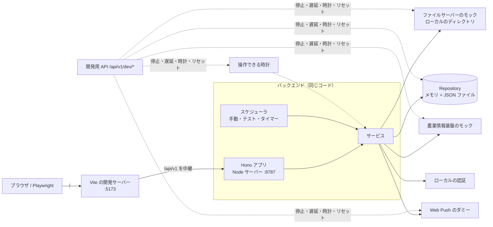

# 開発仕様書

目的: アプリを実装・テストするための仕様詳細を定める。ディレクトリ・パッケージ構成、モジュールとポート／アダプタの対応、AWS なしで動かすローカル実行構成、未確定事項の暫定仕様（採用値と根拠）、ユースケースと画面・API・ジョブの対応、テスト構成を示す。

> **この文書の位置づけ**
> - 画面・API・ジョブの振る舞いは [functional-specification.md](./functional-specification.md)、構成の方針は [architecture.md](../architecture/architecture.md)、データ項目は [data-dictionary.md](../data/data-dictionary.md)、観点・判断基準は [viewpoint/](../viewpoint/) に従う。ここには**重複して書かず**、開発のために決めた事項（構成、ローカル実行、暫定の採用値、テスト）のみを書く
> - 要件・ユースケース・設計のうち、発注者への確認が必要な事項（Q-番号）は、4章に**暫定の採用値と根拠**を示す。確認の結果で変わる場合は、4章の「実装の場所」の1か所（設定・定数・アダプタ）を変える
> - 基礎部分（本書の初版）に続き、全ユースケース（UC-01〜UC-24）を実装した。実装した範囲と、残りの課題は、8章に示す
> - 作成した日: 2026-10-09。技術スタックは [ADR-0005](../adr/0005-tech-stack.md) に従う

## 1. ディレクトリ・パッケージ構成

### 1.1 リポジトリ構成

[directory-structure.md](../../00_project/directory-structure.md) に従い、`src/`（backend・frontend・shared）と `tests/` に分ける。

```text
smart-farm-monitoring/
├── package.json / pnpm-workspace.yaml / pnpm-lock.yaml   # pnpm ワークスペースのルート（ツール類は開発用の依存）
├── tsconfig.json                 # TypeScript の共通設定（各パッケージが継承）
├── eslint.config.js / .oxlintrc.json / .prettierrc / .prettierignore / .editorconfig
├── .license-check/               # 依存パッケージのライセンス確認のレポート（license-report.md）
├── vitest.config.ts              # 単体・結合テスト、カバレッジ
├── playwright.config.ts          # E2E テスト
├── playwright.stress.config.ts   # 負荷テスト（`pnpm test:stress`。6.5）
├── playwright.csp.config.ts      # 画面の CSP の確認（`pnpm test:csp`。6.7）
├── playwright.smoke.config.ts    # サーバーレス環境のスモークテスト・性能の実測（`pnpm test:smoke`。手動実行。6.6）
├── dev-ports.ts                  # 開発サーバーのポート（Vite 5173・バックエンド 8787）。playwright.config.ts と vite.config.ts が共有
├── .env.example                  # 環境変数の一覧（ダミー値）
├── src/
│   ├── shared/                   # @smart-farm/shared: フロントエンドとバックエンドで共有する定数・スキーマ・型
│   │   ├── constants/            #   ステータス・観点・データ項目・メトリクス・権限・並べ替え・入力の上限
│   │   ├── schemas/              #   Zod スキーマと型（設備・観測値・評価・判断基準・通知・認証・API・取り込み・監査）
│   │   ├── errors.ts             #   共通のエラー型（AppError）と、検証・重複の生成関数
│   │   └── time.ts・omit-undefined.ts・criteria-text.ts   #   時間の単位・タイムゾーン、値が undefined のキーを除く関数、判断基準の文言
│   ├── backend/                  # @smart-farm/backend: Hono のバックエンド
│   │   ├── domain/               #   ドメイン層（評価エンジン、通知の規則、品質判定）。外部に依存しない純粋なロジック
│   │   ├── application/          #   アプリケーション層（ユースケース）とポート
│   │   ├── infrastructure/       #   インフラ層（ポートのアダプタ。ローカル実装（local/repositories/ に集約ごとの Repository）、FormatProfile、ログ）
│   │   ├── presentation/         #   提示層（Hono アプリ、ルート、領域ごとのハンドラ、認証・認可、共通エラー）
│   │   └── runtime/              #   実行形態（設定、組み立て、Node サーバー、Lambda ハンドラ）
│   └── frontend/                 # @smart-farm/frontend: React + Vite の SPA（pages/・components/・hooks/・api/・auth/・router/・push/・i18n/・styles/。public/ はサービスワーカー・マニフェスト）
├── tests/
│   ├── unit/{shared,backend,frontend}/   # 単体テスト（src/ と同じ階層構成）
│   ├── integration/                      # 結合テスト（Hono アプリ・サービス・Repository の契約）
│   ├── e2e/                              # E2E テスト（Playwright。UC-NN-<英語の概略名>.ts と scenario-<英語の概略名>.ts。補助は support/）
│   ├── stress/                           # 負荷テスト（Playwright。stress-NN-<英語の概略名>.ts。補助は support/。6.5）
│   ├── smoke/                            # サーバーレス環境のスモークテスト・性能の実測（Playwright。smoke-NN-<英語の概略名>.ts。補助は support/。6.6）
│   ├── fixtures/                         # 合成データ（ファイルサーバーのモック用のファイル）
│   └── support/                          # テストの補助（組み立て・データ生成・API のスタブ・画面の単体テストの描画）
├── scripts/                      # 補助スクリプト（いまはなし）
└── test-result/                  # テストの出力（Git 管理外。カバレッジ、動画、スクリーンショット、レポート）
```

### 1.2 パッケージ

| パッケージ | パス | 役割 | 主な依存 |
|------------|------|------|----------|
| （ルート） | `/` | ツール（TypeScript、Vitest、Playwright、ESLint、Prettier）とテストの依存。アプリのコードは持たない | 開発用の依存のみ |
| `@smart-farm/shared` | `src/shared/` | 定数・Zod スキーマ・型・共通のエラー。画面と API で同じ検証を使う（FR-4.1、FR-5.7）。サブパス公開（`@smart-farm/shared/schemas/criteria` のように、`index.ts` を介さない） | zod |
| `@smart-farm/backend` | `src/backend/` | ドメイン・アプリケーション・インフラ・提示・実行形態 | hono、@hono/node-server、@hono/aws-lambda、web-push（3.6.7。Web Push の送信。#241）、zod、shared |
| `@smart-farm/frontend` | `src/frontend/` | SPA | react、react-dom、zod、shared。開発: vite、@vitejs/plugin-react |

- 共通コードは、`exports: { "./*": "./*.ts" }` で、TypeScript のソースを直接公開する。ビルドなしで、Vite・Vitest・Node（型の除去）・tsc が同じソースを読む
- 本体のコードは、拡張子つきの相対 import（`./x.ts`）と `import type` を使う（Node 24 の型の除去、`verbatimModuleSyntax`、`erasableSyntaxOnly` と整合させるため。`enum`・namespace・パラメータプロパティは使わない）

### 1.3 実行環境・バージョン

| 項目 | 内容 |
|------|------|
| Node.js | `engines: >=24`。コードは Node 24 の機能の範囲で書く（開発機は v25.9.0。同じコードで動作を確認した）。バックエンドは、Node の型の除去で、ビルドなしで `.ts` を直接実行する（`node --disable-warning=ExperimentalWarning src/backend/runtime/main.ts`） |
| pnpm | 12.8.2（`packageManager`）。ロックファイル `pnpm-lock.yaml` で固定。pnpm の新しい版の公開から一定時間以内のパッケージを拒否する設定（供給網の保護）が有効で、その範囲外の版は使えない。回避するための除外設定は追加しない。`pnpm-workspace.yaml` に、ライセンス対応の `overrides`（`lightningcss: '-'`。Vite 8 が必須の依存として宣言する MPL-2.0 のパッケージを導入しない。1.5）と、`allowBuilds`（`esbuild: false`。インストール時スクリプトを実行しない）を置く |
| TypeScript | 6.0.3（`~6.0.3`）。ADR-0005 は「6系または7系。周辺ツールの対応を確認して決める」。typescript-eslint 8.71 が TypeScript 6.1 未満のみ対応のため、6.0 系を採用した |
| ESLint | 9.39.5（flat config、typescript-eslint 8.71 の `strictTypeChecked` + `stylisticTypeChecked`、react-hooks 7）。ESLint 10 は採用していない（以前は、`eslint-plugin-jsx-a11y` が未対応だったため。同プラグインは、ライセンス対応で外した。ほかの依存の ESLint 10 への対応は、未確認） |
| oxlint | 1.84（`~1.84.0`）。`jsx-a11y` のルール（アクセシビリティ）の検査のみに使う。`eslint-plugin-jsx-a11y` は、axe-core（MPL-2.0）に依存するため、使わない。設定は `.oxlintrc.json`（1.4・1.5） |
| Vitest / Vite | Vitest 4.1.12（ADR-0005 の 4系）、Vite 8.3 系（`~8.3.1`）、`@vitest/coverage-v8`。CSS の最小化は esbuild（`esbuild ^0.28.0`。`src/frontend/vite.config.ts` の `build.cssMinify: 'esbuild'`。Vite の既定の lightningcss は、MPL-2.0 のため使わない） |
| Playwright | 1.64（chromium） |
| React | 19.3、`react-dom` 19.3 |
| Hono | 4.13、`@hono/node-server` 2.1、`@hono/aws-lambda` 1.0（`hono/aws-lambda` が非推奨のため、同じ Hono プロジェクトのアダプタを使う） |
| Zod | 4.6 |
| web-push | 3.6.7（固定。#241）。Web Push の本文の暗号化（RFC 8291）と VAPID の署名・送信。**ライセンスは MPL-2.0**（弱いコピーレフト）。改変せず（`pnpm patch` などで中身を変えない）、サーバー側（Lambda）だけで使い、配布物（画面）には含めない。MPL-2.0 は 0 件にしていた運用の、唯一の例外（ユーザーが了承。`.license-check/license-report.md`）。型定義は配布物にないため、使う範囲だけを `src/backend/infrastructure/web-push/web-push.d.ts` に宣言する。4.0.0 は、公開から日が浅く（2026-11-06）、見送った |

### 1.4 TypeScript・Lint・フォーマット・テストの設定

| 項目 | 内容 |
|------|------|
| tsconfig | ルートの `tsconfig.json` に共通の設定（`strict`、`noUncheckedIndexedAccess`、`exactOptionalPropertyTypes`、`noImplicitOverride`、`noFallthroughCasesInSwitch`、`noImplicitReturns`、`noUnusedLocals`、`noUnusedParameters`、`verbatimModuleSyntax`、`erasableSyntaxOnly`、`isolatedModules`）。`src/shared`・`src/backend`・`src/frontend`・`tests` の各 `tsconfig.json` が継承し、`lib`・`types`・`jsx` のみ変える |
| ESLint | `eslint.config.js`（flat config）。型情報つきの strict 系ルール、`no-console`（ログは共通のロガー）、`enum` の禁止。**依存の向きを `no-restricted-imports` で強制する**: ドメイン・共通コードは Hono・React・AWS SDK・Node 標準・外側の層を import できない。アプリケーション層は Hono・React・AWS SDK・インフラ・提示・実行形態を import できない。フロントエンドは backend を import できない |
| oxlint | `.oxlintrc.json`。`jsx-a11y` プラグインの、eslint-plugin-jsx-a11y の推奨設定と同じルール・オプション（31 ルール）のみを有効にする。`pnpm lint` は、`eslint .` に続けて `oxlint -c .oxlintrc.json src/frontend` を実行する。例外の指定は、`oxlint-disable-next-line` を使う（`eslint-disable` だと ESLint が「未使用の指示」と報告するため） |
| Prettier | `.prettierrc`（シングルクォート、100桁、末尾カンマ）。`docs/`・Markdown・`tests/fixtures/`（意図的に不正な形式のファイルを含む）・`test-result/` は対象外 |
| Vitest | `vitest.config.ts`。プロジェクトを2つ持つ: `node`（`tests/unit/{shared,backend}`・`tests/integration`）、`frontend`（`tests/unit/frontend`、jsdom）。カバレッジは v8、出力は `./test-result/coverage` |
| Playwright | `playwright.config.ts`。`tests/e2e/UC-NN-*.ts`・`tests/e2e/scenario-*.ts`、video は手元で常に有効（CI では撮らない）、出力は `./test-result/e2e`、HTML レポートは `./test-result/playwright-report`。バックエンドと Vite を起動して実行する（6章） |

### 1.5 スクリプト

コマンドの詳細と実行結果は [commands.md](../../00_project/commands.md)。

| スクリプト | 内容 |
|------------|------|
| `pnpm test` | 単体・結合テスト（カバレッジつき）→ E2E テスト。カバレッジレポートを `./test-result/` に出力 |
| `pnpm test:unit` / `pnpm test:e2e` | それぞれのみ |
| `pnpm data:backup` | データファイル（`PERSISTENCE=file`）のバックアップ・一覧・復元（`backup`・`list`・`restore`。手順は [backup-restore.md](../../40_operations/backup-restore.md)） |
| `pnpm test:stress` | 負荷テスト（大量データの状態で、全ユースケースの操作の応答時間を計測する。6.5。結果は `./test-result/stresstest.result.log`） |
| `pnpm test:csp` | 画面の CSP の確認（本番ビルドの画面に、CloudFront と同じ CSP を付けて、主な画面を一巡し、違反が出ないことを確認する。6.7） |
| `pnpm test:smoke` | サーバーレス環境（評価環境）のスモークテスト・性能の実測（6.6。手動実行。結果は `./test-result/smoketest.result.log`） |
| `pnpm lint` / `pnpm typecheck` / `pnpm format` | ESLint と oxlint（jsx-a11y）、型検査（共通・backend・frontend・tests）、Prettier |
| `pnpm dev:backend` / `pnpm dev:frontend` / `pnpm build` | ローカルのバックエンド、Vite の開発サーバー、フロントエンドのビルド |

## 2. モジュールとポート／アダプタ

### 2.1 層と依存の向き

依存は内向き（提示・インフラ → アプリケーション → ドメイン。[architecture.md](../architecture/architecture.md) 3.2、[ADR-0001](../adr/0001-modular-monolith-ports-and-adapters.md)）。ドメインは、SDK・Hono・React に依存しない。

| 層 | ディレクトリ | 内容 |
|----|--------------|------|
| ドメイン | `src/backend/domain/` | `evaluation/`（観点の定義、メトリクスの算出、判定、集計、診断メッセージ、評価の単位ごとの評価）、`notification-rules.ts`、`observation-quality.ts`、`status-code.ts`。**純粋関数**。時刻・乱数・DB・ネットワークを使わない |
| アプリケーション | `src/backend/application/` | ユースケース（サービス）、ポートの定義（`ports/`）、ジョブ、スケジューラ、動作設定（`settings.ts`）、初期データ |
| インフラ | `src/backend/infrastructure/` | ポートの実装。`common/`（アダプタ共通の規則: 観測値・手動入力の絞り込みと並べ替え、ページ分割。ローカルと DynamoDB が共有）、`local/`（ローカルのアダプタ）、`dynamodb/`（DynamoDB の Repository。ADR-0007）、`cognito/`（Cognito の認証と資格情報。ADR-0008）、`format-profiles/`、`logging/`。そのほかの本番のアダプタ（Cognito・実ファイルサーバー等）は、同じポートの実装として、ここに追加する |
| 提示 | `src/backend/presentation/` | Hono アプリ、ルート一覧、領域ごとのハンドラ（`handlers.ts`・`viewpoint-handlers.ts`・`manual-entry-handlers.ts`、設定・管理は `admin-handlers.ts` が、`equipment-`・`status-code-`・`criteria-`・`user-`・`ingestion-`・`push-subscription-handlers.ts` をまとめる）、ミドルウェア（`middleware.ts`）、認証・認可の補助（`auth-guards.ts`）、本文・クエリの読み取り（`request-parsing.ts`）、ETag（`etag.ts`）、共通のエラー形式、開発用 API（`dev-routes.ts`）。本番の経路は、インフラ層に依存しない（ESLint で強制。開発用 API の `dev-routes.ts`・`api-deps.ts` を除く） |
| 実行形態 | `src/backend/runtime/` | 環境変数の検証（`config.ts`）、組み立て（`container.ts`）、Node サーバー、Lambda ハンドラ、起動のエントリ |

### 2.2 モジュールとユースケースの対応（ADR-0001 の8モジュール）

| モジュール | アプリケーション層のサービス | 主な責務 | UC |
|------------|------------------------------|----------|----|
| 取り込み | `ingestion/ingestion-service.ts`、`ingestion-admin-service.ts`（設定の参照・変更・状況）、`ingestion-settings.ts`、`file-server-credentials.ts`（認証情報から認証のヘッダーを組み立てる）、`routing-file-source.ts`（接続方式で、モック・S3 と HTTP に振り分ける） | 取得 → 重複判定 → 解釈 → 検証 → 保存 → ログ → 評価の更新。再試行、失敗の通知。接続テスト。取り込み元ごとに独立して実行（定期の実行で、1つが想定外のエラーで失敗しても、他の取り込み元は実行し、エラーは、実行後にジョブへ伝える） | UC-08, 09, 15, 16, 24 |
| 設備管理 | `equipment/equipment-service.ts`、`equipment/status-code-service.ts` | 設備の登録・編集・削除（論理）・階層の取得、ステータスコードの登録・編集・削除（論理）・一覧。変更後は、評価を更新し、変更履歴に記録 | UC-12, 17 |
| 手動入力 | `manual-entry/manual-entry-service.ts`、`audit/audit-service.ts` | 検証・保存・修正・論理削除・一覧（検索・絞り込み・並べ替え・ページ分割）・変更履歴の記録と参照。保存後は、評価の更新・連携キューへの追加。項目のカタログと検証は `shared/constants/items.ts`・`shared/schemas/manual-entry.ts`（画面と共通） | UC-06, 07, 18 |
| 評価 | `evaluation/evaluation-service.ts`、`criteria-service.ts`、`criteria-admin-service.ts`（判断基準の編集・既定値へ戻す）、`scope.ts` | 観測値の読み出し → 純粋関数の評価 → 保存 → 状態変化の検知 → 通知・連携キューへ | UC-01〜04, 19, 21 |
| 通知 | `notification/notification-service.ts`、`push-subscription-service.ts` | 作成（状態変化は出来事で判定。取り込み系は 60 分の抑制）、一覧（経過・回復日時・メモの件数・読み込み時点）、既読（個別・一括〔`until` まで。件数つきの確認〕）、メモの追記・一覧、Web Push の購読の登録（暗号鍵つき）・解除・状態、配信（実配信・ダミー）と再送 | UC-05, 10, 22, 23, 24 |
| 連携 | `federation/federation-service.ts` | 連携キューへの追加、非同期の送信、保留・再試行、結果の記録 | UC-11 |
| 参照 | `query/dashboard-query.ts`、`viewpoint-query.ts`、`observation-query.ts` | ダッシュボード・観点の詳細・推移・満足度・取り込み済みデータの一覧（保存済みの評価結果・観測値を読むだけ） | UC-01〜03, 20, 21 |
| 認証 | `auth/access-policy.ts`、`auth/auth-service.ts`、`auth/user-service.ts` | ロール → 権限の方針、ログイン・更新・ログアウト、認証済みの利用者（権限つき）、ユーザーの登録・編集・削除（一覧は最終ログイン日時つき） | UC-13, 14 |
| （横断）ジョブ | `jobs/job-runner.ts`、`jobs/scheduler.ts` | JB-01〜JB-04 の実行、時計に基づくスケジューラ | UC-08〜11, 24 |

### 2.3 ポートとアダプタ

ポートは `src/backend/application/ports/` に定義する。ローカルのアダプタは `src/backend/infrastructure/local/`。

| ポート | 役割 | ローカル（基礎部分で実装） | 本番（後で追加） |
|--------|------|----------------------------|------------------|
| `FileSourcePort` | ファイルの一覧・読み取り・接続テスト（読み取り専用） | `mock-file-server.ts`: ローカルのディレクトリ（`<ルート>/<取り込み元>/`）。停止・遅延を再現。`infrastructure/http/`（`address-guard.ts`: 内部のアドレスの判定、`http-probe.ts`: HTTP の接続テスト。ADR-0022） | SFTP・S3・HTTPS 等（Q-002）。モックと同じ契約テストを適用 |
| `FormatProfile` / `FormatProfileRegistry` | ファイルの解釈（レイアウトと項目の対応づけ。版と状態） | `format-profiles/declarative-profile.ts`: 宣言的な設定（JSON）で、ロボット JSON・環境センサー CSV を読む | 確定仕様の FormatProfile を追加・差し替え（FR-1.12） |
| `Repository`（13種） | 永続化。`Repositories` にまとめる | `local/local-repositories.ts`（組み立て）と `local/repositories/`（集約ごとの実装）: メモリ + JSON ファイル（3.4） | `dynamodb/dynamodb-repositories.ts`（組み立て）と、集約ごとの実装: DynamoDB（物理設計は [data-model.md](../data/data-model.md) 2章・[ADR-0007](../adr/0007-dynamodb-table-design.md)。対応は 4.3） |
| `NotifierPort` | Web Push の配信（画面内の通知は、通知の保存そのもの） | `web-push/web-push-notifier.ts`: プッシュサービスへ実際に送る（`WEB_PUSH_DELIVERY=vapid`。#241。送信は `library-sender.ts`〔`web-push` 3.6.7〕）。`local/dummy-web-push.ts`: 配信を記録。成功・失敗・購読無効を再現（既定。ローカル・テスト） | Web Push の配信サービス。メール等の追加 |
| `FederationPort` | 農業情報基盤への送信 | `mock-federation.ts`: 受け取りを記録。成功・停止・遅延・拒否を再現 | `http/ngsi-ld-federation.ts`（NGSI-LD の upsert。`FEDERATION_MODE=ngsi-ld`。ADR-0024。#177 の PR 1）。接続先が未設定のあいだは、保留 |
| `AuthPort` | 認証（誰か）。ロールから権限への変換は、アプリケーション層の `AccessPolicy` | `local-auth.ts`: アプリ内のユーザーID・パスワード、セッション、試行回数の制限（3.6）。`cognito/cognito-identity.ts`: Amazon Cognito（ADR-0008。`AUTH_PROVIDER=cognito`） | Amazon Cognito（実装済み） |
| `ClockPort` | 現在時刻と待機（`sleep`） | `clocks.ts`: システム時計、操作できる時計（固定・進行） | （同じ） |
| `SecretPort` | 秘密情報の読み取り・書き込み・状態（非同期。#206） | `ssm/ssm-secret.ts`: パラメータストア（SecureString。5 分のキャッシュ。`get` の `refresh` で取り直す）。`local/env-secret.ts`: メモリ・環境変数 `SECRET_<参照名>`（ローカル・テスト） | Secrets Manager（自動のローテーションが要るとき） |
| `PasswordHasherPort` | パスワードのハッシュ化（ローカルの資格情報が使う） | `password-hasher.ts`: scrypt（ソルトつき） | Cognito では、使わない（ユーザーのパスワードを持たない） |
| `CredentialPort` | 資格情報（パスワード）の管理（作成・再設定・削除）。ユーザー管理（UC-14）・最初のユーザーが使う | `local-credentials.ts`: ハッシュを、ユーザーの記録に持つ | `cognito/cognito-identity.ts`: Cognito（`AdminCreateUser`・`AdminSetUserPassword`・`AdminDeleteUser`） |
| `LoginThrottlePort` | ログインの試行回数の制限（接続元ごと。複数の実行環境で共有する実装が使う） | `in-memory-login-throttle.ts`: メモリ（ローカルの認証は、`local-auth.ts` が自前で持つ） | `dynamodb/login-throttle.ts`: DynamoDB（`LOGINFAIL`。TTL で自動削除） |
| `IdGeneratorPort` | 識別子の生成 | `ids.ts`: UUID、連番（テスト用） | （同じ） |
| `Logger` | 構造化ログ（JSON） | `logging/json-logger.ts`: 標準出力、秘密情報らしい名前の項目をマスク | Powertools の Logger 等への差し替え可 |

`Repositories` の13種: 設備、ステータスコード、判断基準（変更後）、観測値、評価結果（最新と状態変化）、通知（既読は利用者ごと）、取り込み（ファイルの記録・ログ）、連携キュー（ログ）、変更履歴、手動入力、ユーザー、Web Push の購読、設定。

### 2.4 評価エンジンの構造（[architecture.md](../architecture/architecture.md) 7章）

`src/backend/domain/evaluation/`。観点の追加は、「観点の定義」（`viewpoints/`）と「判断基準の既定値」（`default-criteria.ts`）の追加で行う（NFR-2.7、NFR-8.2）。

| 部品 | 内容 |
|------|------|
| `viewpoints/*.ts` | 観点の定義（`defineViewpoint`。主要メトリクスを省略すると、判定する指標と同じ）: 判定する指標、必須の入力、短期評価の有無、ダッシュボードの主要メトリクス、メトリクスの算出関数（robot-health.md / house-health.md / operation-health.md の算出式）。ロボット7・ハウス1・評価の運用面2 |
| `default-criteria.ts` | 判断基準の既定値（viewpoint/ の値）。閾値の型は上限型・下限型・範囲型。コードの判定ロジックに閾値を書かない |
| `measures.ts` | 観測値 → 集計済みの入力（使う観測値の選択、手動入力の優先、合計・最新・平均・最悪のカテゴリ、データ活用度合いの入力） |
| `grading.ts` | 閾値判定（境界は「以上」「未満」）、最も悪い判定、短期と長期の組み合わせ（不明を除く） |
| `engine.ts` | 1つの視点の評価: 必須の入力の不足・算出不能 → 不明、最も悪い判定、診断メッセージ・推奨アクション |
| `scope-evaluator.ts` | 評価の単位ごとに、全観点の短期・長期（当日・7・30・60・90日）を評価 |
| `messages.ts` | 診断メッセージ・推奨アクションの文言（暫定。Q-010） |

## 3. ローカル実行構成（AWS なしで、E2E・負荷テストを動かす）

### 3.1 全体

本番は、Hono のアプリを Lambda のハンドラとして使い、DynamoDB・Cognito・EventBridge 等を使う。ローカルでは、**同じ Hono アプリを Node のサーバーとして起動**し、ポートのローカル実装（メモリ／ファイルの Repository、モックの外部サービス、アプリ内の認証、操作できる時計）に差し替える。ドメイン・アプリケーション・提示のコードは、本番と同じ。



### 3.2 起動の方法

| 形態 | 入口 | 用途 |
|------|------|------|
| Node サーバー | `runtime/main.ts`（`pnpm dev:backend`）。`startNodeServer()`（`runtime/node-server.ts`） | ローカル開発、E2E、負荷テスト |
| Lambda ハンドラ | `runtime/lambda.ts`（`handler`）。`@hono/aws-lambda` の `handle` | 本番（関数の URL）。組み立ては最初の呼び出しで1回。`APP_MODE`・`PERSISTENCE` の明示が必須（未設定は `ConfigError`。`PERSISTENCE=file` は拒否。開発用 API・スケジューラは、指定にかかわらず無効。`SEED_MODE` は `ConfigError`）。初期化に失敗しても、失敗を保持せず、次の呼び出しで再試行する。`APP_MODE=production` は、DynamoDB・Cognito が必須（ADR-0009） |
| 合成データを生成する Lambda ハンドラ（#174: 取り込み元ごとの `latest.json` を、毎回、上書きする） | `runtime/demo-feed-lambda.ts`（`handler`）。ファイルの内容は `infrastructure/local/demo-feed-files.ts`（`buildDemoFeedFiles`）、定数は `application/demo/demo-feed-schedule.ts` | EventBridge が 15 分ごとに起動し、ファイルサーバーのモックの S3 に、直近 4 区間の合成データのファイル（ロボットの JSON・環境センサーの CSV。区間の時刻から決まる）を置く（Issue #77。ADR-0012）。環境変数は `FILE_SERVER_S3_BUCKET` のみ。S3 への書き込みだけ（DynamoDB・Cognito は使わない） |
| デモデータのコマンド | `runtime/demo-data-main.ts`（`pnpm demo-data seed` / `reset [--yes]`）。ロジックは `runtime/demo-data-cli.ts` | 評価環境のデモデータを、手元で、投入（`SEED_MODE=DEMO` と同じ内容。設備があれば何もしない）・リセット（ユーザー・`LOGINFAIL`・`JOBLOCK` 以外の全データと、S3 のファイルを消す。`--yes` がなければ、件数だけ示す。S3 を先に消し、失敗したら DynamoDB は消さない）する（Issue #77。ADR-0012）。AWS のエラーは、名前だけを出力する |
| ジョブの Lambda ハンドラ | `runtime/job-lambda.ts`（`handler`） | EventBridge の入力 `{ jobId }` で、JB-01〜JB-04 を実行する（Issue #76。ADR-0011）。組み立ては、API の Lambda と同じ（`parseLambdaConfig`）。実行の前に、`job:{jobId}` のロック（DynamoDB のリース式。期限 360 秒）を取り、取れなければ、実行しない（`SKIPPED`）。失敗は例外を投げる（再試行しない）。入力が不正なときは、内容を出さずに拒否する |
| 組み立て | `runtime/container.ts`（`createContainer(config, overrides)`） | 設定に応じて、アダプタを選び、サービスを組み立てる。テストは、時計・識別子・ログ・動作設定を差し替えて使う |

### 3.3 環境変数

起動時に Zod で検証する（`runtime/config.ts`。エラーには変数名のみで、値を含めない）。変数名とダミー値は `.env.example`。ハンドラの中で `process.env` を直接参照しない。

| 変数 | 既定 | 内容 |
|------|------|------|
| `APP_MODE` | `local` | `local`／`test`／`production`。`production` は、`AUTH_PROVIDER=cognito` と `PERSISTENCE=dynamodb` が必須（満たさなければ `ConfigError`。ADR-0009）。開発用 API は、`DEV_API_ENABLED=true` と明示した場合だけ有効（`production` では、DynamoDB が必須で、`DEV_API_ENABLED=true` は `ConfigError`） |
| `HOST`・`PORT` | `127.0.0.1`・`8787` | Node サーバーの待ち受け（`PORT=0` で空きポート） |
| `AUTH_PROVIDER` | `local` | `local`（アプリ内の認証）／`cognito`（Amazon Cognito。ADR-0008）。`cognito` は、`COGNITO_USER_POOL_ID`・`COGNITO_CLIENT_ID` が必須で、`PERSISTENCE=dynamodb` が必要。`INITIAL_USER_*` とは併用不可 |
| `PERSISTENCE` | `memory` | `memory`（メモリのみ）／`file`（`DATA_FILE` の JSON ファイル）／`dynamodb`（DynamoDB。`DYNAMODB_OBSERVATIONS_TABLE`・`DYNAMODB_MAIN_TABLE` が必須。ローカルの確認用に、`DYNAMODB_ENDPOINT`（DynamoDB Local）。`DEV_API_ENABLED` とは併用不可） |
| `DATA_FILE` | `.local-data/store.json` | ファイル永続化の保存先（Git 管理外） |
| `FILE_SERVER_S3_BUCKET` | なし | ファイルサーバーのモックの S3 のバケット名。指定すると、`FILE_SERVER_DIR` ではなく、S3 の `<バケット>/<取り込み元>/` を使う（評価環境の Lambda。Issue #77。ADR-0012）。S3 版には、停止・遅延の再現がない |
| `FILE_SERVER_DIR` | `.local-data/file-server` | ファイルサーバーのモックのルート。`<ルート>/robot/`・`<ルート>/environment-sensor/` に合成データのファイルを置く |
| `SEED_MODE` | `NONE` | `DEMO`: デモの設備・合成データ（3日分）・手動入力・評価・通知を投入（設備が1件もないときのみ） |
| `INITIAL_USER_ID`・`INITIAL_USER_NAME`・`INITIAL_USER_PASSWORD` | なし | 最初のユーザー（4章 No.2）。3つそろえて指定する。パスワードは、パスワードの条件（FR-9.2）を満たす |
| `ROLE_DEFINITIONS_JSON`・`INITIAL_USER_ROLE` | 管理者 `admin`（全権限）・一般 `general`（手動入力のみ）の 2 ロール | ロールと権限の割り当て（4章 No.1）。初期ユーザーのロールの既定は、ユーザー管理の権限を持つ最初のロール（既定では `admin`。なければ、`INITIAL_USER_ROLE` の指定が必須） |
| `DEV_API_ENABLED` | `false` | 開発用 API（3.8）を有効にするか。既定は無効。E2E（`playwright.config.ts`）・結合テスト（`tests/support/test-context.ts`）では、明示的に `true` にする。有効なときは、起動時に警告のログを出す。時刻を操作できる時計は、有効なときだけ作る（無効なときは、システム時計） |
| `TRUSTED_PROXY_HOPS` | `0` | 信頼するプロキシの段数（0〜10）。0 は、`X-Forwarded-For` を信頼せず、接続情報（Node: 接続元のアドレス、Lambda: イベントの `sourceIp`）を使う。N は、`X-Forwarded-For` の末尾から N 番目の値（信頼するプロキシが付けた値）を、ログインの試行回数の制限の接続元とみなす（値の数が N に満たなければ使わない）。E2E は 1。**CloudFront → 関数の URL の構成では、`X-Forwarded-For` が切り詰められるため、使わない**（ADR-0010） |
| `CREDENTIAL_STORE` | `memory` | 秘密情報の保管先（`memory`・`ssm`＝パラメータストア）。Lambda は、IaC が `ssm` を設定する（#206）。名前に SECRET・KEY を含めない |
| `CREDENTIAL_PATH_PREFIX` | なし | `ssm` のときの、パスの接頭辞（先頭と末尾が `/`。`/sfm/<環境>/`。必須）。形式が不正なときは、設定エラー |
| `HTTP_FILE_SOURCE_ALLOW_PRIVATE` | `false` | ファイルサーバー（HTTP）の接続先に、内部のアドレス（ループバック・プライベート・リンクローカル）を許可するか（#172。ADR-0022）。ローカル・E2E・テストで、手元の HTTP サーバーに接続するときだけ `true`。`APP_MODE=production` では、指定しても拒否する。開発サイト・本番には、設定しない |
| `LOGIN_FAILURE_LIMIT` | `5` | 接続元ごとのログインの失敗の制限の回数（1〜100 の整数。範囲外は設定エラー。4章 No.3。Issue #244） |
| `LOGIN_FAILURE_WINDOW_MINUTES` | `15` | 同じ制限の時間（分。1〜1440 の整数。範囲外は設定エラー。失敗の記録は、この時間で期限が切れる） |
| `CLIENT_IP_HEADER` | 未指定 | 利用者の IP が入っているヘッダーの名前（英数字とハイフン。小文字にして使う）。指定すると、そのヘッダーの値（IP として正しいときだけ）を、ログインの試行回数の制限の接続元とみなす（`TRUSTED_PROXY_HOPS`・接続情報より優先）。評価環境は、CloudFront の Function が入れる `x-sfm-viewer-ip`（ADR-0010） |
| `ORIGIN_VERIFY_SECRET` | 未指定 | CloudFront が、オリジンに付ける秘密のヘッダー（`x-sfm-origin-secret`）の値（英数字 32〜128 文字）。指定すると、API は、値が一致しない呼び出しを、`/health` を含めて、本文なしの 403 で拒否する（Issue #102）。**ローカル・テスト用**（Lambda では、起動しない） |
| `ORIGIN_VERIFY_ARN` | 未指定 | 上の秘密の値を保管している Secrets Manager の秘密の ARN（秘密の値ではない）。API の Lambda が、コールドスタートの 1 回だけ、読む。**本番の API の Lambda は、必須**（Issue #102） |
| `INGESTION_STOP_NOTIFICATION_ENABLED` | `true` | 新しいデータが届かない取り込み元を、「データ取得停止」として通知するか（4章 No.34） |
| `FEDERATION_MODE` | `mock` | 農業情報基盤との連携の方式（`mock`: モック〔ローカル・テスト〕／`ngsi-ld`: NGSI-LD のアダプタ。接続先・テナント・context は、設定から読む。ADR-0024。Issue #177） |
| `INGESTION_FUTURE_TOLERANCE_MINUTES` | `5` | 取り込みの計測日時の未来の許容（分。0〜60 の整数。範囲外は設定エラー）。受信より、これを超えて先の計測日時は、不正にする。手動入力は、5 分固定（4章 No.13。ADR-0016 の D-13。Issue #200） |
| `INGESTION_FILE_FAILURE_NOTIFICATION_ENABLED` | `true` | ファイル単位の失敗（読み取り不可・形式違い・大きすぎる）も、取り込み失敗として通知するか（4章 No.35） |
| `SCHEDULER_ENABLED`・`SCHEDULER_TICK_SECONDS` | `false`・`30` | サーバー内でスケジューラを動かすか |
| `LOG_LEVEL` | `info` | `debug`／`info`／`warn`／`error` |
| `DEFAULT_INGESTION_INTERVAL_MINUTES`・`STALE_AFTER_INTERVALS` | `15`・`3` | 評価の「全データ数」のスロットの幅（5・15・30・60・360・1440 のいずれか。取り込みの取得間隔は、設備ごとの設定〔#197〕で、この値を使わない）、「古い」の基準の倍数 |
| `WEB_PUSH_DELIVERY` | `dummy` | Web Push の配信の方式（#241）。`dummy`: 実際には送らず、記録だけ（ローカル・E2E）。`vapid`: プッシュサービスへ実際に送る（`WEB_PUSH_PUBLIC_KEY`・`WEB_PUSH_SUBJECT` が必要。秘密鍵は、SecretPort の `web-push/vapid-private-key`） |
| `WEB_PUSH_SUBJECT` | なし | VAPID の連絡先（https の URL。アプリの URL など。個人のメールアドレスは使わない）。`WEB_PUSH_DELIVERY=vapid` で必須 |
| `WEB_PUSH_PUBLIC_KEY` | なし | Web Push の公開鍵（VAPID。base64url）。設定すると、購読を受け付け、画面に公開鍵を返す。なければ、Web Push を使えない（画面内の通知のみ）。ダミー値は `.env.example` |
| `INGESTION_RETRY_BASE_DELAY_MS` | `1000` | 取り込みの再試行の待ち時間の基準（試行ごとに2倍） |
| `FEDERATION_EXPIRY_DAYS` | `30` | 連携の破棄の期限（日。1〜365 の整数）。連携キューに積んでから、この日数を過ぎても送れていない項目は、破棄する（#204。ADR-0016 の D-06） |

### 3.4 Repository のローカル実装（インメモリ + ファイル永続化）

- `infrastructure/local/local-store.ts`: コレクション（キー → 値の Map）を持ち、変更を一定時間（既定 300 ms）まとめて、JSON ファイルへ書く（一時ファイルに書いてから置き換える）。読み込み時に、**各値をスキーマで検証**する（壊れたデータを内部に渡さない）。`PERSISTENCE=memory` ではファイルを使わない
- `infrastructure/local/local-repositories.ts`: 13種の Repository を組み立てる。集約ごとの実装は `infrastructure/local/repositories/`（観測値・通知・取り込みと連携・設備などのマスタ・評価・手動入力と変更履歴・ユーザーと購読）にあり、コレクションの上に実装する。観測値は、設備ごとの索引と、計測日時の順の索引（一意キーと計測日時。保存した新しい一意キーは、次の参照でまとめて加える。読み込みの直後に作る）を持ち、一覧の既定の並べ替え（計測日時）は、全件を並べ替えず、索引をたどって先頭のページだけを取り出す。一覧は、サーバー側で絞り込み・並べ替え・ページ分割する（カーソルは、位置を符号化した不透明な文字列。不正なカーソルは入力不正）
- DynamoDB の実装（`infrastructure/dynamodb/`。Issue #73）は、**同じ `Repositories` の別実装**。AWS SDK（`@aws-sdk/client-dynamodb`・`@aws-sdk/lib-dynamodb`）は、このアダプタだけが使う。**契約テスト**（`tests/integration/repository-contract.test.ts`）を、メモリ・ファイル・DynamoDB（DynamoDB Local）の 3 つに適用している（手順は [commands.md](../../00_project/commands.md)）。DynamoDB 固有の振る舞いは、`tests/integration/dynamodb-adapter.test.ts`
- 既知の差: 観測値の保存と連携キューへの追加は、本番ではトランザクション書き込みで同時に行う（ADR-0004）。ローカルは別々の呼び出し。DynamoDB のアダプタ（Issue #73）も、Repository ごとの呼び出しのため、別々（同時に書く対応は、取り込みの組み立てを AWS に合わせるときに行う）

### 3.5 モックの外部サービス

| モック | 内容 | 停止・遅延の再現 |
|--------|------|------------------|
| ファイルサーバー | ローカルのディレクトリ。取り込み元の識別子（`robot`・`environment-sensor`）の下のファイルを、更新日時・名前の順に一覧。ファイルの識別子は、ファイル名。取り込み元の識別子・ファイル名で、ルートの外へ出られない。合成データは `tests/fixtures/file-server/` | `UP`／`DOWN`（接続できない）／`SLOW`（`delayMs`）。時計の `sleep` を使うため、固定した時計では、待たずに時刻だけが進む |
| 農業情報基盤 | 受け取った項目を記録する（`received()`） | `UP`／`DOWN`（停止。連携は保留）／`SLOW`／`REJECT`（受け付けない。連携は失敗） |
| Web Push | 配信を記録する（`delivered()`）。実際のブラウザへの配信は行わない | `UP`／`DOWN`（配信失敗。再送の検証）／`REJECT`（購読が無効。購読を無効にする検証） |

停止・遅延は、開発用 API（3.8）から切り替える。E2E では、実際の Web Push の配信は検証せず、購読の登録・解除と、配信の記録を検証する。ブラウザの Web Push の機能（Push API・通知の許可）は、テストの初期化スクリプトで差し替え、サービスワーカー（`/sw.js`）の登録、サーバーへの購読の登録、ダミーの配信の記録は、実際のものを使う（`tests/e2e/support/push.ts`）。サービスワーカー本体（`public/sw.js`）は、登録された実物のサービスワーカーに push・notificationclick のイベントを渡し、`showNotification`・`openWindow` の引数と、通知を閉じる動作を確認する（ヘッドレスの Chromium は、サービスワーカーからの通知の表示を許可しないため、これらは記録する関数に差し替える）。Push サービスからの実際の配信、OS・ブラウザの通知の見た目、実機のブラウザの許可の操作は、E2E では確認できない（実際の配信のアダプタは未実装。push の本文の形式 `{ title, message, notificationId }` は、`sw.js` 側の想定であり、サーバー側に送信の実装はまだない）。

### 3.6 認証のローカル実装（`AuthPort`）

`infrastructure/local/local-auth.ts`。Cognito 版は、`infrastructure/cognito/cognito-identity.ts`（ADR-0008。ローカルとの違いは、ADR の表）。

- パスワードは、Node 標準の `scrypt`（ソルトつき）でハッシュ化して保存する。平文を保存・出力しない。ユーザーが存在しない場合も同じ時間をかけて検証し、処理時間でユーザーの存在を推測させない
- セッションは、不透明なランダムなトークン（アクセス・リフレッシュ）。サーバー側には**ハッシュのみ**を持つ。メモリのみで保持する（再起動で再ログイン）。ユーザーのロール・削除は、次のリクエストから反映する。ユーザーの削除・パスワードの再設定では、そのユーザーのセッションを失効する（本人が自分のパスワードを再設定した場合は、操作に使ったセッションだけを残す）。セッションは、ユーザーの作成日時（世代）を持ち、同じ ID で再登録されたユーザーには、削除前のトークンが使えない。メモリの上限: 期限切れのセッションは発行のたびに掃除し、失敗の記録を持つ接続元は 10,000 まで
- ミドルウェアで、**全ルートに認証・認可を適用**する（`presentation/create-app.ts`）。公開ルートは、ルート一覧（`presentation/route-table.ts`）に `PUBLIC` と明示する（ログイン・更新のみ）。権限は、サーバー側で確認する

### 3.7 時計の固定・進行（`ClockPort`）

- すべての時刻の取得・待機は、`ClockPort`（`now()`・`sleep(ms)`）を介する。直接 `new Date()` を使うのは、システム時計の実装・ミドルウェアの処理時間・UI のみ
- 操作できる時計（`infrastructure/local/clocks.ts`）は、**固定**（`freeze`）・**進行**（`advance`）・**設定**（`set`）・**固定の解除**（`unfreeze`。設定した時刻から実時間で進む）ができる。固定中の `sleep` は、待たずに時刻だけを進める（再試行の待ち時間を、テストで即座に再現できる）
- `local`／`test` の組み立てでは、常に操作できる時計を使う（固定していない間は実時間と同じ）。テストは、固定した時計（`tests/support/test-context.ts` の `TEST_NOW`）で始める

### 3.8 スケジューラ・ジョブ・開発用 API

- ジョブは `JobRunner`（`application/jobs/job-runner.ts`）が、識別子（JB-01〜JB-04）から実行する。EventBridge（ジョブの Lambda。ロックで重複を防ぐ。ADR-0011）・ローカルのスケジューラ・テスト・開発用 API が、同じ入口を使う
- スケジューラ（`application/jobs/scheduler.ts`）は、時計に基づいて、前回の実行から間隔が過ぎたジョブを実行する。`tick()` を**手動・テストから呼び出せる**。サーバー内の定期実行は `SCHEDULER_ENABLED=true`（実時間の間隔で `tick()` を繰り返す）。既定の間隔: JB-01（取り込み。設備ごとの取得間隔は、ジョブの中で判定）1分、JB-02（評価。データ途絶の確認）5分、JB-03（連携）5分、JB-04（通知の配信）1分。1つのジョブの失敗は、他のジョブに影響しない
- **開発用 API**（`/api/v1/dev/*`。`DEV_API_ENABLED=true` のときだけ登録する（既定は無効。`production`・Lambda では常に無効）。ログインが必要で、権限は設けない）:

| API | 内容 |
|-----|------|
| `POST /dev/reset` | データを消し、初期データ（と、`{ "seed": "DEMO" }` ならデモの設備・合成データ、`{ "seed": "EQUIPMENT" }` ならデモの設備のみ）を入れ直す。モックの状態と時計も戻す。初期ユーザーは作り直す（時計が実時間に戻るため、ログインし直す） |
| `POST /dev/observations`（`{ observations[], series[], evaluate? }`） | 観測値を直接投入する（E2E の前提のデータ用）。`series` は、期間・間隔・値から展開する（上限あり）。`evaluate`（既定 true）なら、保存後に評価を更新する |
| `GET /dev/clock`・`PUT /dev/clock`（`{ at?, mode?: FREEZE／RUNNING }`）・`POST /dev/clock/advance`（`{ minutes }`） | 時計の確認・設定・固定・解除・進行 |
| `POST /dev/scheduler/tick` | 間隔が来たジョブを実行 |
| `POST /dev/jobs/{JB-01〜JB-04}/run` | ジョブを1つ実行（JB-01 は、取得間隔が来た設備） |
| `PUT /dev/mocks/{file-server／federation／web-push}`（`{ mode?, delayMs? }`） | モックの停止・遅延の切り替え |
| `GET /dev/mocks/federation/received`・`GET /dev/mocks/web-push/delivered` | モックが受け取った内容 |

## 4. 未確定事項の暫定仕様（決め打ち）

rfp.md 7章の方針（推察して仮決め、根拠を記録、確定後に差し替え）に従う。**確認の結果で変わる値は、「実装の場所」の1か所を変える**。ドキュメント側（要件・機能仕様・データ辞書）の TODO は、ここでは解消しない。

### 4.1 暫定仕様の一覧

| No. | 項目 | 採用値（暫定） | 根拠 | 確認事項 | 実装の場所 |
|-----|------|----------------|------|----------|------------|
| 1 | 認証・ロール | ログイン必須（全API）。ロールは設定で割り当てる。**既定は 2 ロール（`admin`＝管理者〔全権限〕・`general`＝一般〔手動入力のみ〕。ADR-0013）**。操作ごとの権限は10種（設備管理、全設備の閲覧〔閲覧範囲の判定に使う。既定では管理者〕、取り込み設定、取り込みの実行、取り込みの状況・ログの閲覧、ステータスコード管理、手動入力、判断基準の編集、ユーザー管理、変更履歴の参照）。「要ログイン」の操作は、権限不要。メニューは、権限のない項目（取り込み・ユーザー管理）を表示しない（サーバー側でも拒否） | security.md は全APIの認証・認可を求める。architecture.md 9章は、1ロールでも3ロールでも、設定で成り立つ構造を求める。FR-9.6（設備の登録・管理は管理者）。既定は、管理者・一般の 2 ロール（ADR-0013。**ロールの分割は実装済み〔#115〕。設備の割り当ては #116**） | 決定済み（ADR-0013） | `shared/constants/permissions.ts`、`application/auth/access-policy.ts`、`ROLE_DEFINITIONS_JSON`、`presentation/route-table.ts` |
| 2 | 最初のユーザーの作成 | ローカル: 環境変数 `INITIAL_USER_*`。ユーザーが1人もいないときのみ作成（冪等）。パスワードはハッシュ化して保存。Cognito: Lambda は `INITIAL_USER_*` を読まず（併用不可）、手元で 1 回だけ `pnpm initial-user` を実行する（ADR-0008） | architecture.md 9章「デプロイ時の設定または初期化コマンド」。秘密情報は環境変数（security.md） | 要件側 R-13。ロールは ADR-0013 | `infrastructure/local/initial-user.ts`、`runtime/initial-user-cli.ts`、`runtime/config.ts` |
| 3 | ログイン試行の制限・セッション | 同じ接続元（`TRUSTED_PROXY_HOPS` の設定に従う。既定は、`X-Forwarded-For` を信頼せず、接続情報の接続元。接続元を取得できない環境では、ユーザーID単位）から、**失敗**が、既定で、15分で5回に達したら、一時的に拒否（成功でリセット）。回数・時間は、環境変数 `LOGIN_FAILURE_LIMIT`（1〜100）・`LOGIN_FAILURE_WINDOW_MINUTES`（1〜1440 分）で変えられる（範囲外は、起動時の設定エラー。AWS では、IaC の `SFM_LOGIN_FAILURE_LIMIT`・`SFM_LOGIN_FAILURE_WINDOW_MINUTES` で指定して、デプロイし直す）。アクセストークン30分、リフレッシュトークン7日。パスワードは8文字以上で英大文字・英小文字・数字を含む | FR-9.2・FR-9.3 の構想時の値。成功も数えると、E2E・複数ユーザーの利用で制限に達するため、失敗のみを数える。入力の長さの上限: ユーザーID 100・パスワード 128・リフレッシュトークン 4096 文字（ローカルのトークンは 43 文字程度だが、Cognito のリフレッシュトークンは 1,000 文字を超え、長さが固定ではないため。Issue #95）。**本番（AWS）**: 経路は確定した（CloudFront → 関数の URL）。接続元は、CloudFront の関数が付けるヘッダー（`CLIENT_IP_HEADER`）から取る（[ADR-0010](../adr/0010-client-ip-from-cloudfront-function.md)。ADR-0009 の `TRUSTED_PROXY_HOPS=2` から変更した）。アカウント単位の制限（一時ロック）は、アプリでは持たず、Cognito のユーザーごとのロックに任せる（**【決定（[ADR-0020](../adr/0020-authentication-rules.md)）】接続元ごとの制限は、5 回 / 15 分を恒久化し、設定値（環境変数）にする）**）。E2E は `TRUSTED_PROXY_HOPS=1` で、テストごとに接続元を分ける | 決定済み（ADR-0020・ADR-0013） | `infrastructure/local/local-auth.ts`、`shared/schemas/auth.ts` |
| 4 | 取得間隔の既定値 | **15分**（候補: 5分／15分／30分／1時間／6時間／日次）。画面の更新（約10秒）とは独立。**【決定（[ADR-0016](../adr/0016-ingestion-federation-rules.md)。実装済み。#197）】取得間隔は、設備ごと。候補は 1分／5分／10分／15分／30分／1時間（6時間・日次を外す。10秒・30秒は見送る）。既定は、ロボット 1分、環境センサー 5分。画面の更新は、10秒ごとの自動更新（表示中のタブ）を恒久化。実装済み（#197）: 設備ごとの設定・ジョブでの判定・取り込み設定の取り込み元ごとの欄の削除。「データが古い」の判定を設備ごとにするのは、#198** | FR-1.5 の構想時の値（現状）。決定の根拠: ADR-0016（D-11） | FR-1.5（Q-001） | `shared/constants/status.ts`（`EQUIPMENT_INTERVAL_MINUTES_OPTIONS`・`DEFAULT_INTERVAL_MINUTES_BY_TYPE`）、`shared/schemas/equipment.ts` |
| 5 | 「データが古い」の基準 | 最終のデータ取得（受信）から、**設備ごとに、その設備の取得間隔 × 3、最低 3 分**（取得間隔は、設備ごとの設定。既定は、ロボット 1 分 → 3 分、センサー 5 分 → 15 分。#197・#198）を超えた設備が 1 つでもあれば STALE（ハウスは、配下のロボット・センサーで判定する）。どの設備にもデータがなければ NONE（未取得）。まだデータのない設備は、判定しない。評価の定期実行（JB-02）で、データの途絶を、短期視点の窓（直近24時間）から外れた時点で「不明」に反映する。**【決定（[ADR-0016](../adr/0016-ingestion-federation-rules.md)。実装済み。#198・#199・#202）】基準は、設備ごとに、その設備の取得間隔 × 3、最低 3 分（1分→3分、5分→15分、10分→30分、15分→45分、30分→90分、1時間→3時間）。ダッシュボードは、選んだ設備（ハウスなら配下の設備）のいずれかが古ければ警告し、古い設備を `staleEquipment` で返す。新しい計測値がなければ、受信日時を更新しない。自動取り込みが有効でない間（手動のみの運用）は、警告を出さず、最終の手動入力を示す（#202）** | FR-6.3 は基準が未定だった。取得が数回連続で失敗した状態を「古い」とする | FR-6.3 | `application/query/dashboard-query.ts`、`shared/schemas/equipment.ts`（`staleThresholdMinutesOf`）、`STALE_AFTER_INTERVALS`、`MIN_STALE_THRESHOLD_MINUTES` |
| 6 | 通知の既読の単位 | **利用者ごと**（通知ごとに、読んだ利用者を持つ）。未読の件数も利用者ごと。**【決定（ADR-0019）】利用者ごとを恒久化。一括既読は、読み込み時点までの通知だけを対象にし、件数つきで確認する（実装済み。#240）** | data-model.md 1.1 の NOTIFICATION_READ（USER ごと）に従う | 決定済み（ADR-0019）。Q-018・Q-011 は、ユーザーが判断（#234） | `application/ports/repositories.ts`（NotificationRepository）、`local-repositories.ts` |
| 7 | 「不明」の通知 | **通知しない**（注意・異常のみ。ダッシュボードには表示する）。**【決定（ADR-0019。実装済み。#236）】恒久化。「不明」は、状態の変化とみなさない（異常 → 不明 → 異常は再通知しない。通知の判定は、履歴から「不明」を除いて行う。履歴には「不明」も残す）。欠損・遅延は、個別に通知しない** | FR-7.1 は「注意」「異常」のみを明記。データの欠損での過剰な通知を避ける | 決定済み（ADR-0019） | `domain/notification-rules.ts` |
| 8 | 通知の作成条件・重複抑制 | 観点の**最終ステータス**（短期と長期（7日）の「不明」を除く悪い方）が、「注意」「異常」に**悪化**したとき（初回の評価を含む）。重複抑制のキー（観点・設備・ステータス）は、通知に残す。**取り込み失敗は、キー＝取り込み元、同じキーの通知は60分以内は作らない**。**【決定（ADR-0019。実装済み。#236）】状態変化の通知は、時間による抑制をやめ、出来事で判定する**: 履歴（「不明」を除く）で、直前が正常で、正常が `recurrenceAfterNormalMinutes`（既定 15 分）以上続いたあと、または、履歴がないときは、新しい出来事として通知する。同じ出来事の中（正常が 15 分未満の行き来を含む）では、その出来事で、通知した重大度（注意 < 異常）より重いときだけ通知する。改善（異常 → 注意）は通知しない。取り込み系は、60 分のまま。判定は、`isNotifiableStatusChange`（純粋関数） | FR-7.1・FR-7.3（抑制の条件は未定だった）。FR-7.4 | 決定済み（ADR-0019） | `domain/notification-rules.ts`、`application/settings.ts` |
| 9 | 手動入力と自動取り込みの重なり | 同じ設備・項目・計測日時では、**手動入力を評価に使い**、自動取り込みの値は評価に使わない（両方を保持する。二重に数えない）。計測日時が異なれば、両方を使う。**【決定（[ADR-0018](../adr/0018-manual-input-and-data-rules.md)。実装は #227・#228）】合計の項目は、累積のスナップショットとし（期間の値 = 期間内の増分の合計。減ったらリセット）、評価の期間に自動の値があれば自動だけ、なければ手動だけを使う。状態値・ステータスコードは、現状のまま** | FR-4.1.4「区別して保持」。手動入力は、現場の確認による補正・補完の意図だったが、補正は要件にない | 決定済み（ADR-0018） | `domain/evaluation/measures.ts` |
| 10 | 判断基準変更の過去の評価 | **過去の評価は、再計算せず、保持する**（判定に使った基準の版を結果に残す）。変更後は、現在の評価（最新の結果）のみ再評価する。変更した基準による判定には、診断メッセージで、その旨を示す。**【決定（[ADR-0017](../adr/0017-evaluation-rules.md)）】推移グラフの背景の帯は、現在の基準で描き、画面に説明する。基準の変更による状態変化は、通知し、本文に「判断基準の変更による」と示す（実装は #218）。保存前に、影響を確認できるプレビューを実装する（#165）** | data-model.md 1.3「判定に使った基準の版を残す」。履歴の改ざんを避ける | 決定済み（ADR-0017） | `application/evaluation/evaluation-service.ts`、`domain/evaluation/messages.ts` |
| 11 | 評価の単位 | **ハウス**: 配下のロボット・センサーの観測値をまとめて評価（全10観点）。**ロボット**: そのロボットの観測値のみ（ロボットの7観点）。**センサー**: そのセンサーのみ（環境適応性）。ハウスで複数台のロボットがある場合は、合計・最新・平均を、ロボットをまたいで集計する（1:1:1 の基本構成で成り立つ近似）。**【決定（[ADR-0017](../adr/0017-evaluation-rules.md)。実装は #212）】設備（ロボット・センサー）ごとに評価し、ハウスの結果は、配下の設備のうち、最も悪い結果**（どの設備かを診断メッセージに示す）。運用面の観点（データ活用度合い・満足度）は、ハウス単位。通知の単位は、設備 | FR-5.3 が未定だった。FR-6.6（ハウス・ロボット・センサーを選んで表示）、data-dictionary.md 8.1 の観点の対象 | 決定済み（ADR-0017） | `application/evaluation/scope.ts`、`shared/constants/viewpoints.ts` |
| 12 | 短期・長期の定義 | **短期**: 直近24時間。**長期**: 直近N日（N＝1・7・30・60・90。ローリング）。集計の種類は、項目カタログに持つ: 合計（件数・時間・金額）、状態値（短期＝最新、長期＝平均）、評価（満足度。各入力者の、期間内の最新の入力を取り、観点ごとに入力者の平均を取る＝1 人 1 票。短期・長期とも。入力者の記録がない入力は、1 人として扱う。決定。[ADR-0017](../adr/0017-evaluation-rules.md)）、累積の合計（自動の合計 5 項目。期間の値＝期間内の増分の合計。決定。[ADR-0018](../adr/0018-manual-input-and-data-rules.md)。実装は #227）、ステータスコード（短期＝最新、長期＝期間内の最も悪いカテゴリ）。**短期評価を持たない観点**: コスト効率・耐久性（MTBF・稼働率は長い期間の指標）、データ活用度合い・満足度（一定期間の指標）。**【決定（[ADR-0017](../adr/0017-evaluation-rules.md)）】この短期の定義と、短期評価を持たない 4 観点を恒久化する。満足度の既定の期間は、30 日（最終ステータスと、期間未選択の表示。期間を選べば、他の観点と同じ長期の期間）** | evaluation.md 5章は、短期を「直近値（観点に応じた直近の集計）」とし、短期を持たない観点は未定だった | 決定済み（ADR-0017。評価関係者に確認する。Q-009） | `domain/evaluation/scope-evaluator.ts`、`measures.ts`、`viewpoints/`、`shared/constants/items.ts` |
| 13 | データの品質（欠損・不正・遅延） | **不正**（INVALID）: 型・範囲外、未定義のステータスコード、計測日時が受信より5分を超えて未来。**欠損**（MISSING）: 値がない（0 で代用しない）。**遅延**（LATE）: 受信が計測から60分を超えて遅れた。評価には、有効（VALID）・遅延（LATE）の値を使い、欠損・不正は使わない。受信が評価時刻より後の値は使わない。不正な値は元の値を残す。**カタログにない項目は、保存せず、棄却数に数える**（取り込みの側で、先に棄却する）。**【決定（[ADR-0016](../adr/0016-ingestion-federation-rules.md)）。範囲・未来の許容は実装済み（#200。2026-11-12）。手動入力の狭い上限は、#192（PR 1）で実装済み】範囲外の数値は不正（温度 −50〜100℃、湿度 0〜100%、照度 0〜200,000 lx、CO2 0〜10,000 ppm、1果実あたりの収穫時間 0〜3,600秒。範囲は、項目の定義〔`items.ts`〕にあり、取り込み・手動入力の共通。手動入力の1果実あたりの収穫時間は 0〜300秒。項目の定義の `manualMax`。実装済み〔#192〕）。件数・金額・時間・分は、単位・集計期間が決まったら範囲を足す。外れ値の検出はしない。遅延（60分は設定値）は評価に使う。計測日時の未来の許容は、取り込みが既定5分の設定値（`INGESTION_FUTURE_TOLERANCE_MINUTES`。0〜60）、手動入力は5分固定** | FR-1.6、evaluation.md 4章。決定: ADR-0016（D-09・D-10・D-13） | FR-1.6 | `domain/observation-quality.ts` |
| 14 | データ活用度合いの「全データ数」 | 期間（最初の観測値の日時から評価時刻まで）を、間隔（取り込み間隔の既定値。手動入力は1日）に区切り、データの入口（ロボット・環境センサー・手動入力）ごとに、**値が1件以上あった間隔の数を取得数、間隔の総数を全データ数**とする。ロボット・センサーが登録されていない入口は、全データ数に含めない。観測値が1件もなければ「不明」。**【決定（[ADR-0017](../adr/0017-evaluation-rules.md)。実装は #216）】スロット = 設備ごとの「古い」の基準（取得間隔 × 3、最低 3 分。ADR-0016 D-12）** | operation-health.md の確認事項（全データ数の定義が未定だった） | 決定済み（ADR-0017） | `domain/evaluation/measures.ts` |
| 15 | MTTR の単位・運用コスト・EconomicProductivity | 復旧に要した時間は分で入力し、MTTR は**時間**（÷60）で判定する。運用コスト（円）＝（ロボットコスト＋人件費）（円/時間）× 稼働時間 ＋ メンテナンス費 ＋ 電気代。EconomicProductivity ＝（可販果率÷100 × 収穫速度（個/時間）× 稼働率÷100）÷ 運用コスト。**単位を円とすると、判断基準（1.0／1.2）に対して値が小さく、異常になりやすい**。**【決定（[ADR-0017](../adr/0017-evaluation-rules.md)。実装は #215）】4 つの費用は、すべて円/時間にそろえ、運用コスト（円/時間）= 4 項目の合計。経済生産性は、根拠が確認できるまで、判定から外し、参考として表示する（コスト効率の判定は、可販果率・平均処理時間・稼働率）。復旧に要した時間は、分で入力し、MTTR は時間（÷60）で判定する（現状を恒久化）。「復旧に要した時間」は、故障回数と同じ入力の中の合計。操作性は、期間内の入力の平均（1 作業あたり。実装は #217）** | robot-health.md の確認事項（単位・集計期間の混在だった）。判断基準の値は変えず、式のみ仮決めだった | 決定済み（ADR-0017）。経済生産性の根拠は確認する（Q-007） | `domain/evaluation/viewpoints/robot-viewpoints.ts`、`helpers.ts` |
| 16 | 診断メッセージ・推奨アクション | 観点・ステータスごとの文言は、共通のひな形（根拠の指標と値・判定、不明の理由）＋観点ごとの注意・異常時の1文。「不明」（評価前を含む）の推奨アクションは、全観点共通の1文（`shared/constants/status.ts` の `UNKNOWN_ACTION`。ダッシュボードのカードと、観点の詳細で同じ文言を使う） | evaluation.md 6章（文言は未定だった） | 決定済み（ADR-0017）。現場の対応手順は確認する（Q-010） | `domain/evaluation/messages.ts`、`viewpoints/`、`shared/constants/status.ts` |
| 17 | 取り込みの再試行・重複判定 | 接続・一覧の取得は、最大3回（初回を含む）、待ち時間 1秒 → 2秒（倍々）。それでも失敗なら、失敗を記録して通知（UC-24）。同じファイルは、（識別子が同じで、最新の版とハッシュが同じ）なら取り込まない（#201。ファイルごとに最新の版の 1 件を記録する。名前が違えば、内容が同じでも別のファイル）。**識別子が同じで内容が変わったファイルは、新しい版として取り込む**。**【実装済み（#174・#199。ADR-0016 の D-08）】変わった観測値だけを保存・連携に積む**: 一意キー（設備・項目・計測日時・取得元）で既存の観測値を引き、**値と品質が同じなら、触らない**（受信日時も、そのまま。新しい計測がなければ、「最終のデータ取得」が更新されず、「古い」を検知できる）。新しい計測日時の観測値は、新しく保存する。同じ計測日時で値が違えば、上書きする（受信日時も更新）。消えた行は、反映しない（観測値を消さない）。連携キューの項目・取り込みログの件数・評価の更新は、変わった分だけ。**更新日時が 1 秒以内のファイルは、読まずに、次の周期に回す**（書き換えの最中の読み取りを避ける。続けて回すのは 2 周期まで。更新日時が現在時刻より未来のときは、回さずに読む。数えは、プロセスの中だけで持ち、プロセスが替わると、数え直す）。形式違いのファイルは、失敗として記録し、同じ内容を再び取り込まない。ファイルの読み取り・一覧の取得・接続テストは、30 秒（`ingestion.ioTimeoutMs`）で打ち切る。10 MiB（`ingestion.maxFileBytes`）を超えるファイルは、読まずに失敗とする。ファイルの取り込み中の想定外の例外は、原因（種類・メッセージ・ファイルID）をログに残し、取り込みログ（失敗）と通知を残してから、呼び出し元へ伝える。**【決定（[ADR-0016](../adr/0016-ingestion-federation-rules.md)。実装済み。#199・#201）】周期の中の再試行（最大3回・1秒→2秒）と、重複判定の規則は、恒久化。提供元のファイルは、JSON 形式で、更新のたびに全体が書き換わり、中身は最新の値だけ（通常 1 MB 以内）。毎周期読み、内容のハッシュが同じなら何もしない。違えば解析し、新規・変更の観測値だけを保存・連携に積む（新しい計測がなければ、受信日時を更新しない）。消えた行は反映しない。10 MiB の上限は維持。更新日時が1秒以内のファイルは、次の周期に回す（更新日時が未来のとき、または、2周期続けて回されたときは、読む）。読めない・大きすぎるファイルは、毎周期再試行する。原本は、残さない（提供元に任せる）。配信の再試行は #146 で決める** | UC-08・FR-1.6・data-flow.md 3章。決定: ADR-0016（D-07・D-08・D-09） | Q-001 | `application/ingestion/ingestion-service.ts`、`application/settings.ts` |
| 18 | 連携の再送・保留 | 連携対象: 取り込んだファイルごとの観測値（生データ）、観点の最終ステータスが変わったときの評価結果（派生データ）、設備の名前・ID（登録・修正のとき。削除では送らない。ADR-0024。実装済み。#177 の PR 2）。送信失敗時は、間隔を広げて再試行（5分から、試行ごとに2倍、上限12時間。**決定: 上限を 60 分に縮める**。基盤が、ふだん停止していて、起動が不定期のため。ADR-0024。実装済み。#177 の PR 1）。農業情報基盤の停止は「保留」、拒否・想定外は「失敗」。**復旧後は、送信に成功したら、溜まった保留・失敗の項目の次の再試行を、すぐ（今）に戻して、積んだ順に送る**（#203 で実装。ADR-0016 の D-06）。戻す件数は、1 回の成功につき、最大でバッチの件数（100 件）の、古い順で、試行の回数は変えない（戻した項目が送れたら、次の 100 件を戻す。1 回 100 件、5 分ごと）。送信に失敗した実行では、戻さない（停止の間は、間隔を広げて再試行する）。取り出しは、次の試行の日時の順（同じ日時は、積んだ日時の順）で、DynamoDB では、未送信の項目の GSI1 を、次の試行の日時の範囲で読む（期限が来た項目・先の項目だけを読み、溜まった件数に比例して読まない）。追いつく時間の目安（概算）: 1 回 100 件・5 分ごとで、1 時間に最大 1,200 件。**破棄の期限（#204 で実装。ADR-0016 の D-06）**: 積んでから、期限（設定値 `FEDERATION_EXPIRY_DAYS`。既定30日。ちょうど30日は過ぎていない）を過ぎても送れていない項目は、送らずに破棄する（状態「期限切れ」。内容は消す）。期限は、次の試行の日時が来て取り出した項目で確かめる（先の項目は、次の試行の日時（最大12時間先）まで待つ）。破棄したら、連携のログに結果「期限切れ」（件数・メッセージ）を記録し、通知（種別 `FEDERATION_EXPIRED`。同じ種類は、60分に1件。本文に件数は含めず、連携のログを確認するよう促す）を作る。通知の失敗は、連携の処理に影響させない。農業情報基盤が停止中でも、期限切れの項目は破棄する。**1 項目の大きさ（#205 で確認・対応。ADR-0016 の D-06）**: 連携キューの 1 項目は、データベース（DynamoDB）の 1 項目で、上限は約400 KB。観測値は、1 件が約300バイト（JSON）。DynamoDB Local での実測: 同じ形の観測値は、1,500件（約460 KB）まで保存でき、2,000件で上限を超えた。1 ファイル分の観測値が上限の件数（1,000件。約300 KB）を超えるときは、複数の項目に分けて積む（順序を保ち、参照に `#part-{番号}-of-{総数}` を付け、内容に `part: { index, total }` を持たせる。上限以下は、分けない）。ファイルの上限（10 MiB）では、観測値が数十万件になりうるため、項目は数百になる。**【決定（[ADR-0016](../adr/0016-ingestion-federation-rules.md)。D-05 は #176、積む対象は #199）】送信の順序は保証しない（基盤の形式は、順序に依存しない時系列にする）。冪等性は、観測値の一意キー（設備・項目・計測日時）と連携項目の ID を送り、受け手で吸収する。連携に積む対象を、新規・変更の観測値だけにすることは、#199（D-08）で実装する** | ADR-0004（方針は設定で持てる形）。FR-8.3。決定: ADR-0016（D-06） | Q-005 | `application/federation/federation-service.ts`、`application/settings.ts` |
| 19 | Web Push の購読・配信 | 購読は、利用者・端末ごと（エンドポイントごと）。状態（有効・無効）は端末ごとに確認する（`GET /push-subscription?endpoint=`）。通知を作ると、Web Push の配信（待機）を持つ。**配信の状態は、購読ごと**（通知の `webPushDeliveries`。未試行・失敗〔再送待ち〕・成功・断念）で、通知の `deliveries` の WEB_PUSH は、そのまとめの状態（未完了の間は PENDING。すべて成功か、配信する相手がなければ SUCCESS。断念があれば FAILURE で終了）。**配信の対象は、最初の配信の実行時点（作成から最大 1 分後）の、有効な購読**で、そのあとに購読した端末には、過去の通知を配信しない（画面内の通知で見られる）。購読がなければ、配信は完了とする（画面内の通知のみ）。**失敗した購読にだけ**、JB-04 で再送する（届いた購読には再配信しない）。**再送の間隔は、1 分から倍々（1・2・4・8・16・32 分。上限 60 分）。通知を作ってから 60 分を過ぎたら、未完了の購読への配信を断念する**（断念した通知は、画面内の通知として残る）。**Web Push の有効期限（TTL）は、その期限までの残りの秒数**（`NotifierPort.deliver` の `ttlSeconds`）。購読が無効なら（配信で無効と返る、または、再送待ちの間に解除された）、購読を無効にして、その購読への配信は断念する。設定は、`webPushRetryBaseMinutes`（1）・`webPushRetryMaxMinutes`（60）・`webPushExpiryMinutes`（60）。**【決定（ADR-0019）】購読は、利用者 × 端末で、この端末の有効化・解除だけ。宛先は、その設備を閲覧できる利用者（#116 と一緒）。実配信は、実装済み（#241）。再送は、実装済み（#237）**。**実配信（#241）**: `PUT /push-subscription` は、`{ endpoint, keys? }`（`keys` は `{ p256dh, auth }`。base64url。購読に保存し、API の応答には出さない。なければ、本文なしで配信）。配信アダプタは、VAPID の秘密鍵を、配信のたびに SecretPort（`web-push/vapid-private-key`）から読み、送信の結果を、2xx＝配信・404/410＝購読が無効・それ以外＝一時的な失敗（再送）にする。本文は `{ title（種別の表示名）, message（300 文字まで）, notificationId }` | FR-7.2・FR-7.7 | 決定済み（ADR-0019）。通知手段・現場の端末は、ユーザーが判断（#234。Q-011。対応する環境は ADR-0019） | `application/notification/notification-service.ts`、`application/settings.ts` |
| 20 | ステータスコードの状態判定 | 走行: `RUNNING`・`HARVESTING`、それ以外は停止。姿勢異常: `FALLEN`。故障・異常: カテゴリが異常。定義にない・削除済みのコード値は、不正な値。**【決定（[ADR-0017](../adr/0017-evaluation-rules.md)。整理は #219）】状態は、カテゴリ（正常・注意・異常）で判定する。走行・姿勢異常・故障の区分は置かず、ステータスコードの名称・説明で表す。`describeRobotState` は、整理する（削除はユーザーに確認）** | FR-3.3（コード仕様が未提供） | Q-001、Q-003 | `domain/status-code.ts` |
| 21 | 取り込み後・手動入力後の評価 | 取り込みの保存後に、評価を更新する（評価の失敗は、取り込みの結果に影響させない）。手動入力の登録・修正・削除後の評価・通知は、通常の規則（保存後に再評価。状態変化で通知）で扱う。**取り込み・手動入力の保存後は、データが変わった設備と、それを含むハウスだけを評価する**（`evaluateAffected`。ほかの設備の評価の更新は、定期の評価 JB-02 が行う。手順10の負荷テストで、全設備の評価が、同時接続の保存の応答を遅くしたため）。設備・ステータスコードの変更後、判断基準の変更後は、全設備を再評価する（失敗しても、変更の結果に影響させない）。評価は、設備ごとの区切りで、イベントループへ制御を戻し、実行の開始の直前に届いた要求は、同じ回にまとめる。**【決定（[ADR-0018](../adr/0018-manual-input-and-data-rules.md)）】修正・削除の後の評価の更新と通知は、この規則のまま。通知に、修正が原因であることは示さない。SC-07 でも、評価の更新（AWS は数分）を示す（#150）** | FR-5.4、UC-18 | 決定済み（ADR-0018） | `application/ingestion/ingestion-service.ts`、`application/manual-entry/manual-entry-service.ts` |
| 22 | 保存期間 | 観測値・手動入力・評価結果・状態変化の履歴・通知・変更履歴は、**期限なし**。**取り込みログ・連携ログ・送信済みの連携項目は、90 日で自動削除**（TTL。決定。[ADR-0018](../adr/0018-manual-input-and-data-rules.md)。実装は #230）。バックアップは、PITR 35 日（変更なし） | NFR-3.6・NFR-4.2 | 決定済み（ADR-0018）。保存期間の指定・バックアップの要望は確認する（#225） | `infrastructure/dynamodb/`（#230） |
| 23 | セッションのブラウザでの保持 | アクセス・リフレッシュトークンを、`sessionStorage` に保持（タブを閉じると消える）。`dangerouslySetInnerHTML` は使わない。Cognito への移行時に、Cookie（HttpOnly）方式も含めて見直す | 基礎部分の簡素な方式 | 決定済み（ADR-0008・ADR-0013） | `src/frontend/api/session-storage.ts` |
| 24 | 設備の削除・識別子 | **ハウスを削除すると、配下のロボット・センサーも論理削除**する（変更履歴には、各設備を記録）。現状は、過去の観測値は残し、評価・取り込み・表示の対象から外す（**【決定（[ADR-0018](../adr/0018-manual-input-and-data-rules.md)。実装は #229）】削除すると、配下の設備とデータも削除する。変更履歴・通知・取り込みログは残し、同じ設備 ID は再登録できる**）。ハウスは親を持てず、ロボット・センサーは親のハウス（削除されていないもの）が必須。**データ上の識別子（`externalId`）・ファイルパス（`sourceFilePath`。ロボット・センサーだけ。[ADR-0023](../adr/0023-http-file-source-per-equipment-file.md)）は、同じ種別の中で一意**（重複は 409。削除済みは数えない） | FR-2。画面で、配下を含む削除を、確認のダイアログで明示する | FR-2 | 決定済み（ADR-0018） | `application/equipment/equipment-service.ts` |
| 25 | ステータスコードの再登録 | **論理削除したコード値と同じコード値は、再び登録できる**（削除を取り消し、新しい内容で有効にする）。有効なコード値との重複は 409。コード値は変更できない（名称・説明・カテゴリのみ） | FR-3.2（再利用の扱いは未定） | FR-3 | `application/equipment/status-code-service.ts` |
| 26 | 手動入力の一意性・連携 | 同じ設備・項目・計測日時の手動入力は、1つだけ（重複は 409。修正で解消する）。保存・修正・削除は、観測値（取得元＝手動入力）と評価・変更履歴に反映し、**連携キューにも積む**（生データとして、取り込みと同様に連携） | FR-4.1.4、FR-8.1 | FR-4.2 | `application/manual-entry/manual-entry-service.ts` |
| 27 | ユーザー管理の制約 | ログイン中のユーザー自身は削除できない（409）。ロールは、設定にあるものだけ。ユーザーの削除・ロールの変更は、次のリクエストから反映する | FR-9.4（制約は未定だった） | 決定済み（ADR-0013） | `application/auth/user-service.ts` |
| 28 | 通知のメッセージの対象名 | 取り込み失敗の通知のメッセージには、取り込み元の**表示名**（「ロボットデータ」「環境センサーデータ」）を使う（未知の取り込み元は識別子）。通知の対象列は、設備の名称（階層にない場合は設備ID）・取り込み元の表示名で示す | FR-7.5。農作業者が、識別子でなく名称で対象を判断できるように | FR-7.5 | `application/ingestion/ingestion-settings.ts`（`sourceDisplayName`）、`frontend/pages/notifications-page.tsx` |
| 29 | 取り込みの即時取得 | `POST /ingestion/{id}/run` は、**取り込みを同期して実行し、結果を 202 で返す**（機能仕様書は「非同期に実行」。結果は、取り込みログでも確認できる）。実行中は 409。画面は、結果の件数を表示し、ログ・連携の状況を読み直す | FR-1.7。E2E で結果を確定的に確認するため | FR-1.7 | `presentation/admin-handlers.ts`、`application/ingestion/ingestion-service.ts` |
| 30 | 手動入力の画面の既定 | 計測日時の既定は現在（日本時間）。直前に入力した設備・カテゴリを、ブラウザ（`localStorage`）に記憶して、次の入力の既定にする（保存できない環境では、記憶しない）。入力の検証は、API と同じ（shared）を、保存の前に行い、API が正 | FR-4.1（入力の負担を減らす） | - | `frontend/components/manual-entry-form.tsx`、`shared/schemas/manual-entry.ts` |
| 31 | 推移（FR-6.5、6.10）の粒度・期間・表示方法 | メトリクスの推移は、**短期視点・当日（1日）: 直近24時間の1時間ごと**（短期の集計＝状態値は最新）、**直近7・30・60・90日: 日本時間の日ごと**（長期の集計）。区間ごとに、評価と同じ算出式でメトリクスを求め、データがない・算出できない区間は欠損（0 で代用しない。グラフは線を途切れさせる）。期間の平均値は、値がある区間の平均（**【決定（[ADR-0017](../adr/0017-evaluation-rules.md)。実装は #214）】診断の値と同じ算出式を、期間全体に当てた「期間の値」に変える**）。観点のステータスの推移は、状態変化の履歴から、期間の開始時点のステータスと期間内の変化を、時系列の帯と一覧で示す。短期評価を持たない観点（コスト効率・データ活用度合い・耐久性・満足度）は、短期視点でも長期の推移を返し、短期のフィードバックは示さない。グラフは、期間（直近N日）の選択に従い、判断基準の区分を背景の帯で示す | FR-6.5、6.10 の推移の粒度・期間・表示方法が未確定だった（機能仕様書 7章）。要求は「グラフ等」 | 決定済み（ADR-0017。粒度・表示方法は、現状を恒久化。ステータスの推移は、最終ステータスの履歴で、期間を変えても同じ。画面に説明する） | `domain/evaluation/series.ts`、`application/query/viewpoint-query.ts`、`frontend/components/trend-section.tsx`・`line-chart.tsx` |
| 32 | 開発用 API の有効化 | **環境変数 `DEV_API_ENABLED=true` と明示したときだけ有効**（既定は無効）。`production` と Lambda では、指定にかかわらず無効。有効なときは、起動時に警告を出し、時刻を操作できる時計を作る | security.md（全 API に認証・認可）。全データの消去・時計の操作・ジョブの強制実行が、ログイン済みの全員に開放されることを防ぐ（レビュー V-001・V-002・V-143） | E2E・負荷テストの設定で、明示的に有効にする。専用の権限（`dev:operate`）の追加は、権限の一覧の変更を伴うため、未実施 | `runtime/config.ts`、`runtime/container.ts`、`runtime/lambda.ts` |
| 33 | 接続元の識別 | `CLIENT_IP_HEADER`（指定したヘッダーの IP。ADR-0010）→ `TRUSTED_PROXY_HOPS`（既定 0。0 は `X-Forwarded-For` を信頼しない。N は、末尾から N 番目の値）→ 接続情報 → ユーザーID単位 | クライアントが付ける `X-Forwarded-For` の先頭を使うと、試行回数の制限を回避できる（V-007・V-008） | 本番の経路（確定済み。ADR-0010） | `presentation/client-address.ts` |
| 34 | データ取得の停止の通知 | 新しいデータ（自動取り込みの受信）が、**設備ごとの基準（その設備の取得間隔 × `STALE_AFTER_INTERVALS`〔既定 3〕、最低 3 分）を超えて止まった**設備を、「データ取得停止」として通知する（JB-01 の中で判定。**取り込み元ごとに 1 件**で、止まった設備の名前をまとめる〔先頭の 3 つ。残りは「ほか N 件」〕。同じ取り込み元は 60 分に 1 件）。一度もデータを取り込んでいない設備・無効な取り込み元は対象外。通知の種別は `INGESTION_FAILURE`（重複抑制のキーは別）。`INGESTION_STOP_NOTIFICATION_ENABLED=false` で無効にできる。**【決定（[ADR-0016](../adr/0016-ingestion-federation-rules.md)。実装済み: #198）】基準は、設備ごとに、その設備の取得間隔 × 3、最低 3 分** | ファイルが 0 件でも取り込みは成功になり、ロボット・センサーの停止（通信断・出力の停止）が、誰にも伝わらない（V-018） | Q-010・Q-011（通知の条件・宛先） | `application/ingestion/ingestion-service.ts`（`notifyStoppedSources`） |
| 35 | ファイル単位の失敗の通知 | **既定で通知する**（設定で切り替えは残す）。`INGESTION_FILE_FAILURE_NOTIFICATION_ENABLED=false` で、通知しない。読み取り不可・形式違い・大きすぎるファイルの失敗も、取り込み失敗として通知する（実装済み。#236。それまでは、既定で通知しなかった。No.17・UC-24 の仕様） | 失敗の通知が、ファイル一覧の取得の失敗だけでは、ロボットが壊れた形式を出し続けても、気づけない（V-017）。通知の条件は、発注者の確認が先に必要なため、既存の仕様を保ち、設定で切り替える | 決定済み（ADR-0019） | `application/ingestion/ingestion-service.ts`、`application/settings.ts` |
| 36 | 計測日時の解釈 | プロファイルの `utcOffsetMinutes`（既定 540 = 日本時間）。**タイムゾーンのない日時は、日本時間として解釈**する（実行環境のタイムゾーンに依存しない）。ISO 8601 以外・存在しない日時は、読み取れない記録として数える。タイムゾーンつき（Z・±hh:mm）は、そのまま。JSON は、設定した項目が1つも読み取れない、CSV は、設定した項目の列が1つもない場合は、形式違い（構造の変更の検出） | 開発 PC は日本時間、Lambda は UTC のため、ローカルでは動き、本番で9時間ずれる、気づきにくい不具合を防ぐ（V-019・V-020） | Q-001（日時の表記・タイムゾーン） | `infrastructure/format-profiles/declarative-profile.ts`、`*.profile.json` |
| 37 | 外部通信のタイムアウト・ジョブの最大実行時間 | ファイルサーバー（一覧・読み取り・接続テスト）・農業情報基盤の送信・Web Push の配信は、30 秒（`ioTimeoutMs`）で打ち切る（農業情報基盤は「保留」、Web Push は配信の失敗）。HTTP のファイルサーバーは、1 回のリクエストの待ち時間を 10 秒とし、一覧は設備ごとの HEAD を順に送るため、設備が多く応答が遅いと、全体で 30 秒を超えて、その周期の取り込みが失敗として扱われる（ロボット・センサー 1 台ずつの想定では問題ない。設備が増えるときは、見直す。ADR-0023）。スケジューラは、ジョブごとに 10 分で打ち切り、ログに残して、次のジョブへ進む | 応答しない通信が、評価・連携・通知の配信を止め続けないように（V-042）。実際のタイマーを使う（`ClockPort` の sleep は、テストで待たずに進むため） | 実ファイルサーバーの特性（Q-002） | `application/with-timeout.ts`、`application/jobs/scheduler.ts` |
| 38 | ユーザー管理の保護 | ユーザー管理の権限を持つ利用者が、**1人もいなくなる変更（最後の管理者を権限のないロールへ変更）は 409**。ユーザーの削除で、Web Push の購読とセッションも削除する。パスワードの再設定で、セッションを失効する | 画面から回復できなくなることを防ぐ（V-010）。削除後も通知が届き続ける・削除前のトークンが再登録で復活することを防ぐ（V-004〜V-006） | 決定済み（ADR-0013） | `application/auth/user-service.ts` |
| 39 | 判断基準の閾値の範囲 | 単位が % の指標は、すべての閾値が 0〜100。それ以外は、物理的な範囲が未定義のため、検証しない | 判定が発動しない（常に正常・常に異常）基準を、保存できないように（V-028） | 指標ごとの範囲（Q-003・Q-007）。判断基準の既定値は、暫定（決定。ADR-0017。画面に説明する。実装は #220） | `shared/schemas/criteria.ts` |
| 40 | データの新しさの判定 | ダッシュボードの「最終のデータ取得」・鮮度は、**自動取り込みで、削除されていない観測値**だけで判定する（手動入力は含めない）。**【決定（[ADR-0016](../adr/0016-ingestion-federation-rules.md)。実装済み: #198・#202）】自動取り込みが有効でない間（手動のみの運用）は、警告を出さず（`dataFreshness` = `MANUAL`）、最終の手動入力（`lastManualInputAt`。入力・修正した日時。論理削除を除く）を示す。単位は設備: 同じ種別の取り込み元が有効で、取得先がある（HTTP は `sourceFilePath`。モック・S3 は種別が合えば対象）設備が、自動取り込みの対象。選んだ設備（ハウスなら配下）に、対象が 1 つもなければ、手動のみ。対象があれば、従来どおり（対象でない設備は判定しない。手動入力は含めない）** | 手動入力で、ロボット・センサーの供給の停止が隠れないように（V-024） | FR-6.3 | `application/query/dashboard-query.ts`、`application/ingestion/auto-target.ts` |

### 4.2 FormatProfile の仮決め仕様（Q-001、Q-004。[ADR-0003](../adr/0003-ingestion-adapter-and-provisional-spec.md)）

仕様は、宣言的な設定ファイル（`src/backend/infrastructure/format-profiles/*.profile.json`）。**状態は「仮決め」**（`PROVISIONAL`）、根拠は設定の `basis` に記載する。取り込んだ観測値には、解釈に使った版（`robot-json@0.1.0(PROVISIONAL)` の形式）を残す。確定仕様の提供後は、新しい設定を追加し、差分を [data-dictionary.md](../data/data-dictionary.md) 10.2 に記録する（FR-1.11、FR-1.12）。

| プロファイル | 取り込み元 | 形式 | レイアウト | 項目の対応 | 根拠 |
|--------------|------------|------|------------|------------|------|
| `robot-json`（0.2.0。#174 で 0.1.0 から見直し） | `robot`（ロボットデータ） | JSON | ファイル全体で1機体（`robotId`）、`records` の配列。各記録は、`timestamp`（ISO 8601）と項目。数値は、その記録の時間帯の発生量（稼働時間は時間）と推察 | `harvestCount`、`harvestSecondsPerFruit`、`operatingHours`、`standbyHours`、`harvestOperatingHours`、`travelStoppedHours`、`statusCode`（キー名は、データ辞書の識別子と同じ） | ロボットの仕様が未提供（Q-001）。構想時の項目から推察 |
| `environment-sensor-json`（0.1.0。#174 で、CSV〔`environment-sensor-csv@0.1.0`〕から置き換え） | `environment-sensor` | JSON | ファイル全体で1台のセンサー（`sensorId`）、`records` の配列。各記録は、`timestamp`（ISO 8601）と項目。値のない項目は `null`（欠損） | `temperatureCelsius`、`humidityPercent`、`illuminanceLux`、`co2Ppm`（キー名は、データ辞書の識別子と同じ） | センサーの機種・取得方式が未確定（Q-004）。一般的なログ形式を想定 |

- ファイルの中の設備の識別子（`robotId`・`sensorId`）は、設備の `externalId` に対応づける（data-dictionary.md 2章）。登録がない識別子の記録は、読み取れなかったものとして数える。**削除した設備の識別子の記録は、「削除済みの設備」として別に数え、読み取れなかったものに含めない**（`deletedEquipmentCount`。取り込みの結果・取り込み元単位のログ。設備を削除するとき、識別子を、設定 `equipment.deletedExternalIds` に残す。同じ識別子で登録し直せば、登録中が優先。#231）
- ファイルは、**1 つのファイルを随時更新する方式**（更新のたびに全体が書き換わり、中身は最新の値だけ）。取り込みは、変わった観測値だけを保存・連携に積む（No.17。ADR-0016 の D-08）。先頭の BOM（U+FEFF）は、取り除いて読む。CSV は、扱わない（#174 で削除）。実際の形式の提供後に、必要なら、プロファイルを追加・差し替える
- 合成データ（`tests/fixtures/file-server/`）: 正常、一部欠損・不正、形式違い（壊れた JSON、構造の違う JSON）。実データは使わない

### 4.3 DynamoDB の物理設計（[data-model.md](../data/data-model.md) 2章）との対応

Repository のポートを境界にし、ローカル実装と DynamoDB 実装を差し替える。ドメイン・アプリケーションのコードは変えない。

| テーブル（data-model.md） | Repository | ローカルの保持 | DynamoDB 実装での留意点 |
|---------------------------|------------|----------------|--------------------------|
| Facilities | `EquipmentRepository` | コレクション `equipment` | ハウスと配下を同じパーティションに。一覧は、論理削除を除く |
| Observations（PK `{設備}#{項目}`、SK `{計測日時}#{取得元}`） | `ObservationRepository` | コレクション `observations` + 設備ごとの索引 | `findForEvaluation` は、項目（カタログ）ごとの範囲クエリ。手動入力の一覧は GSI-1。値・カテゴリでの並べ替えは、アプリ側。`saveMany` と連携キューへの追加は、トランザクション書き込み。最終の受信日時は、設備ごとの集計項目などを検討（検証事項: data-model.md 2.4） |
| IngestedFiles | `IngestionRepository` | `ingestedFiles`・`ingestionLogs` | `LOG#{日時}` の TTL。ファイルの記録は、ファイルごとに最新の 1 件（#201） |
| Evaluations | `EvaluationRepository` | `evaluations`（最新。キーは設備・観点・視点・期間）、`lastStatusChanges`・`statusChangeHistory` | ローカルは、視点・期間ごとの最新を上書き。状態変化の履歴は、通知の判定とステータスの推移（FR-6.10）に使う。data-model.md のキー（ハウス・観点・視点、SK＝評価日時）と、設備・期間を含める点が異なるため、実装時にキーを確定する |
| Notifications（既読は利用者ごと）、GSI-2 | `NotificationRepository` | `notifications`・`notificationReads` | 種別・既読での絞り込みは GSI-2。既読は、利用者ごとの項目。重複抑制の検索（同じキーの最新）の索引が必要 |
| FederationQueue | `FederationRepository` | `federationItems`・`federationLogs` | 状態ごとのパーティション。TTL（送信済み） |
| Config | `CriteriaRepository`、`StatusCodeRepository`、`UserRepository`、`PushSubscriptionRepository`、`SettingsRepository` | `criteria`・`statusCodes`・`users`・`pushSubscriptions`・`settings` | 少量のデータ。ユーザーは、Cognito では、名前・ロール・最終ログインのみ（パスワードのハッシュは持たない。ADR-0008） |
| AuditLog | `AuditLogRepository` | `auditLogs` | 月ごとのパーティション。TTL |

## 5. ユースケースと画面・API・ジョブの対応

画面（SC）・API・ジョブ（JB）は [functional-specification.md](./functional-specification.md)。E2E テストは `tests/e2e/UC-NN-<英語の概略名>.ts`（ユースケースごと）と `tests/e2e/scenario-<英語の概略名>.ts`（複数のユースケース・複数の利用者をまたぐシナリオ。5.2）（6章）。「状態」列は、実装の状態（全ユースケースの画面・API・E2E テストを実装済み）。

| UC | ユースケース | 画面 | API | ジョブ | E2E テスト | 状態 |
|----|--------------|------|-----|--------|-----------|------|
| UC-01 | 観点別の状態をダッシュボードで確認する | SC-02 | `GET /dashboard`、`GET /equipment` | JB-02（事前計算） | `UC-01-view-dashboard.ts` | 実装済み |
| UC-02 | 診断結果と根拠のメトリクスを確認する | SC-03 | `GET /viewpoints/{id}`、`GET /observations` | JB-02 | `UC-02-view-viewpoint-detail.ts` | 実装済み |
| UC-03 | 状態の推移を確認する | SC-03 | `GET /viewpoints/{id}/series` | JB-02 | `UC-03-view-trend.ts` | 実装済み |
| UC-04 | 推奨アクションを確認する | SC-02、SC-03 | `GET /dashboard`、`GET /viewpoints/{id}` | JB-02 | `UC-04-view-recommended-action.ts` | 実装済み |
| UC-05 | 異常の通知を受けて状況を確認する | SC-05、ヘッダー | `GET /notifications`、`/notifications/unread-count`、`POST /notifications/{id}/read` | JB-04 | `UC-05-check-alert.ts` | 実装済み |
| UC-06 | 復旧対応の結果を記録する | SC-06 | `POST /manual-entries` | JB-02 | `UC-06-record-recovery.ts` | 実装済み |
| UC-07 | 取得できないデータを手動で入力・補完する | SC-06 | `POST /manual-entries` | JB-02 | `UC-07-input-missing-data.ts` | 実装済み |
| UC-08 | ロボットデータを自動で取り込む | **UI なし** → SC-11（即時取得）、確認は SC-09・SC-02 | `POST /ingestion/robot/run`、`GET /ingestion/logs`、`GET /observations` | **JB-01** | `UC-08-import-robot-data.ts` | 実装済み |
| UC-09 | 環境センサーデータを自動で取り込む | **UI なし** → SC-11、SC-09、SC-02 | `POST /ingestion/environment-sensor/run` ほか | **JB-01** | `UC-09-import-sensor-data.ts` | 実装済み |
| UC-10 | 異常・注意を検知して通知する | **UI なし** → 手動入力（SC-06）の保存後、SC-05・ヘッダー | `POST /manual-entries`、`GET /notifications` | **JB-02・JB-04** | `UC-10-detect-and-notify.ts` | 実装済み |
| UC-11 | 農業情報基盤へデータを連携する | **UI なし** → 連携の状況（SC-11） | `GET /federation/logs`、開発用 API（モックの停止・再開、ジョブの起動） | **JB-03** | `UC-11-federate-data.ts` | 実装済み |
| UC-12 | 構成を管理する | SC-10 | `/equipment` 一式 | - | `UC-12-manage-equipment.ts` | 実装済み |
| UC-13 | ログイン・ログアウトする | SC-01 | `/auth/*` | - | `UC-13-login-logout.ts` | 実装済み |
| UC-14 | ユーザーを管理する | SC-14 | `/users` 一式 | - | `UC-14-manage-users.ts` | 実装済み |
| UC-15 | 取り込みを設定し、接続テスト・即時取得を行う | SC-11 | `/ingestion/settings`、`/ingestion/{id}/credentials`、`/ingestion/{id}/test`、`/ingestion/{id}/run` | JB-01 | `UC-15-configure-ingestion.ts`、`UC-15-configure-file-server-connection.ts` | 実装済み |
| UC-16 | 取り込み・連携の状況を確認する | SC-11 | `GET /ingestion/logs`、`GET /federation/logs`、`GET /ingestion/facility-logs`、`GET /federation/facility-logs` | JB-01・JB-03 | `UC-16-check-ingestion-status.ts` | 実装済み |
| UC-17 | ステータスコードを管理する | SC-12 | `/status-codes` 一式 | - | `UC-17-manage-status-codes.ts` | 実装済み |
| UC-18 | 入力済みデータを管理する | SC-07、SC-08 | `/manual-entries`、`GET /audit-logs` | JB-02 | `UC-18-manage-entries.ts` | 実装済み |
| UC-19 | 判断基準を編集する | SC-13（SC-03 から） | `/viewpoints/{id}/criteria` 一式 | JB-02 | `UC-19-edit-criteria.ts` | 実装済み |
| UC-20 | 取り込み済みデータを一覧で確認する | SC-09 | `GET /observations` | - | `UC-20-view-observations.ts` | 実装済み |
| UC-21 | 満足度をレーダーチャートで確認する | SC-04 | `GET /viewpoints/satisfaction` | JB-02 | `UC-21-view-satisfaction.ts` | 実装済み |
| UC-22 | 通知を一覧で確認し、既読にする | SC-05 | `/notifications` 一式 | - | `UC-22-manage-notifications.ts` | 実装済み |
| UC-23 | Web Push 通知を設定する | SC-15 | `/push-subscription` | JB-04 | `UC-23-configure-web-push.ts` | 実装済み |
| UC-24 | データ取り込みの失敗を通知する | **UI なし** → SC-05（通知）・SC-11（ログ） | `GET /notifications`、`GET /ingestion/logs`、開発用 API | **JB-01 → JB-04** | `UC-24-notify-ingestion-failure.ts` | 実装済み |

### 5.1 UI のないユースケース（UC-08〜UC-11、UC-24）の E2E の方針

利用者の画面操作がないユースケースは、**画面・API・ジョブのどこで検証するかを、次のとおり決める**。いずれも、AWS なしのローカル構成（3章）で、ブラウザ（Playwright）から実行できる。

| UC | 入口（トリガー） | 結果の確認（画面） | 補助（開発用 API・テストコード） |
|----|------------------|--------------------|----------------------------------|
| UC-08 | テストコードが、ファイルサーバーのモックのディレクトリ（`FILE_SERVER_DIR/robot/`）に、合成データのファイルを置く。**SC-11 の「即時取得」ボタン**（`POST /ingestion/robot/run`）で取り込む | SC-09（取り込み済みデータの一覧）、SC-02（評価の更新）、SC-11（取り込みログ） | スケジューラの経路は、`POST /dev/jobs/JB-01/run`、または時計を進めて `POST /dev/scheduler/tick`（結合テストでも検証） |
| UC-09 | 同上（`environment-sensor/` に JSON） | 同上（環境適応性） | 同上 |
| UC-10 | **手動入力（SC-06）で、注意・異常になる値を保存**する（保存後に評価を更新）。取り込み（UC-08・UC-09）したデータの判定も、ファイルを置いて即時取得で起こす。定期の経路は、評価の取りこぼし・データ途絶: 時計を進めて `POST /dev/jobs/JB-02/run`、`POST /dev/scheduler/tick` | SC-05（通知の一覧）、ヘッダーの未読の件数、SC-02 | 配信は `POST /dev/jobs/JB-04/run`。Web Push は、ダミーの記録（`GET /dev/mocks/web-push/delivered`） |
| UC-11 | 評価・取り込みの結果が連携キューに積まれる。`POST /dev/jobs/JB-03/run` で送信 | SC-11 の連携の状況（成功・失敗・保留） | `PUT /dev/mocks/federation`（`DOWN`／`UP`）で停止・復旧を再現。`GET /dev/mocks/federation/received` で、受け取りを確認。停止中も、ダッシュボード・取り込み・通知が動くことを同じシナリオで確認 |
| UC-24 | `PUT /dev/mocks/file-server`（`DOWN`）にして、SC-11 の「即時取得」を実行（再試行の待ち時間は、固定した時計で即座に進める） | SC-05（取り込み失敗の通知）、SC-11（失敗のログ） | 同じ失敗を繰り返しても、抑制の期間内は通知が増えないこと、時計を進めると通知されることを確認。通知の Web Push の配信の失敗・再送（`PUT /dev/mocks/web-push`、`POST /dev/jobs/JB-04/run`）、画面の幅（1280px・768px・375px）での SC-05・SC-11 の表示も確認 |

- **複数ユーザー**のシナリオ（例: 利用者Aが入力 → 利用者Bが通知を確認）は、ログインのユーザーを切り替える（ブラウザのコンテキストを分ける）。ユーザーの追加は、ユーザー管理（SC-14）、または、ロール設定を変えた別のサーバー起動で行う
- E2E の前提のデータは、`POST /dev/reset`（`DEMO` または `NONE`）で用意する

### 5.2 シナリオテスト（複数のユースケース・複数の利用者をまたぐ E2E）

UC 単位の E2E（`UC-NN-*.ts`）とは別に、**複数の利用者が関わる流れ**と**関連するユースケースの連なり**を、1つのテストで通しで確かめる。利用者A（初期ユーザー）と利用者B（別のブラウザのコンテキスト。動画はコンテキストごとに記録）を切り替え、ユースケースシナリオ（use-cases.md）の基本フロー・代替フローを順に通る。各ユースケースの値の同値分割は `UC-NN-*.ts` が担い、シナリオテストは重複を避けて、ユースケースの連なりと、利用者をまたぐ影響（Aの操作が、Bの画面・通知・評価に反映される）に絞る。画面の要所では、スクリーンショットの撮影とレイアウトの機械的な検査（`shot()`）を行う。

| 配置 | 通るユースケース | 内容 |
|------|------------------|------|
| `UC-05-check-alert.ts`（末尾） | UC-07 → UC-10 → UC-05 → UC-02・04 → UC-06 → UC-01 → UC-22 | Aの入力で異常になり、Bが通知・根拠・推奨アクションを確認し、復旧の結果を記録する。既読は利用者ごと |
| `UC-11-federate-data.ts`（末尾） | UC-09 → UC-10 → UC-11 → UC-16 | 取り込み → 評価・通知 → 農業情報基盤の停止（保留）→ 復旧後の送信 → 連携の結果の確認 |
| `UC-12-manage-equipment.ts`（末尾） | UC-13 → UC-14 → UC-12 → UC-15 → UC-08・09 → UC-01 → UC-10 → UC-05 → UC-02・04 → UC-06 → UC-18 → UC-11・16 → UC-22 → UC-13 | 運用の一連（ログインから、構成・取り込み・異常の確認・復旧の記録・連携・別の利用者の既読・ログアウトまで） |
| `UC-18-manage-entries.ts`（末尾） | UC-06 → UC-18 | Aが入力し、Bが修正し、履歴で確認する |
| `UC-19-edit-criteria.ts`、`UC-21-view-satisfaction.ts`、`UC-22-manage-notifications.ts`、`UC-24-notify-ingestion-failure.ts`（各シナリオ） | UC-19 → UC-02、UC-07 → UC-21 → UC-19、UC-22（既読は利用者ごと）、UC-08 → UC-24 → UC-22 → UC-16 → UC-15 | 各ユースケースに近い、利用者A・Bのシナリオ |
| `scenario-user-onboarding.ts` | UC-13 → UC-14 → UC-13 → UC-12 → UC-01 → UC-14 → UC-13 → UC-12 → UC-14 → UC-13 | Aが利用者Bを登録し、Bがログインして構成を登録し、Aが確認する。Bのロールを閲覧者へ変更すると、Bは参照のみになり、Bを削除すると、Bの画面はログイン画面へ戻り、再ログインできない |
| `scenario-manual-entry-sharing.ts` | UC-07 → UC-10 → UC-22 → UC-20 → UC-02・04 → UC-18 → UC-01 → UC-20 → UC-18 | Aが入力した異常な値を、Bが通知・一覧・診断で確認して修正し、Aが改善と履歴を確認する。Aが削除すると、Bの画面からも消え、観点は不明になる |
| `scenario-criteria-change.ts` | UC-01・04 → UC-19 → UC-01・04・02 → UC-21 → UC-03 → UC-19 → UC-10・22・05 → UC-19 → UC-18 | Aが判断基準を緩める・厳しくする・既定値へ戻すと、Bのダッシュボード・詳細・満足度・推移・通知が、そのたびに変わる。変更は履歴に残る |
| `scenario-outage-recovery.ts` | UC-23 → UC-09・10 → UC-11 → UC-24 → UC-22・05 → UC-16 → UC-01 → UC-15・08 → UC-11・16 → UC-22 | ファイルサーバーと農業情報基盤が同時に止まる。Aだけが有効にした Web Push は、Aの端末にだけ配信される。Bが状況を確認して復旧させ、連携の保留がすべて送られる |
| `scenario-configuration-changes.ts` | UC-17 → UC-15・08 → UC-01・04 → UC-20 → UC-17 → UC-10・22 → UC-12 → UC-20 → UC-12 → UC-18 | Aがステータスコードを登録して取り込み、Bが評価・一覧で確認する。Aがカテゴリ・ロボットの名称・削除を変更すると、Bの評価・通知・一覧・設備の選択に反映される |
| `scenario-scheduled-ingestion.ts` | UC-12 → UC-08・09 → UC-01 → UC-09・10 → UC-01・22 → UC-15 → UC-16 → UC-11 | Aが設備ごとの取得間隔・取り込み元の有効／無効を設定し、定期の取り込み（JB-01）がその設定どおりに動く。Bは、データが古くなった旨と、新しいデータによる異常の通知を、画面で確認する |

## 6. テスト構成

方針は [test-policy.md](../../30_quality/test-policy.md)。ここでは、構成と、本プロジェクトで追加した決めを示す。

### 6.1 種類と配置

| 種類 | 配置 | 実行 | 外部依存 |
|------|------|------|----------|
| 単体テスト | `tests/unit/{shared,backend,frontend}/`（`src/` と同じ階層構成）。名前は対象のファイル名に合わせる（`*.test.ts`・`*.test.tsx`） | Vitest（`node` と `frontend`（jsdom）のプロジェクト） | すべて、スタブ・メモリ・一時ディレクトリ |
| 結合テスト | `tests/integration/`: Hono アプリ（`app.request`）、サービス + ローカルのアダプタ（メモリ上のデータ、モックの外部サービス、固定した時計）、Repository の契約テスト | Vitest | 外部サービスはモック |
| E2E テスト | `tests/e2e/UC-NN-<ユースケース名の英語の概略名>.ts`（例: `UC-01-view-dashboard.ts`）、`tests/e2e/scenario-<シナリオの英語の概略名>.ts`（例: `scenario-user-onboarding.ts`）。補助は `tests/e2e/support/` | Playwright（chromium）。バックエンド（`APP_MODE=test`、メモリ上のデータ、固定のダミーの初期ユーザー）と Vite を起動 | テスト環境一式（ローカル構成） |
| 負荷テスト | `tests/stress/stress-NN-<英語の概略名>.ts`（補助は `tests/stress/support/`）。`pnpm test:stress` で実行（`pnpm test` には含めない。6.5） | Playwright（chromium）。`playwright.stress.config.ts` | 同じローカル構成。大量の合成データを、起動時に投入 |
| 画面の CSP の確認 | `tests/csp/csp-NN-<英語の概略名>.ts`。`pnpm test:csp` で実行（`pnpm test` には含めない。6.7） | Playwright（chromium）。`playwright.csp.config.ts` | 本番ビルドの画面（`vite preview`）と、E2E と同じローカルのバックエンド |
| スモークテスト・性能の実測（サーバーレス環境） | `tests/smoke/smoke-NN-<英語の概略名>.ts`（補助は `tests/smoke/support/`）。`pnpm test:smoke` で実行（`pnpm test` には含めない。手動実行。6.6） | Playwright（chromium）。`playwright.smoke.config.ts` | AWS 上の評価環境（環境変数で接続先・ユーザーを渡す） |
| 画面の単体テストの補助 | `tests/support/management-frontend.ts`（API のスタブ（`METHOD /path` → 応答）での、アプリ全体の描画。全権限・権限なしのログイン）。Node の実験的な `localStorage` が jsdom を隠すため、`tests/unit/frontend/setup.ts` でテストごとにメモリ上の実装へ差し替える | - | - |
| 合成データ | `tests/fixtures/`（匿名化・合成データのみ。意図的に不正な形式のファイルを含む） | - | - |
| テストの補助 | `tests/support/`（組み立て `test-context.ts`、データ生成 `builders.ts`、API のスタブ `frontend.ts`） | - | - |

- E2E は、ユースケースのシナリオ（`UC-NN`）ごとに、画面で操作できる値を**同値分割**（有効・無効・境界）して網羅する。複数の利用者が関わるユースケースは、ブラウザのコンテキストを分けて、**利用者を切り替えるシナリオ**（動画は、コンテキストごとに記録）を持つ。関連するユースケースを続けて行う**統合シナリオ**は、該当する UC のファイルに持つもの（例: UC-12 の運用の一連）と、独立した `scenario-*.ts`（5.2）に持つものがある。サーバーの時計を固定し、ブラウザの時計も `page.clock.setFixedTime` で合わせる
- E2E のファイル名は、test-policy.md（接尾辞 `.test.ts`）と異なる。ユースケースの番号と概略名を、ファイル名で示すため。Playwright の `testMatch` で、`UC-NN-*.ts` と `scenario-*.ts` のみを対象にする（`support/` の補助は、テストとして実行しない）
- テストケース名は、「条件と期待結果」がわかる日本語。Arrange / Act / Assert に分け、1テストで1つの振る舞いを検証する
- テストは互いに独立（テストごとに、組み立て・一時ディレクトリ・時計を作る）。現在時刻・外部通信・乱数は、固定・差し替える

### 6.2 カバレッジ（本体コード全体で 95% 以上）

- **行・分岐・関数・文のすべてで 95% 以上**を、本体コード（`src/` 全体）に課す（Vitest の `coverage.thresholds`。下回ると `pnpm test` が失敗する）。test-policy.md の目標（90%）より厳しい値を採用する（ユーザーの指示。prompt-apps.md）
- 計測: Vitest の v8。レポートは `./test-result/coverage`（`text-summary`・`html`・`lcov`・`json-summary`）
- 計測の対象外（`vitest.config.ts` に理由を明記）: 型定義（`*.d.ts`）、起動のみでロジックを持たないエントリ（`src/frontend/main.tsx`、`src/backend/runtime/main.ts`・`data-backup-main.ts`。結線は `app.tsx`・`node-server.ts`・`shutdown.ts`・`data-backup.ts` のテストで検証）、ビルド設定（`vite.config.ts`）。型だけのファイル（ポート、依存の型）は、実行できる文がなく、合計に影響しない
- E2E のカバレッジ: 現時点は、Vitest（単体・結合）の計測で、基準を満たしている。E2E（ブラウザ・別プロセスのサーバー）の計測の統合（フロントエンドは Playwright の v8 カバレッジ、バックエンドは `NODE_V8_COVERAGE`）は、E2E でしか通らないコードが増え、必要になった時点で検討する
- 重点（分岐をすべて網羅）: アラート・異常検知の判定（閾値の境界値）、欠損・異常値・遅延の扱い、認可（全ルートの認証・権限の表）、取り込みの失敗・再試行、通知の重複抑制

### 6.3 E2E の設定（Playwright）

- **video は、手元では常に有効**（`use.video: { mode: 'on' }`）。**CI（環境変数 `CI` がある）では、撮らない**（`'off'`。保存せず、捨てていたため。時間がかかる。Issue #185）。出力は `./test-result/` 配下: 動画・スクリーンショット・トレースは `./test-result/e2e/`、HTML レポートは `./test-result/playwright-report/`、ファイルサーバーのモックのディレクトリは `./test-result/e2e-file-server/`
- バックエンド: `node --disable-warning=ExperimentalWarning src/backend/runtime/main.ts`（`APP_MODE=test`、`PERSISTENCE=memory`、`LOG_LEVEL=warn`、再試行の待ち時間 10 ms）。フロントエンド: `vite`（`127.0.0.1:5173`。`/api/v1` をバックエンド `127.0.0.1:8787` へ中継）。テストは1ワーカーで、順次実行する（バックエンドのデータを共有するため。各テストの前に `POST /dev/reset`）
- テスト用の初期ユーザー（`tests/e2e/support/e2e-user.ts`）は、明らかにダミーとわかる値。実際の認証情報ではない
- 画面の確認（余計な隙間・要素の重なり・偏りがないこと）は、スクリーンショット（`screenshot: 'on'` と、シナリオごとの名前つきの撮影）を目視して行う。`shot()` と `expectCleanLayout`（`tests/e2e/support/viewpoint-scenarios.ts`）が、撮影のたびに、横スクロール・要素の重なり・表示領域からのはみ出し・文字のあふれ・同じ行のカードの高さの不揃い・表の列の潰れ（文字が1字ずつ縦に折り返される）・ページの下の余計な空白（見えない要素が文書の高さを伸ばす）を機械的に確認する
- ロール: E2E のサーバーは、管理者（`admin`。全権限）・一般（`general`。手動入力のみ）の既定の 2 ロールに、参照のみの確認用の閲覧者（`viewer`。`ingestion:read` のみ）を加えて起動する（`ROLE_DEFINITIONS_JSON`。`tests/e2e/support/e2e-user.ts`）。権限による表示・操作の制限と、サーバー側の拒否を確かめる
- Web Push の公開鍵は、ダミー値の `WEB_PUSH_PUBLIC_KEY` を渡す。ブラウザの Push API・通知の許可は、`addInitScript` で差し替える（3.5）
- バックエンドには、`DEV_API_ENABLED=true`（開発用 API）と `TRUSTED_PROXY_HOPS=1`（接続元を、`X-Forwarded-For` で、テストごとに分ける）を渡す
- 前提: ポート 5173（Vite）・8787（バックエンド）が空いていること（`reuseExistingServer: false`）。全 E2E を 1 つのランナーで実行すると、約 20 分（CI の実測。17〜21 分）。CI では、4 つのシャード（`--shard=N/4`）に分けて、別のランナーで並行して実行する（Issue #185）
- 同じ時刻（固定した時計の同一の瞬間）に作った、ステータスの履歴・変更履歴は、同じキーに上書き・順序が不定になるため、E2E は、時計を進めてから次の操作を行う（既知の制約）

### 6.4 `pnpm` のスクリプト

| スクリプト | 内容 |
|------------|------|
| `pnpm test` | `vitest run --coverage && playwright test`。単体・結合・E2E を実行し、カバレッジのレポートを `./test-result/` に出力 |
| `pnpm data:backup` | データファイル（`PERSISTENCE=file`）のバックアップ・一覧・復元（`backup`・`list`・`restore`。手順は [backup-restore.md](../../40_operations/backup-restore.md)） |
| `pnpm test:stress` | 負荷テスト（6.5）。結果は `./test-result/stresstest.result.log`、報告は `./test-result/stresstest.report.md`。`pnpm test` には含めない（約2〜3分。ポートが E2E と同じため、同時に実行しない） |
| `pnpm test:smoke` | サーバーレス環境のスモークテスト・性能の実測（6.6）。結果は `./test-result/smoketest.result.log`。`pnpm test` には含めない（手動実行。接続先・ユーザーは環境変数） |
| `pnpm lint` | ESLint（依存の向きの強制を含む） |
| `pnpm typecheck` | 共通・backend・frontend・tests の型検査 |
| `pnpm format` | Prettier で整形（確認のみは `pnpm format:check`） |

### 6.5 負荷テスト（`pnpm test:stress`）

大量のデータの状態で、ユースケース（UC-01〜UC-24）の**すべての利用者の操作**を、ブラウザ（Playwright）で行い、各操作の**応答時間**（操作から、結果・次の画面の主要な内容が描画されるまで）と**次の操作が可能になるまでの時間**（読み込み中・保存中の表示が消え、通信がすべて終わり、1回描画されるまで）を計測して、`./test-result/stresstest.result.log` に1行ずつ記録する。許容時間は、`tests/stress/support/limits.ts` の1か所で管理し（NFR-3.3・3.4・3.5。NFR に明示のない操作は、最も近い基準に合わせる。採用した値と根拠は `stresstest.report.md`）、超えたら、テストは失敗する（記録は、失敗しても出力する）。

| 項目 | 内容 |
|------|------|
| 設定・実行 | `playwright.stress.config.ts`（`testDir: tests/stress`、`testMatch: stress-NN-*.ts`、動画・トレースなし）。`pnpm test:stress` は `playwright test -c playwright.stress.config.ts`。フロントエンドは、`vite build`（本番と同じ最適化）の成果物を `vite preview` で配信する。ポートは `dev-ports.ts`（E2E と同じ） |
| バックエンド | `tests/stress/support/stress-server.ts`。通常の起動（`startNodeServer`）の直後に、合成データを Repository へ直接投入し（`seed-data.ts`）、評価し、標準出力に `STRESS_SEED_DONE` を出す（Playwright の `webServer.wait` が待つ）。`DEV_API_ENABLED=true`（UI のない UC のジョブの起動・モックの操作のため） |
| データ規模 | `tests/stress/support/scale.ts` の定数（調整できる）。ハウス3（ロボット4・センサー4。15分・60分間隔）、観測値 約63万件（1年分。最初のハウスは、1:1:1・15分間隔で約35万件）、手動入力 5,000、通知 5,000（未読 約3,500）、変更履歴 5,000、ステータスコード 308、取り込みログ 5,000、取り込み済みファイルの記録 35,000、連携キュー 10,000、利用者 11。実際の件数は、結果ログの先頭に記録 |
| 計測のしくみ | `tests/stress/support/recorder.ts`（`measure`・`measureRefresh`）。結果ログの組み立ては `report-log.ts`、開始・終了の処理は `global-setup.ts`・`global-teardown.ts` |
| シナリオ | `stress-01-single-user.ts`（単独利用。全 UC の約150操作。UC-08〜UC-11・UC-24 は、即時取得・開発用 API のジョブ（JB-01〜JB-04）・モック（ファイルサーバー・農業情報基盤）の停止・復旧で起こし、結果が画面に表れるまでを測る）、`stress-02-concurrent-users.ts`（同時接続。NFR-3.1 の10名が、別のセッションで、全員がそろってから、いっせいに、表示・推移・一覧・入力の保存・通知の既読を操作。2巡。手動入力の計測日時は、利用者ごとに基準の時刻を固定して遡る（`support/observed-at.ts`。呼ぶたびに現在の時刻を読むと、2巡の間隔が約1分のとき、同じ設備・項目・日時になり、409 で不安定になる）。HTTP のエラー（400 以上）の応答は、結果ログの備考に残す）、`stress-03-bulk-ingestion.ts`（取り込みの大量実行。ロボット・センサー各150ファイル（形式違いを含む）の即時取得、取り込み済みの判定のみの再実行、新しい各150ファイルの定期取り込み（JB-01）、連携・評価のジョブ、その後の画面の表示・保存）、`stress-04-mobile-layout.ts`（モバイル・タブレット幅。375px・768px で、主要な9画面を大量データの状態で開き、ページの横スクロールがないことを確認し、スクリーンショットを保存する。応答時間は計測しない） |
| 画面の確認 | 大量データ表示時の主要な画面のスクリーンショット（1280px 幅は stress-01〜03、375px・768px 幅は stress-04）を、`test-result/stress/screenshots/` に保存する（目視で、レイアウト（隙間・被り・偏り・はみ出し）を確認する） |
| 制約 | メモリ実装の1プロセス・1台での計測（DynamoDB・Lambda・ネットワークの遅延を含まない）。ブラウザは、同じ PC の Chromium（ヘッドレス）。計測は、Playwright の操作と描画の確認を含み、数ミリ秒の誤差がある |

### 6.6 サーバーレス環境のスモークテスト・性能の実測（`pnpm test:smoke`。Issue #79）

評価環境（AWS。CloudFront → API の Lambda → Cognito・DynamoDB）に対して、主要な経路が動くことと、性能（ADR-0002 の「実測で確認する」）を、確かめる。

| 項目 | 内容 |
|------|------|
| 設定・実行 | `playwright.smoke.config.ts`（`testDir: tests/smoke`、`testMatch: smoke-NN-*.ts`、サーバーは起動しない、動画・トレースなし）。**手動で実行する**（CI に載せない）。接続先・ユーザーは、環境変数 `SMOKE_BASE_URL`・`SMOKE_USER_ID`・`SMOKE_PASSWORD`（`tests/smoke/support/smoke-env.ts`。`https://` のみ（ローカルの確認は http の localhost も可）。値は、記録に残さない） |
| `smoke-01-flow.ts` | ログイン → ダッシュボード → 手動入力（`SENSOR-01` に、正常の値を 1 件保存）→ 通知の一覧 → 入力の削除 → ログアウト。各操作の時間も記録する |
| `smoke-02-performance.ts` | NFR-3.4 初期表示（新しいブラウザの状態から、ログイン → ダッシュボード。5 回）／NFR-3.3 自動更新（3 回）／NFR-3.5 推移（観点の詳細で、直近 30 日。3 回。**1 か月分のデータが前提**。`pnpm demo-data seed --days 30`）／定期の取り込み（JB-01）の実行時間（取り込みログ API の開始〜終了。Lambda のタイムアウトに対する余裕） |
| `smoke-03-cold-start.ts` | `SMOKE_COLD_START=1` のときだけ動く。60 分以上アクセスがない状態で、ログイン → ダッシュボードの時間（1 回目＝コールドスタートの可能性、2 回目＝ウォーム）を、NFR-3.4（1 回目は 6 秒、2 回目は 3 秒）と比べる |
| 計測・判定 | 負荷テストと同じ部品（`tests/stress/support/recorder.ts` の `measure`・`measureRefresh`）と許容時間（`limits.ts`）を使う。記録の出力先だけ、環境変数 `MEASURE_OUTPUT_DIR`（`playwright.smoke.config.ts` が設定）で `test-result/smoke/` に分ける。時間は、端末のブラウザから見た時間（通信を含む） |
| 結果 | `test-result/smoketest.result.log`（`tests/smoke/support/smoke-report.ts`。実行日時・端末の環境・許容時間・操作ごとの結果・集計・取り込みの実行時間・判定。環境の URL・ユーザーは載せない） |
| ほかのジョブ・Lambda の起動 | JB-02〜04 の実行時間と、Lambda の起動の時間（Init Duration）は、CloudWatch Logs で見る（operations.md 7.7） |

### 6.7 画面の CSP の確認（`pnpm test:csp`。Issue #127）

- 目的: 画面（静的ファイル）の配信に付ける CSP（`infra/lib/content-security-policy.ts`。CloudFront の応答ヘッダーポリシーと同じ定数）のもとで、画面が動き、CSP の違反が出ないことを、AWS に適用する前に確かめる
- 構成: 本番と同じ成果物（`vite build`）を `vite preview` で配信し（開発サーバーは、インラインのスクリプトを注入するため、使えない）、画面（HTML）の応答に CSP を付けて、ローカルのバックエンドと動かす。バックエンド・ブラウザ・ロケールは、E2E と同じ（`playwright.csp.config.ts`）。ポートも同じため、`pnpm test:e2e` と同時に実行しない
- 内容（`tests/csp/csp-01-no-violations.ts`）: 主な画面（14 画面）を一巡して違反が出ない・メニューの移動と手動入力の保存（API の呼び出し）で違反が出ない・CSP が効いている（インラインのスクリプトは、実行されず、違反として検出される）。違反は、`securitypolicyviolation` イベントとコンソールで検出する（発生元のファイル・行を記録する）
- 画面の Zod は、`jitless`（`src/frontend/lib/zod-config.ts`）。Zod が eval を試すと、CSP の違反として報告されるため。Zod と設定は、専用のチャンクにまとめて、共有スキーマより先に、設定が実行されるようにしている（`src/frontend/vite.config.ts`）
- AWS 上の応答ヘッダー・Cache-Control・実際の画面の違反なしは、`pnpm test:smoke`（`tests/smoke/smoke-04-delivery-headers.ts`）で確認する（手動実行）

## 7. API の補足（入出力の詳細）

[functional-specification.md](./functional-specification.md) 4章が「実装時に補う」とした、API の入出力の詳細を示す（全ルートを実装済み）。型は `src/shared/schemas/` の Zod スキーマが正（画面と API で共有）。

| API | 補足 |
|-----|------|
| 共通 | 本文は JSON（UTF-8）、上限 1 MiB（超えると 413）。応答に、`X-Request-Id`（なければ生成）、`Cache-Control: no-store`、`X-Content-Type-Options: nosniff`。エラーは `{ "error": { "code", "message", "fields?" } }`（`code`: `VALIDATION_ERROR` 400、`UNAUTHENTICATED` 401、`FORBIDDEN` 403、`NOT_FOUND` 404、`CONFLICT` 409、`RATE_LIMITED` 429、`INTERNAL_ERROR` 500、`NOT_IMPLEMENTED` 501、`SERVICE_UNAVAILABLE` 503）。全ルートにハンドラがある（ハンドラのないルートがあると、アプリの組み立てが失敗する）。`NOT_IMPLEMENTED`（501）は、将来のルート追加の途中用に残す |
| `GET /health`（`/api/v1` の外） | 認証不要。`{ status, time }`。外部（農業情報基盤・ファイルサーバー）の状態に依存しない |
| `POST /auth/login` | 入力 `{ userId, password }`。応答 `{ accessToken, refreshToken, accessTokenExpiresAt, refreshTokenExpiresAt, user: { userId, userName, role, permissions[], mustChangePassword } }`（`mustChangePassword`: 管理者が決めたパスワードを、本人がまだ変更していない。`true` の間は、パスワードの変更とログアウト以外の API は、403 `PASSWORD_CHANGE_REQUIRED`。D-45）。失敗は 401（原因を特定できないメッセージ）、制限超過は 429 |
| `POST /auth/refresh` | 入力 `{ refreshToken }`。応答はログインと同じ（古いトークンは使えなくなる） |
| `POST /auth/logout` | 204 |
| `PUT /auth/profile` | 入力 `{ userName }`（本人。権限は不要。ロール・ユーザーID・パスワードは、送られても読み捨てる）。応答は、変更後のユーザー情報（`userId`・`userName`・`role`・`lastLoginAt?`）。ユーザー名は、前後の空白を取り除き、空・200 文字超は 400（`fields`: `userName`）。管理者が決めたパスワードの変更が済むまでは、403（`PASSWORD_CHANGE_REQUIRED`）。操作履歴に、本人を操作者として、変更前後を残す |
| `POST /auth/password` | 入力 `{ currentPassword, newPassword }`（本人。権限は不要）。応答はログインと同じ（新しいセッション。`user.mustChangePassword` は `false`）。現在のパスワードの誤りは 400（`fields`: `currentPassword`。ログインの失敗と同じく、接続元ごとの制限に数える。上限は 429）、新しいパスワードが条件を満たさない・現在と同じなら 400（`newPassword`）。成功すると、ユーザーの記録の「変更が必要」の印を外し、すべてのセッションを失効して、新しいセッションを作る（ローカル・Cognito で同じ動き）。**Cognito は、全セッションの失効と同じ秒に発行したトークンも、失効として扱うことがある**（評価環境で確認）ため、新しいセッションが有効（アクセストークンを検証できる）になるまで、700 ms の間隔で、最大 3 回、ログインし直す。有効にならなければ、パスワードは変更済みのまま、401（「パスワードを変更しました。新しいパスワードで、ログインし直してください」）。変更の履歴（`UPDATE`・`user`）に、`passwordChanged: true` を残す（パスワード・ハッシュは、残さない）。Issue #245 |
| `GET /equipment` | `{ facilities: [{ facility, children[] }] }`（論理削除を除く） |
| `GET /status-codes` | `{ items[] }`（コード値順。論理削除を除く） |
| `GET /dashboard` | クエリ `equipmentId`（省略時は最初のハウス。設備がなければ 404）、`horizon`（`SHORT`／`LONG`、既定 `LONG`）、`periodDays`（1・7・30・60・90。省略時は、観点ごとの既定の期間: 満足度 30、ほかは 7。選べば、すべての観点を、選んだ期間で評価する。`defaultPeriodDays`）。応答は functional-specification.md 4.2 に加えて、`dataFreshness`（`FRESH`／`STALE`／`NONE`／`MANUAL`〔手動のみの運用。#202〕）、`lastManualInputAt`（`MANUAL` のときだけ。最終の手動入力の日時。なければ null）、`staleEquipment`（古い設備の `{ equipmentId, name, lastReceivedAt, thresholdMinutes }`。設備ごとの基準。#198）、`evaluatedAt`、観点ごとの `statuses`（短期・長期）・`statusDetail`（ステータスコードの名称）・`horizonUsed`（短期評価を持たない観点で `SHORT` を指定した場合は `LONG`）。設備の種別ごとに、観点を絞る（ハウス10、ロボット7、センサー1）。評価はこの呼び出しでは行わない（事前計算）。応答に、内容のハッシュの `ETag` を付け、`If-None-Match` が一致すれば、本文のない 304 を返す（約10秒間隔の読み直しを、変化がなければ小さな応答にする。functional-specification.md 3.1。認証・認可の後に判定するため、304 で認証は回避できない）。画面の API クライアントは、ETag のある GET に自動で `If-None-Match` を付け、304 なら前回の本文を使う（`frontend/api/client.ts`） |
| `GET /notifications/{id}/memos`、`POST /notifications/{id}/memos` | 通知のメモ（ADR-0019 の D-42。#239）。一覧は、`{ items[] }`（入力の古い順。全件。1件は `{ memoId, notificationId, enteredBy, body, createdAt }`）。追記は、入力 `{ body }`（前後の空白を除き、1〜2000 文字。手動入力のメモと同じ上限）、201 で、追記したメモを返す。**権限**: 一覧は要ログイン、追記は、手動入力と同じ権限（`manual-entry:write`）。通知がなければ 404。**編集・削除の API はない**（追記のみ）。共有（全員が読める）。農業情報基盤には送らない。変更履歴（監査ログ）には載せない。メモ数の上限はない |
| `GET /notifications` | **閲覧範囲（#331）**: 一般は、割り当てたハウスの通知だけ（ハウスに属さない通知は、全設備を閲覧できる利用者だけ）。未読の件数・既読・一括既読・メモも同じ。範囲外の通知は、存在しないもの（404）。クエリ `kind`、`readState`、`limit`（1〜100、既定20）、`cursor`。応答 `{ items[], nextCursor, asOf }`（`asOf` は、サーバーが読み込んだ時点。一括既読の `until` に使う。#240）。1件は `{ notificationId, kind, viewpointId?, equipmentId?, sourceId?, status?, message, createdAt, readState, memoCount, progress? }`（取り込み失敗の通知は、設備ではなく `sourceId`）。既読は、ログイン中の利用者ごと。**`progress`**（状態変化の通知だけ。ADR-0019 の D-42。#238）は、状態の変化の履歴から導出する（新しい保存はない）: `changes`（経過。通知の時点から、同じ観点・設備の次の通知〔なければ現在〕までの、状態の変化。古い順。「不明」を除き、同じ状態が続くものは 1 件にまとめる。次の通知の時点の状態を含む）と、`recovery`（回復日時。経過の中で最初に「正常」に戻った `recoveredAt` と、通知の時点からの `elapsedSeconds`。正常がなければ `null`＝未回復）。経過を示せないとき（履歴がない）は `progress: null`。取り込み失敗・連携の期限切れの通知には付かない。次の通知は、ページより新しい通知も含めて探す |
| `GET /notifications/unread-count` | クエリ `kind`・`until`（ともに任意。ISO 8601 UTC）。応答 `{ unreadCount }`（利用者ごと）。`kind`・`until` を指定すると、その範囲（`until` 以前に作成された通知。ちょうどを含む）の未読の件数（一括既読の確認の件数。`POST /notifications/read-all` が既読にする件数と一致する。ADR-0019 の D-39。#240）。指定がなければ、すべての未読（ヘッダーの未読数。カウンターで数える）。不正なクエリは 400 |
| `POST /notifications/{id}/read` | 204。存在しなければ 404 |
| `POST /notifications/read-all` | 本文 `{ kind?, readState?, until }`（**`until` は必須**。ISO 8601 UTC。`until` 以前に作成された未読の通知だけを既読にする。画面を開いたあとに届いた通知を、既読にしないため。ADR-0019 の D-39。#240）。応答 200 `{ markedCount }`（新しく既読にした件数）。`readState=READ` の範囲は 0 件。本文がない・`until` がない・不正な値は 400（何も既読にしない）。既読は、ログイン中の利用者ごと |
| `GET /viewpoints/{id}`、`GET /viewpoints/{id}/series` | クエリ `equipmentId`（省略時は最初のハウス）、`horizon`、`periodDays`（省略時は、その観点の既定の期間。応答の `periodDays` に、使った期間を示す）。応答の型は `src/shared/schemas/evaluation.ts`（詳細: 診断・メトリクス・判断基準、推移: 時点ごとのステータス）。`id` が観点にない場合は 404 |
| `GET /observations` | クエリ `equipmentId`、`viewpointId`、`category`、`itemKey`、`source`、`from`・`to`（計測日時）、`q`（キーワード。項目・カテゴリ・設備・取得元・状態の表示名、値の部分一致）、`sort`（`observedAt`／`category`／`value`）、`direction`、`limit`、`cursor`。応答 `{ items[], nextCursor }`。**`sort` が `category`・`value`、または、`q`（空白だけは除く）の指定があるときは、期間（`from`・`to`）が必須で、`to − from` は 31 日以内**（ADR-0007 の判断。Issue #91）。足りない・超えるときは、`VALIDATION_ERROR`（400。`from`・`to` の項目ごとのエラーつき）。計測日時の順（既定）は、期間が不要。ローカル・DynamoDB の実装の両方に適用する（API の入力検証） |
| `POST /equipment`、`PUT /equipment/{id}`、`DELETE /equipment/{id}` | 登録は `{ equipmentId, equipmentType, name, facilityId?, externalId?, sourceFilePath?, intervalMinutes? }`（201。設備ID・`externalId`・`sourceFilePath` の重複は 409。ハウスに `sourceFilePath`・`intervalMinutes` を指定すると 400。`intervalMinutes` は 1・5・10・15・30・60 のいずれか。それ以外は 400）。修正は `{ name, facilityId?, externalId?, sourceFilePath?, intervalMinutes? }`（設備IDと種別は変更できない。`externalId`・`sourceFilePath`・`intervalMinutes` を省略すると解除〔`intervalMinutes` は、種別ごとの既定に戻す。ロボット 1 分・センサー 5 分〕。#197）。削除は 204（ハウスは配下も。4.1 No.24）。変更のたびに、評価を更新し、変更履歴に記録 |
| `POST /status-codes`、`PUT /status-codes/{code}`、`DELETE /status-codes/{code}` | 登録は `{ code, name, category, description? }`（201。コード値は英大文字・数字・アンダースコア。重複は 409。削除済みの再登録は 4.1 No.25）。修正は `{ name, category, description? }`。削除は 204 |
| `POST /manual-entries` | 入力 `{ equipmentId, category, observedAt, items, note? }`（`items` は項目の識別子 → 数値。検証は shared の `validateManualEntry` と同じ）。応答 201 `{ entry, viewpointStatuses[], evaluation? }`（関連観点のステータス。`evaluation` は、`DONE`＝保存の前に評価を更新した／`DEFERRED`＝評価は定期の評価（JB-02）が更新する（ステータスは前回の評価の値。`EVALUATION_ON_WRITE=deferred`。ADR-0014）。なければ `DONE`）。設備がなければ 404、検証の不備は 400（`fields`）、同じ設備・項目・計測日時の入力があれば 409 |
| `GET /manual-entries` | クエリ `q`、`category`、`equipmentId`、`from`・`to`、`sort`（`observedAt`／`category`／`enteredBy`）、`direction`、`limit`、`cursor`。論理削除を除く。応答 `{ items[], nextCursor }` |
| `PUT /manual-entries/{id}`、`DELETE /manual-entries/{id}` | 修正は登録と同じ入力・応答（200）。削除は論理削除（204）。存在しなければ 404。修正・削除も、評価の更新・変更履歴・連携キューに反映 |
| `GET /audit-logs` | 権限 `audit:read`。クエリ `operation`（`CREATE`／`UPDATE`／`DELETE`）、`actor`、`targetType`（`manual-entry`・`criteria`・`equipment`・`status-code`・`user`・`ingestion-settings`）、`from`・`to`、`direction`、`limit`、`cursor`。1件は `{ auditId, occurredAt, operation, targetType, targetId, actor, before?, after? }` |
| `GET /viewpoints/{id}/criteria`、`PUT /viewpoints/{id}/criteria`、`POST /viewpoints/{id}/criteria/reset` | 応答は、判断基準 `{ viewpointId, criteria[], version, isDefault, updatedAt?, updatedBy?, usesStatusIndicator }`（`usesStatusIndicator` は、ステータスコードでも判定する観点。その指標はここでは編集しない）。更新は `{ criteria[] }`（大小関係・数値・条件名を検証。不備は 400）。更新・リセットのたびに、現在の評価を更新し、変更履歴に記録 |
| `GET /ingestion/settings`、`PUT /ingestion/settings` | 参照は `ingestion:read`、更新は `ingestion:configure`（いずれも管理者のみ）。取り込み元ごとの `{ sourceId, kind, profileId, connectionRef, connection, isEnabled, formatProfile: { versionLabel, status }, lastStartedAt, lastSuccessAt, isRunning, credentials: { state, updatedAt? } }`（`credentials` は、認証情報の状態。値は含めない）。更新は `{ sources: [{ sourceId, connectionRef, connection?, isEnabled }] }（取得間隔は、設備ごとの設定〔設備 API。#197〕。送られても無視する）`（`connection` を省略すると、現在の接続設定を保つ）。`connection` は、`{ type: 'MOCK' }` または `{ type: 'HTTP', protocol, host, port?, authMethod, apiKeyHeaderName }`（ADR-0022。検証・内部のアドレスの拒否は、400 の項目 `sources.N.connection.*`）。認証情報の値は含めない（参照名のみ）。参照名は英数字・`_`・`.`・`-` |
| `PUT /ingestion/{sourceId}/credentials` | 権限 `ingestion:configure`。書き込み専用（Issue #207）。入力は `{ authMethod: 'BASIC', username, password }`・`{ authMethod: 'BEARER', token }`・`{ authMethod: 'API_KEY', apiKey }`。認証方式は、保存済みの接続設定と同じでなければ 400。値は、SecretPort の `file-server/<取り込み元>` に保存する（Basic は JSON）。応答は、状態 `{ state, updatedAt? }`（値を含めない）。保管先の失敗は、原因を引き継がず 503 |
| `POST /ingestion/{sourceId}/test`、`POST /ingestion/{sourceId}/run` | 接続テストは `{ ok, message }`（200。失敗は、理由だけを `message` に示す。接続先・認証情報を含まない。ADR-0022）。即時取得は、同期して実行し、`{ sourceId, result, filesProcessed, recordCount, rejectedCount, attempts }` を 202 で返す（4.1 No.29）。実行中は 409 |
| `GET /ingestion/logs`、`GET /federation/logs` | 権限 `ingestion:read`（管理者のみ。ないと 403）。クエリ `sourceId`（取り込みログのみ）、`equipmentId`（取り込みログのみ。その設備のログと、その設備の取り込み元〔設備の種別と同じ種別〕の、設備に結びつかないログ。登録のない設備は、空）、`result`（取り込みログのみ。`SUCCESS`＝成功、`FAILURE`＝失敗〔一部成功を含む〕）、`from`・`to`（取り込みログのみ。ログの開始日時〔ISO 8601〕の範囲。両端を含む。画面は、日本時間の日付から変換する）、`limit`（画面は 20）、`cursor`。取り込みログは、新しい順（並べ替えはない。#201）。連携は、`{ items[], nextCursor, queue: { PENDING, SENT, FAILED, HELD, EXPIRED } }`（連携キューの件数を含む） |
| `GET /ingestion/facility-logs`、`GET /federation/facility-logs` | 要ログイン（ハウス別の記録。一般ユーザー向け。#332）。クエリ `limit`・`cursor`。**閲覧できるハウスの分だけ**を、新しい順に返す（管理者は、すべてのハウス。割り当てがなければ、空）。取り込みは、`{ items: [{ logId, facilityId, sourceId, occurredAt, result: 'SUCCESS'｜'FAILURE', recordCount }], nextCursor }`。連携は、`{ items: [{ logId, facilityId, occurredAt, result, itemCount }], nextCursor }`。接続先・認証情報・失敗の理由・全体の件数・連携キューの件数は、含めない。記録は、取り込みログ・連携ログの `facilities`（ハウスごとの内訳）から作る（取り込み: ファイルの設備のハウス。失敗したファイルは、設備の `sourceFilePath` が同じ設備のハウス。連携: 項目の `facilityIds`〔積むときに、送るデータの設備から決める〕）。ハウスに結びつけられない結果・以前のログは、含めない |
| `GET /facility-access` | 権限 `user:manage`。閲覧の割り当ての表 `{ facilities: [{ facilityId, name, userIds[] }], users: [{ userId, userName }] }`（行: 削除済みでないハウス〔作成の順〕。列: 全設備を閲覧する権限をもたない利用者。存在しないユーザー・管理者の割り当ては、返さない）（#330） |
| `PUT /facility-access/{facilityId}` | 権限 `user:manage`。入力 `{ userIds[] }`（そのハウスを閲覧できるユーザーの置き換え。重複はまとめる）。応答は、変更後の行 `{ facilityId, name, userIds[] }`。存在しないユーザー・管理者は 400（`fields`: `userIds`）、存在しない・削除済みのハウス・ハウスでない設備は 404。変更履歴（対象 `facility-access`）に、変更前後を残す（#330） |
| `GET /users`、`POST /users`、`PUT /users/{id}`、`DELETE /users/{id}` | 権限 `user:manage`。一覧は `{ items[], roles[] }`（`lastLoginAt` を含む。パスワードのハッシュは含めない）。登録は `{ userId, userName, password, role }`（201。重複は 409）、修正は `{ userName, role, password? }`、削除は 204（本人は 409） |
| `GET /push-subscription`、`PUT /push-subscription`、`DELETE /push-subscription` | 状態は、クエリ `endpoint`（端末の宛先）を指定すると、その端末の購読の有無。応答 `{ isAvailable, publicKey, isSubscribed }`。登録 `{ endpoint, keys? }`（`keys` は `{ p256dh, auth }`。保存し、応答には出さない。公開鍵が未設定なら 503）、解除は本文 `{ endpoint? }`（なければ、利用者のすべての購読）。いずれも、ログイン中の利用者が対象 |
| 開発用 API | 3.8 |

## 8. 実装した範囲と、申し送り

### 8.1 実装済み

| 領域 | 内容 |
|------|------|
| 共通 | 定数（ステータス・観点10・データ項目カタログ・メトリクスの表示・権限）、Zod スキーマ（設備・観測値・ステータスコード・判断基準（検証つき）・評価・通知・認証・取り込み・連携・変更履歴・手動入力・API）、エラー型。手動入力の検証・値の範囲の説明は、画面と API で共通（`shared/schemas/manual-entry.ts`） |
| ドメイン | 10観点のメトリクス算出・判定・短期長期・不明・最も悪い判定・診断メッセージ・推奨アクション、集計、評価の単位、通知の規則、品質判定、ステータスコードの状態判定（単体テストで、閾値の境界値を網羅） |
| アプリケーション | 評価、判断基準の編集、通知（作成・抑制・一覧・既読・配信・再送）、Web Push の購読、取り込み（再試行・重複判定・検証・失敗の通知・設定・状況）、連携（キュー・保留・再試行）、手動入力（登録・修正・削除・一覧）、変更履歴、設備・ステータスコード・ユーザーの管理、ダッシュボード・観点の詳細・推移・取り込み済みデータの参照、認証・認可、ジョブ・スケジューラ、初期データ |
| インフラ（ローカル） | Repository（メモリ + ファイル）、ファイルサーバー・農業情報基盤・Web Push のモック、ローカルの認証、操作できる時計、宣言的な FormatProfile（ロボット JSON・環境センサー CSV）、構造化ログ、合成データの生成 |
| 提示・実行形態 | Hono アプリ（認証・認可のミドルウェア、共通エラー形式、全ルートのハンドラ）、開発用 API、Node サーバー、Lambda ハンドラ、環境変数の検証、デモデータ |
| フロントエンド | SC-01〜SC-15 の全画面: ログイン、共通ヘッダー・ナビゲーション（未読の通知・最終のデータ取得・権限による項目の表示）、ダッシュボード、観点の詳細・推移、満足度、通知、データ入力、入力済みデータ、変更履歴、取り込み済みデータ、設備、取り込み設定・状況、ステータスコード、判断基準の編集、ユーザー、通知の設定（Web Push。`public/sw.js`）。一覧の条件は URL に反映 |
| テスト | 単体・結合 1513 件（53ファイル。うち2件は、Windows では実行しないファイル権限のテスト。カバレッジ 行 99.39%・分岐 96.03%・関数 99.79%・文 99.41%）、E2E 764 件（UC-01〜UC-24 の24ファイル（754件）と、シナリオテスト `scenario-*.ts` の7ファイル（10件。5.2。`scenario-responsive-layout.ts` は、375px・768px 幅の主要な画面の確認）。複数ユーザー・統合シナリオ・権限を含む。動画あり）。`pnpm test` は成功。計測値の詳細は [commands.md](../../00_project/commands.md) |

### 8.2 課題・申し送り

- **手順9（後半）の確認待ち**: レビュー指摘のうち、発注者・ユーザーの判断が先に必要なもの・本番のスコープ外のものは、`work/.current-session/work/review.md` の各項目の「状態」に、理由と提案を記載している
- **負荷テスト**（`pnpm test:stress`）は実装済み（6.5。結果と報告は `./test-result/stresstest.result.log`・`stresstest.report.md`）。ローカルのメモリ実装・1台での計測であり、本番（DynamoDB・Lambda 等）の性能は、本番のアダプタの実装後に、同じテストで確認する
- **E2E のカバレッジ**は、Vitest（単体・結合）の計測のみ。E2E（ブラウザ・別プロセスのサーバー）の計測の統合は未実施（6.2）
- **本番のアダプタ**のうち、DynamoDB の Repository は実装済み（Issue #73。DynamoDB Local で、契約テストを通した。AWS では、`Main` テーブルの一部のみ、手元のバックエンドから確認済み）。Cognito の認証も、実装済み（Issue #74。偽の Cognito で契約テストを通し、実際の Cognito でも、手元のバックエンドから確認済み。Lambda からも確認済み（2026-10-20。ADR-0009・ADR-0010））。Lambda は、これらを、本番の設定（`APP_MODE=production`）で使う（Issue #75。ADR-0009）。実ファイルサーバー・実際の Web Push の配信・農業情報基盤は未実装。ポートの契約テストを、実装時に同じものを適用する
- **未使用のコード**: `frontend/pages/placeholder-page.tsx`（全画面を実装したため、どの画面からも使っていない。削除の候補）
- **テスト方針との差**: カバレッジの目標は 95%（test-policy.md の 90% より厳しい）、E2E のファイル名は `UC-NN-*.ts`・`scenario-*.ts`（test-policy.md の接尾辞 `.test.ts` と異なる）。いずれも 6章に理由を記載
- **既知の制約**: 固定した時計の同一の瞬間に作った、ステータスの履歴・変更履歴は、同じキーの上書き・順序の不定が起こる。E2E は、時計を進めてから次の操作を行う
- 4.1 の暫定仕様（No.24〜30）は、機能仕様書・要件との差があるため、発注者の確認（FR-1.7 の同期実行、FR-2 のハウス削除の扱い、FR-3.2 の再登録など）が必要
