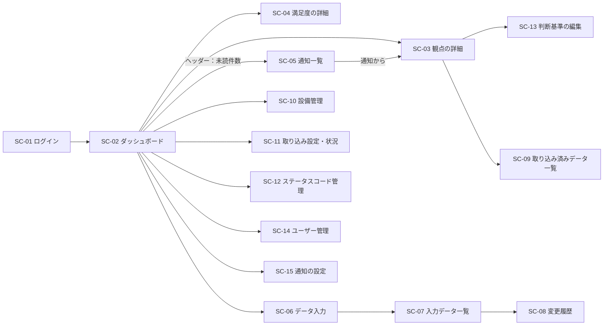

# 機能仕様書

目的: [functional-requirements.md](../requirements/functional-requirements.md) の機能要件を、画面・API・処理の振る舞いとして具体化し、実装とテストの拠り所とする。

> **記載のルール**
> - 各項目に、元になった要件ID（FR-x.x）とユースケースID（UC-xx）を示す。要件にない振る舞いを推測で足さない
> - 評価のメトリクス・判断基準は [viewpoint/](../viewpoint/)、データ項目は [data-dictionary.md](../data/data-dictionary.md)、構造は [data-model.md](../data/data-model.md)、処理の流れは [data-flow.md](../data/data-flow.md)、構成は [architecture.md](../architecture/architecture.md) を参照し、ここに重複して書かない
> - 権限（どの操作を誰ができるか）は、認証・認可の確認（Q-017）の結果による。本書では「要ログイン」とし、ロールによる制御は `TODO:` とする。操作ごとに権限を設定で割り当てる構造（architecture.md 9章）
> - 画面の見た目（配色・レイアウトの詳細）は、画面設計で別に定める。本書は、表示項目・操作・検証・振る舞いを定める
> - 未確定の事項は `TODO:` と確認事項の番号（rfp.md の Q-xxx）で示す

## 1. 共通事項

### 1.1 構成

- 画面は、React の SPA（PWA）。API は、REST（JSON）で、Hono を使った Lambda の関数として提供する（[ADR-0005](../adr/0005-tech-stack.md)）
- 画面は、日本語で表示する。PC・タブレット・スマートフォンで閲覧・入力できる（NFR-7.1、NFR-7.3。#142 の D-33 の決定）。狭い幅（900px 以下）では、表（SC-03 の判断基準・SC-05・SC-07・SC-08・SC-09・SC-11・SC-12・SC-14）を、1 行ごとのカード（項目名と値）で表示し、判断基準の編集（SC-13）は、保存・既定値へ戻すボタンを画面の下に固定する（#151）。設備管理（SC-10）は、表の枠の中で横にスクロールする
- 画面のデザイン（方向性・色・アイコン・共通のレイアウト）は、[ui-design-guidelines.md](./ui-design-guidelines.md) に従う
- 状態の更新は、画面が約10秒間隔で、保存済みの最新の評価結果を読み直す（タブの表示中のみ。FR-6.7）
- ロボット・ハウスを操作する機能はない（自動制御を行わない。goals.md）

### 1.2 共通のルール

| 項目 | 内容 |
|------|------|
| 認証 | ログインしたユーザーのみが、画面・APIを使える。未認証のアクセスは、ログイン画面へ誘導する（FR-9.1）。APIは、すべて認証トークンを検証する |
| 権限 | 要ログイン。操作ごとのロール制御は TODO（Q-017、FR-9.5） |
| 時刻 | APIは UTC（ISO 8601）で扱い、画面は日本時間（`Asia/Tokyo`）で表示する |
| 欠損・不明 | 欠損は「—」（ダッシュ）で表示する。評価できない観点は、ステータス「不明」で、理由と推奨アクションを表示する（FR-5.5） |
| ステータスの表示 | 正常／注意／異常／不明を、色・アイコン・文字で示す。色だけに頼らない（NFR-7.2） |
| 一覧 | ページ分割（既定 20件）。並べ替え・絞り込みの条件は、URLのクエリに反映し、再読み込みで保持する |
| 入力の検証 | 画面とAPIの両方で検証する（画面は即時のフィードバック、APIが正）。不正な場合は、項目ごとにエラーを表示して、再入力を促す（FR-4.1.3） |
| 確認 | 削除などの取り消しにくい操作は、確認を求める |
| 空の状態 | データがない場合は、その旨と、次の操作（例: データの入力）を表示する |
| ヘルプ | 判断基準（閾値・ステータスの意味）を画面から参照できる。主要な操作に、ツールチップを表示する（NFR-7.4） |

### 1.3 APIの共通仕様

| 項目 | 内容 |
|------|------|
| 形式 | `/api/v1/...`。リクエスト・レスポンスは JSON（UTF-8） |
| 認証 | `Authorization: Bearer <token>`（方式は設計で確定。FR-9.3） |
| 成功 | 200（取得・更新）、201（作成）、204（削除・既読化） |
| エラー | 4xx（入力不正 400、未認証 401、権限なし 403、存在なし 404、競合 409）、5xx。形式は `{ "error": { "code": "...", "message": "...", "fields": [{ "name": "...", "message": "..." }] } }`。`message` に内部情報（スタックトレース、パス、設定値）を含めない（security.md） |
| ページ分割 | `?limit=&cursor=`。応答に `nextCursor` を含める |
| 並べ替え・絞り込み | クエリ（例: `?from=&to=&category=&sort=`） |
| 冪等性 | 作成系は、重複を防ぐキーがある場合に、条件付き書き込みで 409 を返す |
| ログ | 構造化ログ。リクエスト本文の全体・秘密情報を出力しない |

## 2. 画面一覧と遷移

### 2.1 画面一覧

| ID | 画面 | 内容 | 要件・UC |
|----|------|------|----------|
| SC-01 | ログイン | ログイン・ログアウト | FR-9.1 / UC-13 |
| SC-02 | ダッシュボード | 全観点のステータス一覧、サマリー、最終取得日時 | FR-6.1〜6.3、6.6、6.7 / UC-01 |
| SC-03 | 観点の詳細 | 診断結果、根拠のメトリクス、判断基準、元データ、推移 | FR-5、FR-6.4、6.5、6.10 / UC-02〜UC-04 |
| SC-04 | 満足度の詳細 | 総合満足度、各観点の満足度（レーダーチャート） | FR-6.9 / UC-21 |
| SC-05 | 通知一覧 | 通知の一覧、絞り込み、既読化 | FR-7.5、7.6 / UC-05、UC-22 |
| SC-06 | データ入力 | 手動入力・補完、復旧対応の記録 | FR-4.1 / UC-06、UC-07 |
| SC-07 | 入力データ一覧 | 入力済みデータの一覧・検索・修正・削除 | FR-4.2.1、4.2.2 / UC-18 |
| SC-08 | 変更履歴 | 入力・変更・削除の履歴 | FR-4.2.3 / UC-18 |
| SC-09 | 取り込み済みデータ一覧 | 取り込んだデータの一覧 | FR-6.8 / UC-20 |
| SC-10 | 設備管理 | ハウス・ロボット・センサーの登録・変更・削除 | FR-2 / UC-12 |
| SC-11 | 取り込み設定・状況 | 接続先・間隔の設定、接続テスト、即時取得、取り込み・連携のログ | FR-1.4〜1.8、FR-8.3 / UC-15、UC-16 |
| SC-12 | ステータスコード管理 | ステータスコードの定義 | FR-3 / UC-17 |
| SC-13 | 判断基準の編集 | 観点の判断基準の閾値の編集（SC-03 の判断基準欄から） | FR-5.7、5.8 / UC-19 |
| SC-14 | ユーザー管理 | ユーザーの一覧・登録・編集・削除 | FR-9.4 / UC-14 |
| SC-15 | 通知の設定 | Web Push の有効化・解除 | FR-7.2 / UC-23 |

TODO: SC-14（ユーザー管理）は、認証・認可の確認結果（Q-017）で、要否が変わる。

### 2.2 画面遷移

### 2.3 共通のヘッダー・ナビゲーション

共通のレイアウトは、**左のサイドメニュー**と、**上部のバー**（設備の選択・未読の通知の件数・最終のデータ取得日時・ユーザー）。狭い幅（900px 以下）では、メニューを、☰ で開閉する引き出しにする（Esc・閉じるボタン・本文を覆う面で閉じる。開いている間は、Tab の移動を中に閉じ込め、閉じたら ☰ にフォーカスを戻す）。詳細は、[ui-design-guidelines.md](./ui-design-guidelines.md) 8 章。

| 要素 | 内容 | 要件 |
|------|------|------|
| 設備の選択 | ハウス・ロボット・センサーを選び、表示の対象を切り替える | FR-6.6 |
| 未読の件数 | 未読の通知の件数を表示し、通知一覧（SC-05）へ移る | FR-7.6 |
| 最終のデータ取得日時 | 最後にデータを取り込んだ日時。古い・未取得の場合は、その旨を表示。自動取り込みが有効でない間（手動のみの運用）は、警告を出さず、「最終の手動入力」を示す（[ADR-0016](../adr/0016-ingestion-federation-rules.md)。実装は #198・#202） | FR-6.3 |
| メニュー | サイドメニュー（アイコン + 文字）。ダッシュボード、データ入力、通知（未読の件数の印）、取り込み済みデータ（SC-09）、設定（設備・取り込み・ステータスコード・ユーザー・通知の設定。開閉できるまとまり。既定では開く）。権限のない項目の表示は TODO（Q-017） | - |
| ユーザー | ログイン中のユーザー名、ログアウト | FR-9.1 |

## 3. 画面仕様

### 3.1 SC-02 ダッシュボード（FR-6.1〜6.3、6.6、6.7 / UC-01）

| 項目 | 内容 |
|------|------|
| 目的 | 設備の状態を、観点ごとに、一目で把握する |
| 表示 | **サマリー**: ステータスごと（正常／注意／異常／不明）の観点の件数。**観点のカード**（10観点を、表示順（evaluation.md 1章）に）: 観点名、ステータス、主要メトリクスの値（viewpoint/ の「ダッシュボード表示（主要）」）、診断メッセージ、推奨アクション、判定の対象期間。**最終のデータ取得日時**。短期視点・長期視点の切り替え（既定: 長期・直近7日） |
| カードのステータス | 短期視点と長期視点のうち、「不明」を除いた悪い方。両方「不明」なら「不明」（evaluation.md 5章） |
| 操作 | カードを選ぶ → SC-03（観点の詳細）。設備を選ぶ（ヘッダー）。長期視点の期間を選ぶ（当日／直近7日／30日／60日／90日） |
| 更新 | 約10秒間隔で、最新の評価結果を読み直す（タブの表示中のみ。変化がなければ、小さな応答） |
| データがない場合 | 取り込み・入力がない場合は、その旨と、データ入力・取り込み設定への導線を表示する |
| データが古い場合 | 設備ごとに、その設備の取得間隔 × 3（最低 3 分）を超えて、新しい計測値がない場合は、警告を表示する。選んだ設備（ハウスなら配下の設備）のいずれかが古ければ、警告する（どの設備かの表示の設計は #158）。自動取り込みが有効でない間（手動のみの運用）は、警告を出さず、最終の手動入力を示す（[ADR-0016](../adr/0016-ingestion-federation-rules.md)。実装は #198・#202） |
| 関連API | `GET /api/v1/dashboard`、`GET /api/v1/equipment` |

### 3.2 SC-03 観点の詳細（FR-5、FR-6.4、6.5、6.10 / UC-02〜UC-04）

| 項目 | 内容 |
|------|------|
| 目的 | 診断結果の根拠を理解し、対応を判断する |
| 表示 | **診断結果**: ステータス、診断メッセージ、推奨アクション（変更した判断基準による判定の場合は、その旨）。**根拠のメトリクス**: 全メトリクスの値（ダッシュボードに出さないものを含む）と、指標ごとの判定。**判断基準**: 条件、正常・注意・異常の区分（表。変更済みを識別できる）。**元データ**: 分析に使った取り込みデータ・手動入力データ（一覧・並べ替え・絞り込み・ページ分割）。**推移（長期視点）**: 主要メトリクスの時系列グラフと、期間の平均値。観点のステータスの推移のグラフ（FR-6.10。TODO: 粒度・期間・表示方法）。グラフは指標ごとに開閉できる。視点ごとの判定の対象期間 |
| 操作 | 短期／長期の切り替え、期間の選択。判断基準の編集（SC-13）。元データの絞り込み（キーワード）・並べ替え（日時・値） |
| 満足度 | 観点が「満足度」の場合は、SC-04 を表示する |
| 振る舞い | 評価できない（不明）場合は、「データ不足のため評価できない」旨と、取得・入力を確認する推奨アクションを表示する。ステータスコードのメトリクスは、カテゴリ名ではなく、名称を表示する（メンテナンス性） |
| 狭い画面 | 900px 以下は、判断基準の表を、指標ごとのカード（指標名を題名に、条件名と、正常・注意・異常の条件を、項目名と値で）で表示し、横にスクロールしなくても、すべての条件を読める（#151） |
| 関連API | `GET /api/v1/viewpoints/{viewpointId}`、`GET /api/v1/viewpoints/{viewpointId}/series`、`GET /api/v1/observations` |

### 3.3 SC-04 満足度の詳細（FR-6.9 / UC-21）

| 項目 | 内容 |
|------|------|
| 表示 | 総合満足度（9観点の平均。小数第1位）、各観点の満足度（1〜5）をレーダーチャートで表示。判断基準（4.0以上 正常、3.0以上4.0未満 注意、3.0未満 異常） |
| 振る舞い | 9観点のいずれかが未入力の場合は、「不明」とし、入力を促す（データ入力画面への導線）。レーダーチャートは、軸のラベルが切れず、左右・上下に偏らないよう、描画後に文字の範囲を測って表示の範囲を決める。画面の幅が狭い（480px 以下）ときは、半径を小さくして、ラベルを読める大きさで収める。レーダーチャートと観点別の表は、900px 以下で縦に並べる（NFR-7.3） |
| 関連API | `GET /api/v1/viewpoints/satisfaction` |

### 3.4 SC-05 通知一覧（FR-7.5、7.6 / UC-05、UC-22）

| 項目 | 内容 |
|------|------|
| 表示 | 日時、種別（異常検知／データ取得失敗）、対象の観点、設備、ステータス、メッセージ、既読状態。新しい順 |
| 絞り込み | 種別、既読／未読 |
| 操作 | 通知を選ぶ → 対象の観点の詳細（SC-03）へ移り、通知を既読にする。個別に既読にする。一括で既読にする（絞り込み中の範囲、または全件。TODO: 範囲） |
| 状態 | 未読／既読の2つのみ。対応状況（未対応／対応中／完了）の管理・承認はない（Q-018） |
| 更新 | 未読の件数は、約10秒間隔で読み直す（ヘッダー） |
| 空の状態 | 通知がない場合は、その旨を表示 |
| 狭い画面 | 長い値（設備名 200 文字を含む対象・メッセージ）や 900px 以下の幅（タブレット・スマートフォン）でも、列が潰れず、ページが横にはみ出さない。900px 以下は、表を通知ごとのカード（項目名と値の縦並び）で表示し、横にスクロールしなくても「既読にする」「詳細を確認」を操作できる（NFR-7.3）。未読の件数（ヘッダー）は、3桁以上でも 1 行で収まる |
| 関連API | `GET /api/v1/notifications`、`GET /api/v1/notifications/unread-count`、`POST /api/v1/notifications/{id}/read`、`POST /api/v1/notifications/read-all` |

### 3.5 SC-06 データ入力（FR-4.1 / UC-06、UC-07）

| 項目 | 内容 |
|------|------|
| 目的 | 機器から取れない情報や、人の対応の結果を入力し、評価に反映する |
| 入力 | **必須**: 対象の設備（ハウス・ロボット・センサー）、カテゴリ、計測日時。**カテゴリごとの項目**（data-dictionary.md 5.2）: 操作情報、収穫情報、安全情報、コスト情報、故障情報（復旧対応の回数・復旧に要した時間）、環境情報、満足度情報（満足度以外の9観点の 1〜5 スター）。**任意**: 備考（所感・運用上の補足） |
| 検証 | 必須項目が未入力なら登録できない。数値は、型（整数／数値）・範囲（0以上、湿度は 0〜100、満足度は 1〜5 の整数）・単位を検証する。計測日時は、現在から 5 分を超える未来を指定できない（5 分は、端末の時計のずれを吸収する余裕。固定。[ADR-0016](../adr/0016-ingestion-federation-rules.md)）。カテゴリに属さない項目は受けない。**自動取り込みの項目は、すべて、手動でも入力できる**（予備の入口。実装は #192）。範囲は、データ辞書のとおり（温度 −50〜100℃、湿度 0〜100%、照度 0〜200,000 lx、CO2 0〜10,000 ppm、1果実あたりの収穫時間 0〜300秒（手動入力）。実装は #200・#192） |
| 保存 | 検証済みの内容を、観測値（取得元＝手動入力、入力者、取得日時）として保存し、変更履歴に記録する |
| 保存後 | 評価を更新する。「注意」「異常」があれば、通知につなげる。保存結果と、更新後の関連観点のステータスを表示する（FR-4.1.5）。**AWS（`EVALUATION_ON_WRITE=deferred`）では、保存の応答の前に評価せず、定期の評価（JB-02）が更新する。表示する関連観点のステータスは、前回の評価の値で、「反映には数分かかります」と示す（ADR-0014）** |
| 重なり | 自動取り込みと同じ項目・時刻の値が重なる場合は、両方を保持する。評価での優先は TODO（FR-4.1.4） |
| 操作 | 保存、入力のクリア。入力済みデータの一覧（SC-07）へ移る |
| 使いやすさ | カテゴリを選ぶと、その項目だけを表示する。直前の対象の設備・カテゴリを記憶する（入力の負担を減らす。human-in-the-loop.md 4章） |
| 関連API | `POST /api/v1/manual-entries` |

### 3.6 SC-07 入力データ一覧（FR-4.2.1、4.2.2 / UC-18）

| 項目 | 内容 |
|------|------|
| 表示 | 計測日時、設備、カテゴリ、入力項目と値、入力者、備考。論理削除したものは表示しない |
| 検索・絞り込み・並べ替え | キーワード（全入力項目・入力者の部分一致）、カテゴリ、設備、計測日時の期間。並べ替えは、計測日時（既定: 新しい順）・カテゴリ・入力者。ページ分割 |
| 操作 | 修正（SC-06 と同じ入力で編集）、削除（確認を求める。論理削除）。修正・削除は、権限に応じて制御（TODO: Q-017）。変更履歴（SC-08）へ移る |
| 保存後 | 修正・削除の後の評価の更新と通知の扱いは TODO（要件側）。変更履歴に記録する |
| 狭い画面 | 900px 以下は、表を入力データ 1 件ごとのカード（項目名と値）で表示し、横にスクロールしなくても、修正・削除を操作できる（#151） |
| 関連API | `GET /api/v1/manual-entries`、`PUT /api/v1/manual-entries/{id}`、`DELETE /api/v1/manual-entries/{id}` |

### 3.7 SC-08 変更履歴（FR-4.2.3 / UC-18）

| 項目 | 内容 |
|------|------|
| 表示 | 日時、操作種別（登録／編集／削除）、対象データ、変更者、変更前の値、変更後の値。手動入力の変更前後の値は、入力項目と値のほか、計測日時・設備・カテゴリ・備考を示す（これらだけを修正した場合も、違いが分かる）。表は、長い値（備考 2000 文字、長い入力者）や狭い画面でも、列が潰れず、表の枠の中で横にスクロールする |
| 絞り込み・並べ替え | 操作種別、変更者、期間。並べ替え。ページ分割 |
| 狭い画面 | 900px 以下は、表を履歴 1 件ごとのカード（項目名と値。変更前・変更後を含む）で表示する（#151）。変更点の強調（差分の表示）は、別の Issue で検討する |
| 関連API | `GET /api/v1/audit-logs` |

### 3.8 SC-09 取り込み済みデータ一覧（FR-6.8 / UC-20）

| 項目 | 内容 |
|------|------|
| 表示 | 日時、設備、カテゴリ、項目、値、取得元（自動取り込み／手動入力）、状態（有効／欠損／遅延／不正） |
| 絞り込み・並べ替え | カテゴリ、日時の期間。並べ替えは、日時・カテゴリ・値。ページ分割 |
| 狭い画面 | 900px 以下は、表を取り込み済みデータ 1 件ごとのカード（項目名と値）で表示し、横にスクロールしなくても、値・取得元・状態を読める（#151） |
| 関連API | `GET /api/v1/observations` |

### 3.9 SC-10 設備管理（FR-2 / UC-12）

| 項目 | 内容 |
|------|------|
| 表示 | ハウス → ロボット／環境センサーの階層（ツリー）。各設備の名称、種別、状態 |
| 操作 | ハウスの登録。ハウスへのロボット・センサーの追加（紐づけ）。名称等の変更。削除（確認を求める。論理削除） |
| 検証 | 設備IDは一意（重複はエラー。FR-2.4）。ロボット・センサーは、ハウスに属する。名称は必須 |
| 削除 | 論理削除。削除した設備の過去データの扱いは TODO（FR-2.3）。取り込み・評価の対象から外れる |
| 反映 | 設備の追加は、設定の変更だけで、取り込み・評価・表示・連携に反映される（FR-2.5） |
| 提供方法 | TODO: 画面で行うか、設定ファイル等で行うか（Q-016）。どちらも同じユースケースで扱える構造（architecture.md 12章） |
| 関連API | `GET/POST /api/v1/equipment`、`PUT/DELETE /api/v1/equipment/{id}` |

### 3.10 SC-11 取り込み設定・状況（FR-1.4〜1.8、FR-8.3 / UC-15、UC-16）

| 項目 | 内容 |
|------|------|
| 設定 | 取り込み元（ロボットデータ・環境センサーデータ）ごとに、接続先（現状は、接続設定の参照名）。**取得間隔は、設備ごと**（1分／5分／10分／15分／30分／1時間。既定は、ロボット 1分、環境センサー 5分。実装は #197）。**認証情報**は、管理者が、画面から**書き込み専用**で登録する（保存後は再表示せず、「設定済み／未設定」と更新日時を示す。画面・ログ・変更履歴に値を残さない。パラメータストアで管理。FR-1.4。実装は #196・D-01 の回答に合わせる）。[ADR-0016](../adr/0016-ingestion-federation-rules.md) |
| 操作 | **接続テスト**（接続先に接続できるかを確認し、結果を表示）、**即時取得**（手動で取り込みを実行）。実行中は、二重実行を防ぐ |
| 取り込みの状況 | 取り込みログの一覧（日時、設備、成功／失敗、取得件数、エラー内容）。ログは、新しいデータがあった実行と、失敗した実行だけを残し、空振りは残さない。設備ごとに、最終の実行日時と結果を示す。設備・結果・期間で絞り込む（条件は URL に反映。1ページ 20 件。並べ替えは設けない）（[ADR-0016](../adr/0016-ingestion-federation-rules.md)。実装は #201。現状は、すべての実行を残し、取り込み元でだけ絞り込む） |
| 連携の状況 | 連携の結果の一覧（成功／失敗／保留、日時）。農業情報基盤の停止中は、保留を表示 |
| 仕様の状態 | 解釈に使っている FormatProfile の版と状態（仮決め／確定）を表示する（FR-1.11） |
| 狭い画面 | 長い値（接続先の参照名 100 文字）や 900px 以下の幅（タブレット・スマートフォン）でも、列が潰れず、ページが横にはみ出さない。900px 以下は、取り込み・連携のログの表を、ログ 1 件ごとのカード（項目名と値の縦並び）で表示し、横にスクロールしなくても、結果・エラー内容を読める（NFR-7.3） |
| 関連API | `GET/PUT /api/v1/ingestion/settings`、`POST /api/v1/ingestion/{sourceId}/test`、`POST /api/v1/ingestion/{sourceId}/run`、`GET /api/v1/ingestion/logs`、`GET /api/v1/federation/logs` |

### 3.11 SC-12 ステータスコード管理（FR-3 / UC-17）

| 項目 | 内容 |
|------|------|
| 表示 | コード値、名称、説明、カテゴリ（正常／注意／異常） |
| 操作 | 登録・編集・削除（確認を求める。論理削除）・参照 |
| 検証 | コード値は一意（重複はエラー）。名称・カテゴリは必須 |
| 影響 | カテゴリの変更は、観点の判定（収穫速度、メンテナンス性、耐久性）に影響する。変更後の評価への反映は、次の評価から（TODO: 過去の評価の扱い）。変更は履歴に残す |
| 狭い画面 | 900px 以下は、表をステータスコード 1 件ごとのカード（項目名と値）で表示し、横にスクロールしなくても、修正・削除を操作できる（#151） |
| 関連API | `GET/POST /api/v1/status-codes`、`PUT/DELETE /api/v1/status-codes/{code}` |

### 3.12 SC-13 判断基準の編集（FR-5.7、5.8 / UC-19）

| 項目 | 内容 |
|------|------|
| 表示 | 観点の判断基準（指標ごと）。型（上限型／下限型／範囲型）、閾値、条件名。変更済みかどうかの識別 |
| 操作 | 閾値の編集・保存、既定値へ戻す |
| 検証 | 上限型: 注意開始値 < 異常開始値。下限型: 異常下限 < 注意下限。範囲型: 異常下限 < 正常下限 < 正常上限 < 異常上限。数値であること。条件名は空欄不可・200文字以内。条件は20件以内。不正な場合は、保存できない（FR-5.7） |
| 対象外 | ステータス項目（ステータスコードのカテゴリで判定するもの）は、ここでは編集できない。「ステータスコード管理で設定する」旨を表示する |
| 反映 | 変更はシステム全体に適用する（利用者ごとではない）。以降の評価・ダッシュボード・通知の判定に使う。診断メッセージで、変更した基準による判定である旨を示す（FR-5.8）。過去の評価への影響は TODO（UC-19）。変更の履歴（変更者・前後）を残す |
| 権限 | 編集できる人は TODO（Q-017）。参照は全員 |
| 狭い画面 | 900px 以下は、保存・既定値へ戻すボタンを、画面の下に固定する（指標ごとのフォームが縦に長いため）（#151） |
| 関連API | `GET/PUT /api/v1/viewpoints/{viewpointId}/criteria`、`POST /api/v1/viewpoints/{viewpointId}/criteria/reset` |

### 3.13 SC-14 ユーザー管理（FR-9.4 / UC-14）

| 項目 | 内容 |
|------|------|
| 表示 | ユーザーID、ユーザー名、ロール、最終ログイン日時 |
| 操作 | 登録・編集・削除（確認を求める）・参照。パスワードの設定・再設定 |
| 検証 | ユーザーIDは一意（重複はエラー）。パスワードは、8文字以上で、英大文字・英小文字・数字を含む（FR-9.2）。ロールは、定義済みのもの |
| 備考 | 認証の方式（Cognito か、アプリ内か）で、実現の方法が変わる（architecture.md 9章。Cognito は [ADR-0008](../adr/0008-cognito-authentication.md)）。最初のユーザーの作成方法は、ローカルは環境変数 `INITIAL_USER_*`、Cognito は、手元で 1 回だけ実行するコマンド `pnpm initial-user` |
| 狭い画面 | 900px 以下は、表をユーザー 1 人ごとのカード（項目名と値）で表示し、横にスクロールしなくても、ロール・最終ログイン・修正・削除を操作できる（#151） |
| 関連API | `GET/POST /api/v1/users`、`PUT/DELETE /api/v1/users/{userId}` |

### 3.14 SC-01 ログイン（FR-9.1〜9.3 / UC-13）

| 項目 | 内容 |
|------|------|
| 入力 | ユーザーID、パスワード |
| 処理 | 認証に成功したら、ダッシュボード（または、遷移前の画面）へ。失敗した場合は、原因を特定できないメッセージ（「ユーザーIDまたはパスワードが正しくありません」）を表示する |
| 制限 | 同じ接続元からの試行は、15分あたり5回まで（構想時の値。超過時は、一時的に拒否し、その旨を表示）。パスワードを平文で保存・ログ出力しない |
| セッション | 有効期限を設け（アクセストークン30分、リフレッシュトークン7日。Cognito で実現。[ADR-0008](../adr/0008-cognito-authentication.md)）、期限切れの場合は再ログインを求める。ログアウトで、セッションを破棄する |
| 関連API | `POST /api/v1/auth/login`、`POST /api/v1/auth/refresh`、`POST /api/v1/auth/logout`（Cognito を使う場合も、API の形は同じ。API が、Cognito を呼ぶ。ADR-0008） |

### 3.15 SC-15 通知の設定（FR-7.2 / UC-23）

| 項目 | 内容 |
|------|------|
| 操作 | Web Push 通知の有効化（ブラウザの許可を求め、購読を登録）、解除 |
| 状態 | 有効／無効を表示する。ブラウザが未対応・許可されていない場合は、その旨を表示し、画面内の通知のみとなることを示す |
| 前提 | HTTPS が必要。無効になった購読（解除・期限切れ）は、自動で破棄する |
| 備考 | 通知手段・宛先の確定は TODO（Q-011）。対象端末・利用者ごとの設定は TODO |
| 関連API | `GET /api/v1/push-subscription`（状態の確認。端末の宛先を指定すると、その端末の購読の有無）、`PUT /api/v1/push-subscription`、`DELETE /api/v1/push-subscription` |

## 4. API仕様

認証は、すべて必要（ログイン以外）。権限列の「要ログイン」は、ロールによる制御が TODO（Q-017）であることを示す。

### 4.1 一覧

| 領域 | メソッドとパス | 概要 | 権限 | 要件 |
|------|----------------|------|------|------|
| 認証 | `POST /auth/login` | ログイン | 不要 | FR-9.1 |
| | `POST /auth/refresh` | セッションの更新 | 要トークン | FR-9.3 |
| | `POST /auth/logout` | ログアウト | 要ログイン | FR-9.1 |
| 設備 | `GET /equipment` | 設備の階層を取得 | 要ログイン | FR-2、FR-6.6 |
| | `POST /equipment` | 設備の登録 | 要ログイン（TODO） | FR-2.1、2.2 |
| | `PUT /equipment/{id}`、`DELETE /equipment/{id}` | 設備の変更・削除（論理） | 要ログイン（TODO） | FR-2.3 |
| ダッシュボード・評価 | `GET /dashboard` | 全観点の最新の評価結果（設備・視点・期間を指定） | 要ログイン | FR-6.1〜6.3 |
| | `GET /viewpoints/{viewpointId}` | 観点の詳細（診断、根拠のメトリクス、判断基準） | 要ログイン | FR-6.4 |
| | `GET /viewpoints/{viewpointId}/series` | 観点・メトリクスの推移（期間指定） | 要ログイン | FR-6.5、6.10 |
| | `GET /viewpoints/{viewpointId}/criteria` | 判断基準の取得 | 要ログイン | FR-5.7 |
| | `PUT /viewpoints/{viewpointId}/criteria` | 判断基準の更新 | 要ログイン（TODO） | FR-5.7 |
| | `POST /viewpoints/{viewpointId}/criteria/reset` | 既定値へ戻す | 要ログイン（TODO） | FR-5.7 |
| 観測値 | `GET /observations` | 観測値の一覧（設備・カテゴリ・項目・期間・取得元で絞り込み） | 要ログイン | FR-6.4、6.8 |
| 手動入力 | `POST /manual-entries` | 手動入力の登録 | 要ログイン（TODO） | FR-4.1 |
| | `GET /manual-entries` | 入力済みデータの一覧 | 要ログイン | FR-4.2.1 |
| | `PUT /manual-entries/{id}`、`DELETE /manual-entries/{id}` | 修正・削除（論理） | 要ログイン（TODO） | FR-4.2.2 |
| | `GET /audit-logs` | 変更履歴 | 要ログイン（TODO） | FR-4.2.3 |
| ステータスコード | `GET /status-codes` | 一覧 | 要ログイン | FR-3 |
| | `POST /status-codes`、`PUT /status-codes/{code}`、`DELETE /status-codes/{code}` | 登録・編集・削除（論理） | 要ログイン（TODO） | FR-3.2 |
| 通知 | `GET /notifications` | 通知の一覧（種別・既読で絞り込み） | 要ログイン | FR-7.5 |
| | `GET /notifications/unread-count` | 未読の件数 | 要ログイン | FR-7.6 |
| | `POST /notifications/{id}/read`、`POST /notifications/read-all` | 既読にする（個別・一括） | 要ログイン | FR-7.6 |
| | `GET /push-subscription`、`PUT /push-subscription`、`DELETE /push-subscription` | Web Push の購読の状態・購読・解除 | 要ログイン | FR-7.2 |
| 取り込み | `GET /ingestion/settings`、`PUT /ingestion/settings` | 取り込み設定（参照名・間隔） | 要ログイン（TODO） | FR-1.4、1.5 |
| | `POST /ingestion/{sourceId}/test` | 接続テスト | 要ログイン（TODO） | FR-1.7 |
| | `POST /ingestion/{sourceId}/run` | 即時取得 | 要ログイン（TODO） | FR-1.7 |
| | `GET /ingestion/logs` | 取り込みログ | 要ログイン | FR-1.8 |
| 連携 | `GET /federation/logs` | 連携の結果 | 要ログイン | FR-8.3 |
| ユーザー | `GET /users`、`POST /users`、`PUT /users/{userId}`、`DELETE /users/{userId}` | ユーザー管理 | 要ログイン（TODO） | FR-9.4 |

- 農業情報基盤へ読み取り専用のREST API（プル方式。NFR-8.3）を提供する場合は、別途追加する（TODO: Q-005）

### 4.2 主なAPIの入出力

**`GET /dashboard`**

| 項目 | 内容 |
|------|------|
| クエリ | `equipmentId`（設備。省略時はヘッダーで選択中の設備）、`horizon`（`SHORT`／`LONG`。省略時 `LONG`）、`periodDays`（1／7／30／60／90。既定 7） |
| 応答 | `summary`（ステータスごとの件数）、`lastReceivedAt`（最終のデータ取得日時）、`viewpoints[]`（`viewpointId`、`status`、`metrics`（主要メトリクスの名前→値。null 可）、`diagnosticMessage`、`recommendedAction`、`evaluatedFrom`／`evaluatedTo`、`isCustomCriteria`、`statuses`（短期・長期のステータス）） |
| 備考 | 保存済みの最新の評価結果を読む（事前計算）。評価は、この呼び出しでは行わない（NFR-3.4） |

**`POST /manual-entries`**

| 項目 | 内容 |
|------|------|
| 入力 | `equipmentId`、`category`、`observedAt`、`items`（項目の識別子→値。カテゴリに属する項目のみ）、`note`（任意） |
| 応答 | 201。作成した入力の `id`、保存した観測値、更新後の関連観点のステータス |
| エラー | 400（必須の欠け・型・範囲の不正。`fields` に項目ごと）、404（設備がない）、403（権限なし。TODO） |

**`PUT /viewpoints/{viewpointId}/criteria`**

| 項目 | 内容 |
|------|------|
| 入力 | `criteria[]`（`indicator`、`kind`、`thresholds`、`label`） |
| 応答 | 200。保存した判断基準（`version`、`isDefault=false`） |
| エラー | 400（閾値の大小関係の逆転、数値でない、条件名が空欄または200文字超、20件超。`fields` に理由）、ステータス項目の指標は 400 |

**`GET /notifications`**

| 項目 | 内容 |
|------|------|
| クエリ | `kind`、`readState`（`UNREAD`／`READ`）、`limit`、`cursor` |
| 応答 | `items[]`（`notificationId`、`kind`、`viewpointId`、`equipmentId`、`status`、`message`、`createdAt`、`readState`）、`nextCursor` |

**`POST /ingestion/{sourceId}/test`・`/run`**

| 項目 | 内容 |
|------|------|
| 応答（test） | 200。`ok`（真偽値）、`message`（失敗の原因。内部情報・認証情報を含めない） |
| 応答（run） | 202（非同期に実行）。実行中の場合は 409（二重実行の防止）。結果は、取り込みログで確認する |

その他のAPIは、4.1 の概要と、data-dictionary.md の項目定義に従う（入出力の詳細は、実装時に API 定義ファイルとして補う。TODO: 形式は NFR-6.2）。

## 5. 非同期・定期処理の仕様

| ID | 処理 | 契機 | 内容 | 失敗時 | 要件 |
|----|------|------|------|--------|------|
| JB-01 | 取り込み | スケジューラ（取得間隔）、即時取得 | 取り込み元ごとに独立して実行。新しいファイルの一覧の取得 → 取り込み済みの判定（識別子・ハッシュ）→ 読み込み → 解釈（FormatProfile）→ 検証 → 観測値の保存 → 取り込みログ。保存後に、評価を更新する | 再試行（回数・間隔の上限）。上限を超えたら、取り込み失敗の通知（JB-04）。他の取り込み元・機能は継続 | FR-1.1〜1.3、1.6〜1.10、FR-5.4 |
| JB-02 | 評価 | 取り込み・手動入力の後、定期（データ途絶の確認） | 設備・観点・視点ごとに、観測値を読み、メトリクスを算出し、判断基準でステータスを判定し、診断メッセージ・推奨アクションを付けて、評価結果を保存する。状態の変化を検知して、通知の作成（JB-04）を依頼する | 失敗は記録し、次の契機で再評価する。評価結果が古い場合は、画面で最終の評価日時を示す | FR-5、FR-7.1 |
| JB-03 | 連携 | スケジューラ、または連携キューへの追加 | 連携キューの「待機」「失敗」の項目を、農業情報基盤へ送る。結果（成功／失敗／保留）を記録する | 間隔を広げて再試行。基盤の停止中は「保留」。他の機能は影響を受けない | FR-8 |
| JB-04 | 通知の作成・配信 | 評価の状態変化、取り込みの失敗 | 「注意」「異常」へ変化したとき、または取り込みが失敗したときに、通知を作成（未読）する。重複抑制のキー（観点・対象・ステータス）で、同じ状態の間は繰り返さない。画面内の通知は、必ず保存し、Web Push を購読している利用者へ配信する | 配信の失敗は記録し、再送する（TODO: 方法）。無効な購読は破棄 | FR-7 |

- 各処理は、同じイベントが重複して届いても結果が変わらない（冪等）ように実装する（coding-standards.md）
- 実行は、サーバーレスの関数（スケジューラ・ストリームを契機）。実行時間に収まる単位に分割する（ADR-0002）

## 6. 入力検証・業務ルールの一覧

| 対象 | ルール | 要件 |
|------|--------|------|
| 手動入力 | 設備・カテゴリ・計測日時は必須。数値の型・範囲・単位。湿度 0〜100、満足度 1〜5（整数）、回数・数は 0以上の整数 | FR-4.1.3 |
| 設備 | 設備IDは一意。ロボット・センサーは、ハウスに属する | FR-2.4 |
| ステータスコード | コード値は一意。カテゴリは 正常／注意／異常 | FR-3.1、3.2 |
| 判断基準 | 大小関係の成立、数値、条件名の長さ・件数 | FR-5.7 |
| ユーザー | ユーザーIDは一意。パスワードの強度 | FR-9.2、9.4 |
| 評価 | 分母が 0 の場合は「不明」（例外は、観点ごとの定義）。データ欠損は「不明」 | FR-5.2、evaluation.md 4章 |
| 取り込み | 形式・項目が仕様と異なるデータは、区別して記録。同じファイル（識別子・ハッシュ）は取り込まない | FR-1.6 |
| 通知 | 同じ状態の間は繰り返さない。既読・未読の2状態のみ | FR-7.3、7.6 |
| 論理削除 | 手動入力・設備・ステータスコードは、論理削除。一覧・集計から除外 | FR-2.3、4.2.2、3.2 |

## 7. 未確定事項

| 事項 | 現時点の扱い | 確認事項 |
|------|--------------|----------|
| 操作ごとの権限・ロール、ユーザー管理の要否 | 「要ログイン」。権限は設定で割り当てる構造 | Q-017 |
| 設備の登録を画面で行うか | SC-10 を提供する前提で記載。設定ファイル等の可否は未定 | Q-016 |
| 通知の手段・宛先・条件、「不明」の通知、既読の単位、Web Push の対象 | 画面内・Web Push。他は未定 | Q-011、Q-018、Q-010 |
| 観点のステータスの推移グラフ（粒度・期間・表示方法） | 暫定: 時系列の帯と変化の一覧（dev_spec.md 4.1 No.31）。確定は未 | FR-6.10 |
| 画面の更新方式（自動か、手動か）、「データが古い」の基準 | 自動更新（表示中のタブで約10秒ごと）、設備ごとの取得間隔 × 3（最低 3 分）に決定（[ADR-0016](../adr/0016-ingestion-federation-rules.md)） | FR-6.7、FR-6.3 |
| 取得間隔の既定値、取り込みと画面更新の関係 | 未定 | FR-1.5 |
| 手動入力の重なり、修正後の評価の更新、判断基準変更の過去の評価への影響 | 未定 | FR-4.1.4、UC-18、UC-19 |
| 設備削除時の過去データ、ステータスコード変更の過去の評価への影響 | 論理削除を基本。影響は未定 | FR-2.3 |
| 最初のユーザーの作成方法、認証の方式（Cognito／アプリ内） | 両方を実装した。ローカルは `INITIAL_USER_*`、Cognito は `pnpm initial-user`（ADR-0008）。評価環境で、どちらを使うかは、環境の設定（`AUTH_PROVIDER`）で決める。要件としては、Q-017 の回答待ち | 要件側 R-13、Q-017 |
| APIの入出力の詳細（API定義ファイル） | 実装時に補う | NFR-6.2 |
| 画面の見た目（レイアウト、配色） | 画面設計で別に定める | - |
| 農業情報基盤との連携方式（プル用のAPIの要否を含む） | 未定 | Q-005 |

## 8. 関連文書

- 要件: [functional-requirements.md](../requirements/functional-requirements.md)、[non-functional-requirements.md](../requirements/non-functional-requirements.md)、[use-cases.md](../requirements/use-cases.md)
- 設計: [architecture.md](../architecture/architecture.md)、[human-in-the-loop.md](../architecture/human-in-the-loop.md)、[data-model.md](../data/data-model.md)、[data-dictionary.md](../data/data-dictionary.md)、[data-flow.md](../data/data-flow.md)
- 観点・評価: [viewpoint/](../viewpoint/)、[evaluation.md](../viewpoint/evaluation.md)
