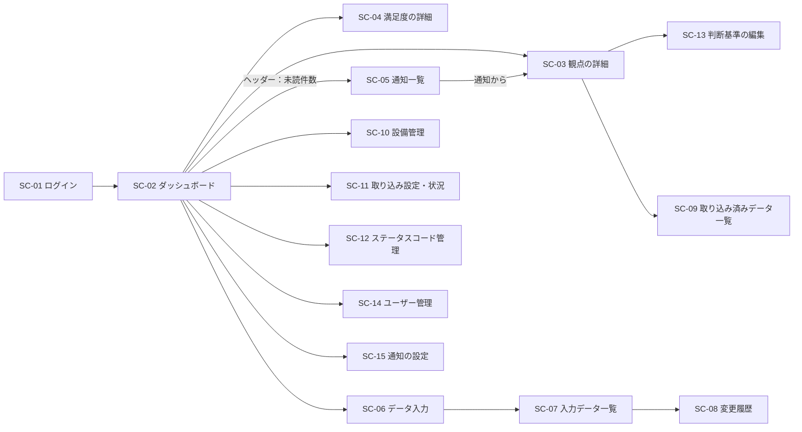

# 機能仕様書

目的: [functional-requirements.md](../requirements/functional-requirements.md) の機能要件を、画面・API・処理の振る舞いとして具体化し、実装とテストの拠り所とする。

> **記載のルール**
> - 各項目に、元になった要件ID（FR-x.x）とユースケースID（UC-xx）を示す。要件にない振る舞いを推測で足さない
> - 評価のメトリクス・判断基準は [viewpoint/](../viewpoint/)、データ項目は [data-dictionary.md](../data/data-dictionary.md)、構造は [data-model.md](../data/data-model.md)、処理の流れは [data-flow.md](../data/data-flow.md)、構成は [architecture.md](../architecture/architecture.md) を参照し、ここに重複して書かない
> - 権限（どの操作を誰ができるか）は、管理者・一般の 2 ロール（決定。[ADR-0013](../adr/0013-environments-and-access-control.md) の表）。**ロールの分割は実装済み**（#115。管理者 `admin`・一般 `general`）。閲覧できる設備の割り当て（#116）は未実装で、それまでは、一般も、全設備を閲覧できる。本書の「権限」列は、ロールごとの可否を示す（「要ログイン」は、権限が不要で、ログインしていれば使える）。操作ごとに権限を設定で割り当てる構造（architecture.md 9章）
> - 画面の見た目（配色・レイアウトの詳細）は、画面設計で別に定める。本書は、表示項目・操作・検証・振る舞いを定める
> - 未確定の事項は `TODO:` と確認事項の番号（rfp.md の Q-xxx）で示す

## 1. 共通事項

### 1.1 構成

- 画面は、React の SPA（PWA）。API は、REST（JSON）で、Hono を使った Lambda の関数として提供する（[ADR-0005](../adr/0005-tech-stack.md)）
- 画面は、日本語で表示する。PC・タブレット・スマートフォンで閲覧・入力できる（NFR-7.1、NFR-7.3。#142 の D-33 の決定）。狭い幅（900px 以下）では、表（SC-03 の判断基準・SC-05・SC-07・SC-08・SC-09・SC-11・SC-12・SC-14）を、1 行ごとのカード（項目名と値）で表示し、判断基準の編集（SC-13）は、保存・既定値へ戻すボタンを画面の下に固定する（#151）。設備管理（SC-10）は、表の枠の中で横にスクロールする
- 画面のデザイン（方向性・色・アイコン・共通のレイアウト）は、[ui-design-guidelines.md](./ui-design-guidelines.md) に従う
- 状態の更新は、画面が約10秒間隔で、保存済みの最新の評価結果を読み直す（タブの表示中のみ。FR-6.7）
- ロボット・ハウスを操作する機能はない（自動制御を行わない。goals.md）

### 1.2 共通のルール

| 項目 | 内容 |
|------|------|
| 認証 | ログインしたユーザーのみが、画面・APIを使える。未認証のアクセスは、ログイン画面へ誘導する（FR-9.1）。APIは、すべて認証トークンを検証する |
| 権限 | 要ログイン。操作ごとのロール制御は、管理者・一般の 2 ロール（ADR-0013 の表。実装済み〔#115〕。設備の割り当ては、実装済み〔#330〕。通知の絞り込みも、実装済み〔#331〕。ログは #332。FR-9.5） |
| 時刻 | APIは UTC（ISO 8601）で扱い、画面は日本時間（`Asia/Tokyo`）で表示する |
| 欠損・不明 | 欠損は「—」（ダッシュ）で表示する。評価できない観点は、ステータス「不明」で、理由と推奨アクションを表示する（FR-5.5） |
| ステータスの表示 | 正常／注意／異常／不明を、色・アイコン・文字で示す。色だけに頼らない（NFR-7.2） |
| 一覧 | ページ分割（既定 20件）。並べ替え・絞り込みの条件は、URLのクエリに反映し、再読み込みで保持する |
| 入力の検証 | 画面とAPIの両方で検証する（画面は即時のフィードバック、APIが正）。不正な場合は、項目ごとにエラーを表示して、再入力を促す（FR-4.1.3） |
| 確認 | 削除などの取り消しにくい操作は、確認を求める |
| 空の状態 | データがない場合は、その旨と、次の操作（例: データの入力）を表示する |
| ヘルプ | 判断基準（閾値・ステータスの意味）を画面から参照できる。主要な操作に、ツールチップを表示する（NFR-7.4） |

### 1.3 APIの共通仕様

| 項目 | 内容 |
|------|------|
| 形式 | `/api/v1/...`。リクエスト・レスポンスは JSON（UTF-8） |
| 認証 | `Authorization: Bearer <token>`（方式は設計で確定。FR-9.3） |
| 成功 | 200（取得・更新）、201（作成）、204（削除・既読化） |
| エラー | 4xx（入力不正 400、未認証 401、権限なし 403、存在なし 404、競合 409）、5xx。形式は `{ "error": { "code": "...", "message": "...", "fields": [{ "name": "...", "message": "..." }] } }`。`message` に内部情報（スタックトレース、パス、設定値）を含めない（security.md） |
| ページ分割 | `?limit=&cursor=`。応答に `nextCursor` を含める |
| 並べ替え・絞り込み | クエリ（例: `?from=&to=&category=&sort=`） |
| 冪等性 | 作成系は、重複を防ぐキーがある場合に、条件付き書き込みで 409 を返す |
| ログ | 構造化ログ。リクエスト本文の全体・秘密情報を出力しない |

## 2. 画面一覧と遷移

### 2.1 画面一覧

| ID | 画面 | 内容 | 要件・UC |
|----|------|------|----------|
| SC-01 | ログイン | ログイン・ログアウト | FR-9.1 / UC-13 |
| SC-02 | ダッシュボード | 全観点のステータス一覧、サマリー、最終取得日時 | FR-6.1〜6.3、6.6、6.7 / UC-01 |
| SC-03 | 観点の詳細 | 診断結果、根拠のメトリクス、判断基準、元データ、推移 | FR-5、FR-6.4、6.5、6.10 / UC-02〜UC-04 |
| SC-04 | 満足度の詳細 | 総合満足度、各観点の満足度（レーダーチャート） | FR-6.9 / UC-21 |
| SC-05 | 通知一覧 | 通知の一覧、絞り込み、既読化 | FR-7.5、7.6 / UC-05、UC-22 |
| SC-06 | データ入力 | 手動入力・補完、復旧対応の記録 | FR-4.1 / UC-06、UC-07 |
| SC-07 | 入力データ一覧 | 入力済みデータの一覧・検索・修正・削除 | FR-4.2.1、4.2.2 / UC-18 |
| SC-08 | 変更履歴 | 入力・変更・削除の履歴 | FR-4.2.3 / UC-18 |
| SC-09 | 取り込み済みデータ一覧 | 取り込んだデータの一覧 | FR-6.8 / UC-20 |
| SC-10 | 設備管理 | ハウス・ロボット・センサーの登録・変更・削除 | FR-2 / UC-12 |
| SC-11 | 取り込み設定・状況 | 接続先・間隔の設定、接続テスト、即時取得、取り込み・連携のログ。一般ユーザーには、閲覧できるハウスの記録だけ（#332） | FR-1.4〜1.8、FR-8.3 / UC-15、UC-16 |
| SC-12 | ステータスコード管理 | ステータスコードの定義 | FR-3 / UC-17 |
| SC-13 | 判断基準の編集 | 観点の判断基準の閾値の編集（SC-03 の判断基準欄から） | FR-5.7、5.8 / UC-19 |
| SC-14 | ユーザー管理 | ユーザーの一覧・登録・編集・削除 | FR-9.4 / UC-14 |
| SC-15 | 通知の設定 | Web Push の有効化・解除 | FR-7.2 / UC-23 |

SC-14（ユーザー管理）は、管理者のみ（決定。ADR-0013）。

### 2.2 画面遷移

### 2.3 共通のヘッダー・ナビゲーション

共通のレイアウトは、**左のサイドメニュー**と、**上部のバー**（設備の選択・未読の通知の件数・最終のデータ取得日時・ユーザー）。狭い幅（900px 以下）では、メニューを、☰ で開閉する引き出しにする（Esc・閉じるボタン・本文を覆う面で閉じる。開いている間は、Tab の移動を中に閉じ込め、閉じたら ☰ にフォーカスを戻す）。詳細は、[ui-design-guidelines.md](./ui-design-guidelines.md) 8 章。

| 要素 | 内容 | 要件 |
|------|------|------|
| 設備の選択 | ハウス・ロボット・センサーを選び、表示の対象を切り替える | FR-6.6 |
| 未読の件数 | 未読の通知の件数を表示し、通知一覧（SC-05）へ移る | FR-7.6 |
| 最終のデータ取得日時 | 最後にデータを取り込んだ日時。古い・未取得の場合は、その旨を表示。自動取り込みが有効でない間（手動のみの運用）は、警告を出さず、ヘッダーに「最終の手動入力: 日時」（手動入力がなければ「まだありません」）を示す（[ADR-0016](../adr/0016-ingestion-federation-rules.md)。実装済み: #198・#202。「自動取り込みが有効でない」は、設備の単位: 同じ種別の取り込み元が無効、または、取得先がない〔HTTP で、設備ごとのファイルパスがない〕設備） | FR-6.3 |
| メニュー | サイドメニュー（アイコン + 文字）。ダッシュボード、データ入力、通知（未読の件数の印）、取り込み済みデータ（SC-09）、設定（設備・取り込み・ステータスコード・ユーザー・通知の設定。開閉できるまとまり。既定では開く）。権限のない項目（取り込み・ユーザー）は、表示しない（ADR-0013） | - |
| ユーザー | ログイン中のユーザー名、ログアウト | FR-9.1 |

## 3. 画面仕様

### 3.1 SC-02 ダッシュボード（FR-6.1〜6.3、6.6、6.7 / UC-01）

| 項目 | 内容 |
|------|------|
| 目的 | 設備の状態を、観点ごとに、一目で把握する |
| 表示 | **サマリー**: ステータスごと（正常／注意／異常／不明）の観点の件数。**観点のカード**（10観点を、表示順（evaluation.md 1章）に）: 観点名、ステータス、主要メトリクスの値（viewpoint/ の「ダッシュボード表示（主要）」）、診断メッセージ、推奨アクション、判定の対象期間。**最終のデータ取得日時**。短期視点・長期視点の切り替え（既定: 長期・直近7日） |
| カードのステータス | 短期視点と長期視点のうち、「不明」を除いた悪い方。両方「不明」なら「不明」（evaluation.md 5章） |
| 操作 | カードを選ぶ → SC-03（観点の詳細）。設備を選ぶ（ヘッダー）。長期視点の期間を選ぶ（当日／直近7日／30日／60日／90日） |
| 更新 | 約10秒間隔で、最新の評価結果を読み直す（タブの表示中のみ。変化がなければ、小さな応答） |
| データがない場合 | 取り込み・入力がない場合は、その旨と、データ入力・取り込み設定への導線を表示する |
| データが古い場合 | 設備ごとに、その設備の取得間隔 × 3（最低 3 分）を超えて、新しい計測値がない場合は、警告を表示する。選んだ設備（ハウスなら配下の設備）のいずれかが古ければ、警告する（どの設備かの表示の設計は #158）。古い設備の名前を、警告の文に添える（先頭の 3 つ。残りは「ほか N 件」。実装済み: #198）。まだデータのない設備は、判定しない（ハウスの配下のどの設備にもデータがなければ「未取得」）。自動取り込みが有効でない間（手動のみの運用。選んだ設備、ハウスなら配下の設備に、自動取り込みの対象が 1 つもない）は、警告を出さず（「古い」「未取得」にしない）、「自動取り込みが有効でないため、手動入力のデータで評価しています」の案内と、データ入力への導線を示し、最終の手動入力を示す（[ADR-0016](../adr/0016-ingestion-federation-rules.md)。実装は #202） |
| 関連API | `GET /api/v1/dashboard`、`GET /api/v1/equipment` |

### 3.2 SC-03 観点の詳細（FR-5、FR-6.4、6.5、6.10 / UC-02〜UC-04）

| 項目 | 内容 |
|------|------|
| 目的 | 診断結果の根拠を理解し、対応を判断する |
| 表示 | **診断結果**: ステータス、診断メッセージ、推奨アクション（変更した判断基準による判定の場合は、その旨）。**根拠のメトリクス**: 全メトリクスの値（ダッシュボードに出さないものを含む）と、指標ごとの判定。**判断基準**: 条件、正常・注意・異常の区分（表。変更済みを識別できる）。**元データ**: 分析に使った取り込みデータ・手動入力データ（一覧・並べ替え・絞り込み・ページ分割）。**推移（長期視点）**: 主要メトリクスの時系列グラフと、期間の値（判定に使った値と同じ算出式を、期間全体に当てた値。[ADR-0017](../adr/0017-evaluation-rules.md)。実装は #214）。観点のステータスの推移のグラフ（FR-6.10。TODO: 粒度・期間・表示方法）。グラフは指標ごとに開閉できる。視点ごとの判定の対象期間 |
| 操作 | 短期／長期の切り替え、期間の選択。判断基準の編集（SC-13）。元データの絞り込み（キーワード）・並べ替え（日時・値・カテゴリ）。キーワード・値・カテゴリの順は、診断期間が 31 日を超えるとき、終了日時から 31 日分に絞る（その旨を表示）。診断期間がない（評価前）ときは、使えない（#91） |
| 満足度 | 観点が「満足度」の場合は、SC-04 を表示する |
| 振る舞い | 評価できない（不明）場合は、「データ不足のため評価できない」旨と、取得・入力を確認する推奨アクションを表示する。ステータスコードのメトリクスは、カテゴリ名ではなく、名称を表示する（メンテナンス性）。**【決定（[ADR-0017](../adr/0017-evaluation-rules.md)）】観点の詳細に、算出式と、判断基準・算出式が暫定であることを表示する（実装は #220）。診断メッセージは、「注意」「異常」のとき、最も悪い指標を先頭に「原因: …」として示す（実装は #213）。ステータスの推移は、最終ステータスの履歴で、期間を変えても同じである旨と、背景の帯は現在の基準である旨を、画面に説明する（#160）** |
| 狭い画面 | 900px 以下は、判断基準の表を、指標ごとのカード（指標名を題名に、条件名と、正常・注意・異常の条件を、項目名と値で）で表示し、横にスクロールしなくても、すべての条件を読める（#151） |
| 関連API | `GET /api/v1/viewpoints/{viewpointId}`、`GET /api/v1/viewpoints/{viewpointId}/series`、`GET /api/v1/observations` |

### 3.3 SC-04 満足度の詳細（FR-6.9 / UC-21）

| 項目 | 内容 |
|------|------|
| 表示 | 総合満足度（9観点の平均。小数第1位）、各観点の満足度（1〜5）をレーダーチャートで表示。判断基準（4.0以上 正常、3.0以上4.0未満 注意、3.0未満 異常） |
| 振る舞い | 期間内に、9観点のいずれかの入力がない場合は、「不明」とし、入力を促す（データ入力画面への導線）。評価に使う値は、各入力者の期間内の最新の入力を取り、観点ごとに平均する（1 人 1 票）。既定の期間は 30 日で、期間を選べば、他の観点と同じ長期の期間で評価する（決定。[ADR-0017](../adr/0017-evaluation-rules.md)）。レーダーチャートは、軸のラベルが切れず、左右・上下に偏らないよう、描画後に文字の範囲を測って表示の範囲を決める。画面の幅が狭い（480px 以下）ときは、半径を小さくして、ラベルを読める大きさで収める。レーダーチャートと観点別の表は、900px 以下で縦に並べる（NFR-7.3） |
| 関連API | `GET /api/v1/viewpoints/satisfaction` |

### 3.4 SC-05 通知一覧（FR-7.5、7.6 / UC-05、UC-22）

| 項目 | 内容 |
|------|------|
| 表示 | 日時、種別（異常検知／データ取得失敗）、対象の観点、設備、ステータス、メッセージ、既読状態。新しい順 |
| 絞り込み | 種別、既読／未読 |
| 操作 | 通知を選ぶ → 対象の観点の詳細（SC-03）へ移り、通知を既読にする。個別に既読にする。一括で既読にする（絞り込み中の範囲、または全件。画面に読み込んだ時点までに届いた通知だけが対象で、件数つきの確認ダイアログで実行する。確認の件数と実行の範囲は同じ。0 件のときは、確認を開かず、その旨を示す。決定。[ADR-0019](../adr/0019-notification-rules.md)。実装済み。#240）。通知ごとに、経過と回復日時、メモ（共有・追記のみ）を示す（決定。経過・回復日時は、API が返す〔実装済み。#238〕。メモは、API が返す〔実装済み。#239〕。画面の表示は #159） |
| 状態 | 未読／既読の2つのみ。対応状況（未対応／対応中／完了）の管理・承認はない（Q-018） |
| 更新 | 未読の件数は、約10秒間隔で読み直す（ヘッダー） |
| 空の状態 | 通知がない場合は、その旨を表示 |
| 狭い画面 | 長い値（設備名 200 文字を含む対象・メッセージ）や 900px 以下の幅（タブレット・スマートフォン）でも、列が潰れず、ページが横にはみ出さない。900px 以下は、表を通知ごとのカード（項目名と値の縦並び）で表示し、横にスクロールしなくても「既読にする」「詳細を確認」を操作できる（NFR-7.3）。未読の件数（ヘッダー）は、3桁以上でも 1 行で収まる |
| 関連API | `GET /api/v1/notifications`、`GET /api/v1/notifications/unread-count`、`POST /api/v1/notifications/{id}/read`、`POST /api/v1/notifications/read-all`、`GET /api/v1/notifications/{id}/memos`、`POST /api/v1/notifications/{id}/memos` |

### 3.5 SC-06 データ入力（FR-4.1 / UC-06、UC-07）

| 項目 | 内容 |
|------|------|
| 目的 | 機器から取れない情報や、人の対応の結果を入力し、評価に反映する |
| 入力 | **必須**: 対象の設備（ハウス・ロボット・センサー）、カテゴリ、計測日時。**カテゴリごとの項目**（data-dictionary.md 5.2）: 操作情報、収穫情報、安全情報、コスト情報、故障情報（復旧対応の回数・復旧に要した時間）、環境情報、満足度情報（満足度以外の9観点の 1〜5 スター。数値の文字入力ではなく、観点ごとに 5 つのスター（ラジオ）から選ぶ。9観点が揃わないと保存できない。決定。[ADR-0017](../adr/0017-evaluation-rules.md)）。**任意**: 備考（所感・運用上の補足） |
| 検証 | 必須項目が未入力なら登録できない。数値は、型（整数／数値）・範囲（0以上、湿度は 0〜100、満足度は 1〜5 の整数）・単位を検証する。**満足度情報は、9観点すべての値が必須**（画面・API の両方。修正も、9観点が揃った状態を保つ。選んでいない観点ごとに、「満足度（〇〇）を選択してください」のエラーを示す）。既存の、一部の観点だけの入力は、そのまま残り、修正するときに、9観点を揃える。計測日時は、現在から 5 分を超える未来を指定できない（5 分は、端末の時計のずれを吸収する余裕。固定。[ADR-0016](../adr/0016-ingestion-federation-rules.md)）。カテゴリに属さない項目は受けない。**自動取り込みの項目は、すべて、手動でも入力できる**（予備の入口。実装は #192）。範囲は、データ辞書のとおり（温度 −50〜100℃、湿度 0〜100%、照度 0〜200,000 lx、CO2 0〜10,000 ppm。実装済み〔#200〕。範囲外は保存できず、エラーと入力欄の説明に、範囲を示す。1果実あたりの収穫時間 0〜300秒（手動入力）は、#192） |
| 保存 | 検証済みの内容を、観測値（取得元＝手動入力、入力者、取得日時）として保存し、変更履歴に記録する |
| 保存後 | 評価を更新する。「注意」「異常」があれば、通知につなげる。保存結果と、更新後の関連観点のステータスを表示する（FR-4.1.5）。**AWS（`EVALUATION_ON_WRITE=deferred`）では、保存の応答の前に評価せず、定期の評価（JB-02）が更新する。表示する関連観点のステータスは、前回の評価の値で、「反映には数分かかります」と示す（ADR-0014）** |
| 重なり | 自動取り込みと値が重なる場合は、両方を保持する。**合計の項目は、評価の期間に自動の値があれば、手動の入力は評価に使われない**ため、保存のとき、「この期間は自動取り込みの値を使うため、この入力は評価に使われません」と示す（保存はできる）。状態値は、どちらも使う（決定。[ADR-0018](../adr/0018-manual-input-and-data-rules.md)。実装は #228・#162）。合計の項目の入力欄に、値の意味（「今日これまでの累計」など）を書く（#154・#162） |
| 操作 | 保存、入力のクリア。入力済みデータの一覧（SC-07）へ移る |
| 使いやすさ | カテゴリを選ぶと、その項目だけを表示する。直前の対象の設備・カテゴリを記憶する（入力の負担を減らす。human-in-the-loop.md 4章）。満足度のスターは、矢印キー・Tab のキーボード操作ができ、狭い幅（375px）でも、押せる大きさ（44px 四方）で、横にはみ出さずに並ぶ。選ばなかった観点は、エラーを文字で示す（色だけに頼らない）。保存後は、スターの選択を空に戻す |
| 関連API | `POST /api/v1/manual-entries` |

### 3.6 SC-07 入力データ一覧（FR-4.2.1、4.2.2 / UC-18）

| 項目 | 内容 |
|------|------|
| 表示 | 計測日時、設備、カテゴリ、入力項目と値、入力者、備考。論理削除したものは表示しない |
| 検索・絞り込み・並べ替え | キーワード（全入力項目・入力者の部分一致）、カテゴリ、設備、計測日時の期間。並べ替えは、計測日時（既定: 新しい順）・カテゴリ・入力者。ページ分割 |
| 操作 | 修正（SC-06 と同じ入力で編集）、削除（確認を求める。論理削除）。修正・削除は、管理者・一般のどちらもできる（一般は、割り当てられた設備に対して。ADR-0013。ロールは実装済み〔#115〕。設備の割り当ては #116）。変更履歴（SC-08）へ移る |
| 保存後 | 修正・削除の後も、影響した設備を再評価し、状態が変われば通常どおり通知する。AWS では、「評価への反映には、数分かかります」と示す（決定。[ADR-0018](../adr/0018-manual-input-and-data-rules.md)。表示は #150）。変更履歴に記録する |
| 狭い画面 | 900px 以下は、表を入力データ 1 件ごとのカード（項目名と値）で表示し、横にスクロールしなくても、修正・削除を操作できる（#151） |
| 関連API | `GET /api/v1/manual-entries`、`PUT /api/v1/manual-entries/{id}`、`DELETE /api/v1/manual-entries/{id}` |

### 3.7 SC-08 変更履歴（FR-4.2.3 / UC-18）

| 項目 | 内容 |
|------|------|
| 表示 | 日時、操作種別（登録／編集／削除）、対象データ、変更者、変更前の値、変更後の値。手動入力の変更前後の値は、入力項目と値のほか、計測日時・設備・カテゴリ・備考を示す（これらだけを修正した場合も、違いが分かる）。表は、長い値（備考 2000 文字、長い入力者）や狭い画面でも、列が潰れず、表の枠の中で横にスクロールする |
| 絞り込み・並べ替え | 操作種別、変更者、期間。並べ替え。ページ分割 |
| 狭い画面 | 900px 以下は、表を履歴 1 件ごとのカード（項目名と値。変更前・変更後を含む）で表示する（#151）。変更点の強調（差分の表示）は、別の Issue で検討する |
| 関連API | `GET /api/v1/audit-logs` |

### 3.8 SC-09 取り込み済みデータ一覧（FR-6.8 / UC-20）

| 項目 | 内容 |
|------|------|
| 表示 | 日時、設備、カテゴリ、項目、値、取得元（自動取り込み／手動入力）、状態（有効／欠損／遅延／不正） |
| 絞り込み・並べ替え | カテゴリ、日時の期間、キーワード。並べ替えは、日時・カテゴリ・値。ページ分割。**値・カテゴリの順の並べ替えと、キーワード検索は、期間（開始日・終了日。31 日以内）の指定が必須**（決定。ADR-0007。#91）。足りない・31 日を超えるときは、「並べ替え・検索は、期間（31 日以内）を指定してください」と案内する。日時の順（既定）は、期間がなくても、全期間をページで表示する |
| 狭い画面 | 900px 以下は、表を取り込み済みデータ 1 件ごとのカード（項目名と値）で表示し、横にスクロールしなくても、値・取得元・状態を読める（#151） |
| 関連API | `GET /api/v1/observations` |

### 3.9 SC-10 設備管理（FR-2 / UC-12）

| 項目 | 内容 |
|------|------|
| 表示 | ハウス → ロボット／環境センサーの階層（ツリー）。各設備の名称、種別、データ上の識別子、ファイルパス、**取得間隔**（指定した値。未設定は「既定（1 分／5 分）」。#197）、状態 |
| 操作 | ハウスの登録。ハウスへのロボット・センサーの追加（紐づけ）。名称・データ上の識別子・ファイルパス・**取得間隔**等の変更。削除（確認を求める。論理削除） |
| 取得間隔 | 設備ごとの取得間隔（#197。ADR-0016 の D-11）: ロボット・センサーは、取得間隔（1・5・10・15・30・60 分。未設定は、ロボット 1 分・環境センサー 5 分）を持つ。取り込みのジョブ（JB-01）は、**設備ごとに**、最終の開始から、その設備の取得間隔が過ぎたものだけを取り込む（接続方式 HTTP は、設備ごとのファイル。モック・S3 は、1 つのファイルに複数の設備が入るため、その取り込み元の設備のうち、最短の間隔で、ファイル全体を取り込む）。設備がない取り込み元は、種別の既定の間隔。「データが古い」の判定・停止の通知は、#198 まで、取り込み元ごとの設定のまま。ハウスには、指定できない（400）。省略は、既定に戻す。変更履歴に残す |
| 検証 | 設備IDは一意（重複はエラー。FR-2.4）。ロボット・センサーは、ハウスに属する。名称は必須。**ファイルパス**（任意。ファイルサーバー〔HTTP〕の、この設備のファイルの場所）は、`/` で始まるファイル 1 つの形式で、ロボット・センサーだけに指定でき、同じ種別の中で一意（[ADR-0023](../adr/0023-http-file-source-per-equipment-file.md)。#119） |
| 削除 | **削除すると、配下の設備とデータも削除する**（変更履歴・通知・取り込みログは残す。農業情報基盤に送信済みのデータは削除しない）。復元はできない。**確認**: ハウスは、警告文（配下の設備の一覧・元に戻せないこと・基盤のデータは削除されないこと）を示し、ハウスの名前を入力して確認する。ロボット・センサーは、警告つきの確認ダイアログ。削除した設備と同じ設備 ID は、再登録できる（決定。[ADR-0018](../adr/0018-manual-input-and-data-rules.md)。実装は #229・#163） |
| 反映 | 設備の追加は、設定の変更だけで、取り込み・評価・表示・連携に反映される（FR-2.5） |
| 提供方法 | **画面で行う**（一括登録は設けない。権限は管理者のみ）（決定。[ADR-0018](../adr/0018-manual-input-and-data-rules.md)）。登録データ（DB）を正とする構造は、維持する（architecture.md 12章） |
| 閲覧の割り当て | **ハウス側から割り当てる**（#330）。ハウスの行に、閲覧できる一般ユーザー（なければ「なし」）を示す列と、「閲覧の割り当て」のボタンがある（ユーザーを管理する権限〔`user:manage`〕がある利用者だけ。ロボット・センサーの行にはない）。ボタンで、そのハウスを閲覧できる一般ユーザーを、チェックボックスで選ぶパネルが開き、「割り当てを保存」で、そのハウスの全ユーザーで置き換える（管理者は、すべてのハウスを閲覧できるため、選択肢に含めない）。割り当てがない一般ユーザーは、何も閲覧できず、画面に「閲覧できるハウスが割り当てられていません。管理者に連絡してください」と示す。削除・存在しないハウスの割り当ては、無効。ユーザーを削除すると、その割り当てを外す。変更は、すぐに反映される |
| 関連API | `GET/POST /api/v1/equipment`、`PUT/DELETE /api/v1/equipment/{id}`、`GET /api/v1/facility-access`、`PUT /api/v1/facility-access/{facilityId}`（閲覧の割り当て） |

### 3.10 SC-11 取り込み設定・状況（FR-1.4〜1.8、FR-8.3 / UC-15、UC-16）

| 項目 | 内容 |
|------|------|
| 設定 | 取り込み元（ロボットデータ・環境センサーデータ）ごとに、接続先（接続設定の参照名）と、**ファイルサーバーの接続設定**（[ADR-0022](../adr/0022-file-server-http-connection-provisional.md)。#172）: 接続方式（モック／HTTP）・プロトコル（HTTPS が既定。HTTP を選ぶと、通信が暗号化されない旨を警告する）・ホスト名（FQDN・IP アドレス）・ポート番号（省略は、HTTPS 443・HTTP 80）・認証方式（なし／Basic 認証／Bearer トークン／API キー。API キーは、送るヘッダー名）。内部のアドレスは、指定できない。**取得するファイルは、設備ごとに、設備の画面（SC-10）で、ファイルパスを指定する**（[ADR-0023](../adr/0023-http-file-source-per-equipment-file.md)。この画面には、案内だけを表示する）。**取得間隔は、設備ごとの設定**（設備の画面 SC-10。1分／5分／10分／15分／30分／1時間。既定は、ロボット 1分、環境センサー 5分。#197）で、この画面には、入力欄を出さない（案内だけを示す）。以前に保存された、取り込み元ごとの取得間隔は、移行せず、読み込むときに無視する。**認証情報**は、管理者が、画面から**書き込み専用**で登録する（保存後は再表示せず、「設定済み／未設定」と更新日時を示す。画面・ログ・変更履歴に値を残さない。パラメータストアで管理。FR-1.4。**実装済み**: #207。認証方式〔Basic: ユーザー名・パスワード、Bearer: トークン、API キー〕ごとの入力欄〔伏せ字〕と「認証情報を保存」。**保存済みの設定の認証方式で登録する**〔認証方式・接続方式を変えたときは、先に設定を保存する〕。保存のたびに現在の値を上書きする。保存名は、環境と取り込み元から自動で決まる〔`file-server/<取り込み元>`〕。変更履歴には、「認証情報を更新した」という事実と認証方式だけを残す。権限のない利用者には、状態だけを示す）。[ADR-0016](../adr/0016-ingestion-federation-rules.md) |
| 操作 | **接続テスト**（接続先に接続できるかを確認し、結果を表示。HTTP は、ファイルパスが設定された最初の設備のファイルの有無を確かめる。該当する設備がなければ、その旨を示す。失敗は、理由だけを示し、接続先・ファイルパス・認証情報は表示しない）、**即時取得**（手動で取り込みを実行。HTTP は、設備ごとのファイルを取得して取り込む。#119）。実行中は、二重実行を防ぐ |
| 取り込みの状況 | 取り込みログの一覧（日時、設備、成功／失敗、取得件数、読み取れなかった数、**削除済みの設備**〔削除した設備のレコードの数。棄却数に含めない。取り込み元単位のログにある場合。#231〕、エラー内容）。ログは、新しいデータがあった実行と、失敗した実行だけを残し、空振りは残さない。設備ごとに、最終の実行日時と結果を示す。設備・結果・期間で絞り込む（条件は URL に反映。1ページ 20 件。並べ替えは設けない）（[ADR-0016](../adr/0016-ingestion-federation-rules.md)。**実装済み**: #201）。**実装の詳細**: ログは、設備ごと（設備に結びつかない失敗〔接続できない・一覧を取得できない・どの設備にも結びつかない記録やファイルの失敗〕は、取り込み元単位で 1 件。設備の列は「—」）。絞り込み: **設備**（その設備のログと、その設備の取り込み元の、設備に結びつかないログ）・**結果**（成功／失敗。失敗は、一部成功〔取り込めなかったものがある〕を含む）・**期間**（開始日・終了日。日本時間の日付。ログの開始日時で判定。両端を含む）。取り込み元ごとのカードに、**設備ごとの最終の実行**（最終の実行の日時・結果・最後にデータが取れた日時。一度も実行していない設備は「まだ実行していません」）を示す（空振りは、ログに残らないため、生存の確認に使う。表示の設計は #158） |
| 連携の状況 | 連携の結果の一覧（成功／失敗／保留／期限切れ、日時、件数、内容）と、連携キューの状態ごとの件数（待機・送信済み・失敗・保留・期限切れ）。農業情報基盤の停止中は、保留を表示。破棄の期限を過ぎて破棄した項目は、期限切れとして表示（#204） |
| 仕様の状態 | 解釈に使っている FormatProfile の版と状態（仮決め／確定）を表示する（FR-1.11） |
| ハウス別の記録（一般ユーザー） | **取り込みの参照権限（`ingestion:read`）がない利用者（一般）**には、同じ画面（`/settings/ingestion`。メニューの「取り込み」）に、**閲覧できるハウスの、取り込み・農業情報基盤への連携の記録だけ**を示す（#332。[ADR-0013](../adr/0013-environments-and-access-control.md)）。取り込みの記録は、日時・ハウス・取り込み元・結果（成功／失敗）・件数。連携の記録は、日時・ハウス・結果（成功／失敗／保留／期限切れ）・項目数。新しい順に、1 ページ 10 件。**設定・接続先・認証情報・失敗の理由・全体の件数・連携キューの件数・即時取得は、示さない**（取得もしない）。ハウスに結びつけられない結果（接続の失敗・設備に結びつかないファイルの失敗・以前のログ）は、示さない（管理者の画面で確認する）。割り当てがなければ、「閲覧できるハウスの取り込み（連携）の記録はありません」と示す。割り当ての変更は、すぐに反映される |
| 狭い画面 | 長い値（接続先の参照名 100 文字）や 900px 以下の幅（タブレット・スマートフォン）でも、列が潰れず、ページが横にはみ出さない。900px 以下は、取り込み・連携のログの表を、ログ 1 件ごとのカード（項目名と値の縦並び）で表示し、横にスクロールしなくても、結果・エラー内容を読める（NFR-7.3） |
| 関連API | `GET/PUT /api/v1/ingestion/settings`、`PUT /api/v1/ingestion/{sourceId}/credentials`、`POST /api/v1/ingestion/{sourceId}/test`、`POST /api/v1/ingestion/{sourceId}/run`、`GET /api/v1/ingestion/logs`、`GET /api/v1/federation/logs`、`GET /api/v1/ingestion/facility-logs`、`GET /api/v1/federation/facility-logs`（ハウス別。一般ユーザー向け） |

### 3.11 SC-12 ステータスコード管理（FR-3 / UC-17）

| 項目 | 内容 |
|------|------|
| 表示 | コード値、名称、説明、カテゴリ（正常／注意／異常） |
| 操作 | 登録・編集・削除（確認を求める。論理削除）・参照 |
| 検証 | コード値は一意（重複はエラー）。名称・カテゴリは必須 |
| 影響 | カテゴリの変更は、観点の判定（収穫速度、メンテナンス性、耐久性）に影響する。変更後の評価への反映は、次の評価から（過去の評価は、保持する。決定。[ADR-0017](../adr/0017-evaluation-rules.md)）。変更は履歴に残す |
| 狭い画面 | 900px 以下は、表をステータスコード 1 件ごとのカード（項目名と値）で表示し、横にスクロールしなくても、修正・削除を操作できる（#151） |
| 関連API | `GET/POST /api/v1/status-codes`、`PUT/DELETE /api/v1/status-codes/{code}` |

### 3.12 SC-13 判断基準の編集（FR-5.7、5.8 / UC-19）

| 項目 | 内容 |
|------|------|
| 表示 | 観点の判断基準（指標ごと）。型（上限型／下限型／範囲型）、閾値、条件名。変更済みかどうかの識別 |
| 操作 | 閾値の編集・保存、既定値へ戻す |
| 検証 | 上限型: 注意開始値 < 異常開始値。下限型: 異常下限 < 注意下限。範囲型: 異常下限 < 正常下限 < 正常上限 < 異常上限。数値であること。条件名は空欄不可・200文字以内。条件は20件以内。不正な場合は、保存できない（FR-5.7） |
| 対象外 | ステータス項目（ステータスコードのカテゴリで判定するもの）は、ここでは編集できない。「ステータスコード管理で設定する」旨を表示する |
| 反映 | 変更はシステム全体に適用する（利用者ごとではない）。以降の評価・ダッシュボード・通知の判定に使う。診断メッセージで、変更した基準による判定である旨を示す（FR-5.8）。過去の評価は、再計算せず、保持する。基準の変更による状態変化は、通知し、本文に「判断基準の変更による」と示す（実装は #218）。保存前に、影響を確認できるプレビューを表示する（#165）（決定。[ADR-0017](../adr/0017-evaluation-rules.md)）。変更の履歴（変更者・前後）を残す |
| 権限 | 編集できる人は、管理者のみ（ADR-0013。#115）。参照は全員 |
| 狭い画面 | 900px 以下は、保存・既定値へ戻すボタンを、画面の下に固定する（指標ごとのフォームが縦に長いため）（#151） |
| 関連API | `GET/PUT /api/v1/viewpoints/{viewpointId}/criteria`、`POST /api/v1/viewpoints/{viewpointId}/criteria/reset` |

### 3.13 SC-14 ユーザー管理（FR-9.4 / UC-14）

| 項目 | 内容 |
|------|------|
| 表示 | ユーザーID、ユーザー名、ロール、最終ログイン日時 |
| 操作 | 登録・編集・削除（確認を求める）・参照。パスワードの設定・再設定（管理者が決めたパスワードは、一時のもので、本人が最初のログインで変更する。決定。[ADR-0020](../adr/0020-authentication-rules.md)）。登録・再設定したユーザーの記録に「パスワードの変更が必要」の印を付け、本人が変更すると外す。管理者が、自分自身のパスワードを再設定したときは、付けない |
| 検証 | ユーザーIDは一意（重複はエラー）。パスワードは、8文字以上で、英大文字・英小文字・数字を含む（FR-9.2）。ロールは、定義済みのもの |
| 備考 | 認証の方式（Cognito か、アプリ内か）で、実現の方法が変わる（architecture.md 9章。Cognito は [ADR-0008](../adr/0008-cognito-authentication.md)）。最初のユーザーの作成方法は、ローカルは環境変数 `INITIAL_USER_*`、Cognito は、手元で 1 回だけ実行するコマンド `pnpm initial-user` |
| 狭い画面 | 900px 以下は、表をユーザー 1 人ごとのカード（項目名と値）で表示し、横にスクロールしなくても、ロール・最終ログイン・修正・削除を操作できる（#151） |
| 関連API | `GET/POST /api/v1/users`、`PUT/DELETE /api/v1/users/{userId}` |

### 3.14 SC-01 ログイン（FR-9.1〜9.3 / UC-13）

| 項目 | 内容 |
|------|------|
| 入力 | ユーザーID、パスワード |
| 処理 | 認証に成功したら、ダッシュボード（または、遷移前の画面）へ。失敗した場合は、原因を特定できないメッセージ（「ユーザーIDまたはパスワードが正しくありません」）を表示する |
| 制限 | 同じ接続元からの失敗は、15分あたり5回まで（既定。環境変数 `LOGIN_FAILURE_LIMIT`・`LOGIN_FAILURE_WINDOW_MINUTES` で変えられる。超過時は、一時的に拒否し、その旨を表示）。アカウント単位のロックは、Cognito に任せる（決定。[ADR-0020](../adr/0020-authentication-rules.md)）。管理者が決めたパスワードで、最初にログインしたときは、新しいパスワードを決めるまで、ほかの操作ができない（決定。ログインの応答の `user.mustChangePassword` が `true`。画面は、パスワードの変更の画面だけを表示し、メニュー・ほかの画面へは移れない。サーバーは、パスワードの変更とログアウト以外の API を、403 `PASSWORD_CHANGE_REQUIRED` で拒否する）。パスワードを平文で保存・ログ出力しない |
| ユーザー名の変更 | **本人が、自分のユーザー名を変更できる**（一般を含む。ヘッダーの「ユーザー名の変更」。`/profile`）。入力: ユーザー名（前後の空白は取り除く。空は不可。200 文字以内）。ユーザーID・ロールは、表示だけで、変えられない（ロールの変更は、ユーザー管理だけ）。変更すると、ヘッダーの表示も変わる。変更の履歴（操作履歴）に、本人を操作者として残す。パスワードは、変わらない（FR-9.7） |
| パスワードの変更 | **本人が、自分のパスワードを変更できる**（ヘッダーの「パスワードの変更」。管理者が決めたパスワードの変更にも、同じ画面）。入力: 現在のパスワード・新しいパスワード（確認つき）。新しいパスワードは、パスワードの条件（8 文字以上・英大文字・英小文字・数字）を満たし、現在のパスワードと違うこと。現在のパスワードの誤りは、ログインの失敗と同じく、接続元ごとの制限に数える。変更すると、すべてのセッションを失効し、新しいセッションを返す（ほかの端末は、再ログインが要る） |
| セッション | 有効期限を設け（アクセストークン30分、リフレッシュトークン7日。Cognito で実現。[ADR-0008](../adr/0008-cognito-authentication.md)）、期限切れの場合は再ログインを求める。ログアウトで、セッションを破棄する |
| 関連API | `POST /api/v1/auth/login`、`POST /api/v1/auth/refresh`、`POST /api/v1/auth/logout`、`PUT /api/v1/auth/profile`、`POST /api/v1/auth/password`（Cognito を使う場合も、API の形は同じ。API が、Cognito を呼ぶ。ADR-0008） |

### 3.15 SC-15 通知の設定（FR-7.2 / UC-23）

| 項目 | 内容 |
|------|------|
| 操作 | Web Push 通知の有効化（ブラウザの許可を求め、購読を登録）、解除 |
| 状態 | 有効／無効を表示する。ブラウザが未対応・許可されていない場合は、その旨を表示し、画面内の通知のみとなることを示す |
| 前提 | HTTPS が必要。無効になった購読（解除・期限切れ）は、自動で破棄する。有効にするとき、ブラウザの購読の暗号鍵（p256dh・auth）も、サーバーへ登録する（本文つきで配信するため。鍵のない以前の購読は、本文なしで配信される。実装済み。#241） |
| 備考 | 通知手段は、画面内と Web Push（メールは見送り）。購読は、利用者 × 端末で、この端末の有効化・解除だけ。受け取る種類は、選べない。宛先は、その設備を閲覧できる利用者（#116 と一緒に実装）（決定。[ADR-0019](../adr/0019-notification-rules.md)）。通知手段・現場の端末は、ユーザーが判断（#234。Q-011）。Web Push は、iOS・iPadOS では 16.4 以降で、ホーム画面に追加したウェブアプリのときだけ使える（Safari のタブのままでは使えない。利用者が、対応する環境を使う前提とする（ユーザーが判断。#234）） |
| 関連API | `GET /api/v1/push-subscription`（状態の確認。端末の宛先を指定すると、その端末の購読の有無）、`PUT /api/v1/push-subscription`（`{ endpoint, keys? }`）、`DELETE /api/v1/push-subscription` |

## 4. API仕様

認証は、すべて必要（ログイン以外）。権限列は、ロール（管理者・一般。ADR-0013）ごとの可否を示す。「要ログイン」は、権限が不要で、ログインしていれば使える。一般が閲覧できる設備は、割り当てたハウス（配下を含む）に絞られる（#330。範囲外は、404）。通知は、閲覧できるハウスの通知だけ（#331。ハウスに属さない通知は、管理者のみ。範囲外は 404）。取り込み・連携のログは #332 で絞る（それまでは、管理者のみ）。

### 4.1 一覧

| 領域 | メソッドとパス | 概要 | 権限 | 要件 |
|------|----------------|------|------|------|
| 認証 | `POST /auth/login` | ログイン | 不要 | FR-9.1 |
| | `POST /auth/refresh` | セッションの更新 | 要トークン | FR-9.3 |
| | `POST /auth/logout` | ログアウト | 要ログイン | FR-9.1 |
| | `PUT /auth/profile` | 本人のユーザー名の変更（入力は `{ userName }`。ロール・ユーザーID・パスワードは変えられない）。応答は、変更後のユーザー情報（`userId`・`userName`・`role`・`lastLoginAt?`）。ユーザー名が空・200 文字を超える場合は 400。管理者が決めたパスワードの変更が済むまでは、使えない | 要ログイン（本人。権限は不要） | FR-9.7 |
| | `POST /auth/password` | 本人のパスワードの変更（現在のパスワードの入力が要る）。管理者が決めたパスワードの変更が済むまで、使える API は、この API とログアウトだけ | 要ログイン（本人。権限は不要） | FR-9.4、FR-9.7 |
| 設備 | `GET /equipment` | 設備の階層を取得（一般は、割り当てたハウスと配下だけ。#330） | 要ログイン | FR-2、FR-6.6 |
| | `POST /equipment` | 設備の登録 | 管理者のみ | FR-2.1、2.2 |
| | `PUT /equipment/{id}`、`DELETE /equipment/{id}` | 設備の変更・削除（論理） | 管理者のみ | FR-2.3 |
| ダッシュボード・評価 | `GET /dashboard` | 全観点の最新の評価結果（設備・視点・期間を指定） | 要ログイン | FR-6.1〜6.3 |
| | `GET /viewpoints/{viewpointId}` | 観点の詳細（診断、根拠のメトリクス、判断基準） | 要ログイン | FR-6.4 |
| | `GET /viewpoints/{viewpointId}/series` | 観点・メトリクスの推移（期間指定） | 要ログイン | FR-6.5、6.10 |
| | `GET /viewpoints/{viewpointId}/criteria` | 判断基準の取得 | 要ログイン | FR-5.7 |
| | `PUT /viewpoints/{viewpointId}/criteria` | 判断基準の更新 | 管理者のみ | FR-5.7 |
| | `POST /viewpoints/{viewpointId}/criteria/reset` | 既定値へ戻す | 管理者のみ | FR-5.7 |
| 観測値 | `GET /observations` | 観測値の一覧（設備・カテゴリ・項目・期間・取得元で絞り込み） | 要ログイン | FR-6.4、6.8 |
| 手動入力 | `POST /manual-entries` | 手動入力の登録 | 管理者・一般（一般は、割り当てた設備だけ。範囲外は 404。#330） | FR-4.1 |
| | `GET /manual-entries` | 入力済みデータの一覧 | 要ログイン | FR-4.2.1 |
| | `PUT /manual-entries/{id}`、`DELETE /manual-entries/{id}` | 修正・削除（論理） | 管理者・一般（一般は、割り当てた設備の入力だけ。他人の入力にも。範囲外は 404。#330） | FR-4.2.2 |
| | `GET /audit-logs` | 変更履歴 | 管理者のみ | FR-4.2.3 |
| ステータスコード | `GET /status-codes` | 一覧 | 要ログイン | FR-3 |
| | `POST /status-codes`、`PUT /status-codes/{code}`、`DELETE /status-codes/{code}` | 登録・編集・削除（論理） | 管理者のみ | FR-3.2 |
| 通知 | `GET /notifications` | 通知の一覧（種別・既読で絞り込み）。一般は、割り当てたハウスの通知だけ（ハウスに属さない通知は、管理者のみ。#331） | 要ログイン | FR-7.5 |
| | `GET /notifications/unread-count` | 未読の件数（`kind`・`until` を指定すると、その範囲の件数。一括既読の確認の件数。#240） | 要ログイン | FR-7.6 |
| | `GET /notifications/{id}/memos`、`POST /notifications/{id}/memos` | 通知のメモの一覧（入力の古い順）・追記（共有・追記のみ。編集・削除はない。#239） | 一覧は要ログイン。追記は、手動入力と同じ権限（`manual-entry:write`） | FR-7.6 |
| | `POST /notifications/{id}/read`、`POST /notifications/read-all` | 既読にする（個別・一括。一括は、読み込んだ時点 `until` までの未読だけ。件数を返す。#240） | 要ログイン | FR-7.6 |
| | `GET /push-subscription`、`PUT /push-subscription`、`DELETE /push-subscription` | Web Push の購読の状態・購読・解除 | 要ログイン | FR-7.2 |
| 取り込み | `GET /ingestion/settings`、`PUT /ingestion/settings` | 取り込み設定（参照名・間隔） | 管理者のみ（参照 `ingestion:read`、更新 `ingestion:configure`） | FR-1.4、1.5 |
| | `PUT /ingestion/{sourceId}/credentials` | 認証情報の登録・上書き（書き込み専用。応答は、状態〔設定済み／未設定・更新日時〕だけ） | 管理者のみ（`ingestion:configure`） | FR-1.4 |
| | `POST /ingestion/{sourceId}/test` | 接続テスト | 管理者のみ | FR-1.7 |
| | `POST /ingestion/{sourceId}/run` | 即時取得 | 管理者のみ | FR-1.7 |
| | `GET /ingestion/logs` | 取り込みログ | 管理者のみ（`ingestion:read`） | FR-1.8 |
| | `GET /ingestion/facility-logs` | ハウス別の取り込みの記録（日時・ハウス・取り込み元・結果・件数。閲覧できるハウスの分だけ。管理者は、すべてのハウス。#332） | 要ログイン（閲覧範囲で絞り込み） | FR-1.8、FR-9.8 |
| 連携 | `GET /federation/logs` | 連携の結果 | 管理者のみ（`ingestion:read`） | FR-8.3 |
| | `GET /federation/facility-logs` | ハウス別の連携の記録（日時・ハウス・結果・項目数。閲覧できるハウスの分だけ。キューの件数・失敗の理由は含めない。#332） | 要ログイン（閲覧範囲で絞り込み） | FR-8.3、FR-9.8 |
| ユーザー | `GET /users`、`POST /users`、`PUT /users/{userId}`、`DELETE /users/{userId}` | ユーザー管理 | 管理者のみ | FR-9.4 |
| | `GET /facility-access` | 閲覧の割り当て（ハウスと、そのハウスを閲覧できる一般ユーザーの一覧と、割り当ての対象のユーザー〔全設備を閲覧する権限をもたない利用者〕。設備管理の画面が使う。#330） | 管理者のみ（`user:manage`） | FR-9.8 |
| | `PUT /facility-access/{facilityId}` | そのハウスを閲覧できる一般ユーザーの置き換え（入力 `{ userIds }`。重複はまとめる。存在しないユーザー・管理者は 400。存在しない・削除済みのハウス、ハウスでない設備は 404。変更履歴に、変更前後を残す） | 管理者のみ（`user:manage`） | FR-9.8 |

- 農業情報基盤へ読み取り専用のREST API（プル方式。NFR-8.3）を提供する場合は、別途追加する（TODO: Q-005）

### 4.2 主なAPIの入出力

**`GET /dashboard`**

| 項目 | 内容 |
|------|------|
| クエリ | `equipmentId`（設備。省略時はヘッダーで選択中の設備）、`horizon`（`SHORT`／`LONG`。省略時 `LONG`）、`periodDays`（1／7／30／60／90。省略時は、観点ごとの既定の期間: 満足度 30、ほかは 7。選べば、すべての観点を、選んだ期間で評価する） |
| 応答 | `summary`（ステータスごとの件数）、`lastReceivedAt`（最終のデータ取得日時）、`viewpoints[]`（`viewpointId`、`status`、`metrics`（主要メトリクスの名前→値。null 可）、`diagnosticMessage`、`recommendedAction`、`evaluatedFrom`／`evaluatedTo`、`isCustomCriteria`、`statuses`（短期・長期のステータス）） |
| 備考 | 保存済みの最新の評価結果を読む（事前計算）。評価は、この呼び出しでは行わない（NFR-3.4） |

**`POST /manual-entries`**

| 項目 | 内容 |
|------|------|
| 入力 | `equipmentId`、`category`、`observedAt`、`items`（項目の識別子→値。カテゴリに属する項目のみ）、`note`（任意） |
| 応答 | 201。作成した入力の `id`、保存した観測値、更新後の関連観点のステータス |
| エラー | 400（必須の欠け・型・範囲の不正。`fields` に項目ごと）、404（設備がない）、403（権限なし） |

**`PUT /viewpoints/{viewpointId}/criteria`**

| 項目 | 内容 |
|------|------|
| 入力 | `criteria[]`（`indicator`、`kind`、`thresholds`、`label`） |
| 応答 | 200。保存した判断基準（`version`、`isDefault=false`） |
| エラー | 400（閾値の大小関係の逆転、数値でない、条件名が空欄または200文字超、20件超。`fields` に理由）、ステータス項目の指標は 400 |

**`GET /notifications`**

| 項目 | 内容 |
|------|------|
| クエリ | `kind`、`readState`（`UNREAD`／`READ`）、`limit`、`cursor` |
| 応答 | `items[]`（`notificationId`、`kind`、`viewpointId`、`equipmentId`、`status`、`message`、`createdAt`、`readState`、`memoCount`〔メモの件数。#239〕、`progress`〔状態変化の通知だけ。経過・回復日時。#238〕）、`nextCursor` |

**`PUT /ingestion/{sourceId}/credentials`**（Issue #207。D-47。[ADR-0022](../adr/0022-file-server-http-connection-provisional.md)）

| 項目 | 内容 |
|------|------|
| 入力 | `authMethod`（保存済みの設定の認証方式と同じ。`BASIC`／`BEARER`／`API_KEY`）と、認証方式ごとの値: `BASIC` は `username`（200 文字以内。`:` は不可）・`password`（1000 文字以内）、`BEARER` は `token`、`API_KEY` は `apiKey`（どちらも、表示できる ASCII で 2000 文字以内。空白・改行・日本語は不可） |
| 応答 | 200。状態 `{ state, updatedAt? }`（値は含めない）。`state` は `CONFIGURED`（設定済み）。設定の取得（`GET /ingestion/settings`）の取り込み元ごとに、`credentials` として、状態（`NOT_REQUIRED`〔認証が不要〕・`NOT_CONFIGURED`〔未設定〕・`CONFIGURED`・`UNAVAILABLE`〔保管先から読み出せない〕）と更新日時を返す |
| エラー | 400（入力不正、認証方式が保存済みの設定と違う、認証が不要な取り込み元。`fields` に理由。**値を含めない**）、403（権限なし）、404（取り込み元がない）、503（保管先に保存できない。原因・値を含めない） |
| 記録 | 値は、画面・API の応答・ログ・エラー・変更履歴のどこにも残さない。変更履歴には、`credentials/<取り込み元>` の更新と、認証方式だけを残す |

**`POST /ingestion/{sourceId}/test`・`/run`**

| 項目 | 内容 |
|------|------|
| 応答（test） | 200。`ok`（真偽値）、`message`（失敗の原因。内部情報・認証情報を含めない） |
| 応答（run） | 202（非同期に実行）。実行中の場合は 409（二重実行の防止）。結果は、取り込みログで確認する |

その他のAPIは、4.1 の概要と、data-dictionary.md の項目定義に従う。**入出力の詳細は、共有のスキーマ（`src/shared/schemas/`。Zod）が正**で、OpenAPI 等の API 定義ファイルは使わない（決定。[ADR-0021](../adr/0021-nonfunctional-ops-doc-rules.md)）。

## 5. 非同期・定期処理の仕様

| ID | 処理 | 契機 | 内容 | 失敗時 | 要件 |
|----|------|------|------|--------|------|
| JB-01 | 取り込み | スケジューラ（取得間隔）、即時取得 | 取り込み元ごとに独立して実行。新しいファイルの一覧の取得 → 取り込み済みの判定（識別子・ハッシュ）→ 読み込み → 解釈（FormatProfile）→ 検証 → 観測値の保存 → 取り込みログ。保存後に、評価を更新する | 再試行（回数・間隔の上限）。上限を超えたら、取り込み失敗の通知（JB-04）。他の取り込み元・機能は継続 | FR-1.1〜1.3、1.6〜1.10、FR-5.4 |
| JB-02 | 評価 | 取り込み・手動入力の後、定期（データ途絶の確認） | 設備・観点・視点ごとに、観測値を読み、メトリクスを算出し、判断基準でステータスを判定し、診断メッセージ・推奨アクションを付けて、評価結果を保存する。状態の変化を検知して、通知の作成（JB-04）を依頼する | 失敗は記録し、次の契機で再評価する。評価結果が古い場合は、画面で最終の評価日時を示す | FR-5、FR-7.1 |
| JB-03 | 連携 | スケジューラ、または連携キューへの追加 | 連携キューの「待機」「失敗」の項目を、農業情報基盤へ送る。結果（成功／失敗／保留／期限切れ）を記録する。破棄の期限を過ぎた項目は、送らずに破棄し、連携のログと通知に残す | 間隔を広げて再試行。基盤の停止中は「保留」。他の機能は影響を受けない | FR-8 |
| JB-04 | 通知の作成・配信 | 評価の状態変化、取り込みの失敗 | 「注意」「異常」へ変化したとき、または取り込みが失敗したときに、通知を作成（未読）する。状態変化の通知は、出来事で判定する（正常が 15 分以上続いたあとの悪化は新しい出来事。同じ出来事の中では、重くなるときだけ。改善・「不明」は通知しない。決定。ADR-0019）。取り込みの失敗・停止、連携の期限切れは、同じ取り込み元・状況は 60 分に 1 件。画面内の通知は、必ず保存し、Web Push を購読している利用者へ配信する | 配信の失敗は記録し、失敗した購読にだけ、1 分から倍々の間隔で、1 時間まで再送する（決定。[ADR-0019](../adr/0019-notification-rules.md)。実装済み。#237）。無効な購読は破棄 | FR-7 |

- 各処理は、同じイベントが重複して届いても結果が変わらない（冪等）ように実装する（coding-standards.md）
- 実行は、サーバーレスの関数（スケジューラ・ストリームを契機）。実行時間に収まる単位に分割する（ADR-0002）

## 6. 入力検証・業務ルールの一覧

| 対象 | ルール | 要件 |
|------|--------|------|
| 手動入力 | 設備・カテゴリ・計測日時は必須。数値の型・範囲・単位。湿度 0〜100、満足度 1〜5（整数）、回数・数は 0以上の整数 | FR-4.1.3 |
| 設備 | 設備IDは一意。ロボット・センサーは、ハウスに属する | FR-2.4 |
| ステータスコード | コード値は一意。カテゴリは 正常／注意／異常 | FR-3.1、3.2 |
| 判断基準 | 大小関係の成立、数値、条件名の長さ・件数 | FR-5.7 |
| ユーザー | ユーザーIDは一意。パスワードの強度 | FR-9.2、9.4 |
| 評価 | 分母が 0 の場合は「不明」（例外は、観点ごとの定義）。データ欠損は「不明」 | FR-5.2、evaluation.md 4章 |
| 取り込み | 形式・項目が仕様と異なるデータは、区別して記録。同じファイル（識別子・ハッシュ）は取り込まない | FR-1.6 |
| 通知 | 状態変化は出来事で判定し、同じ出来事は繰り返さない（取り込み系は 60 分に 1 件）。既読・未読の2状態のみ（利用者ごと） | FR-7.3、7.6 |
| 論理削除 | 手動入力・設備・ステータスコードは、論理削除。一覧・集計から除外 | FR-2.3、4.2.2、3.2 |

## 7. 未確定事項

| 事項 | 現時点の扱い | 確認事項 |
|------|--------------|----------|
| 操作ごとの権限・ロール、ユーザー管理の要否 | 管理者・一般の 2 ロール（決定。ADR-0013）。ロールの分割は実装済み（#115）。設備の割り当ては #116 | 決定済み |
| 設備の登録を画面で行うか | 画面で行う（決定。ADR-0018）。設定ファイル等は、将来の拡張 | 決定済み（Q-016） |
| 通知の手段・宛先・条件、「不明」の通知、既読の単位、Web Push の対象 | 画面内・Web Push。「不明」は通知しない。既読は利用者ごと。Web Push の購読は、利用者 × 端末で、受け取る種類は選ばせない（決定。ADR-0019） | Q-011、Q-018（ユーザーが判断。#234）、Q-010 |
| 観点のステータスの推移グラフ（粒度・期間・表示方法） | 決定（ADR-0017 の D-25）: 粒度は、当日（直近 24 時間）が 1 時間ごと、7〜90 日が日ごと。ステータスは、時系列の帯と変化の一覧（dev_spec.md 4.1 No.31） | FR-6.10 |
| 画面の更新方式（自動か、手動か）、「データが古い」の基準 | 自動更新（表示中のタブで約10秒ごと）、設備ごとの取得間隔 × 3（最低 3 分）に決定（[ADR-0016](../adr/0016-ingestion-federation-rules.md)） | FR-6.7、FR-6.3 |
| 取得間隔の既定値、取り込みと画面更新の関係 | 決定（ADR-0016 の D-11）: 既定は、ロボット 1分・環境センサー 5分。画面は 10秒ごとに更新するが、新しいデータが増えるのは取得間隔ごと | FR-1.5 |
| 手動入力の重なり、修正後の評価の更新、判断基準変更の過去の評価への影響 | 決定済み（ADR-0018・ADR-0017）。実装は #228・#150・#218 | FR-4.1.4、UC-18、UC-19 |
| 設備削除時の過去データ、ステータスコード変更の過去の評価への影響 | 決定（ADR-0018・ADR-0017）: 設備は、配下とデータも削除。ステータスコードは、論理削除。過去の評価は、再計算せず、保持する | FR-2.3 |
| 最初のユーザーの作成方法、認証の方式（Cognito／アプリ内） | 両方を実装した。ローカルは `INITIAL_USER_*`、Cognito は `pnpm initial-user`（ADR-0008）。評価環境で、どちらを使うかは、環境の設定（`AUTH_PROVIDER`）で決める。要件としては、認証は必須（決定。ADR-0013） | 要件側 R-13 |
| APIの入出力の詳細（API定義ファイル） | 実装時に補う | NFR-6.2 |
| 画面の見た目（レイアウト、配色） | 画面設計で別に定める | - |
| 農業情報基盤との連携方式（プル用のAPIの要否を含む） | #176 で調査して決める | Q-005 |

## 8. 関連文書

- 要件: [functional-requirements.md](../requirements/functional-requirements.md)、[non-functional-requirements.md](../requirements/non-functional-requirements.md)、[use-cases.md](../requirements/use-cases.md)
- 設計: [architecture.md](../architecture/architecture.md)、[human-in-the-loop.md](../architecture/human-in-the-loop.md)、[data-model.md](../data/data-model.md)、[data-dictionary.md](../data/data-dictionary.md)、[data-flow.md](../data/data-flow.md)
- 観点・評価: [viewpoint/](../viewpoint/)、[evaluation.md](../viewpoint/evaluation.md)
