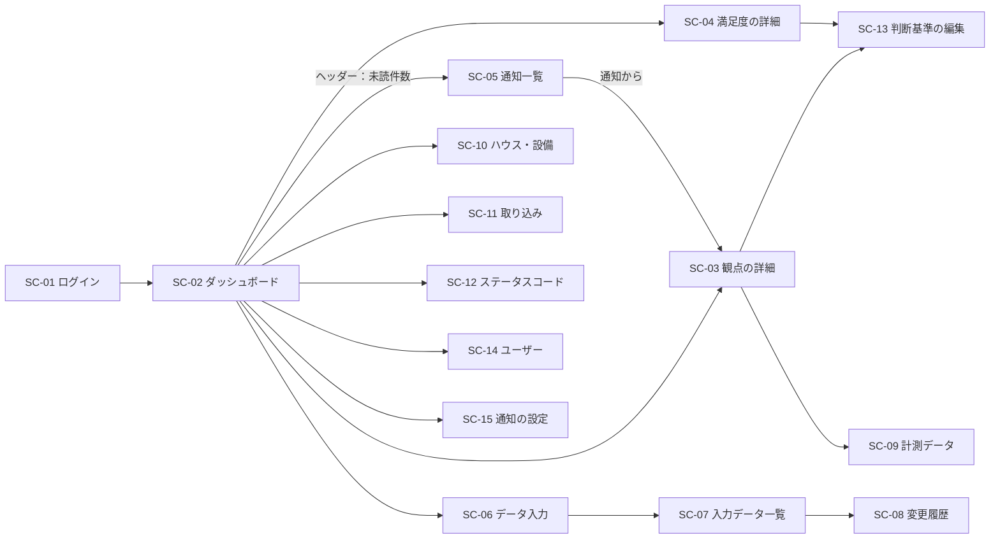

# 機能仕様書

目的: [functional-requirements.md](../requirements/functional-requirements.md) の機能要件を、画面・API・処理の振る舞いとして具体化し、実装とテストの拠り所とする。

> **記載のルール**
> - 各項目に、元になった要件ID（FR-x.x）とユースケースID（UC-xx）を示す。要件にない振る舞いを推測で足さない
> - 評価のメトリクス・判断基準は [viewpoint/](../viewpoint/)、データ項目は [data-dictionary.md](../data/data-dictionary.md)、構造は [data-model.md](../data/data-model.md)、処理の流れは [data-flow.md](../data/data-flow.md)、構成は [architecture.md](../architecture/architecture.md) を参照し、ここに重複して書かない
> - 権限（どの操作を誰ができるか）は、管理者・一般の 2 ロール（決定。[ADR-0013](../adr/0013-environments-and-access-control.md) の表）。**ロールの分割は実装済み**（#115。管理者 `admin`・一般 `general`）。閲覧できる設備の割り当て（#116）は未実装で、それまでは、一般も、全設備を閲覧できる。本書の「権限」列は、ロールごとの可否を示す（「要ログイン」は、権限が不要で、ログインしていれば使える）。操作ごとに権限を設定で割り当てる構造（architecture.md 9章）
> - 画面の見た目（配色・レイアウトの詳細）は、画面設計で別に定める。本書は、表示項目・操作・検証・振る舞いを定める
> - 未確定の事項は `TODO:` と確認事項の番号（rfp.md の Q-xxx）で示す

## 1. 共通事項

### 1.1 構成

- 画面は、React の SPA（PWA）。API は、REST（JSON）で、Hono を使った Lambda の関数として提供する（[ADR-0005](../adr/0005-tech-stack.md)）
- 画面は、日本語で表示する。PC・タブレット・スマートフォンで閲覧・入力できる（NFR-7.1、NFR-7.3。#142 の D-33 の決定）。狭い幅（900px 以下）では、表（SC-03 の判断基準・SC-05・SC-07・SC-08・SC-09・SC-11・SC-12・SC-14）を、1 行ごとのカード（項目名と値）で表示し、判断基準の編集（SC-13）は、保存・既定値へ戻すボタンを画面の下に固定する（#151）。設備管理（SC-10）は、表の枠の中で横にスクロールする
- 画面のデザイン（方向性・色・アイコン・共通のレイアウト）は、[ui-design-guidelines.md](./ui-design-guidelines.md) に従う
- 状態の更新は、画面が約10秒間隔で、保存済みの最新の評価結果を読み直す（タブの表示中のみ。FR-6.7）
- ロボット・ハウスを操作する機能はない（自動制御を行わない。goals.md）

### 1.2 共通のルール

| 項目 | 内容 |
|------|------|
| 認証 | ログインしたユーザーのみが、画面・APIを使える。未認証のアクセスは、ログイン画面へ誘導する（FR-9.1）。APIは、すべて認証トークンを検証する |
| 権限 | 要ログイン。操作ごとのロール制御は、管理者・一般の 2 ロール（ADR-0013 の表。実装済み〔#115〕。設備の割り当ては、実装済み〔#330〕。通知の絞り込みも、実装済み〔#331〕。ログは #332。FR-9.5） |
| 時刻 | APIは UTC（ISO 8601）で扱い、画面は日本時間（`Asia/Tokyo`）で表示する |
| 欠損・不明 | 欠損は「—」（ダッシュ）で表示する。評価できない観点は、ステータス「不明」で、理由と推奨アクションを表示する（FR-5.5） |
| ステータスの表示 | 正常／注意／異常／不明を、色・アイコン・文字で示す。色だけに頼らない（NFR-7.2） |
| 一覧 | ページ分割（既定 20件）。並べ替え・絞り込みの条件は、URLのクエリに反映し、再読み込みで保持する。**共通の部品（#152）**: 絞り込みの枠は、**適用中の条件の数**（初期値と違う条件の数。絞り込み・並べ替えを含む。「適用中の条件 3 件」）と、**条件のクリア**（条件をすべて初期値に戻す。URL のクエリから外す。適用中の条件がなければ選べない）を、項目の上に示す。**狭い幅（900px 以下）は、項目を折りたたみ**、開閉のボタン（「絞り込みを開く／閉じる」。`aria-expanded`）で開く（折りたたんでも、条件の数と条件のクリアは見える。広い幅は、常に開く）。ページ送りは、**表示範囲**（「21〜40 件目」）を示す。**総件数・総ページは示さない**（カーソル方式のため。1 年で約 63 万件の想定）。対象: SC-05・SC-07・SC-08・SC-09・SC-11（取り込みのログ。ページ送りの表示範囲は、連携の結果・ハウス別の記録も） |
| 入力の検証 | 画面とAPIの両方で検証する（画面は即時のフィードバック、APIが正）。不正な場合は、項目ごとにエラーを表示して、再入力を促す（FR-4.1.3） |
| 結果の通知 | 保存・修正・削除・接続の確認などの結果は、共通の部品（`ResultNotice`。データ入力の保存結果のパネルは、同じ規則の `useRevealOnChange`）で示す。`role="status"` でスクリーンリーダーに通知し、**表示されたとき（現れた・変わったとき）に、画面内になければスクロールする**（すでに見えていれば動かない。動きを減らす設定のときは、アニメーションしない）。**フォーカスは動かさない**（結果の通知は、操作できる要素を持たないため。押したボタンの位置を失わない）。成功は完了メッセージ（形のアイコン + 文字）、失敗は `form-error` の見た目。画面全体のエラー（`role="alert"`）は、この部品ではなく、従来どおり（#150） |
| 確認 | 削除などの取り消しにくい操作は、確認を求める。確認のダイアログには、対象（どのデータか）を、ラベルと値で示す。影響があるものは、影響の説明を添える（共通の部品 `ConfirmDialog`。対象の項目と影響の説明を、任意で示せる。#153） |
| 空の状態 | データがない場合は、その旨と、次の操作（例: データの入力）を表示する |
| ヘルプ | 判断基準（閾値・ステータスの意味）を画面から参照できる。主要な操作に、ツールチップを表示する（NFR-7.4）。**共通の部品（#154）**: 指標名・入力欄のラベルの横に、**ヘルプヒント**（「?」のボタン。ボタンの名前は「{対象}の説明」。押す・Enter・Space で、説明を開く。`aria-expanded`。もう一度押す・Esc〔ダイアログの中でも、ヒントだけを閉じる〕・外側を押す・フォーカスが外へ移る、で閉じる。同時に開くのは 1 つ。狭い幅でも、画面の幅に収める。`title` 属性だけには頼らない）を置く。状態の意味は、**折りたたみ式の凡例**（はじめは閉じている。ボタンで開閉）で示す。別のヘルプのページは設けない。指標の説明は、指標の定義（`shared/constants/metrics.ts` の `help`）、入力項目・カテゴリの説明は、`shared/constants/item-help.ts` に持ち、各画面は、そこから表示する（用語辞書）。説明は、設計の定義（viewpoint/・data-dictionary.md・用語集・ADR）から書き、定義のないものには付けない |

### 1.3 APIの共通仕様

| 項目 | 内容 |
|------|------|
| 形式 | `/api/v1/...`。リクエスト・レスポンスは JSON（UTF-8） |
| 認証 | `Authorization: Bearer <token>`（方式は設計で確定。FR-9.3） |
| 成功 | 200（取得・更新）、201（作成）、204（削除・既読化） |
| エラー | 4xx（入力不正 400、未認証 401、権限なし 403、存在なし 404、競合 409、版の確認が必要な更新に `If-Match` がない 428）、5xx。形式は `{ "error": { "code": "...", "message": "...", "fields": [{ "name": "...", "message": "..." }] } }`。`message` に内部情報（スタックトレース、パス、設定値）を含めない（security.md） |
| ページ分割 | `?limit=&cursor=`。応答に `nextCursor` を含める |
| 並べ替え・絞り込み | クエリ（例: `?from=&to=&category=&sort=`） |
| 冪等性 | 作成系は、重複を防ぐキーがある場合に、条件付き書き込みで 409 を返す |
| 版つき更新 | 判断基準の更新・既定値へ戻す操作は、`GET` の応答の `ETag`（内容のハッシュ）を、`If-Match` に付ける（同時編集の検出。SC-13-1）。`If-Match` がなければ 428、現在の版と一致しなければ 409（更新しない）。ワイルドカード（`*`）は受け付けない |
| ログ | 構造化ログ。リクエスト本文の全体・秘密情報を出力しない |

## 2. 画面一覧と遷移

### 2.1 画面一覧

| ID | 画面 | 内容 | 要件・UC |
|----|------|------|----------|
| SC-01 | ログイン | ログイン・ログアウト | FR-9.1 / UC-13 |
| SC-02 | ダッシュボード | 全観点のステータス一覧、サマリー、最終取得日時 | FR-6.1〜6.3、6.6、6.7 / UC-01 |
| SC-03 | 観点の詳細 | 診断結果、根拠の指標、判断基準、元データ、推移 | FR-5、FR-6.4、6.5、6.10 / UC-02〜UC-04 |
| SC-04 | 満足度の詳細 | 総合満足度、各観点の満足度（レーダーチャート） | FR-6.9 / UC-21 |
| SC-05 | 通知一覧 | 通知の一覧、絞り込み、既読化 | FR-7.5、7.6 / UC-05、UC-22 |
| SC-06 | データ入力 | 手動入力・補完、復旧対応の記録 | FR-4.1 / UC-06、UC-07 |
| SC-07 | 入力データ一覧 | 入力済みデータの一覧・検索・修正・削除 | FR-4.2.1、4.2.2 / UC-18 |
| SC-08 | 変更履歴 | 入力・変更・削除の履歴 | FR-4.2.3 / UC-18 |
| SC-09 | 計測データ | 計測データ（自動取り込み・手動入力）の一覧 | FR-6.8 / UC-20 |
| SC-10 | ハウス・設備 | ハウス・ロボット・センサーの登録・変更・削除（登録・修正は、ダイアログ。#364） | FR-2 / UC-12 |
| SC-11 | 取り込み | 接続先・間隔の設定、接続テスト、即時取得、取り込み・連携のログ。一般ユーザーには、閲覧できるハウスの記録だけ（#332） | FR-1.4〜1.8、FR-8.3 / UC-15、UC-16 |
| SC-12 | ステータスコード | ステータスコードの定義 | FR-3 / UC-17 |
| SC-13 | 判断基準の編集 | 観点の判断基準の閾値の編集（観点の詳細〔SC-03〕・満足度の詳細〔SC-04〕の「判断基準を編集」から） | FR-5.7、5.8 / UC-19 |
| SC-14 | ユーザー | ユーザーの一覧・登録・編集・削除 | FR-9.4 / UC-14 |
| SC-15 | 通知の設定 | Web Push の有効化・解除 | FR-7.2 / UC-23 |

SC-14（ユーザー）は、管理者のみ（決定。ADR-0013）。

### 2.2 画面遷移

### 2.3 共通のヘッダー・ナビゲーション

共通のレイアウトは、**左のサイドメニュー**と、**上部のバー**（☰・タイトル・通知のアイコンと未読の件数のバッジ・ユーザーメニュー。対象の設備の選択は、ダッシュボード・観点の詳細・満足度の詳細の中へ、最終のデータ取得日時は、ダッシュボードの中（3.1 の「取得日時など」）へ移した。通知・観点の詳細・満足度の詳細には、最終のデータ取得日時を出さない。#355）。☰ は、画面の幅に関わらず、サイドメニューを開閉する。広い幅では、サイドメニューは既定で開いていて、☰ で閉じると、本文が全幅になる（閉じている間は、見えず、キーボードの移動の対象にもならない。閉じた状態は、保存しない）。狭い幅（900px 以下）では、メニューを、☰ で開閉する引き出しにする（画面の高さまで届く。Esc・閉じるボタン・本文を覆う面で閉じる。開いている間は、Tab の移動を中に閉じ込め、閉じたら ☰ にフォーカスを戻す）。詳細は、[ui-design-guidelines.md](./ui-design-guidelines.md) 8 章。

| 要素 | 内容 | 要件 |
|------|------|------|
| ☰・タイトル | ヘッダーの左に、☰（サイドメニューの開閉。名前は「メニューの開閉」。状態は `aria-expanded`）と、タイトル「Greenhouse Monitor」（ダッシュボードへのリンク）を、この順に置く。画面の幅に関わらず表示する。狭い幅では、タイトルが長いとき、末尾を省略する。サイドメニューの中には、タイトルを置かない（#354） | - |
| 通知のアイコンと未読の件数 | ベルのアイコンの右上に、未読の件数のバッジ（赤）を重ねる。アイコンを押すと、通知一覧（SC-05）を開く（メニューには、通知の項目を置かない。#351）。未読が 0 件のときは、バッジを出さず（ベルだけ）、100 件以上は「99+」と表示する（リンクの名前〔読み上げ〕は、実際の件数「未読の通知: N件」）。通知の画面にいる間は、アイコンを現在の画面として強調する（`aria-current`） | FR-7.6 |
| メニュー | サイドメニュー（アイコン + 文字。「設定」のアイコンは歯車）。ダッシュボード、データ入力、計測データ（SC-09）、設定（設備・取り込み・ステータスコード・ユーザー。開閉できるまとまり。既定では開く。「通知の設定」は、ユーザーメニューへ移した。#353）。権限のない項目（取り込み・ユーザー）は、表示しない（ADR-0013）。**現在の画面の項目は、強調する**（`aria-current="page"`）。判定は、**パスの前方一致**（区切りの `/` の単位）で、入力データ一覧・変更履歴でも「データ入力」を強調する（#155）。ダッシュボード（`/`）は、すべてのパスの前方になるため、完全一致のみ。メニューにない画面（観点の詳細・満足度の詳細・通知・通知の設定など）では、どの項目も強調しない | - |
| ユーザーメニュー | 右端の、ユーザーアイコン・ユーザー名・ロール（括弧内。管理者・一般。知らないロールは、括弧なし）の 1 つのボタン。長いユーザー名は省略し（全文は、ボタンの名前・ツールチップ）、狭い幅（900px 以下）は、アイコンだけ（名前・ロールは、ボタンの名前で読み上げる）。押すと、個人に関する操作を開く: ユーザー名の変更（`/profile`）・パスワードの変更（`/change-password`）・通知の設定（`/settings/push`）の画面へのリンク、テーマ、ログアウト。個人の設定の画面にいる間は、ボタンと該当の項目が現在の画面を示す（`aria-current`）。項目を選ぶと閉じる。↑↓・Home・End・Esc のキーボード操作ができる（#353） | FR-9.1 |
| テーマ（ユーザーメニューの中） | 画面の明るさを、システム（既定。ブラウザ〔OS〕の設定に従う）・ライト・ダークから選ぶ。選ぶとすぐ切り替わる。現在の設定には、チェックが付く。設定は、この端末のブラウザに保存し、再読み込み・次の起動でも保つ（別の端末・ブラウザには、引き継がない）（#352。入口は、#353 でヘッダーのボタンからユーザーメニューへ移した） | - |

## 3. 画面仕様

### 3.1 SC-02 ダッシュボード（FR-6.1〜6.3、6.6、6.7 / UC-01）

| 項目 | 内容 |
|------|------|
| 目的 | ハウスの状態を、観点ごとに、一目で把握する（ダッシュボードは、ハウス単位。#355） |
| 表示 | **取得日時など**（ヘッダーから、ここへ移した）: 最終のデータ取得日時（古い・未取得の場合は、その旨。手動のみの運用は「最終の手動入力」）・最終の評価日時・判定の対象期間（満足度を除く観点で同じなら、ここに 1 回だけ示し、カードには示さない。満足度の期間が、これと違うとき〔例: 既定の 30 日〕は、満足度のカードにだけ示す。満足度を除く観点の間で違うときは、期間のあるカードごとに示す。日時は、分まで〔秒は示さない〕。#160）。**サマリー**（見出し「状態ごとの観点の数」）: ステータスごと（正常／注意／異常／不明）の観点の件数。**観点別の状態の表**（見出し「観点別の状態」。#356）: 件数の下に、10 観点を、1 行に 1 観点（観点名〔詳細へのリンク〕・状態）で示す。**観点のカード**（見出し「観点ごとの診断と推奨アクション」。10観点を、表示順〔evaluation.md 1章〕に）: 観点名〔観点の詳細へのリンク。カードの詳細へのリンクは、題名の 1 つだけ。#160〕、ステータス、主要な指標の値（viewpoint/ の「ダッシュボード表示（主要）」）、診断メッセージ、推奨アクション。視点（短期・長期）の切り替えはない（長期の評価を、選んだ期間で示す。既定: 直近7日。満足度は 30 日）。**ヘルプヒントと凡例**（#154。SC-02-7）: 状態の凡例（「状態の見かた」。折りたたみ式。正常・注意・異常・不明の意味。evaluation.md 2 章）を、サマリーの上に置く。カードの指標名（可販果率・走行停止率・平均修復時間〔MTTR〕・稼働率・データ連携率・ステータスなど）の横に、ヘルプヒントを置く（定義のある指標だけ。運用コストなど、定義が別の Issue で決まるものは付けない） |
| カードのステータス | 短期視点と長期視点のうち、「不明」を除いた悪い方。両方「不明」なら「不明」（通知と同じ最終ステータス。evaluation.md 5章）。表示する指標・診断メッセージは、長期の評価。短期の方が悪い（長期の評価と違う）ときは、カードに、「直近 24 時間の評価は「異常」です（この期間の評価は「正常」）。ステータスは、悪い方を示しています」のように示す（#355。#160 の SC-02-1 への対応） |
| 操作 | **対象のハウス**を選ぶ（ダッシュボードの中。ハウスだけ。ロボット・センサーは、観点の詳細で選ぶ。観点の詳細で、ロボット・センサーを選んでから戻ったときは、そのハウスに、選択をそろえる）。**期間**を選ぶ（当日／直近7日／30日／60日／90日。URL の `periodDays` で保持する）。**更新**（手動。約 10 秒の自動更新は続ける。更新中は、押せない）。カード・表の行を選ぶ → 観点の詳細を、右からのドロワーで開く（SC-03。満足度は SC-04。URL は `/?viewpoint=観点`。選んだ期間を引き継ぎ、期間を選んでいなければ付けない。#357）。通知一覧の「詳細を確認」からも、同じドロワーを開く（対象のハウスは、通知のハウス。#159 の SC-05-6） |
| 更新 | 約10秒間隔で、最新の評価結果を読み直す（タブの表示中のみ。変化がなければ、小さな応答） |
| データがない場合 | 取り込み・入力がない場合は、その旨と、データ入力・取り込みへの導線を表示する |
| データが古い場合 | 設備ごとに、その設備の取得間隔 × 3（最低 3 分）を超えて、新しい計測値がない場合は、警告を表示する。選んだ設備（ハウスなら配下の設備）のいずれかが古ければ、警告する。古い設備の名前を、警告の文に添える（先頭の 3 つ。残りは「ほか N 件」。実装済み: #198）。**警告を開くと、古い設備の一覧**（設備名・最終の受信日時・基準〔分〕。「古い設備の一覧（N 件）」。開閉できる。閉じた状態から始まる。#158）を示す。まだデータのない設備は、判定しない（ハウスの配下のどの設備にもデータがなければ「未取得」）。自動取り込みが有効でない間（手動のみの運用。選んだ設備、ハウスなら配下の設備に、自動取り込みの対象が 1 つもない）は、警告を出さず（「古い」「未取得」にしない）、「自動取り込みが有効でないため、手動入力のデータで評価しています」の案内と、データ入力への導線を示し、最終の手動入力を示す（[ADR-0016](../adr/0016-ingestion-federation-rules.md)。実装済み。#202） |
| 評価が更新されていない場合 | 最終の評価の日時から、**15 分（評価の間隔 5 分 × 3 回分）以上**たっているとき、「評価が更新されていません（最終の評価: 日時）。…」の警告を表示する（評価のジョブが止まると、古い状態が現在のものに見えるため）。評価がまだなければ、出さない。現在の時刻は、端末の時計で判定する。間隔・基準は、共有の定数（`EVALUATION_INTERVAL_MINUTES`・`EVALUATION_STALE_MINUTES`）で、評価のジョブ（JB-02）の間隔と一致させる（[ADR-0014](../adr/0014-defer-evaluation-on-manual-entry-write.md)。#158。SC-02-6）。運用側のアラームは、別（#429） |
| ヘルプヒント（鮮度） | 「最終の評価」の横: ステータスは 5 分ごとの定期の評価で更新され、手動入力の保存後の反映に最大 5 分かかることがあること、15 分以上更新されないと警告を出すこと。「最終のデータ取得」の横: 画面は 10 秒ごとに更新されるが、新しいデータが増えるのは設備ごとの取得間隔ごとであること、取り込み画面の「自動取り込みを有効にする」を外すと手動のみの運用になり「データが古い」の警告が出なくなること（手動のみの運用では、「最終の手動入力」の横に、同趣旨の説明）（#158。SC-11-9。ADR-0016 の D-11・D-12） |
| 関連API | `GET /api/v1/dashboard`、`GET /api/v1/equipment` |

### 3.2 SC-03 観点の詳細（FR-5、FR-6.4、6.5、6.10 / UC-02〜UC-04）

| 項目 | 内容 |
|------|------|
| 目的 | 診断結果の根拠を理解し、対応を判断する |
| 表示の形 | 全画面のページ（`/viewpoints/{viewpointId}`。直接 URL・データ入力の結果のリンク）と、ダッシュボードのカード・観点別の状態の表・**通知一覧の「詳細を確認」**から開く、**右からのドロワー**（`/?viewpoint={viewpointId}`。#357。通知からは、#159 の SC-05-6）の 2 つ。中身は同じ。ドロワーは、幅 `min(880px, 100vw)`（900px 以下は全画面）で、ダッシュボードの上に重ねる（ダッシュボードは描画したまま。閉じても、スクロール位置・選んだ期間・対象のハウスが保たれる）。✕・Esc・背面・ブラウザの「戻る」で閉じる。開いている間は、本文のスクロールを固定し、フォーカスをドロワーの中に閉じ込め、閉じたら、開いたカードに戻す。見出しは h2（パンくずは出さない）。「ページで開く」で、全画面のページへ移れる。ドロワーの中の期間は、ダッシュボードの期間（URL の `periodDays`）と同じ。ドロワーを開いている間は、対象の設備の選択を、ハウスにそろえない（ドロワーの中で、ロボット・センサーを選べる。閉じたときに、そろえる） |
| 表示 | **診断結果**: ステータス、診断メッセージ、推奨アクション（変更した判断基準による判定の場合は、その旨）。視点（短期・長期）ごとの判定（ステータス・診断メッセージ・推奨アクション・判定の対象期間）は、この欄の「視点ごとの判定」に、1 箇所だけ示す（推移の欄には、同じ内容を繰り返さない。#160）。短期評価を持たない観点は、「短期評価はありません」に、理由（長い期間・一定期間の指標のため）のヘルプヒントを添える（[ADR-0017](../adr/0017-evaluation-rules.md) D-15。#160）。**構成**: 上から、診断・根拠の指標・推移・元データ・判断基準。推移と元データは、折りたたみ（既定は閉。見出しを押して開閉する。期間・設備を切り替えても、開閉の状態を保つ。全画面のページとドロワーで同じ。#160）。**根拠の指標**: 全指標の値（ダッシュボードに出さないものを含む）と、指標ごとの判定。指標名の横に、ダッシュボードと同じヘルプヒントを置く（#154）。**判断基準**: 条件、正常・注意・異常の区分（表。変更済みを識別できる。「既定値」または「変更済み」だけを示し、内部の版〔`V2`・`CUSTOM-1` など〕は示さない。#154）。**元データ**: 分析に使った取り込みデータ・手動入力データ（一覧・並べ替え・絞り込み・ページ分割）。**推移（長期視点）**: 主要な指標の時系列グラフと、期間の値（判定に使った値と同じ算出式を、期間全体に当てた値。[ADR-0017](../adr/0017-evaluation-rules.md)。実装は #214）。観点のステータスの推移（FR-6.10。**決定（[ADR-0017](../adr/0017-evaluation-rules.md) D-25）**: 粒度は、短期・当日が 1 時間ごと、7〜90 日が日ごと。ステータスの推移は、最終ステータスの履歴で、期間を変えても同じ。時系列の帯〔両端に、開始・終了の日時〕と、変化の一覧で示し、その旨を画面に説明する。#160）。グラフの背景の帯は、現在の基準で描く（D-24）旨も、画面に説明する。グラフは指標ごとに開閉できる。**グラフの値**: 点を押す（タップ・クリック。またはキーボードでフォーカスする。矢印キー・Home・End で前後の点へ移る）と、日時・値・状態（判断基準の区分）を、グラフの下に示す。全区間の値は、「値の表」（見える折りたたみ。日時・値・状態の列）でも読める。マウスを載せたときの説明（SVG の `title`）だけには頼らない（#160） |
| 操作 | **対象の設備**（ハウス・ロボット・センサー）を選ぶ（ページの中。以前は、ヘッダー。#355）。短期／長期の切り替え、期間の選択。判断基準の編集（SC-13）。元データの絞り込み（キーワード）・並べ替え（日時・値・カテゴリ）。キーワード・値・カテゴリの順は、診断期間が 31 日を超えるとき、終了日時から 31 日分に絞る（その旨を表示）。診断期間がない（評価前）ときは、使えない（#91） |
| 満足度 | 観点が「満足度」の場合は、SC-04 を表示する |
| 振る舞い | 評価できない（不明）場合は、「データ不足のため評価できない」旨と、取得・入力を確認する推奨アクションを表示する。**選んでいる設備では評価しない観点（ロボットに満足度、センサーにロボットの観点など）を開いたときは、エラーの見た目（警告）ではなく、中立の案内（情報。`role="status"`）を表示する。サーバーのメッセージ（「この設備では評価しない観点です」）に続けて、開いた観点を評価する設備の種類に合わせた文を示し（満足度: 「この観点（満足度）は、ハウスの評価です（ロボットでは評価しません）」。ロボットとハウスで評価する観点をセンサーで開いたとき: 「この観点（収穫精度）は、ロボットとハウスで評価します（センサーでは評価しません）」。センサーとハウスで評価する観点をロボットで開いたとき: 「この観点（環境適応性）は、センサーとハウスで評価します（ロボットでは評価しません）」。どの観点をどの設備の種類で評価するかは、観点・設備の種類の定義〔`viewpointsForEquipmentType`〕から導く）、親のハウスへ切り替える「ハウス「名称」を表示」ボタンを付ける（押すと、対象の設備が、そのハウスになる。ダッシュボードのドロワーの中でも同じ。#156）。ハウスを選んでいて評価しない、または存在しない観点（URL の誤りなど）のときは、切り替え先がないため、ボタンは出さず、「ハウスまたは対象の設備を選び直してください」を案内する。SC-04 も同じ部品を使う**。ステータスコードの指標は、カテゴリ名ではなく、名称を表示する（メンテナンス性）。**【決定（[ADR-0017](../adr/0017-evaluation-rules.md)）】観点の詳細に、算出式と、判断基準・算出式が暫定であることを表示する（実装は #220）。診断メッセージは、「注意」「異常」のとき、最も悪い指標を先頭に「原因: …」として示す（実装は #213）。ステータスの推移は、最終ステータスの履歴で、期間を変えても同じである旨と、背景の帯は現在の基準である旨を、画面に説明する（実装済み。#160）** |
| 狭い画面 | 900px 以下は、判断基準の表を、指標ごとのカード（指標名を題名に、条件名と、正常・注意・異常の条件を、項目名と値で）で表示し、横にスクロールしなくても、すべての条件を読める（#151） |
| 関連API | `GET /api/v1/viewpoints/{viewpointId}`、`GET /api/v1/viewpoints/{viewpointId}/series`、`GET /api/v1/observations` |

### 3.3 SC-04 満足度の詳細（FR-6.9 / UC-21）

| 項目 | 内容 |
|------|------|
| 表示の形 | SC-03 と同じ（全画面のページ `/satisfaction` と、ダッシュボードのカード・観点別の状態の表から開く右からのドロワー `/?viewpoint=satisfaction`。#357） |
| 操作 | **対象の設備**を選ぶ（ページの中。ハウス・ロボット・センサー。#355）。期間を選ぶ。総合満足度の判断基準（注意下限・異常下限）は、判断基準の状態（既定値／変更済み。内部の版は示さない。#154）の横の「判断基準を編集」から、判断基準の編集（SC-13）で編集する（他の観点と同じ画面・同じ部品。#359） |
| 表示 | 総合満足度（9観点の平均。小数第1位）、各観点の満足度（1〜5）をレーダーチャートと表（列見出しは「指標」「値」）で表示。判断基準（4.0以上 正常、3.0以上4.0未満 注意、3.0未満 異常） |
| 振る舞い | 期間内に、9観点のいずれかの入力がない場合は、「不明」とし、入力を促す（データ入力画面への導線）。**案内の文言は、実態に合わせて 2 つ（#160）**: (1) 9観点すべてが未入力（期間内に、入力が 1 件もない。入力が遅れて、前回の入力が期間から外れた場合を含む）: 「期間内に、満足度の入力がありません」と、評価が「不明」である旨、月に 1 回を目安に 9観点すべてを入力する旨、期間を長くすると前回の入力が含まれることがある旨を示す（観点の一覧は示さない）。(2) 一部の観点だけが未入力（新しい入力は 9観点が必須のため、以前の、一部の観点だけの入力が、期間内の最新の入力として残っている場合）: 「未入力の観点があります」と、その観点の一覧、評価が「不明」である旨、以前の入力を修正して、または新しく 9観点すべてを入力する旨を示す。**ロボット・センサーを選んでいて、満足度を評価しないときは、エラーの見た目ではなく、中立の案内（情報。`role="status"`）で、「この観点（満足度）は、ハウスの評価です（ロボットでは評価しません）」（センサーを選んでいるときは、「…（センサーでは評価しません）」）と、親のハウスへ切り替える「ハウス「名称」を表示」ボタンを示す（SC-03 と同じ部品。ドロワーの中も同じ。#156）。**評価に使う値は、各入力者の期間内の最新の入力を取り、観点ごとに平均する（1 人 1 票）。既定の期間は 30 日で、期間を選べば、他の観点と同じ長期の期間で評価する（決定。[ADR-0017](../adr/0017-evaluation-rules.md)）。レーダーチャートは、軸のラベルが切れず、左右・上下に偏らないよう、描画後に文字の範囲を測って表示の範囲を決める。画面の幅が狭い（480px 以下）ときは、半径を小さくして、ラベルを読める大きさで収める。レーダーチャートと観点別の表は、900px 以下で縦に並べる（NFR-7.3） |
| 関連API | `GET /api/v1/viewpoints/satisfaction` |

### 3.4 SC-05 通知一覧（FR-7.5、7.6 / UC-05、UC-22）

| 項目 | 内容 |
|------|------|
| 表示 | 日時、種別（状態の悪化／データ取得失敗／連携の期限切れ。「状態の悪化」は、正常 → 注意・異常、注意 → 異常の通知。#159 の SC-05-2）、対象の観点、**対象**（ハウスの名称）、**設備**（ロボット・環境センサーの名称）、ステータス、メッセージ、既読状態。新しい順。対象は、設備の通知なら、親のハウス（ハウスの通知は、そのハウス）。ハウスの通知・設備のない通知は、設備を「—」にする。取り込み失敗などで、設備のない通知は、対象に取り込み元の名称を示す。設備の一覧にない設備（削除など）は、対象を「—」、設備を設備 ID で示す（#362。API の変更なし。画面が持つ設備の一覧から引く）。**通知ごとに、回復日時**（状態変化の通知に、「11:20 に回復（20 分）」または「未回復」。経過を示せない通知〔取り込み失敗など〕には出さない）と、**開閉できる欄「経過・メモ」**（既定は閉じる。経過: 「11:00 異常 → 11:20 正常 → 11:40 異常」〔通知の日と違う日は、月/日つき〕。メモ: 共有・追記のみ・入力者〔ユーザー ID〕と日時つき。入力は、手動入力と同じ権限〔`manual-entry:write`〕で、ない利用者は読むだけ。結果は、共通の結果の通知〔1.2〕で示し、失敗はエラー）を示す。推奨アクションは、一覧に載せない（観点の詳細で確認する）（実装済み。#159 の SC-05-1） |
| 絞り込み | 種別、既読／未読。共通の部品（1.2「一覧」）: 適用中の条件の数・条件のクリア・狭い幅での折りたたみ・ページ送りの表示範囲（#152）。「既読にする」の操作（絞り込みの範囲・すべて）は、絞り込みの枠の外に置き、狭い幅で折りたたんでも隠さない |
| 操作 | 通知を選ぶ（観点のある通知の「詳細を確認」）→ **ダッシュボード上のドロワー**（`/?viewpoint={観点}`。SC-03。満足度は SC-04）で、対象の観点の詳細を開き、通知を既読にする。ドロワーを開くとき、ダッシュボードの対象のハウスは、**通知のハウス**になる（通知の設備〔ロボット・センサー〕が、通知のハウスの配下なら、ドロワーは、その設備で開く。設備が別のハウスへ移った・削除されたときは、通知のハウスで開く）。視点・期間は指定しない（通知時点の判定は再現しない。出来事ごとの記録は、通知ごとの経過で示す。ADR-0019 の D-42。#159 の SC-05-6）。観点のない通知（取り込み失敗など）は、取り込みの状況（SC-11）へ移る。個別に既読にする。一括で既読にする（絞り込み中の範囲、または全件。画面に読み込んだ時点までに届いた通知だけが対象で、件数つきの確認ダイアログで実行する。確認の件数と実行の範囲は同じ。0 件のときは、確認を開かず、その旨を示す。決定。[ADR-0019](../adr/0019-notification-rules.md)。実装済み。#240）。通知ごとに、経過と回復日時、メモ（共有・追記のみ）を示す（決定。API は #238・#239。画面は、上の「表示」） |
| 状態 | 未読／既読の2つのみ。対応状況（未対応／対応中／完了）の管理・承認はない（Q-018） |
| 更新 | 未読の件数は、約10秒間隔で読み直す（ヘッダー）。通知の一覧も約10秒間隔で読み直すが、**新しい通知は、自動では加えない**（操作中に、行が下へずれないように）。「新着あり（N 件）。押すと更新します」を示し、押すと、新着を含めて更新する。表示中の通知の内容（既読・メモの件数）は、その場で更新する。自分の操作（既読にする）のあとは、新着を含めて更新する。絞り込み・ページを変えたときは、新しい条件の一覧を、そのまま示す（#159 の SC-05-10） |
| 空の状態 | 通知がない場合は、その旨を表示 |
| 狭い画面 | 長い値（設備名 200 文字を含む対象・メッセージ）や 900px 以下の幅（タブレット・スマートフォン）でも、列が潰れず、ページが横にはみ出さない。900px 以下は、表を通知ごとのカード（項目名と値の縦並び）で表示し、横にスクロールしなくても「既読にする」「詳細を確認」を操作できる（NFR-7.3）。未読の件数（ヘッダー）は、3桁以上でも、バッジが「99+」で 1 行に収まる |
| 関連API | `GET /api/v1/notifications`、`GET /api/v1/notifications/unread-count`、`POST /api/v1/notifications/{id}/read`、`POST /api/v1/notifications/read-all`、`GET /api/v1/notifications/{id}/memos`、`POST /api/v1/notifications/{id}/memos` |

### 3.5 SC-06 データ入力（FR-4.1 / UC-06、UC-07）

| 項目 | 内容 |
|------|------|
| 目的 | 機器から取れない情報や、人の対応の結果を入力し、評価に反映する |
| 入力 | **必須**: 対象の設備（ハウス・ロボット・センサー。選択肢は、ハウスの下にロボット・センサーを字下げし、種別〔ロボット・センサー〕を付ける。同名の設備を区別できる。#152 の SC-06-8）、カテゴリ（**対象の設備の種別に合うものだけ選べる**。ハウスは満足度情報だけ、ロボットは環境情報・満足度情報以外、環境センサーは環境情報だけ。data-dictionary.md 5.2。#360）、計測日時。**カテゴリごとの項目**（data-dictionary.md 5.2）: 操作情報、収穫情報（自動取り込みの収穫数・1 果実あたりの収穫時間も、手動で入力できる）、稼働情報（自動取り込みの稼働時間・待機時間・収穫稼働時間・走行停止時間。予備の入口。#192）、ステータス（ステータスコード。登録済み〔削除していない〕のコードから選ぶ。#192）、安全情報、コスト情報、故障情報（復旧対応の回数・復旧に要した時間）、環境情報、満足度情報（満足度以外の9観点の 1〜5 スター。数値の文字入力ではなく、観点ごとに 5 つのスター（ラジオ）から選ぶ。9観点が揃わないと保存できない。決定。[ADR-0017](../adr/0017-evaluation-rules.md)）。**任意**: 備考（所感・運用上の補足） |
| 検証 | 必須項目が未入力なら登録できない。数値は、型（整数／数値）・範囲（0以上、湿度は 0〜100、満足度は 1〜5 の整数）・単位を検証する。**満足度情報は、9観点すべての値が必須**（画面・API の両方。修正も、9観点が揃った状態を保つ。選んでいない観点ごとに、「満足度（〇〇）を選択してください」のエラーを示す）。既存の、一部の観点だけの入力は、そのまま残り、修正するときに、9観点を揃える。計測日時は、現在から 5 分を超える未来を指定できない（5 分は、端末の時計のずれを吸収する余裕。固定。[ADR-0016](../adr/0016-ingestion-federation-rules.md)）。カテゴリに属さない項目は受けない。**対象の設備の種別に合わないカテゴリは、新しい入力と、対象かカテゴリを変える修正で、拒否する**（400。`fields` は `category`）。対象・カテゴリを変えない修正は、以前の入力（今は選べない組み合わせ。例: ハウスの故障情報）でも保存できる（既存のデータを、そのまま扱うため。#360）。**自動取り込みの項目は、すべて、手動でも入力できる**（予備の入口。実装済み〔#192〕。ステータスコードは、登録済み〔削除していない〕のコードだけ。登録のない・削除済みのコードは、項目のエラー）。範囲は、データ辞書のとおり（温度 −50〜100℃、湿度 0〜100%、照度 0〜200,000 lx、CO2 0〜10,000 ppm。実装済み〔#200〕。範囲外は保存できず、エラーと入力欄の説明に、範囲を示す。1果実あたりの収穫時間は、手動入力で 0〜300秒〔データとしては 0〜3,600秒〕。実装済み〔#192〕） |
| 入力欄のヘルプヒント | #154（SC-06-9）: カテゴリ・計測日時・備考・一般の項目（環境の 4 項目・1 果実あたりの収穫時間・ステータスコード・果実損傷数・誤収穫数・取り残し数・緊急停止回数・ヒヤリハット件数・参考の項目）のラベルの横に、ヘルプヒントを置く（意味。数値は入力例）。カテゴリのヒントは、選べるカテゴリの意味（data-dictionary.md 4 章）を並べる。**コスト情報・故障情報・操作情報の項目と、合計の項目〔収穫数・稼働時間・待機時間・収穫稼働時間・走行停止時間〕には付けない**（単位・値の意味の説明は、#215・#217・#162 で、実装にあわせて付ける） |
| 保存 | 検証済みの内容を、観測値（取得元＝手動入力、入力者、取得日時）として保存し、変更履歴に記録する。手動入力は、値と対象の時刻（計測日時）を入力する形で、対象の期間を指定する入力は設けない（決定。[ADR-0018](../adr/0018-manual-input-and-data-rules.md)） |
| 保存後 | 評価を更新する。「注意」「異常」があれば、通知につなげる。保存結果と、更新後の関連観点のステータスを表示する（FR-4.1.5）。**保存結果のパネルは、フォームの上に出るため、`role="status"` でスクリーンリーダーに通知し、保存のたびに（狭い幅でも、押した保存ボタンから見えるように）画面内へスクロールする。フォーカスは、動かさない（1.2「結果の通知」。#150 の SC-06-3）。**AWS（`EVALUATION_ON_WRITE=deferred`）では、保存の応答の前に評価せず、定期の評価（JB-02）が更新する。表示する関連観点のステータスは、前回の評価の値で、「反映には数分かかります」と示す（ADR-0014）** |
| 重なり | 自動取り込みと値が重なる場合は、両方を保持する。**合計の項目は、評価の期間に自動の値があれば、手動の入力は評価に使われない**ため、保存のとき、「この期間は自動取り込みの値を使うため、この入力は評価に使われません」と示す（保存はできる）。状態値は、どちらも使う（決定。[ADR-0018](../adr/0018-manual-input-and-data-rules.md)。実装は #228・#162）。合計の項目の入力欄に、値の意味（「今日これまでの累計」など）を書く（#154・#162） |
| 操作 | 保存、入力のクリア。入力済みデータの一覧（SC-07）へ移る |
| 使いやすさ | **数値の項目は、数値の欄とスライダーを連動させ**、スライダーの範囲の目安と単位を示す（#361。数値の欄が入力の本体で、ラベル・入力できる値の説明・エラー・検証は従来どおり。範囲の目安は、項目ごとの表〔`shared/constants/entry-ranges.ts`〕で、**仮の値**〔確定は #516〕。目安を超える値は、数値の欄に入力でき〔保存できる上限までは〕、スライダーの範囲が、その値を含むように広がる。ステータスコード〔選択〕と満足度〔スター〕は、スライダーにしない）。**満足度の 9 観点は、広い幅（枠の幅が約 760px 以上）で、3 つずつ（3 列）、狭い幅で、1 列に並べる**（#361）。対象の設備を先に選ぶと、その種別に合うカテゴリだけを選べる（設備を選ぶまでは、カテゴリの選択は無効で、先に設備を選ぶ旨を案内する）。対象の設備を変えて、選んでいたカテゴリが選べなくなるときは、カテゴリと入力した値を空にして、その旨を案内する（誤った組み合わせを保存しないため。カテゴリを選ぶと案内は消え、空にした値は戻らない）。同じ種別のままなら、カテゴリ・入力値は残す。直前に記憶したカテゴリが、記憶した設備に合わないときは、カテゴリを空にする。修正（SC-07）では、以前の入力は、そのカテゴリのまま修正できる（対象を、合わない種別へ変えると、カテゴリを空にする）（#360）。カテゴリを選ぶと、その項目だけを表示する。直前の対象の設備・カテゴリを記憶する（入力の負担を減らす。human-in-the-loop.md 4章）。**対象の設備の初期値**は、次の優先順位で決める。(1) 修正では、修正する入力の設備。(2) 新しい入力では、直前に入力した設備（記憶したもの）。(3) 記憶した設備がなければ、ダッシュボードで選んでいる対象（ハウス。観点の詳細で、ロボット・センサーを選んでいれば、その設備。選んでいなければ、先頭のハウス）。満足度のスターは、矢印キー・Tab のキーボード操作ができ、狭い幅（375px）でも、押せる大きさ（44px 四方）で、横にはみ出さずに並ぶ。選ばなかった観点は、エラーを文字で示す（色だけに頼らない）。保存後は、スターの選択を空に戻す |
| 関連API | `POST /api/v1/manual-entries` |

### 3.6 SC-07 入力データ一覧（FR-4.2.1、4.2.2 / UC-18）

| 項目 | 内容 |
|------|------|
| 表示 | 計測日時、設備、カテゴリ、入力項目と値、入力者、備考。削除したものは表示しない |
| 検索・絞り込み・並べ替え | キーワード（**設備名・カテゴリ名・入力者・備考・入力項目の名称と値〔単位つき・なし〕の部分一致。大文字小文字を区別しない**。この対象を、画面の説明文にも示す。#152 の SC-07-8）、カテゴリ、設備（選択肢は、ハウスの下にロボット・センサーを字下げし、種別を付ける。**ハウスを選ぶと、配下のロボット・センサーの入力も含める**。計測データ〔SC-09〕と同じ。API の `equipmentId`）、計測日時の期間。並べ替えは、計測日時（既定: 新しい順）・カテゴリ・入力者。ページ分割。共通の部品（1.2「一覧」。条件の数・条件のクリア・狭い幅での折りたたみ・ページ送りの表示範囲。#152） |
| 操作 | 修正（SC-06 と同じ入力で編集。**修正は、ダイアログ〔幅は、広め〕で行う**。「修正」を押した行から離れた、表の上に出さない。開いたら、最初の入力欄にフォーカスを移し、キャンセル・Esc・✕ で閉じる。保存に成功すると閉じる〔失敗したときは、閉じずに、エラーを示す〕。閉じたら、「修正」のボタンへフォーカスを戻す。他の登録・修正のダイアログと同じ。#150 の SC-07-2）、削除（確認を求める。**確認のダイアログに、対象〔計測日時・設備名・項目と値。設備が階層にないときは、設備 ID〕を示し、「削除したデータは、一覧と集計の対象から外れます。元に戻す操作はありません（変更履歴には残ります）」と示す**。復元の機能は設けない。「論理削除」という用語は画面に出さない。[用語集](../../00_project/glossary.md)「画面での呼び方」。#153）。修正・削除は、管理者・一般のどちらもできる（一般は、割り当てられた設備に対して。ADR-0013。ロールは実装済み〔#115〕。設備の割り当ては #116）。変更履歴（SC-08）へ移る |
| 保存後 | 修正・削除の後も、影響した設備を再評価し、状態が変われば通常どおり通知する（修正が原因であることは示さない）。変更履歴に記録する。**修正・削除の後も、保存（SC-06）と同じく、評価の更新を示す**（D-27。#150）。結果の見出し（「修正しました」「削除しました」）の下に、評価の更新（ローカル〔`DONE`〕: 「評価を更新しました。関連する観点の現在のステータスです」と、関連する観点のステータス／AWS〔`DEFERRED`〕: 「ステータスへの反映には、数分かかります」と、前回の評価の関連する観点のステータス。[ADR-0014](../adr/0014-defer-evaluation-on-manual-entry-write.md)・[ADR-0018](../adr/0018-manual-input-and-data-rules.md)）を示す。この結果は、保存結果（3.5）と同じ部品で、`role="status"`・表示されたとき画面内へスクロール・フォーカスは動かさない（1.2「結果の通知」）。次の「修正」「削除」を押すと消える |
| 狭い画面 | 900px 以下は、表を入力データ 1 件ごとのカード（項目名と値）で表示し、横にスクロールしなくても、修正・削除を操作できる（#151） |
| 関連API | `GET /api/v1/manual-entries`、`PUT /api/v1/manual-entries/{id}`、`DELETE /api/v1/manual-entries/{id}`（修正・削除の応答は、保存と同じ形〔評価の状態・関連観点のステータス。削除の `entry` は、削除済みの入力〕。削除は 200。#150） |

### 3.7 SC-08 変更履歴（FR-4.2.3 / UC-18）

| 項目 | 内容 |
|------|------|
| 表示 | 日時、操作種別（登録／編集／削除）、対象データ、変更者、変更前の値、変更後の値。手動入力の変更前後の値は、入力項目と値のほか、計測日時・設備・カテゴリ・備考を示す（これらだけを修正した場合も、違いが分かる）。表は、長い値（備考 2000 文字、長い入力者）や狭い画面でも、列が潰れず、表の枠の中で横にスクロールする |
| 絞り込み・並べ替え | 操作種別、変更者、期間。並べ替え。ページ分割。共通の部品（1.2「一覧」。条件の数・条件のクリア・狭い幅での折りたたみ・ページ送りの表示範囲。#152）。対象の ID での絞り込みは設けない（#155 で、入力データから対象を絞って履歴へ移る導線を扱う） |
| 狭い画面 | 900px 以下は、表を履歴 1 件ごとのカード（項目名と値。変更前・変更後を含む）で表示する（#151）。変更点の強調（差分の表示）は、別の Issue で検討する |
| 記録の範囲 | **データを変える操作**（登録・編集・削除）を記録する。対象は、手動入力・判断基準・設備・ステータスコード・ユーザー・閲覧の割り当て・取り込み設定の 7 種類で、画面は分けない。**記録しない操作**: ログイン・ログアウト、取り込みの実行、通知の既読、Web Push の購読。最終ログインは、ユーザー一覧（SC-14）に出る。取り込みの実行は、取り込みログ（SC-11）に残る。ログインの失敗の制限は、接続元ごとの制限と Cognito が担う（[ADR-0020](../adr/0020-authentication-rules.md)）。ログイン履歴は設けない |
| 関連API | `GET /api/v1/audit-logs` |

### 3.8 SC-09 計測データ（FR-6.8 / UC-20）

| 項目 | 内容 |
|------|------|
| 表示 | **日時順（既定）は、1 回の計測ごとに 1 行にまとめる**（#363）: 日時、設備、カテゴリ（計測の項目のカテゴリを「・」でつなぐ）、項目と値（項目ごとに 1 行。単位つき。有効でない項目は、横に状態）、取得元（自動取り込み／手動入力）、状態（すべて有効、または、有効でない項目の状態ごとの件数）。1 回の計測は、設備・計測日時・取得元（手動入力は、1 回の入力）。**並べ替えを「カテゴリ」「値」にすると、従来どおり、項目ごとに 1 行**（日時、設備、カテゴリ、項目、値、取得元、状態）で、そのことを画面で案内する |
| 絞り込み・並べ替え | カテゴリ、日時の期間、キーワード。並べ替えは、日時・カテゴリ・値。ページ分割。**値・カテゴリの順の並べ替えと、キーワード検索は、期間（開始日・終了日。31 日以内）の指定が必須**（決定。ADR-0007。#91）。足りない・31 日を超えるときは、「並べ替え・検索は、期間（31 日以内）を指定してください」と案内する。日時の順（既定）は、期間がなくても、全期間をページで表示する。**計測ごとの一覧**（日時順）では、カテゴリ・キーワードで絞ると、一致した項目を含む計測を、**全項目で**表示する。ページは、**計測の数（20）**で分け、同じ日時の計測は、まとめて同じページに入る（20 を超えることがある）。1 回の計測は、ページの境界で割れない。共通の部品（1.2「一覧」。条件の数・条件のクリア・狭い幅での折りたたみ・ページ送りの表示範囲〔計測の数ではなく、このページの行の数〕。#152）。**ハウスを選ぶと、配下のロボット・センサーのデータも含める**（SC-07 と同じ） |
| 凡例 | #154（SC-09-2）: 絞り込みの枠の上に、**データの状態の凡例**（「データの状態の見かた」。折りたたみ式。はじめは閉じている）を置く。有効・欠損・遅延・不正の意味と、評価での扱い（有効・遅延は使う。欠損・不正は使わない。使える値が足りないときは「不明」）を示す（[ADR-0016](../adr/0016-ingestion-federation-rules.md) の D-10。遅延・未来の許容の時間は設定値のため、「既定 60 分・5 分」と書く） |
| 狭い画面 | 900px 以下は、表を計測データ 1 件ごとのカード（項目名と値）で表示し、横にスクロールしなくても、値・取得元・状態を読める（#151） |
| 関連API | `GET /api/v1/observations/measurements`（計測ごと。日時順）、`GET /api/v1/observations`（項目ごと） |

### 3.9 SC-10 ハウス・設備（FR-2 / UC-12）

| 項目 | 内容 |
|------|------|
| 表示 | ハウス → ロボット／環境センサーの階層（字下げの表）。各設備の名称、種別、データ上の識別子、ファイルパス、**取得間隔**（指定した値。未設定は「既定（1 分／5 分）」。#197）。状態は、この画面には出さない（取り込み画面〔SC-11〕の設備ごとの表の「最後にデータが取れた日時」「状態」と、ダッシュボードで見られる） |
| 操作 | **登録・修正は、ダイアログで行う**（#364）: 表の上に、「ハウスの登録」「ロボット・環境センサーの登録」のボタンを置き、押すと、ダイアログ（✕・Esc・キャンセルで閉じる。背面を押しても閉じない。開いている間は、背面のスクロールを止め、Tab はダイアログの中で循環し、閉じたら、開いたボタンへフォーカスを戻す）にフォームを示す。登録・修正に成功すると、ダイアログは閉じ、結果を画面に示す。メニュー・題名は「ハウス・設備」。ハウスの登録。ハウスへのロボット・センサーの追加（紐づけ）。名称・データ上の識別子・ファイルパス・**取得間隔**等の変更。削除（確認を求める。論理削除） |
| 取得間隔 | 設備ごとの取得間隔（#197。ADR-0016 の D-11）: ロボット・センサーは、取得間隔（1・5・10・15・30・60 分。未設定は、ロボット 1 分・環境センサー 5 分）を持つ。取り込みのジョブ（JB-01）は、**設備ごとに**、最終の開始から、その設備の取得間隔が過ぎたものだけを取り込む（設備ごとのファイルを取り込む。[ADR-0023](../adr/0023-http-file-source-per-equipment-file.md)）。設備がない取り込み元は、種別の既定の間隔。「データが古い」の判定・停止の通知は、#198 まで、取り込み元ごとの設定のまま。ハウスには、指定できない（400）。省略は、既定に戻す。変更履歴に残す |
| 検証 | 設備IDは一意（重複はエラー。FR-2.4）。ロボット・センサーは、ハウスに属する。名称は必須。**ファイルパス**（任意。ファイルサーバー〔HTTP〕の、この設備のファイルの場所）は、`/` で始まるファイル 1 つの形式で、ロボット・センサーだけに指定でき、同じ種別の中で一意（[ADR-0023](../adr/0023-http-file-source-per-equipment-file.md)。#119）。**設備 ID** に使える文字は、英数字・ハイフン・アンダースコアで、先頭は英数字、100 文字以内。登録後は変更できない旨を、入力欄の説明に示す（#367） |
| 取り込み元の接続 | **ロボット・環境センサーのダイアログ**（登録・修正）に「取り込み元の接続」の欄を置く（ハウスにはない。取り込みの参照権限〔`ingestion:read`〕がある利用者に表示。[ADR-0026](../adr/0026-per-equipment-file-server-connection.md)。#367）。入力は、プロトコル（HTTPS が既定。HTTP は暗号化されない旨を警告）・ホスト名・ポート番号（省略は、HTTPS 443・HTTP 80）・認証方式（なし／Basic 認証／Bearer トークン／API キー〔送るヘッダー名〕）。内部のアドレスは指定できない。**認証情報**は、書き込み専用（保存後は再表示せず、状態〔設定済み・更新日時／未設定／不要〕だけを示す）。認証情報の登録は、設備と接続を保存してから行う。**その設備だけの接続テスト**（`ingestion:run`）。**同じ種別で、設備ごとの接続を持つ設備から、接続をコピー**できる（接続の項目だけ。**認証情報は写さない**ので、保存後に入力し直す）。**未設定に戻す**（設備ごとの接続を解除する。確認を求める。接続がない設備の取り込みは、「接続先が設定されていません」の失敗になる）。設備の保存と接続の保存は別の操作で、設備だけ保存できて接続が保存できなかったときは、その旨を示し、再度の保存を促す。接続の変更は、変更履歴に残す（認証情報は、更新した事実と認証方式だけ） |
| 登録後の案内 | ハウスを登録したあとは、「続けて、ロボット・環境センサーを登録できます」と示し、登録のボタンを出す。ロボット・環境センサーを登録したあとは、「データは、自動取り込み（ファイルのパスと接続を設定した場合）か、手動入力で追加できます」と示し、データ入力へのリンクを出す（#367） |
| 修正の確認 | **ロボット・環境センサーの親のハウスを変えて保存するとき**は、保存の前に、確認のダイアログ（`ConfirmDialog`）を、修正のダイアログの前面に示す（SC-10-7。#163）。対象の設備と、変更前・変更後のハウスの名称（ID でなく）を並べ、「親のハウスを X から Y に変えます。閲覧できる利用者（割り当て）と、ハウスの評価が変わります」と、影響を示す。影響: **閲覧の割り当ては、ハウス単位**のため、設備を閲覧できる一般ユーザーは、新しいハウスの割り当てに従う（FR-9.8）。この設備のデータは、新しいハウスの配下のものとして評価される（ハウスの結果は、配下の設備のうち、最も悪い結果。保存すると、すぐに評価し直す。[ADR-0017](../adr/0017-evaluation-rules.md)）。**通知は、作成時のハウスに固定**され、**過去の評価（ステータスの変化の履歴）は再計算せず保持する**ので、元のハウスのまま残る（[ADR-0019](../adr/0019-notification-rules.md) の D-41、ADR-0017 の D-24）。確定は「親のハウスを変更して保存」、キャンセル・Esc は、保存せず、修正のダイアログへ戻る（入力は、そのまま）。**親を変えない修正は、確認を出さない**（ハウスの修正にも、親の項目はない）。親を変えてから元に戻したときも、確認は出ない。API は変えない（`PUT /equipment/{id}` が、親の変更を、もとから許している） |
| 削除 | **削除すると、配下の設備とデータも削除する**（変更履歴・通知・取り込みログは残す。農業情報基盤に送信済みのデータは削除しない）。復元はできない。**確認**: ハウスは、警告文（配下の設備の一覧・元に戻せないこと・基盤のデータは削除されないこと）を示し、ハウスの名前を入力して確認する。ロボット・センサーは、警告つきの確認ダイアログ。削除した設備と同じ設備 ID は、再登録できる（決定。[ADR-0018](../adr/0018-manual-input-and-data-rules.md)。実装は #229・#163）。**設備を削除すると、その設備ごとの接続も削除する**。認証情報は、保管先に削除の機能がないため残る（同じ ID の設備を作り直すと、その認証情報が使われる。[ADR-0026](../adr/0026-per-equipment-file-server-connection.md)） |
| 反映 | 設備の追加は、設定の変更だけで、取り込み・評価・表示・連携に反映される（FR-2.5） |
| 提供方法 | **画面で行う**（一括登録は設けない。権限は管理者のみ）（決定。[ADR-0018](../adr/0018-manual-input-and-data-rules.md)）。登録データ（DB）を正とする構造は、維持する（architecture.md 12章） |
| 閲覧の割り当て | **ハウス側から割り当てる**（#330）。ハウスの行に、閲覧できる一般ユーザー（なければ「なし」）を示す列と、「閲覧の割り当て」のボタンがある（ユーザーを管理する権限〔`user:manage`〕がある利用者だけ。ロボット・センサーの行にはない）。ボタンで、**ダイアログ**が開き、そのハウスを閲覧できる一般ユーザーを、**ユーザーの一覧の表**（閲覧のチェック・ユーザーID・ユーザー名）から選び（#365）、「割り当てを保存」で、そのハウスの全ユーザーで置き換える（管理者は、すべてのハウスを閲覧できるため、選択肢に含めない）。割り当てがない一般ユーザーは、何も閲覧できず、画面に「閲覧できるハウスが割り当てられていません。管理者に連絡してください」と示す。削除・存在しないハウスの割り当ては、無効。ユーザーを削除すると、その割り当てを外す。変更は、すぐに反映される |
| 関連API | `GET/POST /api/v1/equipment`、`PUT/DELETE /api/v1/equipment/{id}`、`GET /api/v1/facility-access`、`PUT /api/v1/facility-access/{facilityId}`（閲覧の割り当て）、`PUT/DELETE /api/v1/ingestion/equipment/{equipmentId}/connection`・`PUT /api/v1/ingestion/equipment/{equipmentId}/credentials`・`POST /api/v1/ingestion/equipment/{equipmentId}/test`（設備ごとの接続。SC-11 と共通） |

### 3.10 SC-11 取り込み（FR-1.4〜1.8、FR-8.3 / UC-15、UC-16）

| 項目 | 内容 |
|------|------|
| 設定 | 取り込み元（ロボットデータ・環境センサーデータ）ごとに、**自動取り込みを有効にする**（有効／無効）だけを、この画面で設定する。外すと、手動の運用になる旨（自動取り込みは行われず、ダッシュボードの「データが古い」の警告も出なくなる。必要なときは「即時取得」で取り込める）を示す。**接続は、設備ごと**に持つ（[ADR-0026](../adr/0026-per-equipment-file-server-connection.md)。#367）: 接続先（プロトコル・ホスト名・ポート番号・認証方式・API キーのヘッダー名。[ADR-0022](../adr/0022-file-server-http-connection-provisional.md)）と認証情報は、**設備のダイアログ（SC-10）**で、設備ごとに設定する。この画面には、取り込み元の共通の接続の入力欄・接続先の参照名の入力欄・「最終の成功」の表示を設けず、設備ごとの接続の状況（下の「取り込みの状況」）と、設備のダイアログへの案内だけを示す（取り込み元の共通の接続・接続設定の参照名・共通の認証情報は、廃止した。ADR-0026。以前に保存された共通の接続・参照名は、読み込むときに無視する）。接続がない設備は、「接続先が設定されていません」の失敗にする。接続方式は HTTP の 1 つだけ（ADR-0025）。内部のアドレスは、指定できない。**取得するファイルは、設備ごとに、設備の画面（SC-10）で、ファイルパスを指定する**（[ADR-0023](../adr/0023-http-file-source-per-equipment-file.md)）。**取得間隔は、設備ごとの設定**（設備の画面 SC-10。1分／5分／10分／15分／30分／1時間。既定は、ロボット 1分、環境センサー 5分。#197）で、この画面には、入力欄を出さない。以前に保存された、取り込み元ごとの取得間隔は、移行せず、読み込むときに無視する。**認証情報**は、管理者が、設備のダイアログから**書き込み専用**で登録する（保存後は再表示せず、「設定済み／未設定」と更新日時を示す。画面・ログ・変更履歴に値を残さない。パラメータストアで管理。FR-1.4。実装済み: #207・#367〔設備ごと。取り込み元ごとの認証情報は廃止〕。認証方式〔Basic: ユーザー名・パスワード、Bearer: トークン、API キー〕ごとの入力欄〔伏せ字〕。保存済みの接続の認証方式で登録する〔認証方式を変えたときは、先に接続を保存する〕。保存のたびに現在の値を上書きする。保存名は、環境と設備から自動で決まる〔`file-server/equipment/<設備 ID の SHA-256 の先頭 32 文字>`〕。変更履歴には、「認証情報を更新した」という事実と認証方式だけを残す）。[ADR-0016](../adr/0016-ingestion-federation-rules.md) |
| 操作 | **接続テスト**（`ingestion:run`）: **設備ごと**に、設備の行のボタンで、その設備の接続・認証情報で、その設備のファイルの有無を確かめる。結果は、成功か、理由だけを示し、接続先・ファイルパス・認証情報は表示しない。ファイルパスのない設備は失敗（理由を示す）。**即時取得**（手動で取り込みを実行。設備ごとのファイルを取得して取り込む。#119）。実行中は、二重実行を防ぐ。設備の行の「接続を設定・修正」は、設備のダイアログ（SC-10）へのリンク（設定の権限がある利用者） |
| 取り込みの状況 | 取り込みログの一覧（日時、設備、成功／失敗、取得件数、読み取れなかった数、**削除済みの設備**〔削除した設備のレコードの数。棄却数に含めない。取り込み元単位のログにある場合。#231〕、エラー内容、**取得したデータへのリンク**〔取得件数が 0 の実行はなし。設備・自動取り込み・実行の日付（日本時間）で、計測データの一覧〔SC-09〕を絞る。日付単位のため、同じ日の、ほかの取り込みのデータも含む。#363〕）。**失敗の行**（結果が失敗）は、設備名の下に、その設備の**ファイルのパス**を示す（ログにはパスの記録がないため、設備の現在の設定。設定がなければ「ファイルのパスは未設定です」。管理者の画面だけで、接続先のホスト名・認証情報は示さない。設備の一覧にない設備〔削除済み〕は、「（削除済みの設備）」とし、識別子・パスは示さない。一般ユーザーには、ハウス別の記録〔ハウス名・結果〕だけで、設備・ファイルのパスは示さない。FR-9.8・ADR-0013。#164）。ログは、新しいデータがあった実行と、失敗した実行だけを残し、空振りは残さない。設備ごとに、最終の実行日時と結果を示す。設備・結果・期間で絞り込む（条件は URL に反映。1ページ 20 件。並べ替えは設けない。共通の部品〔1.2「一覧」〕: 条件の数・条件のクリア〔ログの設備・結果・期間だけを戻す。ほかのクエリは残す〕・狭い幅での折りたたみ・ページ送りの表示範囲。#152）（[ADR-0016](../adr/0016-ingestion-federation-rules.md)。**実装済み**: #201）。**実装の詳細**: ログは、設備ごと（設備に結びつかない失敗〔接続できない・一覧を取得できない・どの設備にも結びつかない記録やファイルの失敗〕は、取り込み元単位で 1 件。設備の列は「—」）。絞り込み: **設備**（その設備のログと、その設備の取り込み元の、設備に結びつかないログ）・**結果**（成功／失敗。失敗は、一部成功〔取り込めなかったものがある〕を含む）・**期間**（開始日・終了日。日本時間の日付。ログの開始日時で判定。両端を含む）。取り込み元ごとのカードに、**設備ごとの接続と状況の表**（#367）を示す: 設備名・ファイルのパス・**接続先**（プロトコル・ホスト名・ポート。未設定は「未設定」）・**認証情報の状態**（不要／未設定／設定済み／確認できません）・最終の実行の日時・結果・**最後にデータが取れた日時**（一度も実行していない設備は「まだ実行していません」）・**状態**（最後にデータが取れてから、その設備の「データが古い」の基準〔取得間隔 × 倍数、最低 3 分。ダッシュボードと同じ。ADR-0016 の D-12〕を超えていれば「停止中」。自動取り込みが無効・ファイルのパスがない・まだデータがない設備は判定しない）・操作（設備ごとの接続テスト・設備の接続を設定するリンク）。空振りは、ログに残らないため、生存の確認に使う（表示の設計は #158）。**失敗は、設備ごとに分かれる**（ADR-0026）: 1 つの設備の接続の失敗（認証・停止・未設定）は、他の設備の取り込みを止めない。失敗した設備には、設備ごとの失敗のログと、設備ごとの最終の実行（失敗）を残し、再試行は、失敗した設備のファイルだけにする。一部の設備だけが失敗したときの結果は一部成功で、通知は、取り込み元ごとに 1 回（設備名と、固定の理由）。**取り込み元のすべての設備が失敗したとき**は、取り込み元全体の失敗（取り込み元単位のログ。理由「ファイルサーバーに接続できませんでした」）とする |
| 連携先の設定 | **農業情報基盤の連携先**（[ADR-0024](../adr/0024-agri-platform-federation-ngsi-ld.md)。#177）を、「農業情報基盤への連携」の中で設定する: **接続先の URL**（http・https。**書き込み専用**。保存後は表示せず、設定済みか・更新日時だけを示す。空のまま保存すると、保存済みの接続先を保つ）、**テナント名**（既定 `smart_farm_monitoring`。英小文字で始まる、英小文字・数字・`_` の 64 文字以内）、**context の URL**、**連携を有効にする**。接続先が未設定のままでは、有効にできない。**無効 → 有効**にして保存すると、既存の設備の名前・ID を、連携キューに積む。操作: 保存（`ingestion:configure`）、**接続を確認**（読み取りだけ。成功か、理由だけを示し、接続先は表示しない。`ingestion:run`）。モックの環境では、設定が使われない旨を示す。変更は、変更履歴に残す（接続先の値は、残さない） |
| 連携の状況 | 連携の結果の一覧（**送信済み**／失敗／保留／期限切れ、日時、件数、内容。**連携キューの状態の語と同じ**。#164）と、連携キューの状態ごとの件数（待機・送信済み・失敗・保留・期限切れ）。**保留**: 農業情報基盤の停止中、または**接続先が未設定・無効**のときも、保留になり、復旧後（接続先を設定して有効にしたあとを含む）に送る（破棄の期限は既定 30 日）。この旨を、連携の説明文に示す（ADR-0016・ADR-0024。連携の記録に、保留の中身〔設備・項目〕は持たせない）。破棄の期限を過ぎて破棄した項目は、期限切れとして表示（#204） |
| 仕様の状態 | 解釈に使っている FormatProfile の版と状態（仮決め／確定）を表示する（FR-1.11） |
| 即時取得の実行 | **同期して実行する**（設備ごとのファイルを取得して取り込み、終わってから、結果の概要〔成功・一部成功・失敗と、ファイル・取り込み・読み取れなかった記録の件数〕を示す。API は 202）。実行中は、ボタンに「取得中…」を示し、二重実行を防ぐ。**実行前の確認ダイアログは設けない**（取り込みは、差分だけを保存するため、副作用が小さい。#293）（決定。[ADR-0016](../adr/0016-ingestion-federation-rules.md)） |
| ハウス別の記録（一般ユーザー） | **取り込みの参照権限（`ingestion:read`）がない利用者（一般）**には、同じ画面（`/settings/ingestion`。メニューの「取り込み」）に、**閲覧できるハウスの、取り込み・農業情報基盤への連携の記録だけ**を示す（#332。[ADR-0013](../adr/0013-environments-and-access-control.md)）。取り込みの記録は、日時・ハウス・取り込み元・結果（成功／失敗）・件数。連携の記録は、日時・ハウス・結果（成功／失敗／保留／期限切れ）・項目数。新しい順に、1 ページ 10 件。**設定・接続先・認証情報・失敗の理由・全体の件数・連携キューの件数・即時取得は、示さない**（取得もしない）。ハウスに結びつけられない結果（接続の失敗・設備に結びつかないファイルの失敗・以前のログ）は、示さない（管理者の画面で確認する）。割り当てがなければ、「閲覧できるハウスの取り込み（連携）の記録はありません」と示す。割り当ての変更は、すぐに反映される |
| 狭い画面 | 長い値（接続先のホスト名・ファイルのパス）や 900px 以下の幅（タブレット・スマートフォン）でも、列が潰れず、ページが横にはみ出さない。900px 以下は、取り込み・連携のログの表を、ログ 1 件ごとのカード（項目名と値の縦並び）で表示し、横にスクロールしなくても、結果・エラー内容を読める（NFR-7.3） |
| 関連API | `GET/PUT /api/v1/ingestion/settings`、`POST /api/v1/ingestion/{sourceId}/run`、`PUT/DELETE /api/v1/ingestion/equipment/{equipmentId}/connection`・`PUT /api/v1/ingestion/equipment/{equipmentId}/credentials`・`POST /api/v1/ingestion/equipment/{equipmentId}/test`（設備ごとの接続。#367）、`GET /api/v1/ingestion/logs`、`GET /api/v1/federation/settings`・`PUT /api/v1/federation/settings`・`POST /api/v1/federation/test`（連携先の設定）、`GET /api/v1/federation/logs`、`GET /api/v1/ingestion/facility-logs`、`GET /api/v1/federation/facility-logs`（ハウス別。一般ユーザー向け） |

### 3.11 SC-12 ステータスコード（FR-3 / UC-17）

| 項目 | 内容 |
|------|------|
| 表示 | コード値、名称、説明、カテゴリ（正常／注意／異常）。**カテゴリの凡例**（「カテゴリの見かた」。折りたたみ式で、はじめは閉じている。#154。SC-12-6）: 表の上に置き、正常・注意・異常の意味と対応の目安（正常: 判断基準を満たしている／注意: 正常ではないが、異常ほどではない。農作業者の確認が望ましい／異常: 判断基準を満たしていない。農作業者の対応が必要。[evaluation.md](../viewpoint/evaluation.md) 2 章の定義。ダッシュボードの状態の凡例と同じ文）と、カテゴリは観点（収穫速度・メンテナンス性・耐久性）の判定にそのまま使われ、観点の状態は指標の判定のうち最も悪いものであること（ADR-0017 の D-23・evaluation.md 3 章）を示す。「不明」は、カテゴリにないため示さない。個々のコードの説明は、いまは「—」のまま（実コードの仕様の提供後に入力する。初期データ・既存環境の更新はしない）。権限がなくても開ける |
| 操作 | 登録・編集・削除（確認を求める。論理削除。**確認のダイアログに、対象〔コード値・名称〕と、影響の静的な説明を示す**。#153）・参照。**登録・編集は、ダイアログで行う**（表の上の「ステータスコードの登録」ボタンと、行の「修正」で開く。SC-10 と同じ。#366） |
| 検証 | コード値は一意（重複はエラー）。名称・カテゴリは必須 |
| 影響 | カテゴリの変更は、観点の判定（収穫速度、メンテナンス性、耐久性）に影響する。変更後の評価への反映は、次の評価から（過去の評価は、保持する。決定。[ADR-0017](../adr/0017-evaluation-rules.md)）。変更は履歴に残す。**この影響は、削除の確認のダイアログ（注記）と、修正のダイアログのカテゴリの欄（説明文。常に表示。登録のダイアログには表示しない）に、静的な説明として示す**（「次の評価から反映される。過去の評価は、そのまま保持する」と、影響する観点名〔収穫速度・メンテナンス性・耐久性〕）。最近の観測値の件数などの動的な表示は、設けない（API の追加と読み取りの費用が要るため。評価の変化の事前確認は、#165 のプレビュー）。#153 |
| 狭い画面 | 900px 以下は、表をステータスコード 1 件ごとのカード（項目名と値）で表示し、横にスクロールしなくても、修正・削除を操作できる（#151） |
| 関連API | `GET/POST /api/v1/status-codes`、`PUT/DELETE /api/v1/status-codes/{code}` |

### 3.12 SC-13 判断基準の編集（FR-5.7、5.8 / UC-19）

| 項目 | 内容 |
|------|------|
| 表示 | 観点の判断基準（指標ごと）。型（上限型／下限型／範囲型）、閾値、条件名。変更済みかどうかの識別（**SC-13-5。#154**: 「現在の状態」に、「既定値」または「変更済み」を示し、変更済みのときは、最終変更〔「最終変更: 日時 / 変更者: ユーザーID」。日時・変更者が分からなければ、あるものだけ〕を添える。内部の版〔`CUSTOM-1` など〕は示さない。API の `version` は変えない。リセット後に再変更すると、同じ `CUSTOM-1` に戻る制約〔as-built.md I-13〕は、内部の既知の制約のまま。変更者は、ユーザー ID の表示〔表示名への置き換えは #154 の PR 3〕）。**条件名の説明**（ヘルプヒント。条件名の入力欄のラベルの横）: 診断メッセージと、観点の詳細の判断基準の表で、どの条件に当てはまったかを示す名前であること（診断メッセージでは「条件名 値（状態）」の形で使う）と、200 文字以内。**入力の部品（#358。全観点・満足度で共通）**: 閾値ごとに、スライダーと数値の欄が連動する（数値の欄が入力の本体で、ラベル・エラー・検証は従来どおり。スライダーは、目安の範囲での調整の補助）。閾値ごとに、目安の範囲・単位・既定値（「既定: xx」。**SC-13-3。#165**。同じ指標・同じ型の既定の判断基準〔`shared/constants/default-criteria.ts`。画面と評価で共有する〕の閾値。保存されている値が既定値と違うとき〔変更済み〕は、「（変更済み）」の文字とアイコンと太字で強調する。入力の途中の値ではなく、保存されている値と比べる。比べる既定値がない閾値には示さない）・現在値（保存されている値）・変更後の値（入力の値。変えていなければ「変更なし」）を示す。指標ごとに、正常・注意・異常の帯（色と文字で示し、条件の文章を付ける）を、現在と、変更したとき（変更後）で並べる。大小関係が成り立たない・数値として読めない入力の間は、変更後の帯を出さず、その旨を示す（保存の検証のエラーとは、別の表示）。スライダーの範囲は、指標ごとの目安（`shared/constants/criteria-ranges.ts`。率〔%〕は 0〜100、満足度は 1〜5 など。**仮の値で、評価関係者に確認する。Q-007**）。範囲外の値は、数値の欄に入力でき（保存の検証は変わらない）、スライダーの範囲は、その値を含むように広がる。権限がなければ、スライダーは操作できない |
| 操作 | 閾値の編集（スライダーまたは数値の入力）・保存、既定値へ戻す。満足度（総合満足度の注意下限・異常下限）も、SC-04 の「判断基準を編集」から、同じ画面・同じ部品で編集する（#359）。**同時編集の検出（SC-13-1。#165）**: 画面は、読み込んだときの版（ETag）を保持し、保存・既定値へ戻す操作に付けて送る。他の管理者が先に変更していたら（409）、「他の管理者が変更しました。読み込み直してください」と、「読み込み直す」の操作を示す（読み込み直すと、入力中の内容は破棄され、最新の判断基準を表示する） |
| 検証 | 上限型: 注意開始値 < 異常開始値。下限型: 異常下限 < 注意下限。範囲型: 異常下限 < 正常下限 < 正常上限 < 異常上限。数値であること。条件名は空欄不可・200文字以内。条件は20件以内。不正な場合は、保存できない（FR-5.7） |
| 対象外 | ステータス項目（ステータスコードのカテゴリで判定するもの）は、ここでは編集できない。「メニューの「ステータスコード」で設定する」旨を表示する |
| 反映 | 変更はシステム全体に適用する（利用者ごとではない）。以降の評価・ダッシュボード・通知の判定に使う。診断メッセージで、変更した基準による判定である旨を示す（FR-5.8）。過去の評価は、再計算せず、保持する。基準の変更による状態変化は、通知し、本文に「判断基準の変更による」と示す（実装は #218）。保存前に、影響を確認できるプレビューを表示する（#165）（決定。[ADR-0017](../adr/0017-evaluation-rules.md)）。変更の履歴（変更者・前後）を残す |
| 権限 | 編集できる人は、管理者のみ（ADR-0013。#115）。参照は全員 |
| 狭い画面 | 900px 以下は、保存・既定値へ戻すボタンを、画面の下に固定する（指標ごとのフォームが縦に長いため）（#151） |
| 関連API | `GET/PUT /api/v1/viewpoints/{viewpointId}/criteria`、`POST /api/v1/viewpoints/{viewpointId}/criteria/reset`（更新・既定値へ戻すは、`If-Match` 必須。版つき更新） |

### 3.13 SC-14 ユーザー（FR-9.4 / UC-14）

| 項目 | 内容 |
|------|------|
| 表示 | ユーザーID、ユーザー名、ロール、最終ログイン日時 |
| 操作 | 登録・編集・削除（確認を求める。**確認のダイアログに、対象〔ユーザー名・ユーザーID〕を示し、そのユーザーの Web Push 通知の購読とセッションも削除される旨を示す**。dev_spec.md 4.1 No.38。#153）・参照。**登録・編集は、ダイアログで行う**（表の上の「ユーザーの登録」ボタンと、行の「修正」で開く。SC-10 と同じ。#366）。パスワードの設定・再設定（管理者が決めたパスワードは、一時のもので、本人が最初のログインで変更する。決定。[ADR-0020](../adr/0020-authentication-rules.md)）。登録・再設定したユーザーの記録に「パスワードの変更が必要」の印を付け、本人が変更すると外す。管理者が、自分自身のパスワードを再設定したときは、付けない |
| 検証 | ユーザーIDは一意（重複はエラー）。パスワードは、8文字以上で、英大文字・英小文字・数字を含む（FR-9.2）。ロールは、定義済みのもの |
| パスワード欄 | 登録・再設定のダイアログのパスワード欄に、表示切替（既定は非表示）と、Caps Lock の注意を付ける（SC-01 のログイン・パスワードの変更と同じ部品。[ui-design-guidelines.md](./ui-design-guidelines.md) 8 章。#157） |
| 備考 | 認証の方式（Cognito か、アプリ内か）で、実現の方法が変わる（architecture.md 9章。Cognito は [ADR-0008](../adr/0008-cognito-authentication.md)）。最初のユーザーの作成方法は、ローカルは環境変数 `INITIAL_USER_*`、Cognito は、手元で 1 回だけ実行するコマンド `pnpm initial-user` |
| 狭い画面 | 900px 以下は、表をユーザー 1 人ごとのカード（項目名と値）で表示し、横にスクロールしなくても、ロール・最終ログイン・修正・削除を操作できる（#151） |
| 関連API | `GET/POST /api/v1/users`、`PUT/DELETE /api/v1/users/{userId}` |

### 3.14 SC-01 ログイン（FR-9.1〜9.3 / UC-13）

| 項目 | 内容 |
|------|------|
| 入力 | ユーザーID、パスワード。**画面には、システムの目的を 1 行で示す**（「ロボットとハウスの状態をデータで見える化し、早めの対応を支えるシステムです」。[goals.md](../../00_project/goals.md) の目的の表現）。**パスワードを忘れたときの案内**（「パスワードを忘れたときは、管理者に連絡してください」。忘れたときは、管理者が再設定する。メールによる本人の再設定は設けない。決定。[ADR-0020](../adr/0020-authentication-rules.md)）を、ログインのボタンの下に示す。連絡先は、具体的な名前・メールアドレス・電話番号を書かず、「管理者」とする。評価用の環境であることの表示は設けない（#157）。画面を開いたとき、ユーザーIDの欄にフォーカスがある。**パスワード欄に、表示切替（既定は非表示）と、Caps Lock の注意を付ける**（パスワードの変更・ユーザーの登録／再設定の入力欄も同じ部品。[ui-design-guidelines.md](./ui-design-guidelines.md) 8 章。#157） |
| 処理 | 認証に成功したら、ダッシュボード（または、遷移前の画面）へ。**戻り先（`next`）は、ブラウザと同じ規則（URL の解釈）で、同じサイト内のパスだけを許す**（バックスラッシュ・タブ・改行を挟んで別のサイトになる値、`//`・`https://`・`javascript:` などの外部の値は、ダッシュボードへ。ログイン画面そのもの〔`/login` とその下〕も、戻り先にしない。クエリ・ハッシュは、保つ）。**ログイン後の遷移は、1 か所（ログイン画面）だけ**で行う。ログイン済みでログイン画面を開いたとき（ブックマークなど）も、戻り先、なければダッシュボードへ、1 回だけ移る（#460）。失敗した場合は、原因を特定できないメッセージ（「ユーザーIDまたはパスワードが正しくありません」）を表示する。**セッションが切れて、ログイン画面へ戻されたとき**（ログイン中に、セッションを更新できなくなったとき）は、「セッションの有効期限が切れました。もう一度ログインしてください」を、フォームの上に示す（戻り先〔`next`〕に加えて、理由の印 `reason=expired` を、ログイン画面の URL に付ける。印は、許可リスト〔`expired` だけ〕で検証し、それ以外の値は無視する）。最初の訪問（未認証で開いた）・ログアウトのあとは、示さない（ほかの端末で、パスワードの変更・ユーザーの削除などにより、セッションが失効したときは、更新できないため、示す）（#157） |
| 制限 | 同じ接続元からの失敗は、15分あたり5回まで（既定。環境変数 `LOGIN_FAILURE_LIMIT`・`LOGIN_FAILURE_WINDOW_MINUTES` で変えられる。超過時は、一時的に拒否し、その旨を表示する。**文言**は、待ち時間を設定値から組み立て〔既定は、「ログインに失敗した回数が上限に達しました。15 分ほどしてから、やり直してください。解除できないときは、管理者に連絡してください」〕、API の応答の形・エラーコード〔429 `RATE_LIMITED`〕は変えない。Cognito の呼び出しの上限〔接続元ごとの制限とは別〕のときは、待ち時間を示さない。#157）。アカウント単位のロックは、Cognito に任せる（決定。[ADR-0020](../adr/0020-authentication-rules.md)）。管理者が決めたパスワードで、最初にログインしたときは、新しいパスワードを決めるまで、ほかの操作ができない（決定。ログインの応答の `user.mustChangePassword` が `true`。画面は、パスワードの変更の画面だけを表示し、メニュー・ほかの画面へは移れない。サーバーは、パスワードの変更とログアウト以外の API を、403 `PASSWORD_CHANGE_REQUIRED` で拒否する）。パスワードを平文で保存・ログ出力しない |
| ユーザー名の変更 | **本人が、自分のユーザー名を変更できる**（一般を含む。ヘッダーの「ユーザー名の変更」。`/profile`）。入力: ユーザー名（前後の空白は取り除く。空は不可。200 文字以内）。ユーザーID・ロールは、表示だけで、変えられない（ロールの変更は、ユーザー管理だけ）。変更すると、ヘッダーの表示も変わる。変更の履歴（操作履歴）に、本人を操作者として残す。パスワードは、変わらない（FR-9.7） |
| パスワードの変更 | **本人が、自分のパスワードを変更できる**（ヘッダーの「パスワードの変更」。管理者が決めたパスワードの変更にも、同じ画面）。入力: 現在のパスワード・新しいパスワード（確認つき）。新しいパスワードは、パスワードの条件（8 文字以上・英大文字・英小文字・数字）を満たし、現在のパスワードと違うこと。現在のパスワードの誤りは、ログインの失敗と同じく、接続元ごとの制限に数える。変更すると、すべてのセッションを失効し、新しいセッションを返す（ほかの端末は、再ログインが要る） |
| セッション | 有効期限を設け（アクセストークン30分、リフレッシュトークン7日。Cognito で実現。[ADR-0008](../adr/0008-cognito-authentication.md)）、期限切れの場合は再ログインを求める。ログアウトで、セッションを破棄する |
| 関連API | `POST /api/v1/auth/login`、`POST /api/v1/auth/refresh`、`POST /api/v1/auth/logout`、`PUT /api/v1/auth/profile`、`POST /api/v1/auth/password`（Cognito を使う場合も、API の形は同じ。API が、Cognito を呼ぶ。ADR-0008） |

### 3.15 SC-15 通知の設定（FR-7.2 / UC-23）

| 項目 | 内容 |
|------|------|
| 操作 | Web Push 通知の有効化（ブラウザの許可を求め、購読を登録）、解除、**テスト通知を送る**（有効なときだけ示す。宛先は、自分のこの端末〔この購読〕だけ。同じ端末へは、1 分に 1 回まで。1 分以内に押すと、「テスト通知は、1 分に 1 回までです。あと N 秒たってから、もう一度お試しください」と示す。通知の記録〔通知の一覧〕には、残さない。#159） |
| 状態 | 有効／無効を表示する。ブラウザが未対応・許可されていない場合は、その旨を表示し、画面内の通知のみとなることを示す。**iPhone・iPad の Safari のタブで開いているとき**（Web Push に未対応で、ホーム画面に追加したアプリとして開いていない）は、「ホーム画面に追加して、アイコンから開き直してください」と案内する（それ以外の未対応は、これまでの文言。判定は、User-Agent と、iPadOS のためのタッチの点数。#159）。**購読が、配信の結果で無効にされたとき**（購読の解除・期限切れ）は、設定画面を開くと、「無効になりました。もう一度有効にしてください」と示す（自動の再購読は、扱わない。#159） |
| 前提 | HTTPS が必要。無効になった購読（解除・期限切れ）は、自動で破棄する。有効にするとき、ブラウザの購読の暗号鍵（p256dh・auth）も、サーバーへ登録する（本文つきで配信するため。鍵のない以前の購読は、本文なしで配信される。実装済み。#241） |
| 備考 | 通知手段は、画面内と Web Push（メールは見送り）。購読は、利用者 × 端末で、この端末の有効化・解除だけ。受け取る種類は、選べない。宛先は、その設備を閲覧できる利用者（#116 と一緒に実装）（決定。[ADR-0019](../adr/0019-notification-rules.md)）。通知手段・現場の端末は、ユーザーが判断（#234。Q-011）。Web Push は、iOS・iPadOS では 16.4 以降で、ホーム画面に追加したウェブアプリのときだけ使える（Safari のタブのままでは使えない。利用者が、対応する環境を使う前提とする（ユーザーが判断。#234）） |
| 関連API | `GET /api/v1/push-subscription`（状態の確認。端末の宛先を指定すると、その端末の購読の有無と、無効にされたか）、`PUT /api/v1/push-subscription`（`{ endpoint, keys? }`）、`DELETE /api/v1/push-subscription`、`POST /api/v1/push-subscription/test`（この端末へのテスト通知。`{ endpoint }`） |

## 4. API仕様

認証は、すべて必要（ログイン以外）。権限列は、ロール（管理者・一般。ADR-0013）ごとの可否を示す。「要ログイン」は、権限が不要で、ログインしていれば使える。一般が閲覧できる設備は、割り当てたハウス（配下を含む）に絞られる（#330。範囲外は、404）。通知は、閲覧できるハウスの通知だけ（#331。ハウスに属さない通知は、管理者のみ。範囲外は 404）。取り込み・連携のログは #332 で絞る（それまでは、管理者のみ）。

### 4.1 一覧

| 領域 | メソッドとパス | 概要 | 権限 | 要件 |
|------|----------------|------|------|------|
| 認証 | `POST /auth/login` | ログイン | 不要 | FR-9.1 |
| | `POST /auth/refresh` | セッションの更新 | 要トークン | FR-9.3 |
| | `POST /auth/logout` | ログアウト | 要ログイン | FR-9.1 |
| | `PUT /auth/profile` | 本人のユーザー名の変更（入力は `{ userName }`。ロール・ユーザーID・パスワードは変えられない）。応答は、変更後のユーザー情報（`userId`・`userName`・`role`・`lastLoginAt?`）。ユーザー名が空・200 文字を超える場合は 400。管理者が決めたパスワードの変更が済むまでは、使えない | 要ログイン（本人。権限は不要） | FR-9.7 |
| | `POST /auth/password` | 本人のパスワードの変更（現在のパスワードの入力が要る）。管理者が決めたパスワードの変更が済むまで、使える API は、この API とログアウトだけ | 要ログイン（本人。権限は不要） | FR-9.4、FR-9.7 |
| 設備 | `GET /equipment` | 設備の階層を取得（一般は、割り当てたハウスと配下だけ。#330） | 要ログイン | FR-2、FR-6.6 |
| | `POST /equipment` | 設備の登録 | 管理者のみ | FR-2.1、2.2 |
| | `PUT /equipment/{id}`、`DELETE /equipment/{id}` | 設備の変更・削除（論理） | 管理者のみ | FR-2.3 |
| ダッシュボード・評価 | `GET /dashboard` | 全観点の最新の評価結果（設備・視点・期間を指定） | 要ログイン | FR-6.1〜6.3 |
| | `GET /viewpoints/{viewpointId}` | 観点の詳細（診断、根拠のメトリクス、判断基準） | 要ログイン | FR-6.4 |
| | `GET /viewpoints/{viewpointId}/series` | 観点・メトリクスの推移（期間指定） | 要ログイン | FR-6.5、6.10 |
| | `GET /viewpoints/{viewpointId}/criteria` | 判断基準の取得 | 要ログイン | FR-5.7 |
| | `PUT /viewpoints/{viewpointId}/criteria` | 判断基準の更新 | 管理者のみ | FR-5.7 |
| | `POST /viewpoints/{viewpointId}/criteria/reset` | 既定値へ戻す | 管理者のみ | FR-5.7 |
| 観測値 | `GET /observations` | 観測値の一覧（設備・カテゴリ・項目・期間・取得元で絞り込み） | 要ログイン | FR-6.4、6.8 |
| | `GET /observations/measurements` | 観測値の一覧（1 回の計測ごと。日時順だけ。設備・カテゴリ・期間・取得元・キーワード。応答は `{ items[]（設備・計測日時・取得元・手動入力の識別子・項目ごとの観測値）, nextCursor（最後の計測の日時）}`。キーワードは期間必須。#363） | 要ログイン（閲覧範囲に従う） | FR-6.8 |
| 手動入力 | `POST /manual-entries` | 手動入力の登録 | 管理者・一般（一般は、割り当てた設備だけ。範囲外は 404。#330） | FR-4.1 |
| | `GET /manual-entries` | 入力済みデータの一覧 | 要ログイン | FR-4.2.1 |
| | `PUT /manual-entries/{id}`、`DELETE /manual-entries/{id}` | 修正・削除（論理）。応答は、どちらも 200 で、登録と同じ形（評価の状態・関連観点のステータス。削除の `entry` は、削除済みの入力。#150） | 管理者・一般（一般は、割り当てた設備の入力だけ。他人の入力にも。範囲外は 404。#330） | FR-4.2.2 |
| | `GET /audit-logs` | 変更履歴 | 管理者のみ | FR-4.2.3 |
| ステータスコード | `GET /status-codes` | 一覧 | 要ログイン | FR-3 |
| | `POST /status-codes`、`PUT /status-codes/{code}`、`DELETE /status-codes/{code}` | 登録・編集・削除（論理） | 管理者のみ | FR-3.2 |
| 通知 | `GET /notifications` | 通知の一覧（種別・既読で絞り込み）。一般は、割り当てたハウスの通知だけ（ハウスに属さない通知は、管理者のみ。#331） | 要ログイン | FR-7.5 |
| | `GET /notifications/unread-count` | 未読の件数（`kind`・`until` を指定すると、その範囲の件数。一括既読の確認の件数。#240） | 要ログイン | FR-7.6 |
| | `GET /notifications/{id}/memos`、`POST /notifications/{id}/memos` | 通知のメモの一覧（入力の古い順）・追記（共有・追記のみ。編集・削除はない。#239） | 一覧は要ログイン。追記は、手動入力と同じ権限（`manual-entry:write`） | FR-7.6 |
| | `POST /notifications/{id}/read`、`POST /notifications/read-all` | 既読にする（個別・一括。一括は、読み込んだ時点 `until` までの未読だけ。件数を返す。#240） | 要ログイン | FR-7.6 |
| | `GET /push-subscription`、`PUT /push-subscription`、`DELETE /push-subscription` | Web Push の購読の状態・購読・解除 | 要ログイン | FR-7.2 |
| | `POST /push-subscription/test` | この端末（自分の購読）へのテスト通知（1 分に 1 回まで。通知の記録は作らない。#159） | 要ログイン | FR-7.2 |
| 取り込み | `GET /ingestion/settings`、`PUT /ingestion/settings` | 取り込み設定（取り込み元ごとの自動取り込みの有効／無効。更新は、取り込み元ごとに `{ sourceId, isEnabled }` だけ。取り込み元ごとの設備に、ファイルのパス・接続〔未設定なら省略〕・認証情報の状態・停止の基準〔分〕を含む。#367） | 管理者のみ（参照 `ingestion:read`、更新 `ingestion:configure`） | FR-1.4、1.5 |
| | `PUT /ingestion/equipment/{equipmentId}/connection`、`DELETE /ingestion/equipment/{equipmentId}/connection` | 設備ごとの接続の保存・削除（ロボット・センサーだけ。削除すると、未設定に戻る。応答は、接続の状態） | 管理者のみ（`ingestion:configure`） | FR-1.4 |
| | `PUT /ingestion/equipment/{equipmentId}/credentials` | 設備ごとの認証情報の登録・上書き（書き込み専用。設備ごとの接続の保存が先に必要。応答は、状態だけ） | 管理者のみ（`ingestion:configure`） | FR-1.4 |
| | `POST /ingestion/equipment/{equipmentId}/test` | 設備ごとの接続テスト | 管理者のみ（`ingestion:run`） | FR-1.7 |
| | `POST /ingestion/{sourceId}/run` | 即時取得 | 管理者のみ | FR-1.7 |
| | `GET /ingestion/logs` | 取り込みログ | 管理者のみ（`ingestion:read`） | FR-1.8 |
| | `GET /ingestion/facility-logs` | ハウス別の取り込みの記録（日時・ハウス・取り込み元・結果・件数。閲覧できるハウスの分だけ。管理者は、すべてのハウス。#332） | 要ログイン（閲覧範囲で絞り込み） | FR-1.8、FR-9.8 |
| 連携 | `GET /federation/logs` | 連携の結果 | 管理者のみ（`ingestion:read`） | FR-8.3 |
| | `GET /federation/settings`・`PUT /federation/settings` | 連携先の設定の取得・更新（接続先は書き込み専用。応答に含めない） | 管理者のみ（取得 `ingestion:read`・更新 `ingestion:configure`） | FR-8.4 |
| | `POST /federation/test` | 接続の確認（読み取りだけ） | 管理者のみ（`ingestion:run`） | FR-8.4 |
| | `GET /federation/facility-logs` | ハウス別の連携の記録（日時・ハウス・結果・項目数。閲覧できるハウスの分だけ。キューの件数・失敗の理由は含めない。#332） | 要ログイン（閲覧範囲で絞り込み） | FR-8.3、FR-9.8 |
| ユーザー | `GET /users`、`POST /users`、`PUT /users/{userId}`、`DELETE /users/{userId}` | ユーザー管理 | 管理者のみ | FR-9.4 |
| | `GET /facility-access` | 閲覧の割り当て（ハウスと、そのハウスを閲覧できる一般ユーザーの一覧と、割り当ての対象のユーザー〔全設備を閲覧する権限をもたない利用者〕。設備管理の画面が使う。#330） | 管理者のみ（`user:manage`） | FR-9.8 |
| | `PUT /facility-access/{facilityId}` | そのハウスを閲覧できる一般ユーザーの置き換え（入力 `{ userIds }`。重複はまとめる。存在しないユーザー・管理者は 400。存在しない・削除済みのハウス、ハウスでない設備は 404。変更履歴に、変更前後を残す） | 管理者のみ（`user:manage`） | FR-9.8 |

- 農業情報基盤へ読み取り専用のREST API（プル方式。NFR-8.3）を提供する場合は、別途追加する（連携は、本システムから送る方式に決定済み。ADR-0024）

### 4.2 主なAPIの入出力

**`GET /dashboard`**

| 項目 | 内容 |
|------|------|
| クエリ | `equipmentId`（設備。省略時はヘッダーで選択中の設備）、`horizon`（`SHORT`／`LONG`。省略時 `LONG`）、`periodDays`（1／7／30／60／90。省略時は、観点ごとの既定の期間: 満足度 30、ほかは 7。選べば、すべての観点を、選んだ期間で評価する） |
| 応答 | `summary`（ステータスごとの件数）、`lastReceivedAt`（最終のデータ取得日時）、`viewpoints[]`（`viewpointId`、`status`、`metrics`（主要メトリクスの名前→値。null 可）、`diagnosticMessage`、`recommendedAction`、`evaluatedFrom`／`evaluatedTo`、`isCustomCriteria`、`statuses`（短期・長期のステータス）） |
| 備考 | 保存済みの最新の評価結果を読む（事前計算）。評価は、この呼び出しでは行わない（NFR-3.4） |

**`POST /manual-entries`**

| 項目 | 内容 |
|------|------|
| 入力 | `equipmentId`、`category`、`observedAt`、`items`（項目の識別子→値。カテゴリに属する項目のみ。数値の項目は数値、ステータスコードは文字列〔登録済みのコード〕）、`note`（任意） |
| 応答 | 201。作成した入力の `id`、保存した観測値、更新後の関連観点のステータス |
| エラー | 400（必須の欠け・型・範囲の不正、対象の設備の種別に合わないカテゴリ〔#360〕。`fields` に項目ごと）、404（設備がない）、403（権限なし） |

**`PUT /viewpoints/{viewpointId}/criteria`**

| 項目 | 内容 |
|------|------|
| ヘッダー | `If-Match`（必須）: `GET /viewpoints/{viewpointId}/criteria` の応答の `ETag`（読み込んだ時点の版）。更新で版は変わる。他の変更（ほかの管理者の更新・既定値へ戻す）でも変わる |
| 入力 | `criteria[]`（`indicator`、`kind`、`thresholds`、`label`） |
| 応答 | 200。保存した判断基準（`version`、`isDefault=false`） |
| エラー | 428（`If-Match` がない。`PRECONDITION_REQUIRED`）、409（`If-Match` が現在の版と一致しない。他の管理者が先に変更した。`CONFLICT`。保存しない）、400（閾値の大小関係の逆転、数値でない、条件名が空欄または200文字超、20件超。`fields` に理由）、ステータス項目の指標は 400。確認の順序: 認証・権限・観点の存在（403・404）→ 428 → 409 → 入力の検証（400） |

**`POST /viewpoints/{viewpointId}/criteria/reset`**: 更新と同じ扱い。`If-Match` 必須（なければ 428、一致しなければ 409。既定値へ戻さない）。応答は 200（既定値の判断基準）。

**`GET /notifications`**

| 項目 | 内容 |
|------|------|
| クエリ | `kind`、`readState`（`UNREAD`／`READ`）、`limit`、`cursor` |
| 応答 | `items[]`（`notificationId`、`kind`、`viewpointId`、`equipmentId`、`status`、`message`、`createdAt`、`readState`、`memoCount`〔メモの件数。#239〕、`progress`〔状態変化の通知だけ。経過・回復日時。#238〕）、`nextCursor` |

**`PUT`・`DELETE /ingestion/equipment/{equipmentId}/connection`、`PUT /ingestion/equipment/{equipmentId}/credentials`、`POST /ingestion/equipment/{equipmentId}/test`**（Issue #367。[ADR-0026](../adr/0026-per-equipment-file-server-connection.md)）

| 項目 | 内容 |
|------|------|
| 入力 | `PUT …/connection` は `{ connection }`（プロトコル・ホスト・ポート・認証方式・API キーのヘッダー名。認証情報の値は含めない）。`PUT …/credentials`（Issue #207。D-47。[ADR-0022](../adr/0022-file-server-http-connection-provisional.md)）は、`authMethod`（保存済みの、設備ごとの接続の認証方式と同じ。`BASIC`／`BEARER`／`API_KEY`）と、認証方式ごとの値: `BASIC` は `username`（200 文字以内。`:` は不可）・`password`（1000 文字以内）、`BEARER` は `token`、`API_KEY` は `apiKey`（どちらも、表示できる ASCII で 2000 文字以内。空白・改行・日本語は不可）。`DELETE …/connection`・`POST …/test` は、本文なし |
| 応答 | `PUT`・`DELETE …/connection`: 200。接続の状態 `{ equipmentId, connection?, credentials }`（`connection` は、未設定なら省略）。`PUT …/credentials`: 200。状態 `{ state, updatedAt? }`（値は含めない。`state` は `CONFIGURED`）。設定の取得（`GET /ingestion/settings`）の、取り込み元ごとの設備の項目には、`credentials` として、状態（`NOT_REQUIRED`〔認証が不要〕・`NOT_CONFIGURED`〔未設定〕・`CONFIGURED`・`UNAVAILABLE`〔保管先から読み出せない〕）と更新日時を返す。`POST …/test`: 200。`ok`・`message`（理由だけ。接続先・パス・認証情報を含めない） |
| エラー | 400（入力不正、ハウスへの指定、内部のアドレス、接続が未設定・認証が不要・認証方式が保存済みの設定と違うときの認証情報の登録。**値を含めない**）、403（権限なし）、404（設備がない・削除済み）、503（認証情報を保管先に保存できない） |
| 記録 | 値は、画面・API の応答・ログ・エラー・変更履歴のどこにも残さない。変更履歴は、対象の種類 `ingestion-settings`・対象 ID `equipment-connections/<設備ID>`（接続先。認証情報の値は持たない）と、`credentials/equipment/<設備ID>`（更新した事実と認証方式だけ） |

**`POST /ingestion/{sourceId}/run`**

| 項目 | 内容 |
|------|------|
| 応答（run） | 202（同期して実行し、結果の概要を返す）。実行中の場合は 409（二重実行の防止）。結果は、取り込みログでも確認できる |

その他のAPIは、4.1 の概要と、data-dictionary.md の項目定義に従う。**入出力の詳細は、共有のスキーマ（`src/shared/schemas/`。Zod）が正**で、OpenAPI 等の API 定義ファイルは使わない（決定。[ADR-0021](../adr/0021-nonfunctional-ops-doc-rules.md)）。

## 5. 非同期・定期処理の仕様

| ID | 処理 | 契機 | 内容 | 失敗時 | 要件 |
|----|------|------|------|--------|------|
| JB-01 | 取り込み | スケジューラ（取得間隔）、即時取得 | 取り込み元ごとに独立して実行。新しいファイルの一覧の取得 → 取り込み済みの判定（識別子・ハッシュ）→ 読み込み → 解釈（FormatProfile）→ 検証 → 観測値の保存 → 取り込みログ。保存後に、評価を更新する | 再試行（回数・間隔の上限）。上限を超えたら、取り込み失敗の通知（JB-04）。他の取り込み元・機能は継続 | FR-1.1〜1.3、1.6〜1.10、FR-5.4 |
| JB-02 | 評価 | 取り込み・手動入力の後、定期（データ途絶の確認） | 設備・観点・視点ごとに、観測値を読み、メトリクスを算出し、判断基準でステータスを判定し、診断メッセージ・推奨アクションを付けて、評価結果を保存する。状態の変化を検知して、通知の作成（JB-04）を依頼する | 失敗は記録し、次の契機で再評価する。評価結果が古い場合は、画面で最終の評価日時を示す | FR-5、FR-7.1 |
| JB-03 | 連携 | スケジューラ、または連携キューへの追加 | 連携キューの「待機」「失敗」の項目を、農業情報基盤へ送る。結果（成功／失敗／保留／期限切れ）を記録する。破棄の期限を過ぎた項目は、送らずに破棄し、連携のログと通知に残す | 間隔を広げて再試行。基盤の停止中は「保留」。他の機能は影響を受けない | FR-8 |
| JB-04 | 通知の作成・配信 | 評価の状態変化、取り込みの失敗 | 「注意」「異常」へ変化したとき、または取り込みが失敗したときに、通知を作成（未読）する。状態変化の通知は、出来事で判定する（正常が 15 分以上続いたあとの悪化は新しい出来事。同じ出来事の中では、重くなるときだけ。改善・「不明」は通知しない。決定。ADR-0019）。取り込みの失敗・停止、連携の期限切れは、同じ取り込み元・状況は 60 分に 1 件。画面内の通知は、必ず保存し、Web Push を購読している利用者へ配信する | 配信の失敗は記録し、失敗した購読にだけ、1 分から倍々の間隔で、1 時間まで再送する（決定。[ADR-0019](../adr/0019-notification-rules.md)。実装済み。#237）。無効な購読は破棄 | FR-7 |

- 各処理は、同じイベントが重複して届いても結果が変わらない（冪等）ように実装する（coding-standards.md）
- 実行は、サーバーレスの関数（スケジューラ・ストリームを契機）。実行時間に収まる単位に分割する（ADR-0002）

## 6. 入力検証・業務ルールの一覧

| 対象 | ルール | 要件 |
|------|--------|------|
| 手動入力 | 設備・カテゴリ・計測日時は必須。数値の型・範囲・単位。湿度 0〜100、満足度 1〜5（整数）、回数・数は 0以上の整数 | FR-4.1.3 |
| 設備 | 設備IDは一意。ロボット・センサーは、ハウスに属する | FR-2.4 |
| ステータスコード | コード値は一意。カテゴリは 正常／注意／異常 | FR-3.1、3.2 |
| 判断基準 | 大小関係の成立、数値、条件名の長さ・件数 | FR-5.7 |
| ユーザー | ユーザーIDは一意。パスワードの強度 | FR-9.2、9.4 |
| 評価 | 分母が 0 の場合は「不明」（例外は、観点ごとの定義）。データ欠損は「不明」 | FR-5.2、evaluation.md 4章 |
| 取り込み | 形式・項目が仕様と異なるデータは、区別して記録。同じファイル（識別子・ハッシュ）は取り込まない | FR-1.6 |
| 通知 | 状態変化は出来事で判定し、同じ出来事は繰り返さない（取り込み系は 60 分に 1 件）。既読・未読の2状態のみ（利用者ごと） | FR-7.3、7.6 |
| 論理削除 | 手動入力・設備・ステータスコードは、論理削除。一覧・集計から除外 | FR-2.3、4.2.2、3.2 |

## 7. 未確定事項

| 事項 | 現時点の扱い | 確認事項 |
|------|--------------|----------|
| 操作ごとの権限・ロール、ユーザー管理の要否 | 管理者・一般の 2 ロール（決定。ADR-0013）。ロールの分割は実装済み（#115）。設備の割り当ては #116 | 決定済み |
| 設備の登録を画面で行うか | 画面で行う（決定。ADR-0018）。設定ファイル等は、将来の拡張 | 決定済み（Q-016） |
| 通知の手段・宛先・条件、「不明」の通知、既読の単位、Web Push の対象 | 画面内・Web Push。「不明」は通知しない。既読は利用者ごと。Web Push の購読は、利用者 × 端末で、受け取る種類は選ばせない（決定。ADR-0019） | Q-011、Q-018（ユーザーが判断。#234）、Q-010 |
| 観点のステータスの推移グラフ（粒度・期間・表示方法） | 決定（ADR-0017 の D-25）: 粒度は、当日（直近 24 時間）が 1 時間ごと、7〜90 日が日ごと。ステータスは、時系列の帯と変化の一覧（dev_spec.md 4.1 No.31） | FR-6.10 |
| 画面の更新方式（自動か、手動か）、「データが古い」の基準 | 自動更新（表示中のタブで約10秒ごと）、設備ごとの取得間隔 × 3（最低 3 分）に決定（[ADR-0016](../adr/0016-ingestion-federation-rules.md)） | FR-6.7、FR-6.3 |
| 取得間隔の既定値、取り込みと画面更新の関係 | 決定（ADR-0016 の D-11）: 既定は、ロボット 1分・環境センサー 5分。画面は 10秒ごとに更新するが、新しいデータが増えるのは取得間隔ごと | FR-1.5 |
| 手動入力の重なり、修正後の評価の更新、判断基準変更の過去の評価への影響 | 決定済み（ADR-0018・ADR-0017）。実装は #228・#150・#218 | FR-4.1.4、UC-18、UC-19 |
| 設備削除時の過去データ、ステータスコード変更の過去の評価への影響 | 決定（ADR-0018・ADR-0017）: 設備は、配下とデータも削除。ステータスコードは、論理削除。過去の評価は、再計算せず、保持する | FR-2.3 |
| 最初のユーザーの作成方法、認証の方式（Cognito／アプリ内） | 両方を実装した。ローカルは `INITIAL_USER_*`、Cognito は `pnpm initial-user`（ADR-0008）。評価環境で、どちらを使うかは、環境の設定（`AUTH_PROVIDER`）で決める。要件としては、認証は必須（決定。ADR-0013） | 要件側 R-13 |
| APIの入出力の詳細（API定義ファイル） | 実装時に補う | NFR-6.2 |
| 画面の見た目（レイアウト、配色） | 画面設計で別に定める | - |
| 農業情報基盤との連携方式（プル用のAPIの要否を含む） | 決定済み（ADR-0024。本システムから送る NGSI-LD の upsert。プル用の API は、必要になったら別途） | Q-005 |

## 8. 関連文書

- 要件: [functional-requirements.md](../requirements/functional-requirements.md)、[non-functional-requirements.md](../requirements/non-functional-requirements.md)、[use-cases.md](../requirements/use-cases.md)
- 設計: [architecture.md](../architecture/architecture.md)、[human-in-the-loop.md](../architecture/human-in-the-loop.md)、[data-model.md](../data/data-model.md)、[data-dictionary.md](../data/data-dictionary.md)、[data-flow.md](../data/data-flow.md)
- 観点・評価: [viewpoint/](../viewpoint/)、[evaluation.md](../viewpoint/evaluation.md)
