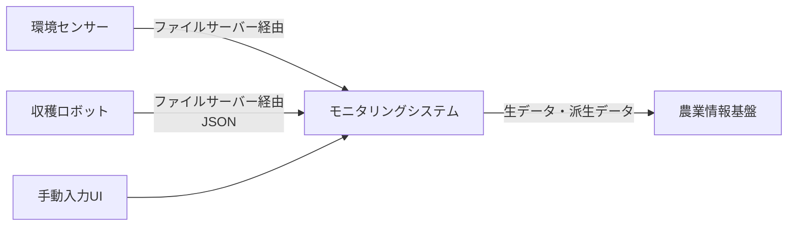
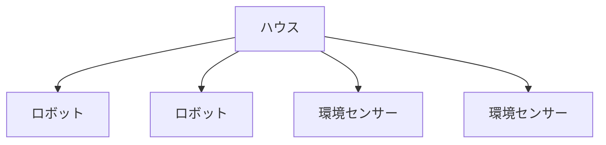

# RFP（発注者の要求と要件定義への橋渡し）

目的: 発注者からの要求（RFP）を原文に近い形で記録し、受注者である我々が詰めるべき点を整理して、要件定義（[functional-requirements.md](./functional-requirements.md) / [non-functional-requirements.md](./non-functional-requirements.md)）へ落とし込むための土台とする。

> **位置づけ**
> - 本プロジェクトのRFPは、発注者からのざっくりした要求を、受注者が具体化していく形式をとる
> - 契約に関わる事項（調達方式、契約形態、予算、納品、スケジュール、プロジェクト管理、検収、選定基準、提案手続き、契約条件、問い合わせ先）は扱わない
> - 要件の詳細は各要件文書に書き、本書には書かない（重複させず、トレーサビリティで結ぶ）
> - 未確定の事項は `TODO:` と明記し、推測で埋めない

## 1. 背景と目的

### 1.1 プロジェクトの経緯

- 2025年度に「いちご収穫ロボットに対応したハウス整備モデルの第三者評価のしくみ構築」を実施した
  - 品質評価に知見を有する部門の参画を得て、収穫ロボットと栽培ハウスの健全性を継続的にモニタリングし、異常発生時は人手で介入・復旧する「ヒューマン・イン・ザ・ループ（HITL）」の実現を検討した
  - ISO/IEC 25059 を参考に、ロボットや栽培環境の健全性を評価する品質評価観点を定義し、各観点を定量評価するメトリクスを整理した
  - 各観点の算出に必要なデータ項目を仮説として整理し、プロトタイプを作成した。シミュレータツールからデータを入力すると、メトリクスの算出と観点ごとの診断結果の表示を行い、第三者評価の仕組みの実現可能性を検証した
- 詳細な背景・現状の課題の全体像は [project-overview.md](../../00_project/project-overview.md) を参照

### 1.2 今年度の目的

- 2025年度の検討を受け、実際のロボット・ハウスのデータを扱えるモニタリングシステムを構築する
- 詳細なシステムの目的・成功条件は [goals.md](../../00_project/goals.md) を参照

## 2. 発注者の要求

| ID | 要求 |
|----|------|
| RQ-001 | ロボットデータの連携方法として、宇都宮大学が管理するファイルサーバー上に配置されたデータを参照する方式が提案された。データ形式としてJSON形式を利用する想定である |
| RQ-002 | 環境センサーデータについても、ロボットデータと同様にファイルサーバーを介して取得する構成を想定している |
| RQ-003 | 将来的な自動連携を前提としながら、仕様未確定の状況でも利用可能なように、利用者が手動でデータを入力・補完できる仕組みが必要。センサー選定や連携方式が未確定のため、専用UIによる手動入力・補完機能も必要 |
| RQ-004 | ロボットや環境センサーから取得できない情報（異常時に人が復旧対応を行った回数、復旧作業に要した時間、作業者による評価や所感、システム運用上の補足情報）は、専用UIによるデータ入力機能が必要 |
| RQ-005 | 複数の栽培ハウスを管理できること。1つのハウスに複数台の収穫ロボットを配置できること。1つのハウスに複数の環境センサーを配置できること。ハウス→ロボット／環境センサーの階層構造でデータを管理する |
| RQ-006 | 本システムに蓄積されたデータは農業情報基盤へ連携できること。連携対象は、生データ（ロボットデータ・環境センサーデータ・人手入力データ）と派生データ（メトリクス・評価観点別診断結果・推奨アクション・分析結果・インサイト） |
| RQ-007 | 農業情報基盤とのデータ連携を実現しながらも、農業情報基盤に依存せず単独で継続稼働できる構成を採用する |
| RQ-008 | 評価観点ごとの状態をダッシュボードで可視化できること。メトリクスの状態をリアルタイムに把握できること。評価観点やメトリクスの推移をグラフ等で確認できること |
| RQ-009 | 評価観点ごとの診断結果を表示できること。診断結果の根拠となるメトリクスを表示できること。メトリクスの良否が直感的に判断できること |
| RQ-010 | 評価結果に応じた推奨アクションを提示できること |
| RQ-011 | 短期的視点および中長期的視点でフィードバックを提供できること。評価観点によっては短期評価を持たない場合もある |
| RQ-012 | ロボットや栽培環境の異常を検知できること |
| RQ-013 | 異常発生時に農作業者へ通知できること。通知方法の例はメール通知、プッシュ通知、その他通知サービス |
| RQ-014 | 2025年度に定義した品質評価観点（収穫精度・収穫速度・環境適応性・操作性・メンテナンス性・コスト効率・安全性・データ活用度合い・耐久性・倫理性）で評価する。ただし、客観的な評価が難しい「倫理性」は「満足度」に置き換えて評価する |
| RQ-015 | 秋田県立大学が保有するAWS環境へデプロイすることを想定している |
| RQ-016 | 研究用途で予算が限られるため、初期構築コストを抑制すること |
| RQ-017 | ランニングコストを抑制すること |
| RQ-018 | 運用・保守負荷を抑制すること |
| RQ-019 | 将来的なロボットやセンサーの追加に柔軟に対応できること |
| RQ-020 | 農業情報基盤との連携拡張に対応できること |
| RQ-021 | 「低コスト」「疎結合」「拡張性」「継続運用性」を重視したアーキテクチャが求められている |

## 3. ステークホルダー

| 区分 | 誰か | 関わり方・関心事 |
|------|------|------------------|
| 発注者 | 秋田県立大学 | 要求の決定、AWS環境の提供、農業情報基盤の運用 |
| 収穫ロボット開発元 | 宇都宮大学（収穫ロボットの研究開発を行う研究者） | ロボットデータのファイルサーバー管理、データ項目・形式の提供。2025年度のプロトタイプをレビューした |

## 4. 現状の業務と設備（As-Is）

### 4.1 評価の仕組み（2025年度の成果）

- 品質評価観点とメトリクスを仮説的に定義した
- 2025年度のプロトタイプ・メトリクス定義などの成果物は、今年度の目指すものと異なるため再利用しない
- プロトタイプは、シミュレータツールからのデータ入力にもとづく。実機・実センサーのデータは使っていない
- 評価に使うデータ項目は仮説の段階。ロボットから取得できる項目と、ロボット側で管理していない項目が混在する（4.2参照）

### 4.2 対象の設備・データ

| 対象 | 現状 | 課題 |
|------|------|------|
| ロボット | データをファイルサーバー上に配置する方式が提案されている。形式はJSONの想定 | ファイルレイアウト・項目定義などのインターフェース仕様が提供されていない。仮説のデータ項目の一部はロボット側で管理していない |
| 環境センサー | IoTセンサーの活用を検討している。導入済みのセンサーでは、期待する形でクラウドにデータを蓄積できなかった | 使用する機種と取得方式が確定していない |
| 人手で得る情報 | 復旧対応の回数・所要時間、作業者の評価・所感、運用上の補足情報 | 取得できる仕組みがない |
| 農業情報基盤 | 2025年度にFIWAREをベースに構築し、AWS EC2で運用している | 運用コストの観点から停止している場合がある。常時稼働を前提としていない |

### 4.3 データの流れ（想定）

管理対象の階層（RQ-005）:

## 5. 目指す姿（To-Be）とスコープ

### 5.1 目指す姿

- システムの目的と位置づけ（人の判断と対応を支援する情報基盤であり、ロボット・ハウスの自動制御は行わない）: [goals.md](../../00_project/goals.md) を参照
- 重視する性質は「低コスト」「疎結合」「拡張性」「継続運用性」（RQ-021）

### 5.2 対象範囲

| 区分 | 内容 |
|------|------|
| 対象（スコープ内） | ロボットデータ・環境センサーデータ・人手入力データの取り込み（ロボット・センサーデータはファイルサーバーからの自動取り込みを含む）、複数ハウス・ロボット・センサーの階層管理、評価観点ごとの診断・ダッシュボード表示、推奨アクション、異常検知・通知、農業情報基盤へのデータ連携 |
| 対象外（スコープ外） | ロボット・ハウスの自動制御（[goals.md](../../00_project/goals.md)） |
| 判断保留 | 自動取り込みの接続先（宇都宮大学のファイルサーバーを対象とするか）とファイル仕様。決定までの進め方は「7. 前提条件・制約条件」の仮決め方針に従う |

## 6. 要求の整理

- RQ-007・RQ-016〜RQ-021 は、アーキテクチャの設計判断に直結する。判断の理由は [adr](../adr/) に残す

要求の漏れを防ぐため、次の観点で確認する。

| 観点 | 確認すること | 現時点の状況 |
|------|--------------|--------------|
| 利用者・業務 | 誰が、いつ、何のためにシステムを使うか | 利用者は10名ほど。ハウス1：ロボット1：環境センサー1が基本（7章参照） |
| 見える化する対象 | ロボット・ハウスのどの状態を、どの粒度・頻度で見たいか | 10観点（2025年度に定義）。メトリクスは今年度新たに定義する（Q-007） |
| 異常の判断・通知 | 何を異常とし、誰にどう知らせるか（[viewpoint-overview.md](../viewpoint/viewpoint-overview.md) 参照） | 判断基準が未定 |
| 人の対応（HITL） | 人が何を確認・承認・操作するか（[human-in-the-loop.md](../architecture/human-in-the-loop.md) 参照） | 入力UIは要求あり。承認フローは未確認 |
| データ | 収集元、項目、頻度、保存期間、欠損や遅延の扱い | 項目の一部のみ。頻度・保存期間・欠損の扱いが未確認 |
| 非機能 | 可用性、性能、使いやすさ、現場の通信環境、セキュリティ（[security.md](../../20_development/security.md) 参照） | コスト・疎結合・拡張性・継続運用性のみ要求あり。性能・セキュリティは未確認 |
| 連携 | ロボット・センサー・農業情報基盤との連携方式 | 農業情報基盤との連携方式（FIWAREのデータモデルなど）が未確認 |
| 運用 | 稼働後に誰がどう運用・保守するか | 低負荷の要求のみ。体制は未確認 |

## 7. 前提条件・制約条件

- AWS環境: 秋田県立大学が保有する環境へデプロイする（RQ-015）
- 予算: 研究用途で限られるため 5千円/月 以内に抑えるようにしたい
- AWSの利用権限: 払い出されたIAMユーザーの範囲で利用する。利用できるサービス・操作はその権限に制約される
- 規模: ハウス1：ロボット1：環境センサー1が基本の構成で、利用者は10名ほど。ただし、複数のハウス・ロボット・センサーを階層で管理できる設計にする（RQ-005、RQ-019）
- データの更新頻度: 「リアルタイム」といっても、HITLで即座に対応できるわけではない。10秒程度の更新頻度で足りる（RQ-008）
- 2025年度のプロトタイプ・メトリクス定義などの成果物は、目指すものが異なるため再利用しない
- ロボットデータ: JSON形式で、宇都宮大学管理のファイルサーバーに配置される想定。インターフェース仕様は未提供
- ファイルサーバーからの自動取り込みは今年度の対象とする。ただし、宇都宮大学のファイルサーバーを対象とするかと、ファイル仕様（レイアウト・項目定義）は未決定である
- そのため、仕様は推察して仮決めし、検証環境に構築するファイルサーバーのモックで開発・検証を進める
  - 仮決めの仕様は、根拠（資料・ヒアリング・推察の理由）とともに記録し、確定した仕様との差分を把握できるようにする
  - 取り込み部分は、仕様の変更や接続先の変更の影響を局所化できる設計にする（RQ-019、RQ-021）
  - 実際のインターフェース仕様が提供されたら、仮決めとの差分を洗い出し、要件・設計・テストを更新する
- 環境センサー: 機種・取得方式が未確定。導入済みセンサーはクラウド蓄積に不向きだった
- 農業情報基盤: FIWAREベースでAWS EC2上にあるが、停止していることがあり、可用性に依存できない
- 圃場データの取り扱い: 機密として扱う（[security.md](../../20_development/security.md) 参照）。

## 8. 確認事項・未確定事項

| No | 確認事項 | 関連する要求ID | 確認先 | 状況 | 回答 |
|----|----------|----------------|--------|------|------|
| Q-001 | ロボットデータのインターフェース仕様（ファイルレイアウト、項目定義、更新頻度）はいつ、誰から提供されるか。提供前に仮決めした仕様を、確認・レビューしてもらえるか | RQ-001 | 宇都宮大学 | 未確認 | - |
| Q-002 | 自動取り込みの接続先を宇都宮大学のファイルサーバーとするか。する場合のアクセス方法（認証、ネットワーク、読み取り専用か）と、秋田県立大学のAWSからの接続可否 | RQ-001, RQ-002, RQ-015 | 宇都宮大学・秋田県立大学 | 未確認 | - |
| Q-003 | ロボットから取得できる項目と、取得できない項目（手動入力が必要なもの）の一覧 | RQ-001, RQ-003 | 宇都宮大学 | 未確認 | - |
| Q-004 | 環境センサーの機種・取得方式はいつ決まるか。ファイルの形式・配置方法は | RQ-002 | 秋田県立大学 | 未確認 | - |
| Q-005 | 農業情報基盤との連携方式（API、データモデル、頻度）。停止中の連携データの扱い（再送・遅延連携を許容するか） | RQ-006, RQ-007, RQ-020 | 秋田県立大学 | 未確認 | - |
| Q-007 | 観点ごとのメトリクス定義・判断基準は今年度新たに定める前提でよいか（2025年度の成果物は再利用しない）。10観点すべてを今年度の対象とするか | RQ-009, RQ-014 | 秋田県立大学・評価関係者 | 未確認 | - |
| Q-008 | 「満足度」の評価方法（誰が、どの尺度で、いつ評価するか） | RQ-014 | 秋田県立大学 | 未確認 | - |
| Q-009 | 短期・中長期の期間の定義と、短期評価を持たない観点はどれか | RQ-011 | 評価関係者 | 未確認 | - |
| Q-010 | 異常の判断基準（閾値など）と、推奨アクションの内容・提示ルール | RQ-010, RQ-012 | 評価関係者 | 未確認 | - |
| Q-011 | 通知の手段・宛先・条件（メール／プッシュなど。既存のサービスの有無） | RQ-013 | 秋田県立大学 | 未確認 | - |
| Q-016 | 設備の構成（ハウス・ロボット・センサー）の登録・変更を、画面で行うか、設定ファイル等で行うか | RQ-005, RQ-019 | 秋田県立大学 | 未確認 | - |
| Q-018 | 異常の通知の既読・未読の管理を機能に含めることでよいか（要求にはなく、あると良い機能としての追加）。対応状況の管理や承認は扱わない前提でよいか | RQ-013 | 秋田県立大学 | 未確認 | - |
