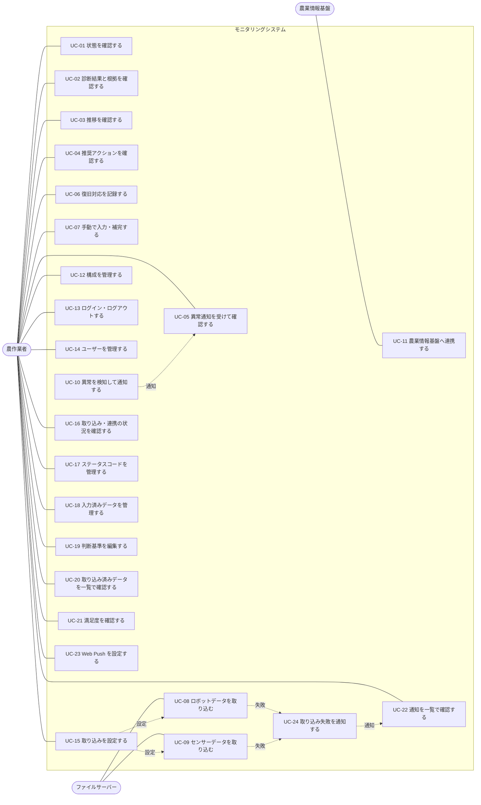
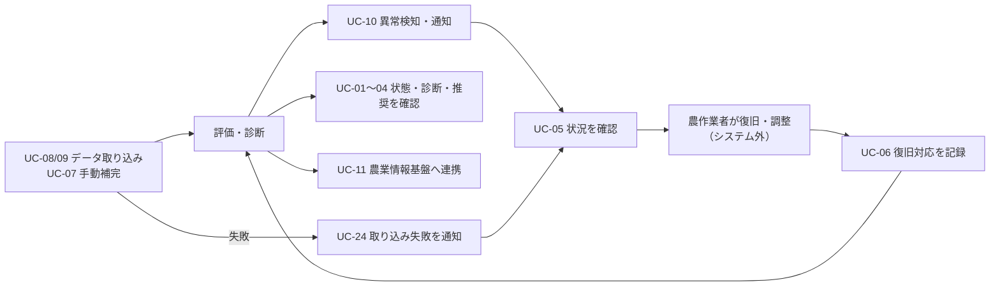

# ユースケース

目的: [rfp.md](./rfp.md) の発注者の要求を、「誰が・何のために・システムをどう使うか」の流れに起こし、機能要件（[functional-requirements.md](./functional-requirements.md)）と E2E テスト（[test-policy.md](../../30_quality/test-policy.md)）の拠り所とする。

> **記載のルール**
> - 各ユースケースの「関連する要求」に、元になった要求ID（rfp.md の RQ-xxx）を記載し、要求との対応を追えるようにする
> - 要求にない振る舞いを推測で書かない。未確定の事項は `TODO:` とし、確認事項の番号（rfp.md の Q-xxx）を添える
> - 機能の詳細（入力項目・画面の項目・閾値など）は機能要件・データ辞書に書き、ここには書かない
> - 本システムはロボット・ハウスの自動制御を行わない（[goals.md](../../00_project/goals.md)）。人の判断と対応を支援するユースケースのみを扱う

## 1. アクター

| アクター | 種別 | 説明 |
|----------|------|------|
| 農作業者 | 人 | ロボット・ハウスの状態確認と復旧・調整を行う本システムの利用者（10名ほど）。[glossary.md](../../00_project/glossary.md) 参照 |
| ファイルサーバー | 外部システム | ロボットデータ・環境センサーデータが配置される。ロボットデータは収穫ロボット開発元（宇都宮大学）が管理する想定。接続先は TODO: 未決定（Q-002）。検証環境ではモックを使う |
| 農業情報基盤 | 外部システム | 秋田県立大学の農業情報基盤（FIWAREベース）。連携先。停止していることがある |

- 設備の登録・管理も農作業者が行う（管理者は区別しない）
- 「収穫ロボット」「環境センサー」は、データの出どころであり、システムを直接操作するアクターではない。データはファイルサーバー経由で届く
- 取り込みの設定・状況確認（UC-15、UC-16）やユーザー管理（UC-14）は、非機能要件（NFR-6.4）で「運用者」が確認するとされているが、運用者・管理者は発注者の要求になく、アクターとして定義しない。ここでは農作業者を主なアクターとして記載する。TODO: 運用者・管理者を農作業者と区別するか確認する（Q-017）

## 2. ユースケース一覧

| ID | ユースケース | 主なアクター | 関連する要求 |
|----|--------------|--------------|--------------|
| UC-01 | 観点別の状態をダッシュボードで確認する | 農作業者 | RQ-008, RQ-014 |
| UC-02 | 診断結果と根拠のメトリクスを確認する | 農作業者 | RQ-009 |
| UC-03 | 状態の推移を確認する | 農作業者 | RQ-008, RQ-011 |
| UC-04 | 推奨アクションを確認する | 農作業者 | RQ-010 |
| UC-05 | 異常の通知を受けて状況を確認する | 農作業者 | RQ-012, RQ-013 |
| UC-06 | 復旧対応の結果を記録する | 農作業者 | RQ-004 |
| UC-07 | 取得できないデータを手動で入力・補完する | 農作業者 | RQ-003 |
| UC-08 | ロボットデータを自動で取り込む | ファイルサーバー | RQ-001 |
| UC-09 | 環境センサーデータを自動で取り込む | ファイルサーバー | RQ-002 |
| UC-10 | 異常・注意を検知して通知する | （システム） | RQ-012, RQ-013 |
| UC-11 | 農業情報基盤へデータを連携する | 農業情報基盤 | RQ-006, RQ-007, RQ-020 |
| UC-12 | ハウス・ロボット・センサーの構成を管理する | 農作業者 | RQ-005, RQ-019 |
| UC-13 | ログイン・ログアウトする | 農作業者 | 提案（発注者への確認が必要） |
| UC-14 | ユーザーを管理する | 農作業者（TODO: 区別するか確認） | 提案（発注者への確認が必要） |
| UC-15 | 取り込みを設定し、接続テスト・即時取得を行う | 農作業者（TODO: 運用者を区別するか確認） | 提案（発注者への確認が必要）、RQ-001, RQ-002 |
| UC-16 | 取り込み・連携の状況を確認する | 農作業者（TODO: 運用者を区別するか確認） | 提案（発注者への確認が必要）、RQ-007, RQ-018 |
| UC-17 | ステータスコードを管理する | 農作業者 | 提案（発注者への確認が必要） |
| UC-18 | 入力済みデータを管理する（一覧・修正・削除・履歴） | 農作業者 | 提案（発注者への確認が必要） |
| UC-19 | 判断基準を編集する | 農作業者 | 提案（発注者への確認が必要） |
| UC-20 | 取り込み済みデータを一覧で確認する | 農作業者 | 提案（発注者への確認が必要） |
| UC-21 | 満足度をレーダーチャートで確認する | 農作業者 | 提案（発注者への確認が必要）、RQ-014 |
| UC-22 | 通知を一覧で確認し、既読にする | 農作業者 | 提案（発注者への確認が必要）、RQ-013 |
| UC-23 | Web Push 通知を設定する | 農作業者 | RQ-013 |
| UC-24 | データ取り込みの失敗を通知する | （システム） | 提案（発注者への確認が必要） |

非機能の要求（RQ-007 の単独稼働、RQ-015〜RQ-021 のコスト・運用保守・拡張性・構成）は、ユースケースとしては扱わず、[non-functional-requirements.md](./non-functional-requirements.md) とアーキテクチャで扱う。「提案」は、発注者の要求にはなく、機能要件側で受注者が加えた要件に対応するユースケースで、発注者への確認が必要（確認するまで暫定）。

非機能要件（NFR）のうち、ユースケースとして扱わないものと理由:

| NFR | 理由 |
|-----|------|
| NFR-1.1〜1.4、NFR-1.6、NFR-2、NFR-3、NFR-4.1、NFR-4.3〜4.5、NFR-5.2〜5.6、NFR-6.1〜6.3、NFR-6.6〜6.8、NFR-7、NFR-8.1、NFR-8.2、NFR-9 | システムの品質・構成・制約・準拠規格であり、利用者の操作の流れではない。対応するユースケースの関連する要求で参照し、設計・テストで扱う（NFR-3.3 は UC-01、NFR-2.1・4.4 は UC-11、NFR-2.4 は UC-12、NFR-6.4 は UC-16、NFR-5.1・5.7 は UC-13、UC-14、UC-18） |
| NFR-1.5（コスト監視・アラート） | 検討の結果、自動の監視・アラートは設けないため、システムを使うユースケースはない（architecture.md 11.1） |
| NFR-4.2（バックアップ・復旧手順） | 開発・運用の手順であり、システムを使うユースケースではない。手順は文書化（NFR-6.2）する。TODO: 運用の体制が決まったら、運用者のユースケースにするか判断する（NFR-6.8） |
| NFR-6.5（更新・ロールバック） | 構築・デプロイの手順であり、農作業者の利用の流れではない（NFR-6.2、NFR-6.6 で扱う） |
| NFR-8.3（REST API による他システム利用） | 利用する他システムが未定で、要求（RQ-020）の拡張への備えにとどまる。利用者が現れた場合に、UC-11 と同様にユースケースを追加する |

機能要件（FR）のうち、FR-1.10（データの保持形式）、FR-1.11・FR-1.12（仮決め仕様の記録・差分把握）は、データ設計・開発プロセスに関する要件で、利用者の操作ではないため、ユースケースにしない（UC-08、UC-09 の関連する要求で参照する）。FR-5.3（評価の単位）は、UC-01 で参照する。

## 3. ユースケース図

## 4. 全体の流れ（ヒューマン・イン・ザ・ループ）

システムがデータを集めて評価し、異常を農作業者に伝え、農作業者が確認・復旧して結果を記録する、という流れが中心となる。

設定・管理系のユースケース（UC-12 構成、UC-13・UC-14 ログイン・ユーザー、UC-15 取り込み設定、UC-17 ステータスコード、UC-19 判断基準）は、上の流れの前提を整える。UC-16・UC-18・UC-20・UC-21・UC-22・UC-23 は、取り込みや記録の結果、通知を確認・管理する。

## 5. ユースケース詳細

### UC-01 観点別の状態をダッシュボードで確認する

| 項目 | 内容 |
|------|------|
| 目的 | ロボット・ハウスの状態を、評価観点ごとに把握し、対応が必要かを判断する |
| アクター | 農作業者 |
| 関連する要求 | RQ-008, RQ-014 / FR-5.1〜FR-5.4、FR-6.1〜FR-6.3、FR-6.6、FR-6.7 / NFR-3.3、NFR-3.4 |
| 事前条件 | 農作業者がシステムを利用できる（ログインは UC-13。TODO: 認証・認可の要否。Q-017）。評価の元となるデータが取り込まれている |
| 基本フロー | 1. 農作業者がダッシュボードを開く 2. システムが、評価観点ごとの状態とメトリクスの状態を表示する 3. 農作業者が、対象のハウス・ロボット・センサーを選んで状態を確認する |
| 代替フロー | データがまだ取り込まれていない・古い場合は、その旨を表示する（「古い」の基準と、手動のみの運用での扱いは [ADR-0016](../adr/0016-ingestion-federation-rules.md)。表示の設計は #158）。欠損・遅延の扱いは [ADR-0016](../adr/0016-ingestion-federation-rules.md) |
| 事後条件 | 農作業者が、現在の状態を把握している |
| 補足 | 状態の更新は10秒程度の頻度で足りる（rfp.md 7章）。評価観点は10観点（倫理性は満足度に置換） |

### UC-02 診断結果と根拠のメトリクスを確認する

| 項目 | 内容 |
|------|------|
| 目的 | 診断結果の理由を理解し、メトリクスの良否を直感的に判断する |
| アクター | 農作業者 |
| 関連する要求 | RQ-009 / FR-5.2、FR-5.5、FR-6.4 / NFR-7.2 |
| 事前条件 | 評価観点の診断結果が算出されている |
| 基本フロー | 1. 農作業者が、評価観点を選ぶ 2. システムが、その観点の診断結果と、根拠となるメトリクスを表示する 3. 農作業者が、メトリクスの良否を確認する |
| 代替フロー | メトリクスの算出に必要なデータが欠けている場合は、診断できない旨と欠けている項目を表示する（TODO: 欠損時の扱い） |
| 事後条件 | 農作業者が、診断結果とその根拠を把握している |

### UC-03 状態の推移を確認する

| 項目 | 内容 |
|------|------|
| 目的 | 評価観点・メトリクスの推移から、短期的・中長期的な傾向を把握する |
| アクター | 農作業者 |
| 関連する要求 | RQ-008, RQ-011 / FR-5.6、FR-6.5、FR-6.10 |
| 事前条件 | 一定期間のデータが蓄積されている |
| 基本フロー | 1. 農作業者が、観点またはメトリクスと、期間（短期／中長期）を選ぶ 2. システムが、推移をグラフ等で表示する（メトリクスの推移、観点のステータスの推移。粒度・表示方法は決定済み。FR-6.10。[ADR-0017](../adr/0017-evaluation-rules.md)） 3. システムが、短期・中長期の視点でフィードバックを提示する |
| 代替フロー | 短期評価を持たない観点では、短期のフィードバックは表示しない |
| 事後条件 | 農作業者が、状態の変化と傾向を把握している |

### UC-04 推奨アクションを確認する

| 項目 | 内容 |
|------|------|
| 目的 | 評価結果に応じて、何をすればよいかを知る |
| アクター | 農作業者 |
| 関連する要求 | RQ-010 / FR-5.5、FR-6.2 |
| 事前条件 | 診断結果が算出されている |
| 基本フロー | 1. 農作業者が、診断結果を確認する（UC-02） 2. システムが、診断結果に応じた推奨アクションを表示する 3. 農作業者が、推奨アクションを参考に、対応を判断する |
| 事後条件 | 農作業者が、取るべき対応の候補を把握している |
| 補足 | システムはロボット・ハウスを自動で操作しない。実際の対応は農作業者が行う |

### UC-05 異常の通知を受けて状況を確認する

| 項目 | 内容 |
|------|------|
| 目的 | 異常にすぐ気づき、状況を確認して復旧・調整につなげる（HITLの入口） |
| アクター | 農作業者 |
| 関連する要求 | RQ-012, RQ-013 / FR-7.1、FR-7.4（取り込み失敗の通知。提案）、FR-7.5、FR-7.6（既読の管理は提案） |
| 事前条件 | UC-10 により、異常の通知が送られている（通知は未読として記録されている） |
| 基本フロー | 1. 農作業者が、異常の通知を受け取る 2. 農作業者が、通知からダッシュボードを開く（未読の通知を確認できる） 3. システムが、異常の対象（ハウス・ロボット・センサー）、内容、根拠のメトリクスを表示する（UC-02） 4. 農作業者が、推奨アクションを確認する（UC-04） 5. 農作業者が、現場でロボット・ハウスの状態を確認し、復旧・調整を行う（システム外） 6. システムが、農作業者が確認した通知を既読にする 7. 農作業者が、対応の結果を記録する（UC-06） |
| 代替フロー | ・通知に気づかなかった場合も、ダッシュボードで異常の状態を確認できる ・通知が取り込み失敗（UC-24）の場合は、取り込みの状況を確認し（UC-16）、設定や接続先を見直す。通知の一覧と既読の管理は UC-22 |
| 事後条件 | 農作業者が、異常に対応している、または対応を判断している |
| 補足 | 通知の対象は、観点のステータスが「注意」または「異常」になったとき（FR-7.1。「不明」の扱いは TODO）。通知の手段・宛先は TODO: 確認する（Q-011）。通知の既読・未読の管理は、発注者の要求にはなく、あると良い機能として追加する。TODO: 発注者に確認する（Q-018）。対応状況（未対応／対応中／完了）の管理や承認は扱わない |

### UC-06 復旧対応の結果を記録する

| 項目 | 内容 |
|------|------|
| 目的 | ロボット・センサーから取得できない、人の対応に関する情報を記録し、評価に使えるようにする |
| アクター | 農作業者 |
| 関連する要求 | RQ-004 / FR-4.1.2、FR-4.1.3、FR-4.1.5 |
| 事前条件 | 農作業者がシステムを利用できる |
| 基本フロー | 1. 農作業者が、入力画面を開き、対象のハウス・ロボット等を選ぶ 2. 農作業者が、復旧対応を行った回数、復旧作業に要した時間、作業者による評価や所感、運用上の補足情報を入力する 3. システムが、入力内容を検証して保存する 4. システムが、評価を更新し、「注意」「異常」があれば通知につなげる（UC-10） |
| 代替フロー | 入力内容が不正な場合（形式、範囲、必須項目の欠け）は、エラーを表示して再入力を促す |
| 事後条件 | 人手入力データが保存され、評価（復旧のしやすさなど）に反映される |
| 補足 | 入力項目の詳細はデータ辞書で定義する。入力操作の権限の区別は TODO: 確認する（Q-017）。入力後の修正・削除は UC-18 |

### UC-07 取得できないデータを手動で入力・補完する

| 項目 | 内容 |
|------|------|
| 目的 | 連携の仕様が未確定の項目や、自動取得できないデータを補い、評価を継続できるようにする |
| アクター | 農作業者 |
| 関連する要求 | RQ-003 / FR-4.1.1、FR-4.1.3〜FR-4.1.5 |
| 事前条件 | 農作業者がシステムを利用できる。自動取り込み（UC-08、UC-09）で取得できない項目がある |
| 基本フロー | 1. 農作業者が、入力画面を開き、対象のハウス・ロボット・センサーと、補完する項目を選ぶ 2. 農作業者が、値と対象の期間・時刻を入力する 3. システムが、入力内容を検証して保存する 4. システムが、手動入力であることを区別できる形でデータを保持する 5. システムが、評価を更新し、「注意」「異常」があれば通知につなげる（UC-10） |
| 代替フロー | ・自動取り込みと手動入力で値が重なる場合、合計の項目は、評価の期間に自動の値があれば自動だけを使い、なければ手動だけを使う（保存のとき、評価に使われない旨を示す）。状態値は、どちらも使う（決定。[ADR-0018](../adr/0018-manual-input-and-data-rules.md)） ・入力内容が不正な場合は、UC-06 と同様にエラーを表示する |
| 事後条件 | 手動入力データが保存され、評価に使われる |

### UC-08 ロボットデータを自動で取り込む

| 項目 | 内容 |
|------|------|
| 目的 | 収穫ロボットのデータを、手作業なしでシステムに取り込む |
| アクター | ファイルサーバー（ロボットデータの提供元） |
| 関連する要求 | RQ-001 / FR-1.1、FR-1.3、FR-1.6、FR-1.9〜FR-1.12 / NFR-2.3、NFR-4.4 |
| 事前条件 | ファイルサーバー上にロボットデータ（JSON）が配置されている。取り込み対象のロボットが、システムに登録されている（UC-12） |
| 基本フロー | 1. システムが、ファイルサーバー上の新しいロボットデータを検知する 2. システムが、ファイルを読み込み、内容を検証する 3. システムが、ロボットとハウスに対応づけて保存する 4. システムが、評価（メトリクス・診断）を更新する |
| 代替フロー | ・ファイルが読めない、形式・項目が仕様と異なる場合は、エラーとして記録し、取り込みを継続する ・接続できない場合は、再試行する（接続・一覧の取得は、最大 3 回（初回を含む）、待ちは 1 秒 → 2 秒。以降は、次の取得間隔で、最初から試す。[ADR-0016](../adr/0016-ingestion-federation-rules.md)）。再試行しても失敗した場合は、通知する（UC-24）。取り込みの失敗が他のユースケースを妨げない ・取り込みの成否は、ログとして記録する（UC-16） ・同じファイルを重複して取り込まない（識別子とハッシュが同じ、または、内容のハッシュが同じで成功済みなら、取り込まない。更新されるファイルは、新規・変更の観測値だけを取り込む。[ADR-0016](../adr/0016-ingestion-federation-rules.md)） |
| 事後条件 | ロボットデータが保存され、評価に反映されている |
| 補足 | ファイルのレイアウト・項目定義は未提供のため、仮決めの仕様で進める（rfp.md 7章）。接続先は TODO: 未決定（Q-001、Q-002）。ファイルは、JSON 形式で、更新のたびに全体が書き換わり、中身は最新の値だけで、設備ごとのファイルパスに置かれる想定（[ADR-0016](../adr/0016-ingestion-federation-rules.md)。確認事項は #193）。仮決めの仕様と実際の仕様の差分を吸収しやすい形にする |

### UC-09 環境センサーデータを自動で取り込む

| 項目 | 内容 |
|------|------|
| 目的 | ハウスの環境センサーのデータを、手作業なしでシステムに取り込む |
| アクター | ファイルサーバー（センサーデータの提供元） |
| 関連する要求 | RQ-002 / FR-1.2、FR-1.3、FR-1.6、FR-1.9〜FR-1.12 / NFR-2.3、NFR-4.4 |
| 事前条件 | ファイルサーバー上にセンサーデータが配置されている。取り込み対象のセンサーが、システムに登録されている（UC-12） |
| 基本フロー | UC-08 と同様（対象がロボットデータではなく環境センサーデータ） |
| 代替フロー | UC-08 と同様 |
| 事後条件 | センサーデータが保存され、評価に反映されている |
| 補足 | センサーの機種・取得方式、ファイルの形式・配置方法は TODO: 未決定（Q-004）。仮決めの仕様で進める |

### UC-10 異常・注意を検知して通知する

| 項目 | 内容 |
|------|------|
| 目的 | ロボット・栽培環境の異常・注意の状態を、農作業者が早く気づけるようにする |
| アクター | （システムが自動で行う。通知の受け手は農作業者） |
| 関連する要求 | RQ-012, RQ-013 / FR-7.1〜FR-7.3、FR-7.7、FR-4.1.5 |
| 事前条件 | 取り込まれたデータ（UC-08、UC-09、UC-07）または評価結果がある。異常の判断基準が定義されている |
| 基本フロー | 1. システムが、取り込んだデータ・評価結果を、異常の判断基準に照らして判定する 2. 観点のステータスが「注意」または「異常」と判定した場合、システムが農作業者へ通知する（FR-7.1。異常には、ロボットの異常と栽培環境の異常を含む） 3. 通知には、ステータス・観点名・対象の設備・診断メッセージを含める |
| 代替フロー | ・データの欠損・異常値・遅延は、異常の判定と区別して扱う（欠損・不正は評価に使わず、遅延は評価に使う。[ADR-0016](../adr/0016-ingestion-federation-rules.md)） ・同じ異常を繰り返し通知しない（TODO: 通知の抑制ルール） ・「不明」の通知の要否は TODO: 確認する（Q-010、Q-011） ・通知に失敗した場合は、記録し、再送する（TODO: 再送の方法。FR-7.7） |
| 事後条件 | 農作業者に通知が送られ、未読として記録されている。異常・注意の発生が記録されている |
| 補足 | 通知の手段・宛先・条件は TODO: 確認する（Q-011）。判定ロジックは、閾値の境界値を含めて、すべての分岐をテストする（[test-policy.md](../../30_quality/test-policy.md)） |

### UC-11 農業情報基盤へデータを連携する

| 項目 | 内容 |
|------|------|
| 目的 | 本システムのデータを、農業情報基盤で活用できるようにする |
| アクター | 農業情報基盤 |
| 関連する要求 | RQ-006, RQ-007, RQ-020 / FR-8.1〜FR-8.4 / NFR-2.1、NFR-2.2 |
| 事前条件 | 連携対象のデータが保存されている |
| 基本フロー | 1. システムが、連携対象のデータを農業情報基盤へ送る 2. 連携対象は、生データ（ロボットデータ・環境センサーデータ・人手入力データ）と、派生データ（メトリクス・評価観点別診断結果・推奨アクション・分析結果・インサイト）とする 3. システムが、連携の結果（成功・失敗）を記録する |
| 代替フロー | 農業情報基盤が停止している場合は、連携を保留し、本システムの他のユースケース（UC-01〜UC-10）は影響を受けずに継続する。農業情報基盤の復旧後の扱いは、送信に成功したら、溜まった項目を、すぐ送り、破棄の期限は設定値（既定 30 日。期限切れは、ログと通知に残す）とする（[ADR-0016](../adr/0016-ingestion-federation-rules.md)）。連携の結果（成功・失敗・保留）は記録し、UC-16 で確認する（FR-8.3） |
| 事後条件 | 連携対象のデータが農業情報基盤に反映されている。または、連携の保留が記録されている |
| 補足 | 連携方式（API、データモデル、頻度）は TODO: 確認する（Q-005）。農業情報基盤に依存せず単独で継続稼働できることが要求（RQ-007） |

### UC-12 ハウス・ロボット・センサーの構成を管理する

| 項目 | 内容 |
|------|------|
| 目的 | 管理対象のハウス、ロボット、環境センサーを登録し、階層で管理する |
| アクター | 農作業者 |
| 関連する要求 | RQ-005, RQ-019 / FR-2.1〜FR-2.6 / NFR-2.4 |
| 事前条件 | 農作業者がシステムを利用できる（設備の登録・管理は、管理者を区別せず農作業者が行う。ただし要件 FR-9.5 と矛盾する可能性があり、TODO: Q-017 の回答とあわせて確認する） |
| 基本フロー | 1. 農作業者が、ハウスを登録する 2. 農作業者が、ハウスにロボット・環境センサーを紐づけて登録する 3. システムが、ハウス→ロボット／環境センサーの階層で、構成を保持する 4. 以降のデータ取り込み・表示・連携は、この構成にもとづく |
| 代替フロー | ・構成の変更（追加・変更・削除）も可能とする。削除すると、配下の設備とデータも削除する（警告つきの確認。復元はできない。農業情報基盤の送信済みのデータは削除しない）。削除した設備と同じ識別子は、再登録できる（決定。[ADR-0018](../adr/0018-manual-input-and-data-rules.md)） ・同一の識別子を重複して登録しようとした場合は、エラーとする |
| 事後条件 | 管理対象の構成が保存されている |
| 補足 | 基本の構成は、ハウス1：ロボット1：環境センサー1。複数のハウス・ロボット・センサーの追加に対応できること。構成の登録は、画面で行う（一括登録は設けない。決定。[ADR-0018](../adr/0018-manual-input-and-data-rules.md)） |

### UC-13 ログイン・ログアウトする

| 項目 | 内容 |
|------|------|
| 目的 | 認証済みの利用者だけが、システムを利用できるようにする |
| アクター | 農作業者 |
| 関連する要求 | 提案（発注者への確認が必要） / FR-9.1〜FR-9.3 / NFR-5.1 |
| 事前条件 | 利用者のユーザーが登録されている（UC-14）。TODO: 認証・認可の要否（Q-017） |
| 基本フロー | 1. 農作業者が、ユーザーIDとパスワードでログインする 2. システムが、認証し、利用を許可する 3. 農作業者が、利用を終えたらログアウトする |
| 代替フロー | ・認証に失敗した場合は、エラーを表示する。試行回数が制限を超えた場合は、ログインを受け付けない（制限の値は TODO: 確認する） ・未認証でアクセスした場合は、ログイン画面へ誘導する ・セッションの有効期限が切れた場合は、再度ログインを求める |
| 事後条件 | 認証済みの農作業者が、システムを利用できる。または、ログアウトしている |
| 補足 | パスワードの条件（8 文字以上で、英大文字・英小文字・数字を含む）・セッションの有効期間（アクセストークン 30 分・リフレッシュトークン 7 日）・方式（Cognito）は、設計で決めた（ADR-0008。dev_spec.md 4.1 No.3） |

### UC-14 ユーザーを管理する

| 項目 | 内容 |
|------|------|
| 目的 | システムを利用する人のユーザーとロールを管理する |
| アクター | 農作業者（TODO: ユーザー管理を行う人を区別するか確認。Q-017） |
| 関連する要求 | 提案（発注者への確認が必要） / FR-9.4〜FR-9.6 / NFR-5.1 |
| 事前条件 | 農作業者がログインしている（UC-13） |
| 基本フロー | 1. 農作業者が、ユーザーの一覧を開き、最終ログイン日時を確認する 2. 農作業者が、ユーザーを登録・編集・削除する（ユーザーID、ユーザー名、パスワード、ロール） 3. システムが、入力内容を検証して保存する |
| 代替フロー | 同じユーザーIDを重複して登録しようとした場合は、エラーとする（FR-9.4 のユーザーIDは一意） |
| 事後条件 | ユーザーの情報が保存されている |
| 補足 | TODO: ロールの分け方と、ロールごとに操作できる範囲を発注者に確認する（Q-017）。FR-9.5（操作をロールで制御する）と FR-9.6（設備の登録・管理で管理者を区別しない）が矛盾する可能性があり、use-cases.md では決めない |

### UC-15 取り込みを設定し、接続テスト・即時取得を行う

| 項目 | 内容 |
|------|------|
| 目的 | ファイルサーバーからの取り込みの接続先・間隔を設定し、動作を確認する |
| アクター | 農作業者（TODO: 運用者を区別するか確認。Q-017） |
| 関連する要求 | 提案（発注者への確認が必要） / RQ-001, RQ-002 / FR-1.3〜FR-1.5、FR-1.7 / NFR-5.4 |
| 事前条件 | 農作業者がログインしている（UC-13）。取り込み対象の設備が登録されている（UC-12） |
| 基本フロー | 1. 農作業者が、取り込みの設定（接続先、認証情報、取得間隔）を入力する 2. システムが、設定を保存する 3. 農作業者が、接続テストを実行し、結果を確認する 4. 農作業者が、必要に応じて、手動で即時に取得する |
| 代替フロー | 接続テストに失敗した場合は、失敗した旨を表示する（内部情報は表示しない。NFR-5.6）。設定の値が不正な場合は、保存しない |
| 事後条件 | 取り込みの設定が保存されている。以降の自動取り込み（UC-08、UC-09）に使われる |
| 補足 | 認証情報は、画面から**書き込み専用**で登録し（保存後は再表示しない）、画面・ログ・変更履歴に値を残さず、パラメータストアで管理する（FR-1.4。[ADR-0016](../adr/0016-ingestion-federation-rules.md)。実装は #196）。取得間隔は、設備ごとに、1分／5分／10分／15分／30分／1時間から選び、既定はロボット 1分・環境センサー 5分。画面は、10 秒ごとに自動で更新するが、新しいデータが増えるのは、取得間隔ごと（FR-1.5・FR-6.7。[ADR-0016](../adr/0016-ingestion-federation-rules.md)）。接続先は TODO: 確認する（Q-002）。設定を画面で行うか設定ファイルで行うかは、要件に定めがないため TODO: 確認する（Q-016 に準じる） |

### UC-16 取り込み・連携の状況を確認する

| 項目 | 内容 |
|------|------|
| 目的 | データの取り込みと農業情報基盤への連携が正常に動いているかを確認する |
| アクター | 農作業者（TODO: 運用者を区別するか確認。Q-017） |
| 関連する要求 | 提案（発注者への確認が必要） / RQ-007, RQ-018 / FR-1.8、FR-8.3 / NFR-6.4 |
| 事前条件 | 農作業者がログインしている（UC-13）。UC-08、UC-09、UC-11 により、結果が記録されている |
| 基本フロー | 1. 農作業者が、取り込みのログを開く 2. システムが、取り込みの日時、成功／失敗、取得件数、エラー内容を一覧で表示する 3. 農作業者が、連携の結果（成功・失敗・保留）を確認する |
| 代替フロー | 失敗や保留が続く場合は、農作業者が、設定の見直し（UC-15）や関係者への確認を行う（システム外） |
| 事後条件 | 農作業者が、取り込み・連携の状況を把握している |
| 補足 | 連携の結果の記録は UC-11（FR-8.3）。失敗した連携データの再送・遅延連携の扱いは [ADR-0016](../adr/0016-ingestion-federation-rules.md)（FR-8.3）。取り込みログは、設備・結果・期間で絞り込む（並べ替えは設けない。[ADR-0016](../adr/0016-ingestion-federation-rules.md)。実装は #201） |

### UC-17 ステータスコードを管理する

| 項目 | 内容 |
|------|------|
| 目的 | ロボットの状態を表すステータスコードの定義を管理し、評価の判定に使えるようにする |
| アクター | 農作業者 |
| 関連する要求 | 提案（発注者への確認が必要） / FR-3.1〜FR-3.4 |
| 事前条件 | 農作業者がログインしている（UC-13） |
| 基本フロー | 1. 農作業者が、ステータスコードの一覧を参照する 2. 農作業者が、ステータスコードを登録・編集・削除する（コード値、名称、説明、カテゴリ（正常／注意／異常）） 3. システムが、入力内容を検証して保存する |
| 代替フロー | ・同じコード値を重複して登録しようとした場合は、エラーとする ・削除する場合は、確認を求める |
| 事後条件 | ステータスコードの定義が保存され、ロボットの状態（走行・停止、姿勢異常、故障・異常）の判定と、観点の評価（収穫速度・メンテナンス性・耐久性）に使われる |
| 補足 | 実際のコードの仕様は未提供のため、仮の定義で進める。TODO: 確認して確定する（Q-001、Q-003）。変更できる人は TODO: 確認する（Q-017） |

### UC-18 入力済みデータを管理する（一覧・修正・削除・履歴）

| 項目 | 内容 |
|------|------|
| 目的 | 手動で入力したデータを確認し、誤りを直し、変更の経緯を追えるようにする |
| アクター | 農作業者 |
| 関連する要求 | 提案（発注者への確認が必要） / FR-4.2.1〜FR-4.2.3 / NFR-5.7 |
| 事前条件 | 農作業者がログインしている（UC-13）。入力済みのデータがある（UC-06、UC-07） |
| 基本フロー | 1. 農作業者が、入力済みデータの一覧を開く 2. 農作業者が、検索・絞り込み・並べ替えで対象を探す（検索はキーワード、絞り込みはカテゴリ・設備・計測日時の期間、並べ替えは計測日時・カテゴリ・入力者） 3. 農作業者が、データを修正または削除する 4. システムが、入力内容を検証して保存する 5. 農作業者が、変更の履歴を参照する（操作種別・変更者・期間で絞り込み） |
| 代替フロー | ・修正内容が不正な場合は、UC-06 と同様にエラーを表示する ・削除は論理削除とし、一覧・集計の対象から除外する |
| 事後条件 | 入力データが更新され、変更の履歴（操作種別、対象、変更者、変更前後の値、日時）が保持されている |
| 補足 | 変更・削除できる人は TODO: 確認する（Q-017）。修正・削除の後も、影響した設備を再評価し（AWS は、定期の評価で最大 5 分）、状態が「注意」「異常」に変われば、通常どおり通知する（修正が原因であることは示さない）。過去の評価は、再計算しない（決定。[ADR-0018](../adr/0018-manual-input-and-data-rules.md)） |

### UC-19 判断基準を編集する

| 項目 | 内容 |
|------|------|
| 目的 | 評価の判断基準の数値を、運用に合わせて調整する |
| アクター | 農作業者 |
| 関連する要求 | 提案（発注者への確認が必要） / FR-5.7、FR-5.8 / NFR-7.4、NFR-8.2 |
| 事前条件 | 農作業者がログインしている（UC-13） |
| 基本フロー | 1. 農作業者が、判断基準の一覧を開き、現在の閾値（上限型・下限型・範囲型）を確認する 2. 農作業者が、閾値を編集して保存する 3. システムが、入力内容を検証して保存する。変更はシステム全体に適用し、変更済みであることを識別できるようにする 4. 農作業者が、必要に応じて、既定値へ戻す |
| 代替フロー | 大小関係が成り立たない、数値でない、条件名が空欄または長すぎるなどの不正な組み合わせは、保存できない（エラーを表示する） |
| 事後条件 | 変更した判断基準が、以降の評価に使われる。変更した基準による判定には、診断メッセージでその旨が示される（UC-02） |
| 補足 | 判断基準の内容は [viewpoint/](../viewpoint/) に従う。変更できる人は TODO: 確認する（Q-017）。**過去の評価は、再計算せず、保持する**。基準の変更による状態変化は、通知する（本文に「判断基準の変更による」。実装は #218）。保存前に、影響を確認できるプレビューを実装する（#165）（決定。[ADR-0017](../adr/0017-evaluation-rules.md)） |

### UC-20 取り込み済みデータを一覧で確認する

| 項目 | 内容 |
|------|------|
| 目的 | 評価の根拠となる、取り込み済みのデータ（自動・手動）を確認する |
| アクター | 農作業者 |
| 関連する要求 | 提案（発注者への確認が必要） / FR-6.8 |
| 事前条件 | 農作業者がログインしている（UC-13）。データが取り込まれている（UC-07〜UC-09） |
| 基本フロー | 1. 農作業者が、データの一覧を開く 2. システムが、日時・設備・カテゴリ・項目・値・取得元（自動取り込み／手動入力）を一覧で表示する 3. 農作業者が、カテゴリ・日時の期間で絞り込み、並べ替え、ページを移動する |
| 代替フロー | 該当するデータがない場合は、その旨を表示する |
| 事後条件 | 農作業者が、取り込み済みのデータを把握している |
| 補足 | 手動入力データの修正・削除は UC-18。観点ごとの元データの参照は UC-02 |

### UC-21 満足度をレーダーチャートで確認する

| 項目 | 内容 |
|------|------|
| 目的 | 各観点に対する満足度を、全体のバランスとして把握する |
| アクター | 農作業者 |
| 関連する要求 | 提案（発注者への確認が必要） / RQ-014 / FR-5.1、FR-6.9（レーダーチャートは提案） |
| 事前条件 | 満足度が入力されている（UC-06、UC-07。満足度以外の各観点に対する 1〜5 スター） |
| 基本フロー | 1. 農作業者が、満足度の詳細画面を開く 2. システムが、各観点の満足度をレーダーチャートで表示する |
| 代替フロー | 新規の入力は、9観点が揃わないと保存できない（決定。[ADR-0017](../adr/0017-evaluation-rules.md)。実装は #221）。既存の一部だけの入力が残る場合は、観点別の最新の値を表示し、ない観点は空とする |
| 事後条件 | 農作業者が、観点別の満足度を把握している |
| 補足 | 満足度は、農作業者の全員が、月に1回を目安に、1〜5スターで入力し、各入力者の期間内の最新の入力の平均（1人1票）で評価する。既定の期間は30日（決定。[ADR-0017](../adr/0017-evaluation-rules.md)。実装は #211。秋田県立大学に確認する。確認事項は #209。Q-008）。評価の内容は [operation-health.md](../viewpoint/operation-health.md) に従う |

### UC-22 通知を一覧で確認し、既読にする

| 項目 | 内容 |
|------|------|
| 目的 | 過去の通知を含めて、通知を確認し、確認済みかを管理する |
| アクター | 農作業者 |
| 関連する要求 | 提案（発注者への確認が必要） / RQ-013 / FR-7.5、FR-7.6 |
| 事前条件 | 農作業者がログインしている（UC-13）。通知が記録されている（UC-10、UC-24） |
| 基本フロー | 1. 農作業者が、ヘッダーの未読件数から、通知の一覧を開く 2. システムが、日時・種別（異常検知／データ取得失敗）・対象の観点・メッセージ・既読状態を一覧で表示する 3. 農作業者が、種別、既読／未読で絞り込む 4. 農作業者が、通知を個別に、または一括で既読にする |
| 代替フロー | 通知がない場合は、その旨を表示する |
| 事後条件 | 既読の状態が更新され、未読の件数に反映される |
| 補足 | 対応状況（未対応／対応中／完了）の管理や承認は扱わない。TODO: 発注者に確認する（Q-018）。通知の受け取りと状況確認は UC-05 |

### UC-23 Web Push 通知を設定する

| 項目 | 内容 |
|------|------|
| 目的 | 画面を開いていないときも、通知に気づけるようにする |
| アクター | 農作業者 |
| 関連する要求 | RQ-013 / FR-7.2 |
| 事前条件 | 農作業者がログインしている（UC-13） |
| 基本フロー | 1. 農作業者が、Web Push 通知を有効にする 2. 以降、UC-10・UC-24 の通知が、画面内の通知に加えて、Web Push で配信される 3. 農作業者が、必要に応じて、通知を解除する |
| 代替フロー | 通知を有効にしていない場合は、画面内の通知のみとする |
| 事後条件 | Web Push 通知の有効・無効の状態が保存されている |
| 補足 | 提供する手段は、画面内の通知と Web Push 通知。メール等の他の手段は、後から追加できる構成にする。通知手段・宛先・条件は TODO: 確認する（Q-011）。Web Push の対象端末や、利用者ごとの設定かは要件にないため TODO: 確認する |

### UC-24 データ取り込みの失敗を通知する

| 項目 | 内容 |
|------|------|
| 目的 | データが取り込めていないことに、農作業者が早く気づけるようにする |
| アクター | （システムが自動で行う。通知の受け手は農作業者） |
| 関連する要求 | 提案（発注者への確認が必要） / FR-1.9、FR-7.4、FR-7.7 |
| 事前条件 | UC-08 または UC-09 で、取り込みに失敗している |
| 基本フロー | 1. システムが、取り込みを再試行する 2. 再試行しても失敗した場合、システムが農作業者へ通知する 3. システムが、通知を未読として記録する |
| 代替フロー | 通知に失敗した場合は、記録し、再送する（TODO: 再送の方法。FR-7.7）。同じ内容の通知を重複して出さない（TODO: 抑制の条件。FR-7.3） |
| 事後条件 | 取り込み失敗の通知が送られ、未読として記録されている。取り込みの失敗が、他の機能の動作を妨げていない |
| 補足 | 通知の手段・宛先は TODO: 確認する（Q-011）。再試行の方法・回数は TODO: 確認する。通知の確認は UC-05、一覧は UC-22、取り込みの状況は UC-16 |

## 6. 確認事項

ユースケースの整理で生じた確認事項（Q-016 設備構成の登録方法、Q-017 認証・認可、Q-018 通知の既読・未読管理）は、[rfp.md](./rfp.md) の「8. 確認事項・未確定事項」で管理する。それ以外の `TODO:` も、同じく rfp.md の確認事項（Q-001〜Q-011）に関係する。

UC-13 以降の追加で生じた、use-cases.md 上の確認事項（rfp.md には書かない。発注者に確認する際に、確認事項の番号を採番する）:

- TODO: 「運用者」「管理者」を農作業者と区別するか（UC-14、UC-15、UC-16。Q-017）。NFR-6.4 の「運用者」が誰かも、あわせて確認する
- TODO: FR-9.5（操作をロールで制御する）と FR-9.6（設備の登録・管理で管理者を区別しない）の矛盾。要件側の問題であり、use-cases.md では決めない（UC-12、UC-14。Q-017）
- TODO: 提案の要件に対応するユースケース（UC-13〜UC-22、UC-24）を、発注者が必要とするか
- 取り込み設定は、画面で行う（UC-15。決定。[ADR-0018](../adr/0018-manual-input-and-data-rules.md)）
- TODO: 「不明」ステータスの通知の要否（UC-10。FR-7.1、Q-010、Q-011）
- 手動入力データの修正・削除後の評価の更新と通知の扱い（UC-18）は、決定済み（ADR-0018）
- 判断基準の変更が過去の評価に影響するか（UC-19）は、決定済み（過去の評価は保持。ADR-0017）
- TODO: Web Push の対象端末・利用者ごとの設定（UC-23）
- TODO: バックアップ・復旧（NFR-4.2）、更新・ロールバック（NFR-6.5）を、利用者のユースケースにするか。運用の体制（NFR-6.8）が決まったら判断する

ユースケースを確定する際は、各ユースケースの `TODO:` を解消し、機能要件・データ辞書に展開する。
